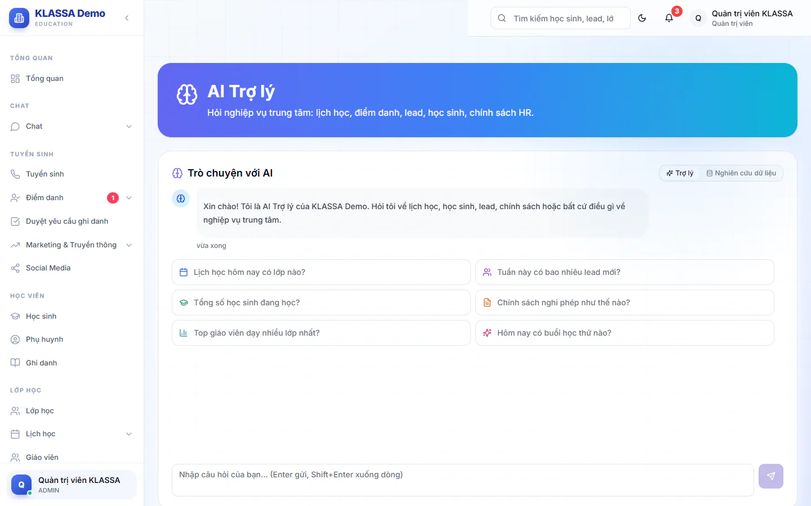
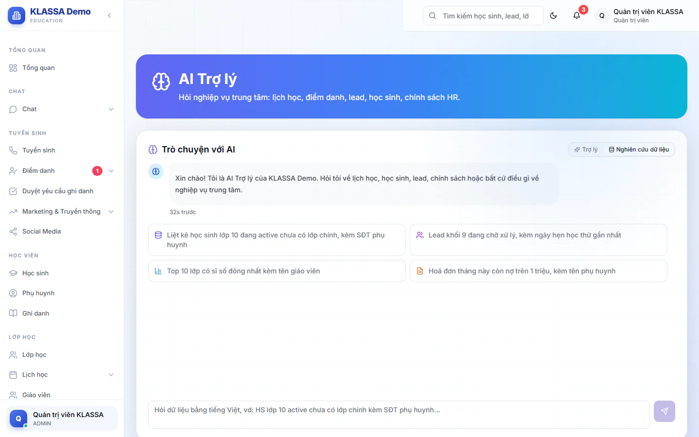

# AI Assistant: hỏi đáp dữ liệu trung tâm

Trợ lý trả lời bằng tiếng Việt về dữ liệu thật của trung tâm: lịch học, học sinh, lead, học phí, chính sách nội bộ. Bạn dùng khi cần tra nhanh một con số mà không muốn mở nhiều trang báo cáo.

Tính năng cần gói mở rộng **AI — Gợi ý & Trợ lý Vận hành**, và gói này cần **Nền tảng AI** đã bật. Xem [Gói mở rộng](../plugin/gioi-thieu.md).

## Đặt câu hỏi cho AI

::: steps
1. Vào **AI Hub → AI Assistant**. Trang có tiêu đề **AI Trợ lý** và khung **Trò chuyện với AI**.
2. Gõ câu hỏi vào ô **Nhập câu hỏi của bạn...** hoặc bấm một câu gợi ý ở giữa màn hình.
3. Bấm Enter để gửi. Muốn xuống dòng thì bấm Shift + Enter.
4. Chờ AI đọc dữ liệu và trả lời. Trong lúc chờ có dòng trạng thái như "Đang tra cứu dữ liệu...".
:::

Câu gợi ý đổi theo vai của bạn. Ví dụ:

- Quản trị viên, Quản lý chi nhánh, Quản lý (sáu câu): "Lịch học hôm nay có lớp nào?", "Tuần này có bao nhiêu lead mới?", "Tổng số học sinh đang học?", "Chính sách nghỉ phép như thế nào?", "Top giáo viên dạy nhiều lớp nhất?", "Hôm nay có buổi học thử nào?"
- Lễ tân: "Tuần này có bao nhiêu lead mới?", "Hôm nay có buổi học thử nào?", "Tổng số học sinh đang học?", "Lịch học hôm nay có lớp nào?"
- Giáo viên: "Hôm nay tôi có lớp nào?", "Tháng này tôi đã dạy bao nhiêu buổi?", "Lớp của tôi tháng này chuyên cần thế nào?", "Chính sách nghỉ phép như thế nào?"
- Trợ giảng: như giáo viên, câu thứ hai là "Tháng này tôi hỗ trợ bao nhiêu buổi?"
- Kế toán: "Doanh thu tháng này bao nhiêu?", "Ai đang nợ học phí nhiều nhất?", "Tổng số học sinh đang học?", "Lịch học hôm nay có lớp nào?"
- Nhân sự: "Chính sách nghỉ phép như thế nào?", "Quy định chấm công giờ làm thế nào?", "Chính sách lương và phúc lợi ra sao?", "Quy trình đánh giá hiệu suất thế nào?"

::: tip Mẹo
Hỏi cụ thể sẽ có kết quả tốt hơn. Thay vì "học phí", hãy hỏi "Hoá đơn tháng này còn nợ trên 1 triệu, kèm tên phụ huynh".
:::

## Với câu hỏi về chính sách

Khi bạn hỏi về chính sách hay câu hỏi thường gặp, AI tìm trong các tài liệu Quản trị viên đã nạp ở [AI Knowledge](knowledge.md). Chưa có tài liệu thì AI chỉ trả lời chung chung.

## Sau khi có câu trả lời

Dưới mỗi câu trả lời có các nút nhỏ:

- **Sao chép**: chép câu trả lời.
- **Hữu ích** và **Chưa tốt**: gửi phản hồi để cải thiện.

Cạnh ô nhập có nút **Tạo lại**: bắt AI trả lời lại câu hỏi cuối cùng.

## Bắt đầu cuộc trò chuyện mới

Khi đã có tin nhắn, góc trên bên phải hiện nút **Cuộc hội thoại mới** (trên điện thoại là **Mới**). Bấm vào để xoá cuộc trò chuyện hiện tại và bắt đầu lại.

::: warning Lưu ý
Lịch sử trò chuyện chỉ lưu trên trình duyệt bạn đang dùng, tối đa khoảng 50 tin gần nhất. Đổi máy hoặc xoá dữ liệu trình duyệt thì lịch sử mất. AI cũng không nhớ cuộc trò chuyện cũ sau khi bạn bấm **Cuộc hội thoại mới**.
:::

## Chế độ Nghiên cứu dữ liệu (chỉ Quản trị viên)

Quản trị viên có thêm hai thẻ ở đầu khung chat: **Trợ lý** và **Nghiên cứu dữ liệu**. Chế độ nghiên cứu cho phép hỏi dữ liệu bằng tiếng Việt và nhận về một bảng kết quả, ví dụ "Lead khối 9 đang chờ xử lý, kèm ngày hẹn học thử gần nhất".

::: steps
1. Bấm thẻ **Nghiên cứu dữ liệu**.
2. Gõ yêu cầu vào ô hỏi dữ liệu, hoặc chọn một câu gợi ý.

   
3. Xem bảng kết quả. Bấm **Toàn màn hình** để xem rộng hơn, bấm **Tải CSV** để lưu về máy mở bằng Excel.
:::

::: warning Lưu ý
Bảng chỉ hiện tối đa 2.000 dòng. Sau khi tải lại trang, bảng không còn, bạn cần hỏi lại để xem và tải CSV. Chế độ này đọc dữ liệu toàn hệ thống nên không mở cho vai khác.
:::

## Câu hỏi thường gặp

::: details AI có trả lời được mọi câu hỏi không?
Không. AI chỉ tra được các loại dữ liệu hệ thống hỗ trợ và chỉ trong phạm vi quyền của vai bạn. Câu hỏi ngoài phạm vi sẽ nhận câu trả lời xin lỗi hoặc chung chung.
:::

::: details Có nên hỏi thông tin nhạy cảm không?
Không nhập mật khẩu hay thông tin cá nhân không cần thiết vào câu hỏi. Câu hỏi được gửi tới nhà cung cấp AI đã cấu hình ở [Nhà cung cấp AI](../tich-hop/ai-providers.md).
:::

::: details Tôi muốn AI biết quy định riêng của trung tâm thì làm sao?
Nhờ Quản trị viên nạp tài liệu ở [AI Knowledge](knowledge.md).
:::
