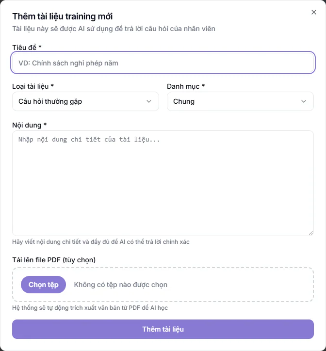
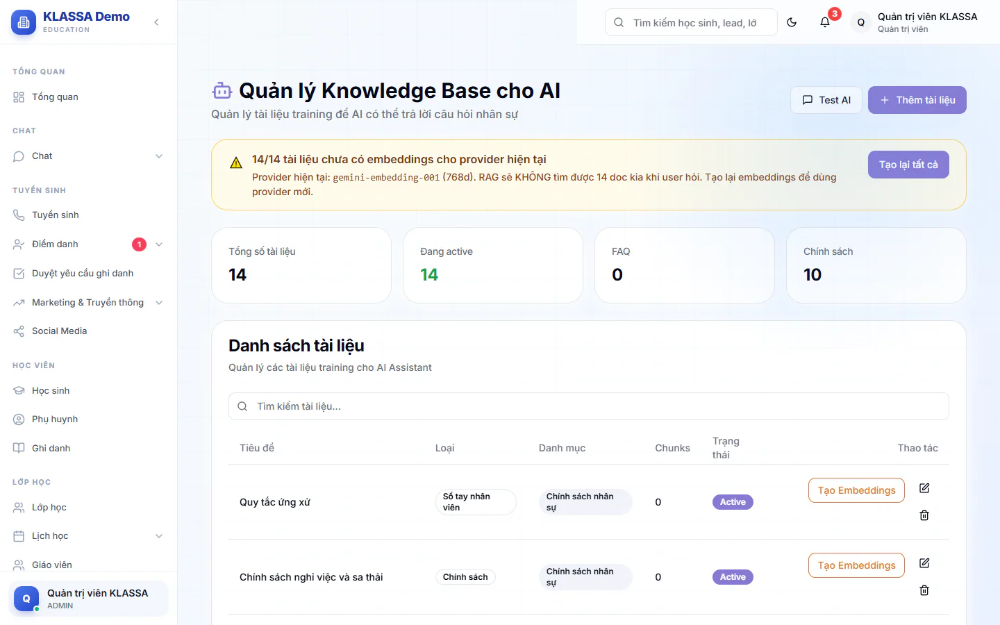

# AI Knowledge: nạp tài liệu cho AI

Trang này là nơi Quản trị viên nạp quy định, quy trình, sổ tay và câu hỏi thường gặp của trung tâm. Khi nhân viên hỏi về chính sách ở [AI Assistant](chat.md), AI sẽ tìm trong các tài liệu này để trả lời theo quy định của bạn, thay vì trả lời chung chung.

Chỉ Quản trị viên mở được trang. Tính năng cần gói mở rộng **AI — Gợi ý & Trợ lý Vận hành**.

## Thêm tài liệu

::: steps
1. Vào **AI Hub → AI Knowledge**. Trang có tiêu đề **Quản lý Knowledge Base cho AI**.
2. Bấm **Thêm tài liệu**, hộp **Thêm tài liệu training mới** hiện ra.
3. Điền **Tiêu đề** (bắt buộc).
4. Chọn **Loại tài liệu** (bắt buộc): Câu hỏi thường gặp, Chính sách, Quy trình, Hướng dẫn hoặc Sổ tay nhân viên. Mặc định là Câu hỏi thường gặp.
5. Chọn **Danh mục** (bắt buộc): Chính sách nhân sự, Lương & Phúc lợi, Nghỉ phép, Chấm công, Phúc lợi, Đánh giá hiệu suất, Đào tạo hoặc Chung. Mặc định là Chung.
6. Gõ hoặc dán văn bản vào ô **Nội dung**, hoặc chọn file ở mục **Tải lên file PDF (tùy chọn)**. Phải có ít nhất một trong hai.
7. Bấm **Thêm tài liệu** (nếu có file PDF thì nút đổi thành **Tải lên PDF và thêm tài liệu**).
:::

Khi chọn file PDF, hệ thống tự lấy văn bản từ file. Nếu bạn vừa gõ nội dung vừa chọn PDF, phần bạn gõ được đặt ở đầu. Nếu ô **Tiêu đề** còn trống, hệ thống lấy tên file làm tiêu đề.

Sau khi thêm, tài liệu được xử lý ngay để AI tìm được. Nếu cột **Chunks** của tài liệu hiện 0, bấm **Tạo Embeddings** ở cuối dòng để xử lý lại (đây là bước tạo chỉ mục cho AI tìm kiếm).

::: warning Lưu ý
Chỉ nhận file PDF có chữ. Nếu là ảnh scan, file mã hoá hoặc file hỏng, hệ thống báo "Không thể đọc file PDF". Khi đó hãy dán nội dung vào ô **Nội dung** rồi thêm lại.
:::

## Kiểm tra AI trả lời thế nào

::: steps
1. Bấm **Test AI**, hộp **Test AI Assistant** hiện ra.
2. Gõ câu hỏi vào ô **Câu hỏi**, ví dụ "Chính sách nghỉ phép năm là gì?".
3. Bấm nút gửi và đọc phần **Câu trả lời** cùng **Nguồn tham khảo**.
:::

Nếu nguồn tham khảo không đúng tài liệu bạn mong đợi, hãy sửa lại tiêu đề hoặc nội dung tài liệu cho rõ ý hơn.

## Sửa và xoá tài liệu

Danh sách **Danh sách tài liệu** có cột **Tiêu đề**, **Loại**, **Danh mục**, **Chunks**, **Trạng thái** và **Thao tác**. Gõ vào ô **Tìm kiếm tài liệu...** để lọc.

- **Sửa**: bấm biểu tượng cây bút ở cuối dòng, sửa trong hộp **Sửa tài liệu** rồi bấm **Lưu thay đổi**. Hộp này sửa được tiêu đề, loại, danh mục và nội dung.
- **Xoá**: bấm biểu tượng thùng rác và xác nhận "Bạn có chắc muốn xóa tài liệu này?".

::: danger Không thể hoàn tác
Tài liệu đã xoá không khôi phục được. Hãy lưu bản gốc ở nơi khác trước khi xoá.
:::

## Khi đổi nhà cung cấp AI

Nếu đổi nhà cung cấp AI ở phần cấu hình, trên đầu trang có thể hiện khung cảnh báo "tài liệu chưa có embeddings cho provider hiện tại". Bấm **Tạo lại tất cả** để AI tìm lại được toàn bộ tài liệu. Chưa bấm thì AI không thấy những tài liệu đó khi trả lời.

## Câu hỏi thường gặp

::: details Có nạp được file Word hay Excel không?
Không. Trang chỉ nhận file PDF có chữ hoặc nội dung gõ trực tiếp. Với file Word, mở file, chép nội dung rồi dán vào ô **Nội dung**.
:::

::: details Bốn ô thống kê ở đầu trang nghĩa là gì?
**Tổng số tài liệu**, **Đang active** (tài liệu đang dùng), **FAQ** (số tài liệu loại Câu hỏi thường gặp) và **Chính sách** (số tài liệu loại Chính sách).
:::

::: details Nội dung tài liệu có bị gửi ra ngoài không?
Có. Để AI tìm được, nội dung được gửi tới nhà cung cấp AI bạn đã chọn khi xử lý. Đừng nạp tài liệu chứa thông tin mà bạn không muốn chia sẻ với nhà cung cấp đó.
:::
