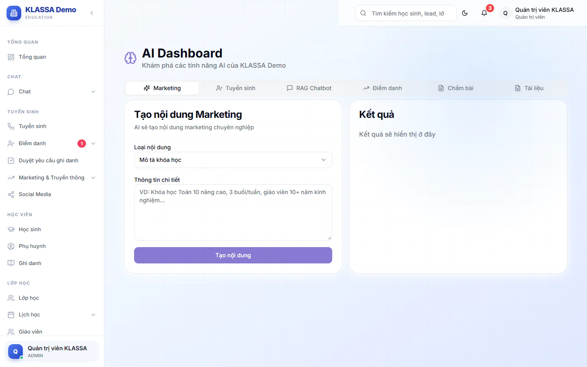

# Media Center: tạo nội dung marketing bằng AI

Trang **Media Center** có tiêu đề **AI Dashboard**. Việc dùng thường xuyên nhất là nhờ AI viết nhanh nội dung quảng cáo từ vài dòng mô tả của bạn.

Tính năng cần gói mở rộng **Nền tảng AI**. Xem [Gói mở rộng](../plugin/gioi-thieu.md).

## Soạn nội dung marketing

Thẻ **Marketing** dành cho Quản trị viên, Quản lý chi nhánh và Quản lý.

::: steps
1. Vào **AI Hub → Media Center**, thẻ **Marketing** mở sẵn.
2. Ở **Loại nội dung**, chọn một loại: Mô tả khóa học, Script TikTok, Bài đăng Facebook, Email Marketing hoặc Tin nhắn SMS.
3. Ở **Thông tin chi tiết**, mô tả khoá học hoặc chương trình cần quảng bá. Ví dụ: "Khóa Toán 9 nâng cao, 3 buổi mỗi tuần, giáo viên 10 năm kinh nghiệm". Ô này bắt buộc.
4. Bấm **Tạo nội dung** và chờ AI viết.
5. Đọc phần **Kết quả** bên phải: **Tiêu đề**, **Nội dung**, **Hashtags** và **Call to Action** (lời kêu gọi hành động), nếu loại nội dung đó có.

   
:::

::: tip Mẹo
Nêu rõ đối tượng (phụ huynh khối 9), điểm mạnh, lịch học và học phí nếu muốn đưa vào. Càng cụ thể, bài càng sát ý bạn. Luôn đọc lại và sửa trước khi đăng.
:::

::: warning Lưu ý
Kết quả chỉ hiện trên màn hình. Hãy sao chép sang nơi bạn đăng bài trước khi chuyển thẻ hoặc đóng trang.
:::

## Các thẻ còn lại

| Thẻ | Dành cho | Việc làm |
| --- | --- | --- |
| **Tuyển sinh** | Quản trị viên, Quản lý chi nhánh, Quản lý | Chấm điểm một lead, bạn phải nhập mã lead vào ô **Lead ID** |
| **RAG Chatbot** | Quản trị viên, Quản lý chi nhánh, Quản lý | Hỏi nhanh một câu và xem nguồn tham khảo |
| **Điểm danh** | Quản trị viên, Quản lý chi nhánh, Quản lý | Tìm bất thường điểm danh của một lớp, bạn phải nhập mã lớp vào ô **Class ID** |
| **Chấm bài** | Quản trị viên, Quản lý chi nhánh, Quản lý, Giáo viên | Tải ảnh bài làm để AI đề xuất điểm |
| **Tài liệu** | Quản trị viên, Quản lý chi nhánh, Quản lý | Trang ghi chú dành cho kỹ thuật |

Giáo viên chỉ thấy thẻ **Chấm bài**. Trợ giảng không mở được khu AI Hub.

Hai thẻ cần nhập mã nội bộ (**Tuyển sinh** và **Điểm danh**) khá bất tiện khi dùng hằng ngày. Nên dùng các màn hình chính thức: xem [Danh sách lead](../tuyen-sinh/danh-sach-lead.md) cho lead, [Điểm danh hằng ngày](../diem-danh/cham-hang-ngay.md) cho điểm danh. Cách chấm bài có hướng dẫn đầy đủ ở [Chấm bài AI](../hoc-tap/cham-bai-ai.md).

## Câu hỏi thường gặp

::: details Trang này có tạo ảnh hay video bằng AI không?
Trang Media Center hiện chỉ có các thẻ ở trên. Tạo ảnh, video và thư viện media nằm ở phần quản lý mạng xã hội, không nằm ở đây.
:::

::: details Vì sao bấm Tạo nội dung báo lỗi?
Thường do chưa bật gói **Nền tảng AI** hoặc chưa cấu hình nhà cung cấp AI. Báo Quản trị viên kiểm tra ở [Nhà cung cấp AI](../tich-hop/ai-providers.md).
:::

::: details Nội dung AI viết có dùng ngay được không?
Nên đọc lại. AI có thể viết sai học phí hay lịch học nếu bạn không đưa thông tin chính xác vào ô **Thông tin chi tiết**.
:::
