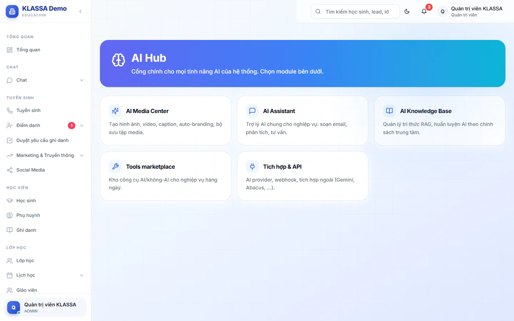

# Tổng quan AI Hub

**AI Hub** gom các tính năng AI vào một trang. Bạn vào đây để chọn đúng công cụ, không cần nhớ từng mục trong menu.

## Mở trang AI Hub

::: steps
1. Vào **AI Hub → Tổng quan AI Hub** (nhóm menu **Automation & AI**).
2. Trang hiện hai khối: **Đội trợ lý CRM** và **Công cụ AI khác**.
:::

Tài khoản chưa được cấp quyền dùng AI sẽ thấy thông báo không có quyền truy cập.

## Khối Đội trợ lý CRM

Mỗi thẻ có một robot và một lối tắt đến màn hình làm việc tương ứng. Thẻ chỉ giúp bạn mở nhanh đúng chỗ, dữ liệu bạn thấy vẫn theo quyền của tài khoản.

| Thẻ | Dùng để | Nút lối tắt |
| --- | --- | --- |
| **Điểm danh** | Theo dõi buổi chưa chấm, lệch điểm danh, lượt chờ đối chiếu | **Mở Điểm danh** |
| **Điều phối** | Xem tổng quan vận hành, lịch lớp | **Xem tổng quan**, **Lịch học** |
| **Lead & chăm sóc** | Mở danh sách lead, theo dõi tư vấn | **Mở Lead** |
| **Tài chính & báo cáo** | Vào số liệu thu chi, công nợ, báo cáo | **Tài chính**, **Báo cáo** |

Nếu tài khoản của bạn không có quyền mở mục nào, thẻ đó hiện dòng "Tài khoản chưa có quyền mở mục này" và không có nút.

::: tip Mẹo
Các thẻ này không chạy AI. Chúng chỉ là lối tắt. Muốn hỏi AI, hãy mở [AI Assistant](chat.md).
:::

## Khối Công cụ AI khác

| Thẻ | Mở ra | Xem thêm |
| --- | --- | --- |
| **AI Media Center** | Trang tạo nội dung marketing | [Media Center](media.md) |
| **AI Assistant** | Trợ lý hỏi đáp về dữ liệu trung tâm | [AI Assistant](chat.md) |
| **AI Knowledge Base** | Tài liệu để AI trả lời theo chính sách trung tâm | [AI Knowledge](knowledge.md) |
| **Tools marketplace** | Trang Công cụ | [Công cụ](../tu-dong-hoa/cong-cu.md) |
| **Tích hợp & API** | Trang Tích hợp, nơi cấu hình nhà cung cấp AI | [Nhà cung cấp AI](../tich-hop/ai-providers.md) |

::: warning Lưu ý
Một số thẻ hiện với mọi vai nhìn thấy trang này, nhưng mở vào có thể bị từ chối. Ví dụ **AI Knowledge Base** chỉ dành cho Quản trị viên.
:::

## Gói mở rộng cần có

Các tính năng AI cần gói mở rộng **Nền tảng AI** (và gói **AI - Gợi ý & Trợ lý Vận hành** cho trợ lý hỏi đáp). Xem [Gói mở rộng](../plugin/gioi-thieu.md).

## Câu hỏi thường gặp

::: details Vì sao tôi không thấy mục AI Hub trong menu?
Menu AI Hub chỉ hiện với Quản trị viên, Quản lý chi nhánh, Quản lý, Lễ tân, Giáo viên, Kế toán và Nhân sự. Lễ tân mở thẳng được **AI Assistant** nhưng không mở được trang tổng quan này. Trợ giảng không mở được khu AI Hub.
:::

::: details AI chấm bài, AI nhân sự nằm ở đâu?
Mỗi tính năng nằm ở đúng phân hệ của nó. Xem [Chấm bài AI](../hoc-tap/cham-bai-ai.md) và [AI nhân sự](../nhan-su/ai-insights.md).
:::
