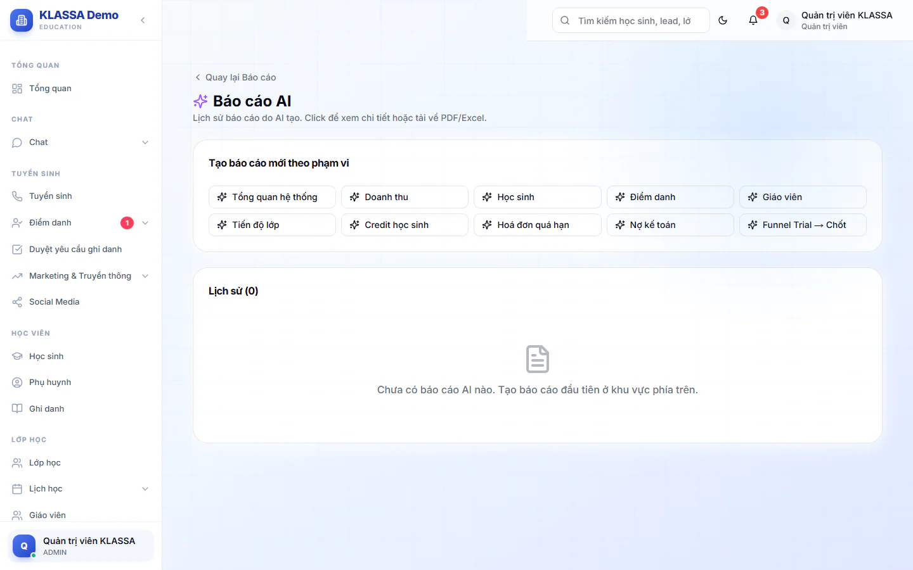

# Báo cáo do AI tổng hợp

Thay vì tự đọc từng bảng số, bạn bấm một nút để AI đọc số liệu và viết bản nhận định bằng tiếng Việt. Các bản đã tạo được lưu lại để xem lại sau.

Tính năng này cần hai gói mở rộng: **Nền tảng AI** và **AI — Gợi ý & Trợ lý Vận hành**. Thiếu một trong hai thì nút bấm sẽ báo lỗi.

## Tạo một báo cáo AI

::: steps
1. Mở báo cáo bạn muốn phân tích, ví dụ [Báo cáo học sinh](hoc-sinh.md).
2. Chọn bộ lọc hoặc khoảng ngày như bình thường.
3. Bấm **Phân tích AI**. Trang báo "AI đang phân tích, có thể mất 30-60 giây..." rồi tự mở bản báo cáo khi xong.
:::

Nút **Phân tích AI** có ở các báo cáo: học sinh, điểm danh, tiến độ, giáo viên, phễu tuyển sinh. Ở [Tổng quan](tong-quan.md) nút có tên **Phân tích AI tổng quan**.

Ở báo cáo điểm danh, AI dùng khoảng ngày bạn đã đặt. Ở báo cáo học sinh, AI dùng các ô lọc đang chọn. Ở các báo cáo còn lại, AI lấy phạm vi mặc định (từ ngày 01 của tháng này), không theo bộ lọc trên trang.

::: tip Giáo viên và trợ giảng
Bạn chỉ tạo được bản AI về **điểm danh** và **tiến độ**, trong phạm vi các lớp mình phụ trách. Bạn bấm **Phân tích AI** ngay trong hai báo cáo đó (trang **Lịch sử AI** mở từ Tổng quan, mà vai của bạn không có trang này).
:::

## Xem lại lịch sử và tạo theo phạm vi

::: steps
1. Ở [Tổng quan](tong-quan.md), bấm **Lịch sử AI**. Trang hiện tiêu đề **Báo cáo AI**.
2. Phần **Tạo báo cáo mới theo phạm vi** có các nút: Tổng quan hệ thống, Doanh thu, Học sinh, Điểm danh, Giáo viên, Tiến độ lớp, Credit học sinh, Hoá đơn quá hạn, Nợ kế toán, Funnel Trial → Chốt. Bấm nút nào để tạo bản mới cho phạm vi đó.

   
3. Phần **Lịch sử** liệt kê các bản đã tạo, mới nhất ở trên. Bấm một dòng để mở.
:::

## Trong một bản báo cáo

Ở bản đã mở, bạn có các nút:

- **Copy**: sao chép nội dung để dán vào tin nhắn hoặc tài liệu.
- **In / PDF**: mở hộp in của trình duyệt, chọn lưu thành PDF.
- **Excel**: tải nội dung về dạng Excel.
- **Xoá**: xoá bản báo cáo. Chỉ Quản trị viên và Quản lý chi nhánh có nút này, và không thể hoàn tác.

::: danger Không thể hoàn tác
Xoá bản báo cáo AI là xoá hẳn. Muốn giữ lại, hãy bấm **In / PDF** hoặc **Excel** trước.
:::

::: warning Lưu ý
AI chỉ tóm tắt và gợi ý từ số liệu có trong hệ thống. Hãy đối chiếu với báo cáo gốc trước khi dùng để quyết định.
:::

## Câu hỏi thường gặp

::: details Bấm Phân tích AI nhưng báo lỗi?
Có thể trung tâm chưa có gói **Nền tảng AI** hoặc **AI — Gợi ý & Trợ lý Vận hành**, hoặc vai của bạn không được tạo bản AI cho báo cáo đó. Liên hệ Quản trị viên.
:::
