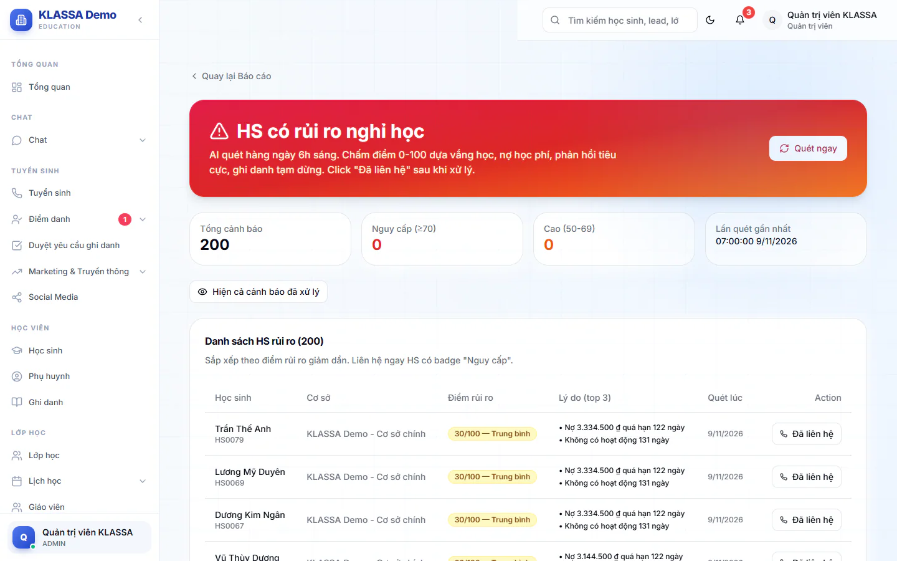

# Học sinh có rủi ro nghỉ học

Trang này liệt kê những em có dấu hiệu sắp nghỉ học, để bạn gọi cho phụ huynh sớm. Mỗi em có một điểm rủi ro từ 0 đến 100, dựa trên việc vắng học, nợ học phí, phản hồi tiêu cực và ghi danh đang tạm dừng.

Trang không có trong menu. Bấm thẻ **HS có rủi ro nghỉ** ở trang [Tổng quan](tong-quan.md) để mở.

## Quét và xem danh sách

::: steps
1. Vào **Báo cáo → Tổng quan**, bấm thẻ **HS có rủi ro nghỉ**. Trang hiện tiêu đề **HS có rủi ro nghỉ học**.
2. Bấm **Quét ngay** để hệ thống chấm điểm lại toàn bộ học sinh đang học. Việc này mất khoảng 30-90 giây.
3. Đọc danh sách **Danh sách HS rủi ro**, xếp theo điểm rủi ro giảm dần.

   
:::

Bốn thẻ ở đầu cho biết **Tổng cảnh báo**, số em **Nguy cấp (≥70)**, số em **Cao (50-69)** và **Lần quét gần nhất**. Nếu chưa quét lần nào, trang ghi "Chưa quét".

Bảng có các cột **Học sinh**, **Cơ sở**, **Điểm rủi ro**, **Lý do (top 3)**, **Quét lúc** và nút thao tác. Điểm rủi ro có bốn mức:

| Điểm | Mức |
| --- | --- |
| Từ 70 | Nguy cấp |
| 50-69 | Cao |
| 30-49 | Trung bình |
| Dưới 30 | Thấp |

::: tip Mẹo
Gọi ngay các em mức **Nguy cấp** trước. Cột **Lý do (top 3)** cho biết nên mở lời thế nào, ví dụ vắng nhiều hay đang nợ phí.
:::

## Đánh dấu đã liên hệ

Sau khi gọi phụ huynh, ghi lại kết quả để lần sau không gọi trùng.

::: steps
1. Ở dòng của em, bấm **Đã liên hệ**. Hộp **Đánh dấu đã xử lý** hiện ra, kèm lý do cảnh báo.
2. Nhập kết quả liên hệ (ít nhất 2 ký tự), ví dụ "Đã gọi PH, HS bị ốm 1 tuần, sẽ học bù".
3. Bấm **Xác nhận đã xử lý**. Bấm **Huỷ** nếu không muốn lưu.
:::

Dòng đã xử lý hiện nhãn **Đã xử lý** và được ẩn khỏi danh sách. Bấm **Hiện cả cảnh báo đã xử lý** để xem lại, bấm **Ẩn các cảnh báo đã xử lý** để thu gọn.

## Ai làm được gì

Quản trị viên, Quản lý chi nhánh và Quản lý thấy nút **Quét ngay** và bấm được **Đã liên hệ**. Lễ tân cũng được xem danh sách và bấm **Đã liên hệ**, nhưng không có nút **Quét ngay**.

## Câu hỏi thường gặp

::: details Trang báo "Chưa có cảnh báo nào"?
Có thể chưa quét lần nào, hoặc không có em nào vượt ngưỡng. Bấm **Quét ngay** để lấy dữ liệu.
:::

::: details Điểm rủi ro có thay thế được việc hỏi giáo viên không?
Không. Đây chỉ là gợi ý để biết nên gọi ai trước. Quyết định vẫn dựa vào bạn và giáo viên lớp.
:::
