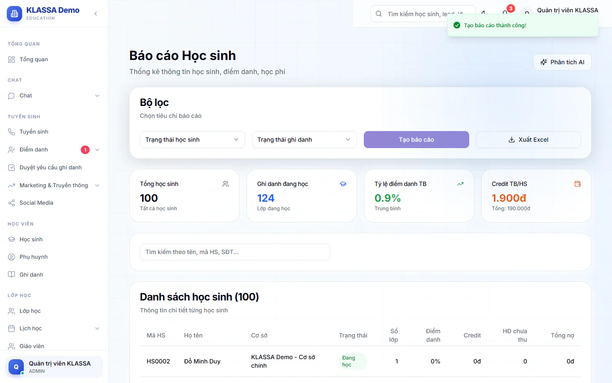

# Báo cáo học sinh

Báo cáo này gom trên một bảng: mỗi học sinh đang học mấy lớp, đi học đều không, còn credit bao nhiêu và đang nợ bao nhiêu. Dùng khi cần rà soát học sinh trước khi nhắc phí hoặc họp tổng kết.

## Xem báo cáo

::: steps
1. Vào **Báo cáo → Báo cáo học sinh**.
2. Ở khung **Bộ lọc**, chọn **Trạng thái học sinh** và **Trạng thái ghi danh** nếu cần (để trống là lấy tất cả).
3. Bấm **Tạo báo cáo**. Bốn thẻ tổng hợp và bảng học sinh hiện ra.

   
4. Gõ vào ô **Tìm kiếm theo tên, mã HS, SĐT...** để lọc nhanh trong bảng.
:::

Báo cáo chỉ hiện số liệu sau khi bạn bấm **Tạo báo cáo**. Đổi bộ lọc xong phải bấm lại.

### Các lựa chọn lọc

| Ô lọc | Lựa chọn |
| --- | --- |
| **Trạng thái học sinh** | Tất cả trạng thái, Đang học, Bảo lưu, Đã tốt nghiệp |
| **Trạng thái ghi danh** | Tất cả, Đang học, Hoàn thành, Đã hủy |

Quản lý chi nhánh và các vai gắn với một cơ sở chỉ thấy học sinh của cơ sở mình.

## Đọc các thẻ tổng hợp

| Thẻ | Ý nghĩa |
| --- | --- |
| **Tổng học sinh** | Số học sinh khớp bộ lọc. |
| **Ghi danh đang học** | Tổng số lượt ghi danh đang học của các em này. Một em học 2 lớp tính 2. |
| **Tỷ lệ điểm danh TB** | Trung bình tỷ lệ điểm danh 30 ngày gần nhất của từng em. Em không có buổi nào trong 30 ngày được tính 0%, nên nếu nhóm lọc có nhiều em đã nghỉ hoặc chưa học, con số này có thể thấp hơn nhiều so với thực tế đang học. |
| **Credit TB/HS** | Credit trung bình mỗi em, dòng nhỏ bên dưới là tổng credit. |

## Đọc bảng danh sách

Bảng **Danh sách học sinh** có các cột: **Mã HS**, **Họ tên**, **Cơ sở**, **Trạng thái**, **Số lớp**, **Điểm danh**, **Credit**, **HĐ chưa thu**, **Tổng nợ**.

- **Điểm danh**: tính trên 30 ngày gần nhất. Em đi trễ hoặc học bù vẫn tính là đi học. Em nghỉ có phép vẫn tính là vắng. Buổi trung tâm huỷ không được tính.
- **HĐ chưa thu**: số phiếu học phí đang chưa trả, trả một phần hoặc quá hạn.
- **Tổng nợ**: tổng số tiền còn thiếu của các phiếu đó.
- Cột **Trạng thái** hiện Đang học, Bảo lưu hoặc Đã nghỉ.

## Xuất Excel và phân tích AI

- Bấm **Xuất Excel** để tải bảng về máy với đúng bộ lọc đang chọn.
- Bấm **Phân tích AI** (góc trên bên phải) để AI viết nhận định về nhóm học sinh đang lọc. Xem [Báo cáo do AI tổng hợp](ai.md).

::: tip Mẹo
Muốn xem danh sách học sinh để chỉnh sửa hồ sơ, dùng trang Học sinh. Báo cáo này chỉ để đọc và xuất số liệu. Xem [Tạo học sinh mới](../hoc-sinh/tao-moi.md).
:::

## Câu hỏi thường gặp

::: details Bảng trống dù tôi đã bấm Tạo báo cáo?
Thử chọn **Tất cả trạng thái** và **Tất cả** ở hai ô lọc. Nếu vẫn trống, có thể cơ sở của bạn chưa có học sinh nào khớp.
:::

::: details Vì sao thẻ Tỷ lệ điểm danh TB chỉ vài phần trăm?
Thẻ tính trung bình trên mọi em khớp bộ lọc, kể cả em không có buổi học nào trong 30 ngày (các em này tính 0%). Chọn **Đang học** ở ô **Trạng thái học sinh** để số sát thực tế hơn.
:::

::: details Vì sao số điểm danh của em khác với báo cáo điểm danh theo lớp?
Báo cáo này tính 30 ngày gần nhất cho từng em, còn [báo cáo điểm danh](diem-danh.md) tính theo khoảng ngày bạn chọn và gộp theo lớp, giáo viên, môn hoặc cơ sở.
:::
