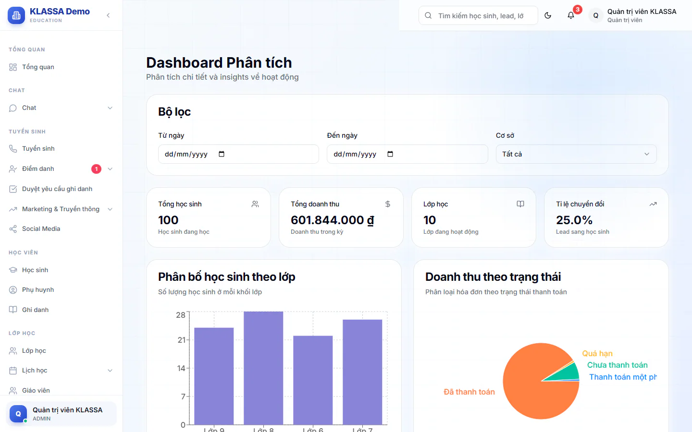

# Phân tích

Trang **Phân tích** gom các con số chính của trung tâm vào một màn hình có biểu đồ. Dùng khi bạn muốn nhìn toàn cảnh theo một khoảng ngày, không cần đi vào từng báo cáo riêng.

## Xem trang Phân tích

::: steps
1. Vào **Báo cáo → Phân tích**. Trang hiện tiêu đề **Dashboard Phân tích**.
2. Ở khung **Bộ lọc**, chọn **Từ ngày** và **Đến ngày** để giới hạn khoảng thời gian.
3. Số liệu tự cập nhật khi bạn đổi ngày.

   
:::

::: warning Lưu ý
Khoảng ngày chỉ có tác dụng khi bạn chọn **cả hai** ô **Từ ngày** và **Đến ngày**. Chọn một ô thôi thì trang vẫn lấy toàn bộ dữ liệu.

Ô **Cơ sở** hiện chỉ có lựa chọn **Tất cả**. Quản lý chi nhánh vẫn chỉ thấy số liệu cơ sở của mình.
:::

## Bốn chỉ số ở đầu trang

| Thẻ | Ý nghĩa |
| --- | --- |
| **Tổng học sinh** | Số học sinh đang học. |
| **Tổng doanh thu** | Tổng giá trị các phiếu học phí được tạo trong kỳ. Đây là số phải thu, không phải số đã thu. |
| **Lớp học** | Số lớp đang hoạt động. |
| **Tỉ lệ chuyển đổi** | Phần trăm lead đã thành học sinh (gồm cả chốt thêm môn) trên tổng lead tạo trong kỳ. |

## Các biểu đồ và thống kê

- **Phân bố học sinh theo lớp**: số học sinh ở mỗi khối lớp.
- **Doanh thu theo trạng thái**: các phiếu học phí chia theo trạng thái thanh toán.
- **Phễu Lead**: số lead theo từng trạng thái: Mới, Đã liên hệ, Tiềm năng, Đã hẹn học thử, Đã hoàn thành học thử, Đã chuyển đổi, Đã chốt (môn bổ sung), Không chốt.
- **Thống kê điểm danh**: tổng buổi học, tỉ lệ có mặt và số lượng theo từng trạng thái điểm danh.
- **Thống kê đánh giá**: tổng bài đánh giá và điểm trung bình trên thang 10.
- **Thống kê ghi danh**: tổng số ghi danh đang học.

::: tip Mẹo
Trang này tính theo cách đơn giản để xem nhanh. Khi cần số chính xác để đối chiếu, dùng báo cáo riêng: [Báo cáo điểm danh](diem-danh.md) cho tỷ lệ đi học, [Phễu tuyển sinh](pheu-tuyen-sinh.md) cho lead, [Báo cáo doanh thu](../ke-toan/bao-cao-doanh-thu.md) cho tiền thu.
:::

## Câu hỏi thường gặp

::: details Vì sao "Tổng doanh thu" lớn hơn số tiền tôi thực thu?
Thẻ này cộng giá trị các phiếu tạo trong kỳ, kể cả phiếu chưa đóng. Số tiền đã thu nằm ở thẻ **Đã thu tháng này** của [Tổng quan](tong-quan.md).
:::

::: details Tỉ lệ có mặt ở đây khác báo cáo điểm danh?
Có thể khác, vì trang này dùng cách tính đơn giản hơn. Lấy [báo cáo điểm danh](diem-danh.md) làm số chuẩn.
:::
