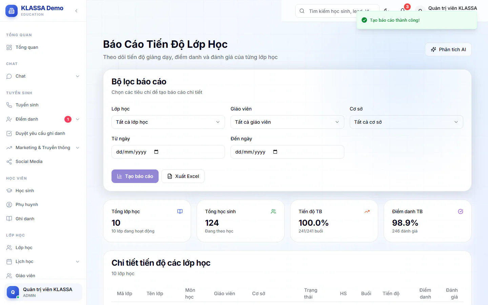

# Báo cáo tiến độ lớp học

Báo cáo trả lời câu hỏi "lớp này dạy đến đâu rồi, có đều không". Mỗi lớp là một dòng, kèm số buổi đã hoàn thành, tỷ lệ điểm danh và số nhận xét buổi học đã viết.

## Xem báo cáo

::: steps
1. Vào **Báo cáo → Báo cáo Tiến độ**.
2. Ở khung **Bộ lọc báo cáo**, chọn **Lớp học**, **Giáo viên**, **Cơ sở** nếu cần (mặc định là tất cả).
3. Chọn **Từ ngày** và **Đến ngày** nếu muốn chỉ tính các buổi trong khoảng đó. Phải chọn đủ cả hai ô thì khoảng ngày mới có tác dụng, để trống hoặc chỉ chọn một ô thì tính toàn bộ.
4. Bấm **Tạo báo cáo**.

   
:::

Chưa bấm **Tạo báo cáo** thì trang hiện "Chưa có dữ liệu". Sau khi có kết quả, bấm **Xuất Excel** để tải bảng về máy.

::: tip Giáo viên và trợ giảng
Bạn chỉ thấy các lớp mình được phân công là giáo viên chính hoặc trợ giảng. Các ô **Lớp học**, **Giáo viên**, **Cơ sở** không hiện với bạn.
:::

## Đọc kết quả

Bốn thẻ đầu: **Tổng lớp học**, **Tổng học sinh**, **Tiến độ TB**, **Điểm danh TB**.

Bảng **Chi tiết tiến độ các lớp học** có các cột:

| Cột | Ý nghĩa |
| --- | --- |
| **Mã lớp**, **Tên lớp**, **Môn học**, **Giáo viên**, **Cơ sở** | Thông tin lớp. |
| **Trạng thái** | Hoạt động, Tạm dừng hoặc Hoàn thành. |
| **HS** | Số học sinh đang học trên sĩ số tối đa, ví dụ 12/20. |
| **Buổi** | Số buổi đã hoàn thành trên tổng số buổi, ví dụ 8/24. |
| **Tiến độ** | Số buổi hoàn thành chia tổng số buổi. |
| **Điểm danh** | Tỷ lệ điểm danh của lớp, cùng cách tính với [báo cáo điểm danh](diem-danh.md). |
| **Đánh giá** | Số nhận xét buổi học đã viết cho lớp. |

Cột **Tiến độ** và **Điểm danh** đổi màu: từ 80% trở lên màu xanh, từ 50% đến dưới 80% màu vàng, dưới 50% màu đỏ.

## Phân tích AI

Bấm **Phân tích AI** ở đầu trang để AI nhận định về tiến độ. Giáo viên và trợ giảng chỉ được phân tích phạm vi lớp mình. Xem [Báo cáo do AI tổng hợp](ai.md).

## Câu hỏi thường gặp

::: details Tiến độ 0% dù lớp đã dạy?
Tiến độ chỉ đếm buổi đã chuyển sang hoàn thành. Nếu buổi chưa được điểm danh xong thì chưa tính. Xem [Điểm danh hằng ngày](../diem-danh/cham-hang-ngay.md).
:::

::: details Cột Đánh giá nghĩa là gì?
Là số nhận xét buổi học đã được viết trong khoảng ngày. Xem [Nhận xét buổi học](../diem-danh/nhan-xet-buoi-hoc.md).
:::
