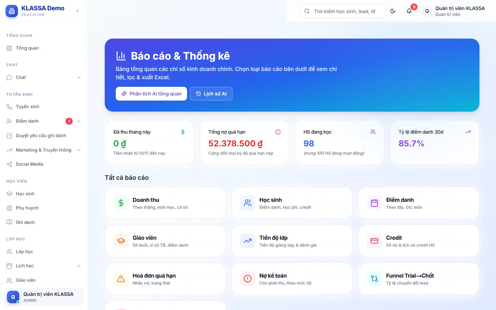

# Tổng quan báo cáo

Trang này cho bạn nhìn nhanh sức khoẻ của trung tâm trong một màn hình, rồi từ đó đi tới từng báo cáo chi tiết. Dùng khi bạn muốn biết "tháng này thu được bao nhiêu, còn nợ bao nhiêu, bao nhiêu em đang học" mà chưa cần đào sâu.

## Mở trang Tổng quan

::: steps
1. Vào **Báo cáo → Tổng quan**.
2. Trang hiện tiêu đề **Báo cáo & Thống kê**, bốn thẻ chỉ số và danh sách **Tất cả báo cáo**.

   
:::

Trang này chỉ hiện trong menu của Quản trị viên và Quản lý chi nhánh. Các vai khác vào thẳng từng báo cáo mà vai đó được xem, xem các bài trong cùng mục.

## Bốn chỉ số ở đầu trang

| Thẻ | Số này là gì |
| --- | --- |
| **Đã thu tháng này** | Tiền phụ huynh đã đóng từ ngày 01 của tháng đến hiện tại, tính theo ngày thu. Đây không phải tổng tiền các phiếu được tạo trong tháng. |
| **Tổng nợ quá hạn** | Cộng dồn mọi kỳ đã qua hạn nộp mà chưa thu đủ. |
| **HS đang học** | Số học sinh đang có ít nhất một ghi danh đang học. Dòng nghiêng bên dưới cho biết số học sinh ở trạng thái đang hoạt động nói chung (gồm cả em chưa xếp lớp). |
| **Tỷ lệ điểm danh 30d** | Tỷ lệ điểm danh trung bình của các lớp trong 30 ngày gần nhất. |

Trong lúc số liệu đang tải, các thẻ hiện khung xám. Nếu một nguồn số liệu không tải được, thẻ tương ứng hiện 0.

## Đi tới báo cáo chi tiết

Phần **Tất cả báo cáo** là các thẻ bấm được. Bấm thẻ nào thì mở báo cáo đó.

| Thẻ | Mô tả trên thẻ | Xem bài |
| --- | --- | --- |
| **Doanh thu** | Theo tháng, môn học, cơ sở | [Báo cáo doanh thu](../ke-toan/bao-cao-doanh-thu.md) |
| **Học sinh** | Điểm danh, học phí, credit | [Báo cáo học sinh](hoc-sinh.md) |
| **Điểm danh** | Theo lớp, GV, môn | [Báo cáo điểm danh](diem-danh.md) |
| **Giáo viên** | Số buổi, sĩ số TB, điểm danh | [Báo cáo giáo viên](theo-giao-vien.md) |
| **Tiến độ lớp** | Tiến độ giảng dạy và đánh giá | [Báo cáo tiến độ](tien-do.md) |
| **Credit** | Số dư và lịch sử credit học sinh | Thuộc nhóm báo cáo tài chính |
| **Hoá đơn quá hạn** | Nhắc nợ, trạng thái | [Hoá đơn quá hạn](../ke-toan/qua-han.md) |
| **Nợ kế toán** | Còn phải thu, theo mức độ | [Báo cáo nợ kế toán](../ke-toan/bao-cao-no-ke-toan.md) |
| **Funnel Trial→Chốt** | Tỷ lệ chuyển đổi lead | [Phễu tuyển sinh](pheu-tuyen-sinh.md) |
| **HS có rủi ro nghỉ** | Cảnh báo dựa vào vắng, nợ, phản hồi | [Học sinh có rủi ro nghỉ học](at-risk.md) |

Ngoài ra, menu **Báo cáo** còn có mục **Phân tích**, xem [Phân tích](phan-tich.md).

## Phân tích AI ngay từ trang này

Ở đầu trang có hai nút:

- **Phân tích AI tổng quan**: nhờ AI đọc số liệu toàn trung tâm rồi viết một bản nhận định. Mất khoảng 30-60 giây, xong tự mở bản báo cáo.
- **Lịch sử AI**: xem lại các bản AI đã tạo. Xem [Báo cáo do AI tổng hợp](ai.md).

::: warning Lưu ý
Phân tích AI cần hai gói mở rộng: **Nền tảng AI** và **AI — Gợi ý & Trợ lý Vận hành**. Thiếu một trong hai thì nút bấm sẽ báo lỗi.
:::

## Câu hỏi thường gặp

::: details Vì sao "HS đang học" nhỏ hơn số học sinh tôi thấy ở danh sách Học sinh?
Thẻ này chỉ đếm em có ghi danh đang học. Em đang hoạt động nhưng chưa xếp vào lớp nào được tính ở dòng nghiêng bên dưới, không tính vào số lớn.
:::

::: details Số "Đã thu tháng này" có khớp với trang Tài chính không?
Có. Thẻ dùng cùng nguồn số liệu với ô **Đã thu** ở trang tổng quan Tài chính.
:::
