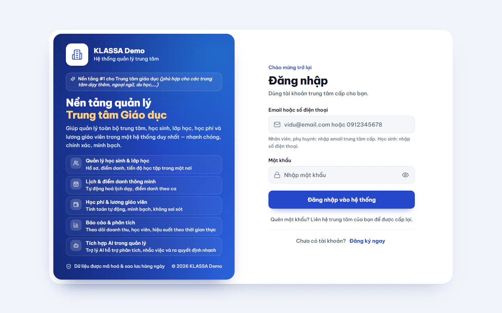
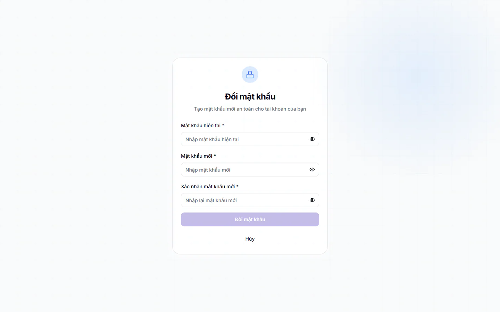
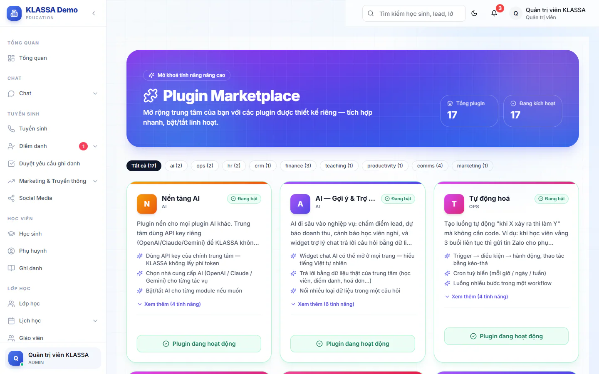

# Bước 1: Đăng nhập lần đầu và kiểm tra gói đang có

Bước này giúp bạn vào được hệ thống bằng tài khoản Quản trị viên mà KLASSA đã cấp cho trung tâm, biết mình đang nhìn thấy gì sau khi vào, và biết trung tâm đang có những gói mở rộng nào để không vướng giữa chừng ở các bước sau.

## Mục tiêu

- Đăng nhập được bằng tài khoản Quản trị viên và đã đổi mật khẩu mặc định (nếu được yêu cầu).
- Biết trung tâm đang có gói mở rộng nào, còn thiếu gói nào cho các bước sau.

## Cần có trước

- Địa chỉ trang đăng nhập của trung tâm bạn (KLASSA gửi khi bàn giao).
- Email và mật khẩu của tài khoản Quản trị viên (cũng do KLASSA gửi).

## Đăng nhập

::: steps
1. Mở địa chỉ trang đăng nhập của trung tâm. Trang hiện tiêu đề **Đăng nhập** và dòng "Dùng tài khoản trung tâm cấp cho bạn".

   

2. Ở ô **Email hoặc số điện thoại**, gõ email Quản trị viên. Nhân viên và phụ huynh nhập email, học sinh nhập số điện thoại.
3. Ở ô **Mật khẩu**, gõ mật khẩu. Bấm biểu tượng con mắt nếu muốn xem lại những gì vừa gõ.
4. Bấm **Đăng nhập vào hệ thống**. Hộp báo "Đăng nhập thành công!" hiện lên, rồi trang tự chuyển sang **Tổng quan**.
:::

Hai ô đều bắt buộc. Nếu để trống, trang nhắc "Vui lòng nhập email hoặc số điện thoại" hoặc "Vui lòng nhập mật khẩu". Email viết sai dạng sẽ nhận câu "Email chưa đúng dạng. Ví dụ: vidu@email.com".

### Lỗi hay gặp khi đăng nhập

| Thông báo | Nghĩa là gì | Cách xử lý |
| --- | --- | --- |
| Email hoặc mật khẩu không đúng | Gõ sai email hoặc mật khẩu | Kiểm tra lại, chú ý chữ hoa chữ thường và dấu cách thừa |
| Tài khoản chưa được thiết lập mật khẩu | Tài khoản chưa có mật khẩu | Liên hệ KLASSA hoặc Quản trị viên của trung tâm để được cấp mật khẩu |
| Tài khoản đang chờ phê duyệt từ quản trị viên | Tài khoản tự đăng ký, chưa được duyệt | Nhờ Quản trị viên duyệt, xem [Bước 3](03-tao-tai-khoan-nhan-vien.md) |
| Tài khoản đã bị vô hiệu hóa | Quản trị viên đã tắt tài khoản | Nhờ Quản trị viên bật lại |
| Tài khoản tạm khóa ... phút do đăng nhập sai nhiều lần | Bạn gõ sai mật khẩu nhiều lần liên tiếp nên tài khoản bị khoá tạm | Chờ hết số phút được báo, hoặc nhờ Quản trị viên mở khoá ở **Quản trị hệ thống → Quản lý Users** (lựa chọn **Mở khóa tài khoản**) |
| Quá nhiều lần thử | Có quá nhiều lần thử sai từ cùng một mạng | Chờ theo thời gian hệ thống báo rồi thử lại |

::: tip Mẹo
Trang đăng nhập không có nút "Quên mật khẩu" tự động. Dòng cuối trang ghi rõ: "Quên mật khẩu? Liên hệ trung tâm của bạn để được cấp lại." Quản trị viên đặt lại mật khẩu cho nhân viên ở **Quản trị hệ thống → Quản lý Users**.
:::

## Đổi mật khẩu nếu hệ thống yêu cầu

Nếu tài khoản đang dùng mật khẩu mặc định, hệ thống đưa bạn sang trang **Đổi mật khẩu** với dòng "Bạn cần đổi mật khẩu mặc định trước khi tiếp tục sử dụng hệ thống". Bạn chưa đổi xong thì chưa vào được các trang khác.

::: steps
1. Ở ô **Mật khẩu hiện tại**, gõ mật khẩu KLASSA gửi.
2. Ở ô **Mật khẩu mới**, gõ mật khẩu bạn muốn dùng. Danh sách "Yêu cầu mật khẩu" bên dưới tick xanh dần khi bạn gõ đủ.
3. Ở ô **Xác nhận mật khẩu mới**, gõ lại đúng mật khẩu đó. Khi khớp, dòng "Mật khẩu khớp" hiện ra.
4. Bấm **Đổi mật khẩu**.
5. Hệ thống báo đã đổi và đưa bạn về màn đăng nhập. Đăng nhập lại bằng mật khẩu mới.
:::

Mật khẩu mới cần có:

- Ít nhất 8 ký tự.
- Ít nhất 1 chữ HOA, 1 chữ thường và 1 số.
- Ít nhất 1 ký tự đặc biệt.

::: warning Lưu ý
Dù trang gợi ý nhiều loại ký tự đặc biệt, hệ thống chỉ nhận các ký tự **@ $ ! % * ? &** và không nhận ký tự nào khác ngoài chữ cái, chữ số. Nếu bạn dùng dấu như # hay dấu chấm, bạn sẽ nhận câu: "Mật khẩu mới cần ít nhất 8 ký tự, có chữ HOA, chữ thường, số và ký tự đặc biệt (chỉ dùng @ $ ! % * ? &)". Ví dụ mật khẩu hợp lệ: `Trungtam@2026`.
:::

Các lỗi khác trên trang này: "Mật khẩu hiện tại không đúng" và "Mật khẩu mới phải khác mật khẩu hiện tại". Nhập sai mật khẩu hiện tại quá 5 lần trong 15 phút thì hệ thống tạm dừng cho đổi, hãy chờ rồi thử lại.

Sau này muốn đổi mật khẩu chủ động, bấm ảnh đại diện (chữ cái đầu tên bạn), chọn **Hồ sơ cá nhân**, sang tab **Bảo mật**, mục **Đổi mật khẩu**. Mật khẩu mới ở đó cần ít nhất 6 ký tự.

## Trang chủ Quản trị viên

Sau khi vào, bạn thấy trang **Tổng quan** (mục đầu tiên của menu bên trái) với lời chào "Chào" kèm tên bạn. Trung tâm mới chưa có dữ liệu nên nhiều thẻ còn trống. Các khối chính:

- **Lịch học trong ngày**: số buổi học theo khung giờ.
- **Việc cần xử lý**: các việc đang chờ bạn.
- **Tiền thu tháng** kèm số tháng hiện tại: số tiền thu trong tháng (bấm để che hoặc hiện số tiền).
- Số liệu nhanh về lượt ghi danh đang học, lớp đang học, lead mới và học thử gần đây, cùng **Phễu tuyển sinh**.

Trung tâm mới sẽ thấy các số này bằng 0. Đó là bình thường, các bước sau sẽ lần lượt đưa dữ liệu vào.

Menu bên trái của Quản trị viên có đủ các nhóm, trong đó nhóm bạn dùng nhiều nhất ở các bước tiếp theo là **Quản trị hệ thống**, **Chi nhánh** và **Cài đặt**.

::: details Trang cài đặt ban đầu là gì, tôi có phải làm gì không?
Với trung tâm dùng KLASSA do KLASSA vận hành, hệ thống đã được cài sẵn khi bàn giao, bạn không phải làm gì. Bạn chỉ cần đăng nhập như trên.
:::

## Kiểm tra gói mở rộng đang có

Một số chức năng của KLASSA chỉ mở khi trung tâm có **gói mở rộng** tương ứng. Bạn nên kiểm tra ngay từ đầu để biết bước nào sẽ làm được, bước nào cần nhờ KLASSA bật thêm gói.

::: steps
1. Vào **Cài đặt → Plugin Marketplace**.
2. Nhìn đầu trang: **Tổng plugin** là số gói hiện có, **Đang kích hoạt** là số gói trung tâm đang dùng. Dòng nhóm bên dưới (**Tất cả** và tên từng nhóm) chỉ cho biết mỗi nhóm có bao nhiêu gói, không bấm để lọc được.
3. Lướt các thẻ gói. Thẻ có nhãn **Đang bật** là gói đang chạy, đáy thẻ ghi **Plugin đang hoạt động**. Thẻ có nhãn **Chưa bật** là gói trung tâm chưa có, đáy thẻ có nút **Liên hệ KLASSA**.

   

4. Đối chiếu với bảng dưới đây, ghi lại gói nào còn thiếu.
5. Vào **Cài đặt → Tổng quan**, kéo tới thẻ **Gói dịch vụ & Hạn mức** để xem dòng **Hết hạn** của gói dịch vụ (hiện "Không thời hạn" nếu không giới hạn). Thẻ này chỉ hiện với Quản trị viên và Quản lý.
:::

### Gói nào dùng ở bước nào

| Gói mở rộng | Dùng để làm gì | Bước cần |
| --- | --- | --- |
| **Đa chi nhánh** | Thêm chi nhánh thứ hai trở đi | [Bước 2](02-thiet-lap-trung-tam.md) |
| **Nhân sự (HRIS)** và **Lương giáo viên** | Hoàn thiện hồ sơ nhân sự, khai cách tính lương, chốt lương cuối tháng. Cần CẢ HAI gói: thiếu một gói thì một nửa việc bị chặn | [Bước 4](04-ho-so-nhan-su-va-cach-tinh-luong.md) và [Bước 15](15-chot-luong-cuoi-thang.md) |
| **Tự động hoá đơn học phí** | Nút tạo phiếu học phí cho cả khối cùng lúc | [Bước 13](13-xuat-phieu-hoc-phi.md) |
| **Zalo (Cá nhân + OA)** | Kết nối Zalo, gửi phiếu học phí và phiếu tháng cho phụ huynh qua Zalo | [Bước 6](06-ket-noi-zalo-ngan-hang-email.md), [Bước 12](12-bao-ket-qua-hoc-tap.md), [Bước 14](14-gui-phieu-va-thu-tien.md) |
| **Cổng Phụ huynh** | Phụ huynh tự xem phiếu học phí, phiếu tháng và bài tập về nhà của con trên web. Giáo viên cũng cần gói này để giao **Bài tập về nhà** | [Bước 12](12-bao-ket-qua-hoc-tap.md), [Bước 14](14-gui-phieu-va-thu-tien.md) |
| **Ứng dụng Di động (PWA)** | Đăng ký máy nhận thông báo, check-in của giáo viên, điểm danh nhanh và chấm công nhân viên trên app | [Bước 4](04-ho-so-nhan-su-va-cach-tinh-luong.md) (chấm công), [Bước 10](10-diem-danh-buoi-dau.md) và [Bước 14](14-gui-phieu-va-thu-tien.md) |

Ngoài ra còn các gói tuỳ chọn như **CRM Tuyển sinh + AI**, **Học online** và **Nền tảng AI**. Lộ trình này không bắt buộc các gói đó.

::: warning Lưu ý
- **Trung tâm không tự bật hoặc tắt gói được.** Chỉ KLASSA bật. Khi mở một chức năng thuộc gói chưa có, màn hình hiện thẻ **Plugin ... chưa được kích hoạt** hoặc thông báo lỗi "Tính năng ... chưa được kích hoạt cho trung tâm. Liên hệ KLASSA để mua hoặc dùng thử." Đây không phải lỗi hệ thống, chỉ là gói chưa có.
- Muốn có thêm gói, bấm **Liên hệ KLASSA** trên thẻ gói, hộp **Liên hệ mua** hiện ra, điền thông tin liên hệ rồi bấm **Gửi yêu cầu**.
- **Gói dùng thử có ngày hết hạn.** Hết hạn là chức năng bị chặn (có thể chậm vài phút mới thấy), thẻ gói về **Chưa bật**. Thẻ gói không ghi ngày hết hạn của từng gói, nên hãy hỏi KLASSA ngày hết hạn của các gói đang dùng thử.
- Menu **Quản lý HR** luôn hiện với Quản trị viên dù trung tâm chưa có gói nhân sự. Bấm vào mới biết gói chưa bật.
:::

::: tip Mẹo
Tạo tài khoản nhân viên ([Bước 3](03-tao-tai-khoan-nhan-vien.md)) và chọn giáo viên, trợ giảng khi tạo lớp ([Bước 7](07-tao-lop-va-lich-hoc.md)) **không cần gói nào**. Nếu trung tâm chưa có gói **Nhân sự (HRIS)**, bạn bỏ qua Bước 4 và Bước 15, lớp học vẫn chạy bình thường, chỉ là chưa tính lương trên phần mềm.
:::

Thông tin chi tiết từng gói xem ở [Giới thiệu gói mở rộng](../plugin/gioi-thieu.md), [Quản lý gói mở rộng đã bật](../plugin/quan-ly.md) và [Bật một gói mở rộng](../plugin/cai-dat.md). Phần nhân sự nói rõ hơn ở [Tổng quan Nhân sự](../nhan-su/tong-quan.md).

## Kiểm tra đã xong

- [ ] Đăng nhập được và thấy trang **Tổng quan** với lời chào mang tên bạn.
- [ ] Đã đổi mật khẩu mặc định (nếu hệ thống yêu cầu) và ghi lại mật khẩu mới ở nơi an toàn.
- [ ] Thấy nhóm **Quản trị hệ thống** trong menu bên trái.
- [ ] Đã ghi lại danh sách gói có nhãn **Đang bật** ở **Plugin Marketplace** và dòng **Hết hạn** ở thẻ **Gói dịch vụ & Hạn mức**.
- [ ] Đã biết gói nào còn thiếu so với bảng trên, và đã nhờ KLASSA bật nếu cần dùng.

## Câu hỏi thường gặp

::: details Tôi đăng nhập được nhưng không thấy mục Quản trị hệ thống?
Mục này chỉ dành cho Quản trị viên. Kiểm tra bạn đang đăng nhập đúng tài khoản Quản trị viên mà KLASSA cấp, không phải tài khoản nhân viên khác.
:::

::: details Có đăng nhập được bằng điện thoại không?
Được. Trang đăng nhập dùng được trên trình duyệt điện thoại. Trung tâm cũng có thể dùng ứng dụng điện thoại KLASSA, cách dùng nằm ở phần Mobile của tài liệu.
:::

## Bước tiếp theo

Tiếp tục với [Bước 2: Thiết lập trung tâm](02-thiet-lap-trung-tam.md).
