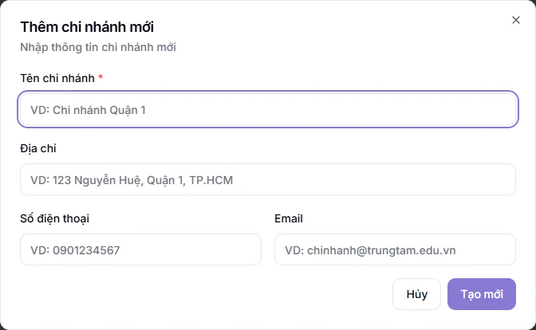
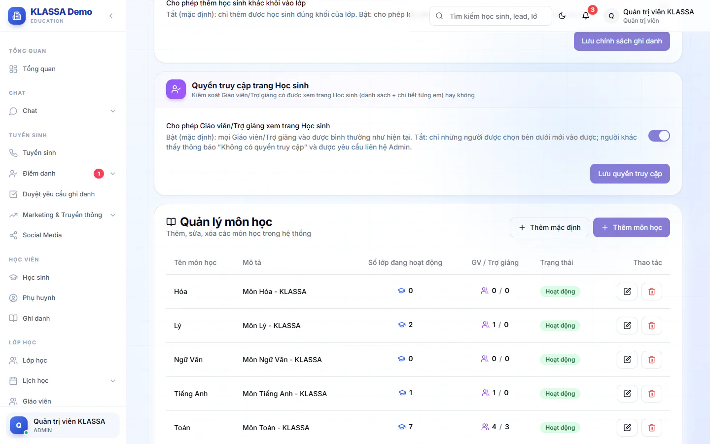
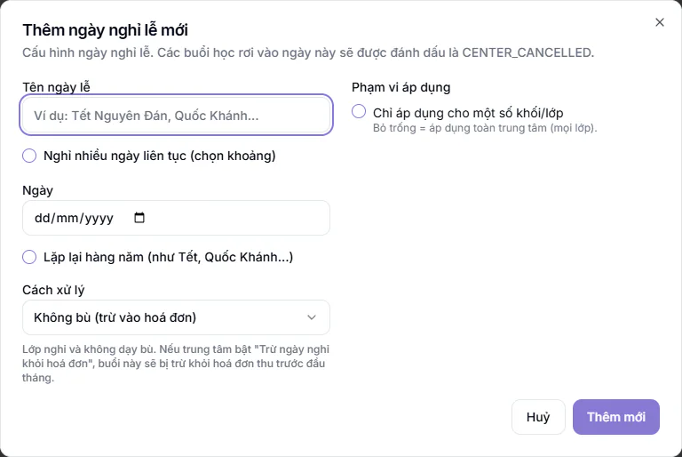

# Bước 2: Thiết lập trung tâm

Bước này đặt nền cho mọi thứ sau đó. Lớp học chỉ tạo được khi trung tâm đã có chi nhánh và môn học, nên hai việc này không bỏ qua được. Thương hiệu, phòng học, cài đặt chung và ngày nghỉ lễ nên làm luôn cho đủ.

## Mục tiêu

- Trang đăng nhập và menu mang tên, logo của trung tâm.
- Có ít nhất một chi nhánh đúng tên, địa chỉ và có đủ môn học trung tâm dạy.
- Đã rà dữ liệu mẫu, đặt tiền tố mã học sinh và có lịch nghỉ lễ của năm.

## Trung tâm mới không hoàn toàn trống

Trung tâm vừa được cấp có thể đã có sẵn dữ liệu mẫu để bạn xem thử. Bạn rà lại, đổi tên cái cần dùng và tắt hoặc xoá cái không dùng, đừng để nguyên:

- 1 chi nhánh mẫu, với tên mẫu (bạn đổi sang tên và địa chỉ thật ở phần **Tạo chi nhánh** bên dưới).
- 5 môn học: Toán, Lý, Hóa, Tiếng Anh, Ngữ Văn (xem phần **Thêm môn học**).
- 5 phòng ban và 8 chức vụ mẫu, dùng khi tạo hồ sơ nhân sự (xem [Bước 4](04-ho-so-nhan-su-va-cach-tinh-luong.md) và [Cấu hình nhân sự](../nhan-su/cau-hinh-hr.md)).
- 4 gói học phí mẫu (rà ở [Bước 5](05-cau-hinh-hoc-phi.md)).
- Một tài khoản Quản lý chi nhánh mẫu và một tài khoản Phụ huynh mẫu. Nếu không dùng, hãy khoá hai tài khoản này để người ngoài không đăng nhập được: vào **Quản trị hệ thống → Quản lý Users**, bấm nút ba chấm ở cuối dòng tài khoản rồi chọn **Vô hiệu hóa**. Nếu vẫn dùng, chọn **Đặt lại mật khẩu** để đặt mật khẩu mới của riêng bạn. Xem thêm [Người dùng](../cai-dat/nguoi-dung.md).

::: warning Lưu ý
Dữ liệu mẫu có thể có hoặc không, tuỳ trung tâm của bạn được dựng thế nào. Cái gì thấy trong danh sách mà bạn không tự tạo, hãy coi là dữ liệu mẫu và rà trước khi dùng.
:::

## Cần có trước

- Đã đăng nhập bằng tài khoản Quản trị viên ([Bước 1](01-dang-nhap-lan-dau.md)).
- Tên trung tâm, logo (ảnh PNG hoặc SVG), địa chỉ và số điện thoại từng cơ sở.
- Danh sách môn học trung tâm dạy và danh sách phòng học.

## Cài thương hiệu

Tên trung tâm hiện ở menu bên trái và trang đăng nhập, logo hiện ở trang đăng nhập, favicon hiện trên tab trình duyệt. Chỉ Quản trị viên lưu được các thay đổi ở trang này.

::: steps
1. Vào **Quản trị hệ thống → Thương hiệu**. Trang **Quản lý Branding** hiện ra với ba tab: **Tổng quan**, **Logo & Favicon**, **Portal PH**.
2. Ở tab **Tổng quan**, sửa ô **Tên trang web** thành tên trung tâm và ô **Mô tả** thành một câu giới thiệu ngắn.
3. Sang tab **Logo & Favicon**. Ở thẻ **Logo chính**, bấm vào vùng "Click để upload logo" và chọn ảnh (khuyến nghị 200x200 px, PNG hoặc SVG). Ở thẻ favicon (biểu tượng nhỏ trên tab trình duyệt), làm tương tự (khuyến nghị 32x32 px, ICO hoặc PNG).
4. Bấm **Lưu cài đặt** ở cuối trang. Hộp báo "Lưu thành công" hiện ra.
:::

Tab **Portal PH** chỉnh những gì phụ huynh thấy trong cổng phụ huynh (cổng này cần gói mở rộng **Cổng Phụ huynh**, chưa có gói thì phụ huynh chưa vào được): tên thương hiệu, tiêu đề cổng, màu thương hiệu và lời chào theo buổi sáng, chiều, tối. Tab này có nút **Lưu cài đặt** riêng, bạn cần bấm nút đó ở trong tab. Bạn có thể để sau, khi bắt đầu mời phụ huynh dùng cổng.

Trong tab **Portal PH** còn ba tab nhỏ: **Thương hiệu**, **Lời chào**, **Tính năng**. Hãy rà tab **Tính năng** trước khi mời phụ huynh. Mặc định phụ huynh thấy hết các mục: Lịch học, Điểm danh, Phiếu thu, Điểm & Đánh giá, Nhận xét buổi học, Thông báo, Xin nghỉ, Bài tập, Thẻ Năng Lực, Phiếu tháng, Đổi quà. Mục nào trung tâm chưa muốn cho phụ huynh xem thì tắt công tắc rồi bấm **Lưu cài đặt**. Chi tiết từng mục xem [Cài đặt cổng phụ huynh](../cong-phu-huynh/cai-dat-cong.md) và [Thương hiệu](../cai-dat/thuong-hieu.md).

::: warning Lưu ý
Tải logo lên chỉ xong khi hộp báo "Upload thành công" hiện ra. Sau đó vẫn phải bấm **Lưu cài đặt** thì logo mới được ghi nhận.
:::

## Tạo chi nhánh (cơ sở)

Mỗi cơ sở của trung tâm là một chi nhánh. Lớp học, phòng học, nhân viên và học sinh đều gắn với chi nhánh. Chưa có chi nhánh nào thì khi tạo lớp hệ thống báo cần tạo chi nhánh trước ("No campus available. Please create a campus first.").

::: steps
1. Vào **Chi nhánh** (nhóm **Cấu hình hệ thống** trong menu). Trang **Quản lý Chi nhánh** hiện ra.
2. Nếu danh sách đã có sẵn một chi nhánh, bấm **Sửa** trên thẻ đó để đổi sang tên và địa chỉ thật. Nếu danh sách trống ("Chưa có chi nhánh"), bấm **Thêm chi nhánh**.
3. Trong hộp **Thêm chi nhánh mới** (hoặc **Chỉnh sửa chi nhánh**), điền **Tên chi nhánh** (bắt buộc, bỏ trống thì hệ thống nhắc "Vui lòng nhập tên chi nhánh"; ví dụ "Cơ sở Cầu Giấy"), **Địa chỉ**, **Số điện thoại**, **Email**. Khi sửa một chi nhánh có thêm ô tích **Chi nhánh đang hoạt động**, hãy để ô này được tích. Hộp thêm mới không có ô này (chi nhánh mới mặc định đang hoạt động).
4. Bấm **Tạo mới** (hoặc **Cập nhật** khi sửa).
:::

Chỉ Quản trị viên được thêm, sửa, xoá chi nhánh. Quản lý chi nhánh và Quản lý chỉ xem ("Chỉ xem").

::: warning Lưu ý về số chi nhánh
- Khi trung tâm chưa có chi nhánh nào, chi nhánh đầu tiên tạo được không cần gói. Từ chi nhánh thứ hai, trung tâm cần có gói mở rộng **Đa chi nhánh**. Vì trung tâm thường đã có sẵn một chi nhánh mẫu, hãy sửa chi nhánh mẫu đó thay vì bấm **Thêm chi nhánh**. Chưa có gói, hệ thống báo gói "multi-campus" chưa được kích hoạt và nhắc liên hệ KLASSA để mua.
- Mỗi gói dịch vụ có số chi nhánh tối đa. Vượt mức, hệ thống báo "Đã sử dụng .../... chi nhánh của gói hiện tại. Liên hệ KLASSA để nâng cấp gói."
- Gói dịch vụ đã hết hạn quá thời gian ân hạn thì không tạo thêm được chi nhánh mới.
:::

Đừng nhầm với mục **Quản lý Chi nhánh** trong nhóm **Quản trị hệ thống**. Mục đó (giao diện tiếng Anh, tiêu đề "Campus Management") chỉ cho xem thống kê từng chi nhánh và tạo yêu cầu chuyển học sinh, giáo viên, nhân viên giữa các chi nhánh, không dùng để tạo chi nhánh. Chi tiết về chi nhánh xem [Chi nhánh và cơ sở](../cai-dat/co-so.md).

## Thêm môn học

Mỗi lớp thuộc một môn học, nên cần có môn học trước khi tạo lớp.

::: steps
1. Vào **Cài đặt → Tổng quan**.
2. Chọn tab **Cấu hình**, rồi mục **Môn học**. Quản trị viên sẽ thấy hai thẻ **Chính sách ghi danh theo khối** và **Quyền truy cập trang Học sinh** ở trên cùng. Cuộn xuống dưới để tới phần **Quản lý môn học**.
3. Xem danh sách môn hiện có trước (các cột **Tên môn học**, **Mô tả**, **Số lớp đang hoạt động**, **GV / Trợ giảng**, **Trạng thái**, **Thao tác**). Trung tâm mới thường đã có sẵn Toán, Lý, Hóa, Tiếng Anh, Ngữ Văn. Môn nào dùng được thì giữ nguyên, không cần thêm lại.
4. Thêm môn còn thiếu: bấm **Thêm môn học**, điền **Tên môn học** (bắt buộc) và **Mô tả**, giữ công tắc **Kích hoạt** bật, bấm **Thêm môn học** trong hộp.
5. Môn nào trung tâm không dạy, bấm biểu tượng bút ở cuối dòng môn đó và tắt **Kích hoạt**, hoặc bấm biểu tượng thùng rác để xoá. Môn đã có lớp thì không xoá được (hệ thống báo "Không thể xóa môn học đang được sử dụng trong các lớp học"), khi đó hãy tắt **Kích hoạt**. Thêm môn trùng tên thì hệ thống báo "Môn học đã tồn tại". Chỉ Quản trị viên thêm, sửa, xoá được môn học.
:::

::: warning Lưu ý
Nút **Thêm mặc định** thêm Toán, Văn, Vật Lý, Hóa học, KHTN, HSA, TSA. Tên các môn này gần trùng môn có sẵn (Văn với Ngữ Văn, Vật Lý với Lý, Hóa học với Hóa), nên bấm nút này dễ sinh hai môn cho cùng một môn dạy. Chỉ bấm khi danh sách đang trống. Lỡ bấm thì xoá hoặc tắt **Kích hoạt** bản trùng, đừng để cả hai, kẻo khi tạo lớp bạn chọn nhầm môn.
:::

::: tip Mẹo
Môn nào trung tâm không dạy, đừng để nguyên. Tắt hoặc xoá bớt để danh sách chọn môn khi tạo lớp gọn hơn.
:::

## Thêm phòng học

Phòng học không bắt buộc để tạo lớp, nhưng phải khai báo trước thì khi tạo lớp bạn mới chọn được phòng cho lớp.

::: steps
1. Vào **Cài đặt → Tổng quan**, tab **Cấu hình**, mục **Phòng học**.
2. Bấm **Thêm phòng học**. Hộp **Thêm phòng học mới** hiện ra.
3. Điền **Tên phòng** (bắt buộc) và **Sức chứa (số chỗ)** (để trống nếu không giới hạn). Nếu trung tâm có từ hai chi nhánh trở lên, ô **Chi nhánh** hiện ra và bắt buộc chọn. Trung tâm chỉ có một chi nhánh thì phòng tự gắn vào chi nhánh đó. Giữ công tắc **Kích hoạt** bật.
4. Bấm **Thêm phòng học**.
:::

Nếu quên chọn chi nhánh, hệ thống nhắc "Vui lòng chọn chi nhánh". Quên tên phòng thì nhắc "Vui lòng nhập tên phòng". Hai phòng cùng tên trong một chi nhánh thì hệ thống báo "Phòng học đã tồn tại trong chi nhánh này".

## Kiểm tra cài đặt chung

Ở **Cài đặt → Tổng quan**, tab **Cấu hình**, mục **Cài đặt chung** (chỉ Quản trị viên thấy). Các ô gồm **Tên hệ thống**, **Tên công ty**, **Múi giờ**, **Ngôn ngữ**, **Định dạng ngày**, **Tiền tệ** và **Tiền tố mã học viên**.

::: steps
1. Kiểm tra **Múi giờ** là Việt Nam (GMT+7), **Tiền tệ** là VND.
2. Ở **Tiền tố mã học viên**, nhập tối đa 6 ký tự chữ và số (ví dụ `CG`). Mã học sinh mới sẽ bắt đầu bằng tiền tố này.
3. Bấm **Lưu cài đặt chung**.
:::

::: warning Lưu ý
Mã học sinh đã tạo giữ nguyên, tiền tố mới chỉ áp dụng cho học sinh tạo sau đó. Hãy đặt tiền tố trước khi thêm học sinh đầu tiên. Nếu bạn chưa đặt, hệ thống dùng một tiền tố mẫu có sẵn, không phải của trung tâm bạn, và mọi mã học sinh tạo ra sẽ mang tiền tố đó.
:::

## Khai báo ngày nghỉ lễ

Ngày nghỉ lễ giúp hệ thống biết lớp nghỉ vào những ngày nào, và khi bật tuỳ chọn tương ứng thì trừ buổi nghỉ khỏi hoá đơn. Chi tiết xem [Ngày nghỉ lễ](../cai-dat/ngay-nghi-le.md). Chỉ Quản trị viên và Quản lý chi nhánh được thêm hoặc sửa ngày nghỉ. Riêng nút **Cài lễ VN** chỉ Quản trị viên dùng được.

::: steps
1. Vào trang lịch nghỉ. Có hai đường:
   - Nếu trung tâm có gói mở rộng **Nhân sự (HRIS)**: vào **Quản lý HR → Dashboard HR**, tìm thẻ **Lịch nghỉ lễ** trong nhóm "Công cụ & AI" và bấm vào.
   - Nếu chưa có gói đó (Dashboard HR không vào được): vào **Tài chính → Kế toán → Cấu hình tài chính**, tìm thẻ **Trừ ngày nghỉ khỏi hoá đơn** và bấm **Quản lý lịch nghỉ →**.

   Cả hai đường đều dẫn tới trang **Cấu hình ngày nghỉ lễ**.
2. Cách nhanh: bấm **Cài lễ VN** kèm năm hiện tại và xác nhận. Hệ thống cài sẵn các ngày lễ Việt Nam của năm (Tết Dương lịch, Tết Âm lịch, Giỗ Tổ, 30/4, 1/5, 2/9). Ngày đã có thì bỏ qua. Các ngày này không tự lặp sang năm sau, đầu mỗi năm bạn bấm lại nút này. Nếu năm đó chưa có bảng tra âm lịch, hệ thống báo để bạn tự thêm Tết Âm lịch và Giỗ Tổ.
3. Thêm ngày riêng của trung tâm: bấm **Thêm ngày nghỉ lễ**, điền **Tên ngày lễ** và **Ngày**. Nghỉ nhiều ngày liên tục thì tick **Nghỉ nhiều ngày liên tục (chọn khoảng)** rồi điền **Từ ngày**, **Đến ngày** (tuỳ chọn **Bỏ qua Chủ nhật trong khoảng**).
4. Tick **Lặp lại hàng năm** nếu ngày này năm nào cũng nghỉ.
5. Ở **Cách xử lý**, chọn một trong ba: **Không bù (trừ vào hoá đơn)** (đang chọn sẵn), **Dạy bù sau**, hoặc **Thu như thường**.
6. Ở **Phạm vi áp dụng** (cột bên phải của hộp, các ô trước đó nằm cột bên trái), không tick gì nếu cả trung tâm cùng nghỉ. Nếu chỉ một số khối hoặc lớp nghỉ, tick **Chỉ áp dụng cho một số khối/lớp** rồi chọn khối hoặc lớp.
7. Bấm **Thêm mới**.

   
:::

Hệ thống nhắc "Vui lòng điền đầy đủ thông tin" nếu thiếu tên hoặc ngày, và báo '"Đến ngày" phải sau "Từ ngày"' nếu khoảng ngày ngược.

::: warning Lưu ý
- Ngày lễ cài sẵn bằng **Cài lễ VN** mặc định không trừ tiền học. Muốn trừ, sửa từng ngày sang **Không bù (trừ vào hoá đơn)**.
- Chọn **Dạy bù sau** chỉ đánh dấu lớp nghỉ, hệ thống chưa tự tạo buổi bù, bạn xếp buổi bù bằng tay.
- Việc trừ buổi nghỉ khỏi hoá đơn còn cần công tắc **Tự động trừ ngày nghỉ khỏi hoá đơn đầu kỳ** ở **Tài chính → Kế toán → Cấu hình tài chính**. Công tắc này mặc định tắt. Xem thêm [Cấu hình tài chính](../hoc-phi/cai-dat.md).
:::

## Mục Cấu hình Hệ thống thì sao?

Mục **Quản trị hệ thống → Cấu hình Hệ thống** là bảng thông số kỹ thuật dạng "khoá và giá trị", giao diện tiếng Anh (tiêu đề "System Configuration"). Bạn không cần dùng ở bước này. Chỉ thêm hoặc sửa ở đó khi KLASSA hướng dẫn cụ thể, vì sửa sai có thể làm tính năng hoạt động khác đi.

## Kiểm tra đã xong

- [ ] Trang đăng nhập hiện đúng tên và logo trung tâm, menu bên trái hiện đúng tên trung tâm.
- [ ] Ở **Chi nhánh** có ít nhất một chi nhánh đang hoạt động, đúng tên và địa chỉ.
- [ ] Ở mục **Môn học** có các môn trung tâm dạy, không có môn trùng nhau.
- [ ] Đã rà dữ liệu mẫu (chi nhánh, môn, tài khoản mẫu) và đổi mật khẩu hoặc khoá tài khoản mẫu không dùng.
- [ ] Đã rà tab **Tính năng** của **Portal PH** (có thể để đến lúc mời phụ huynh).
- [ ] Đã thêm phòng học (nếu muốn xếp phòng cho lớp).
- [ ] Đã lưu **Tiền tố mã học viên** và kiểm tra **Múi giờ**.
- [ ] Trang **Cấu hình ngày nghỉ lễ** đã có lịch nghỉ của năm.

## Câu hỏi thường gặp

::: details Trung tâm chỉ có một cơ sở, tôi có cần quan tâm chi nhánh không?
Có. Vẫn cần đúng một chi nhánh, vì lớp và phòng học gắn với chi nhánh. Bạn không cần mua gói **Đa chi nhánh**.
:::

::: details Tôi lỡ đặt tiền tố mã học viên sai?
Sửa lại ở **Cài đặt chung** và lưu. Từ lúc đó mã mới theo tiền tố mới, mã cũ không đổi.
:::

::: details Môn học của tôi không có trong danh sách mặc định?
Bấm **Thêm môn học** và nhập tên môn mới. Nút **Thêm mặc định** chỉ là gợi ý và có thể sinh môn trùng, nên không cần dùng.
:::

## Bước tiếp theo

Tiếp tục với [Bước 3: Tạo tài khoản nhân viên](03-tao-tai-khoan-nhan-vien.md).
