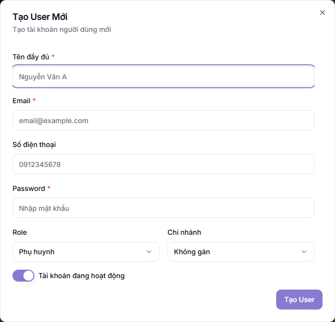
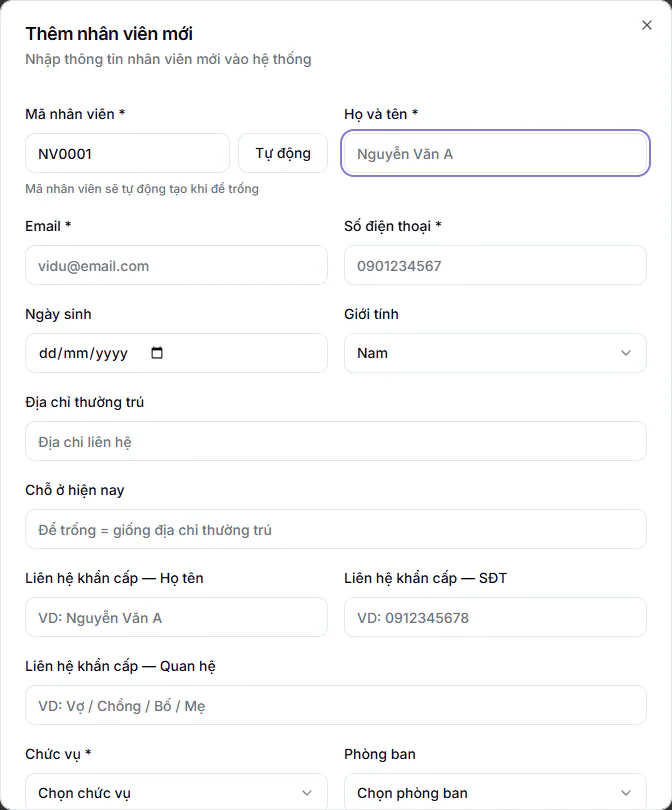

# Bước 3: Tạo tài khoản nhân viên

Mỗi người làm việc trong hệ thống cần một tài khoản riêng, gắn với một vai và một chi nhánh. Vai quyết định người đó thấy menu nào và làm được gì. Phải có tài khoản thì sau này mới xếp được giáo viên, trợ giảng vào lớp và tính được lương. Có hai cách: Quản trị viên tự tạo tài khoản, hoặc để nhân viên tự đăng ký rồi Quản trị viên duyệt.

## Mục tiêu

Mỗi nhân viên có một tài khoản đúng vai, đúng chi nhánh và đã biết mật khẩu khởi đầu.

## Cần có trước

- Đã có ít nhất một chi nhánh ([Bước 2](02-thiet-lap-trung-tam.md)), vì mỗi nhân viên được gắn vào một chi nhánh.
- Danh sách nhân viên: họ tên, email (mỗi người một email riêng, không dùng chung), số điện thoại và vai.
- Gói **Nhân sự (HRIS)** đã bật nếu bạn muốn xem và sửa hồ sơ nhân sự ở bước sau (kiểm tra ở [Bước 1](01-dang-nhap-lan-dau.md)). Tạo tài khoản thì không cần gói này.
- Có sẵn trong danh sách người dùng các tài khoản mẫu của hệ thống (vai Quản lý chi nhánh và vai Phụ huynh). Tài khoản mẫu Quản lý chi nhánh còn chiếm một chỗ trong số tài khoản nhân viên của gói. Nếu bạn không dùng, hãy **Vô hiệu hóa** hoặc **Đặt lại mật khẩu** tài khoản đó (xem mục "Sửa hoặc khoá tài khoản" bên dưới) để người ngoài không đăng nhập được.

## Chọn vai cho đúng

Cột cuối cho biết vai đó có vào được khu **Quản lý HR** (hồ sơ nhân viên, bảng lương) hay không. Người nào phải làm nhân sự và lương thì chọn vai **Quản lý chi nhánh** hoặc **Quản trị viên**.

| Vai trong ô **Role** | Dùng cho | Vào được **Quản lý HR**? |
| --- | --- | --- |
| Quản trị viên | Chủ trung tâm hoặc người quản trị toàn hệ thống | Có, toàn bộ |
| Quản lý chi nhánh | Người phụ trách một cơ sở, kể cả việc nhân sự và lương của cơ sở đó | Có, trong phạm vi chi nhánh của mình |
| Quản lý | Quản lý vận hành | Chỉ thấy **Dạy thay** và **Giao việc** (**Giao việc** cần gói **Giao việc Nội bộ**, lịch ca lễ tân chỉ khi được giao quyền) |
| Lễ tân | Lễ tân, tư vấn tuyển sinh | Không |
| Giáo viên | Giáo viên dạy lớp | Không |
| Trợ giảng | Trợ giảng | Không |
| Kế toán | Kế toán, thu học phí | Không |
| Nhân sự | Nhân viên văn phòng, chỉ dùng **Cổng nhân viên** (chấm công, phiếu lương, nghỉ phép của chính mình) | Không |
| Phụ huynh | Tài khoản phụ huynh (thường để hệ thống tạo khi thêm học sinh) | Không |

::: warning Vai Nhân sự không phải người làm nhân sự
Vai **Nhân sự** chỉ là nhân viên văn phòng. Người này không thấy menu **Quản lý HR**, không mở được hồ sơ nhân viên hay bảng lương của người khác. Muốn giao việc nhân sự và lương cho ai, hãy chọn **Quản lý chi nhánh** (hoặc **Quản trị viên**).
:::

Ba điểm khác nhau giữa **Quản trị viên** và **Quản lý chi nhánh** mà bạn nên biết ngay:

- Chỉ **Quản trị viên** tạo được tài khoản người dùng và vào được khu **Quản trị hệ thống**.
- **Quản lý chi nhánh** không khoá sổ kỳ ở Kế toán được. Việc này do **Quản trị viên** và **Kế toán** làm, và chỉ **Quản trị viên** mở lại được kỳ đã khoá.
- **Quản lý chi nhánh** bị giới hạn trong chi nhánh của mình: chỉ thấy người và dữ liệu thuộc chi nhánh đó. Bảng lương mà họ tạo cũng chỉ gồm nhân viên của chi nhánh đó.

**Quản lý** (không phải Quản lý chi nhánh) không có học phí, tài chính và bảng lương (chỉ xem được phiếu lương của chính mình). Chi tiết từng vai xem [Vai trò người dùng](../tai-khoan/vai-tro-nguoi-dung.md).

Tài khoản **Học sinh** không tạo ở đây. Muốn cấp tài khoản cho học sinh, dùng nút **Cấp tài khoản học sinh** ngay trên trang này hoặc từ trang Học sinh, vì tài khoản học sinh phải gắn đúng hồ sơ của em.

## Cách 1: Quản trị viên tạo tài khoản

::: steps
1. Vào **Quản trị hệ thống → Quản lý Users**. Trang **Quản Lý Users** hiện danh sách người dùng.
2. Bấm **Thêm User**. Hộp **Tạo User Mới** hiện ra.

   

3. Điền **Tên đầy đủ** (bắt buộc), **Email** (bắt buộc) và **Số điện thoại** (không bắt buộc).
4. Ở ô **Password** (bắt buộc), nhập mật khẩu khởi đầu cho người đó.
5. Ở ô **Role**, chọn vai. Ô này đang để sẵn **Phụ huynh**, nhớ đổi sang đúng vai.
6. Ở ô **Chi nhánh**, luôn chọn chi nhánh của người đó, kể cả khi trung tâm chỉ có một chi nhánh. Ô này đang để sẵn **Không gán**, đừng giữ nguyên.
7. Giữ công tắc **Tài khoản đang hoạt động** ở trạng thái bật, rồi bấm **Tạo User**.
8. Hộp báo "Đã tạo user mới" hiện ra và người này xuất hiện trong danh sách.
:::

::: warning Đừng để Chi nhánh là "Không gán"
Người không thuộc chi nhánh nào sẽ biến mất khỏi ô chọn giáo viên của Quản lý chi nhánh, và không có phiếu lương khi kỳ lương (bảng lương của một tháng, tạo ở [Bước 15](15-chot-luong-cuoi-thang.md)) được tạo theo một chi nhánh. Hệ thống không báo lỗi gì, nên rất dễ sót. Riêng tài khoản Quản lý chi nhánh để **Không gán** thì không mở được bảng lương. Nếu lỡ để trống, mở **Chỉnh sửa** và chọn lại chi nhánh (hồ sơ nhân sự của người đó đổi theo).
:::

Với các vai nhân viên (kể cả Quản trị viên và Quản lý), hệ thống tự tạo luôn một **hồ sơ nhân sự** cho người đó. Phụ huynh không có hồ sơ nhân sự. Hồ sơ tự tạo này mang giá trị mặc định, chưa chắc đúng với công việc thật: loại hình làm việc là Bán thời gian với vai Giáo viên, Trợ giảng và Lễ tân, là Toàn thời gian với các vai còn lại; loại hợp đồng là Thử việc 60 ngày; lương cơ bản để trống. Bạn sẽ rà và sửa lại ở [Bước 4: Hồ sơ nhân sự và cách tính lương](04-ho-so-nhan-su-va-cach-tinh-luong.md), nên đừng bỏ qua bước đó.

::: warning Lưu ý về mật khẩu
Tài khoản tạo ở đây không bị bắt đổi mật khẩu khi đăng nhập lần đầu. Hãy gửi mật khẩu cho nhân viên và nhắc họ tự đổi: bấm ảnh đại diện (chữ cái đầu tên), chọn **Hồ sơ cá nhân**, tab **Bảo mật**, mục **Đổi mật khẩu**. Mục **Hồ sơ cá nhân** trong nhóm **Cổng nhân viên** không có phần đổi mật khẩu. Mật khẩu mới ở đó cần ít nhất 6 ký tự.
:::

::: tip Mẹo
Email là tên đăng nhập và không sửa được sau khi tạo (ô bị khoá khi mở lại tài khoản). Gõ kỹ ngay từ đầu. Ví dụ: `an.nguyen@trungtam.vn`.
:::

### Lỗi hay gặp khi tạo tài khoản

| Thông báo | Nguyên nhân | Cách xử lý |
| --- | --- | --- |
| Tên và email là bắt buộc | Để trống tên hoặc email | Điền đủ hai ô |
| Password là bắt buộc khi tạo user mới | Chưa nhập mật khẩu | Nhập mật khẩu khởi đầu |
| User already exists | Email này đã có tài khoản đang dùng | Dùng email khác, hoặc tìm tài khoản cũ trong danh sách |
| Đã sử dụng .../... tài khoản nhân viên của gói hiện tại. Liên hệ KLASSA để nâng cấp gói. | Trung tâm đã dùng hết số tài khoản nhân viên của gói | Liên hệ KLASSA nâng gói, hoặc tắt tài khoản nhân viên đã nghỉ |
| Gói đã hết hạn. Liên hệ KLASSA để gia hạn trước khi tạo người dùng mới. | Gói dịch vụ đã hết hạn | Liên hệ KLASSA gia hạn |

Số tài khoản nhân viên được tính cho các vai nhân viên, không tính tài khoản Phụ huynh.

### Nếu người đó từng có tài khoản đã xoá

Tài khoản bị xoá nằm trong **Thùng rác** (nút ở góc trên trang **Quản Lý Users**). Muốn dùng lại, khôi phục tài khoản cũ thay vì tạo mới.

## Cách 2: Nhân viên tự đăng ký, Quản trị viên duyệt

Cách này tiện khi có nhiều người cần tài khoản cùng lúc. Nhân viên mở trang đăng nhập, bấm **Đăng ký ngay** (dưới dòng "Chưa có tài khoản?"), điền **Họ và tên**, **Email**, **Số điện thoại** (không bắt buộc), chọn **Vai trò**, nhập **Mật khẩu** (tối thiểu 8 ký tự, gồm cả chữ và số) rồi **Xác nhận mật khẩu**. Nếu trang có ô xác nhận "Tôi không phải máy" (trung tâm bật chống máy tự động), hoàn thành ô đó, rồi bấm **Đăng ký**.

Các vai tự đăng ký được là Phụ huynh, Giáo viên, Trợ giảng, Lễ tân và Nhân sự. Các vai Quản trị viên, Quản lý, Quản lý chi nhánh, Kế toán không tự đăng ký được, bạn tạo bằng Cách 1.

::: warning Người làm nhân sự không tự đăng ký vai Nhân sự
Vai **Nhân sự** trong danh sách tự đăng ký chỉ dành cho nhân viên văn phòng dùng **Cổng nhân viên**. Người sẽ quản lý hồ sơ và lương cần vai **Quản lý chi nhánh**, nên hãy tạo họ bằng Cách 1.
:::

Đăng ký xong, người đó thấy "Đăng ký thành công!" và phải chờ duyệt mới đăng nhập được. Nếu đăng nhập sớm, họ thấy "Tài khoản đang chờ phê duyệt từ quản trị viên".

### Duyệt đăng ký

::: steps
1. Vào **Quản trị hệ thống → Quản lý Đăng ký**. Trang **Quản lý Đăng ký** mở ở danh sách **Chờ duyệt**, ô **Chờ phê duyệt** ở trên cho biết đang có bao nhiêu đơn.
2. Tìm người cần duyệt (có thể dùng ô **Tìm kiếm** hoặc bộ lọc vai trong **Bộ lọc nâng cao**).
3. Bấm nút dấu tick xanh ở cột **Hành động**. Hộp **Phê duyệt đăng ký** hiện ra.
4. Chọn chi nhánh ở ô **Chi nhánh** (gợi ý "Chọn chi nhánh cho user này"). Bắt buộc với mọi vai, trừ Phụ huynh và Học sinh. Quên chọn thì hệ thống nhắc "Vui lòng chọn chi nhánh cho user này".
5. Bấm **Phê duyệt**. Hộp báo "Đã phê duyệt đăng ký thành công" hiện ra.
:::

Nếu sau khi bấm **Phê duyệt** hiện hộp báo lỗi, hãy tải lại trang: người đó có thể đã được duyệt (không còn trong danh sách **Chờ duyệt**) nhưng chưa có hồ sơ nhân sự. Khi đó làm theo mục "Kiểm tra hồ sơ nhân sự đã được tạo" bên dưới.

Để từ chối, bấm nút dấu X đỏ cùng hàng, nhập **Lý do từ chối** (bắt buộc, nút **Từ chối** chỉ bấm được khi đã có lý do) rồi bấm **Từ chối**.

Có nhiều đơn cùng lúc thì tick chọn các dòng rồi bấm **Phê duyệt hàng loạt** hoặc **Từ chối hàng loạt**. Phê duyệt hàng loạt gán tất cả vào cùng một chi nhánh, nên hãy lọc theo từng chi nhánh trước. Chi tiết xem [Duyệt đăng ký người dùng](../cai-dat/duyet-dang-ky-nguoi-dung.md).

::: tip Mẹo
Nút **Auto Rules** ở đầu trang cho phép đặt quy tắc tự duyệt đăng ký theo điều kiện. Người mới nên duyệt tay trước để nắm tình hình.
:::

## Kiểm tra hồ sơ nhân sự đã được tạo

Sau khi tạo hoặc duyệt, vào **Quản lý HR → Nhân viên** (màn này cần gói **Nhân sự (HRIS)**) và tìm tên người vừa tạo. Mỗi nhân viên phải có một dòng ở đây. Người mới tạo xong chưa thấy hồ sơ, hoặc nhân viên đăng nhập báo "Tài khoản chưa gắn hồ sơ nhân sự", thì làm như sau.

::: steps
1. Vào **Quản lý HR → Nhân viên**, bấm **Thêm nhân viên**. Hộp **Thêm nhân viên mới** hiện ra.

   

2. Nhập **Họ và tên** và **Email** đúng như tài khoản đã tạo ở Cách 1. Hệ thống nhận ra email đã có tài khoản và gắn hồ sơ vào tài khoản đó. **Số điện thoại** cũng bắt buộc (9-11 chữ số).
3. Chọn **Chức vụ**, **Loại hình làm việc**, **Loại hợp đồng**, **Ngày bắt đầu** và **Cơ sở** (chọn đúng chi nhánh của người đó). Ô **Chức vụ** và **Ngày bắt đầu** đang để trống, bạn phải chọn. Ô **Mã nhân viên** được điền sẵn một mã gợi ý khi hộp mở ra. Bạn có thể để trống ô này: khi bấm **Thêm nhân viên**, hệ thống tự cấp mã kế tiếp. Nếu hệ thống báo mã đã tồn tại, xoá trống ô **Mã nhân viên** rồi bấm lại.
4. Bấm **Thêm nhân viên** ở cuối hộp.
:::

::: warning Luôn tạo tài khoản trước, rồi mới thêm hồ sơ
Nếu bạn điền một email CHƯA có tài khoản vào hộp này, hệ thống sẽ tự tạo luôn tài khoản với vai **Giáo viên** và một mật khẩu mặc định chung. Lễ tân hoặc kế toán tạo theo cách này sẽ mang nhầm vai Giáo viên. Vì vậy hãy tạo tài khoản ở **Quản lý Users** trước (đúng vai), rồi dùng đúng email đó ở đây.
:::

Mỗi tài khoản chỉ có một hồ sơ. Nếu đã có, hệ thống báo tài khoản "đã có hồ sơ nhân viên" và bạn mở hồ sơ cũ để sửa, không tạo mới.

## Sửa hoặc khoá tài khoản sau này

Ở **Quản Lý Users**, bấm nút ba chấm cuối mỗi dòng. Menu có các lựa chọn **Chỉnh sửa**, **Vô hiệu hóa** (hoặc **Kích hoạt**), **Đặt lại mật khẩu** (mật khẩu mới tối thiểu 6 ký tự), **Mở khóa tài khoản** khi người đó bị khoá do gõ sai nhiều lần, và xoá tài khoản. Ô **Tìm kiếm theo tên, email, phone...** và bộ lọc vai giúp tìm nhanh. Chi tiết xem [Quản lý người dùng](../cai-dat/nguoi-dung.md).

Khi nhân viên thôi việc, đừng chỉ bấm **Vô hiệu hóa**: làm vậy người đó vẫn đứng tên ở các lớp. Hãy đổi trạng thái hồ sơ sang **Đã nghỉ việc** ở **Quản lý HR**, hệ thống sẽ khoá tài khoản và tự gỡ người đó khỏi các lớp đang dạy hoặc trợ giảng, xem [Bước 11](11-thay-doi-trong-thang.md).

Có sẵn danh sách nhân viên trong file Excel thì bạn nhập hàng loạt thay vì tạo từng người, xem [Nhập dữ liệu hàng loạt từ Excel](../tai-khoan/nhap-du-lieu-hang-loat.md). Lưu ý: người có email trong file được tạo tài khoản với vai **Giáo viên**, bạn cần vào **Quản Lý Users** đổi vai cho người không phải giáo viên.

## Kiểm tra đã xong

- [ ] Mỗi nhân viên có một dòng trong **Quản Lý Users** với đúng vai và đúng chi nhánh (không để **Không gán**).
- [ ] Người làm nhân sự và lương đang mang vai **Quản lý chi nhánh** hoặc **Quản trị viên**, không phải vai **Nhân sự**.
- [ ] Mỗi nhân viên có một dòng trong **Quản lý HR → Nhân viên** (nếu trung tâm có gói **Nhân sự (HRIS)**).
- [ ] Nhân viên đã nhận email và mật khẩu, đăng nhập thử được và đã được nhắc tự đổi mật khẩu.
- [ ] Giáo viên thấy menu của giáo viên, lễ tân thấy menu của lễ tân (nếu muốn chắc, nhờ họ đăng nhập thử).
- [ ] Tài khoản mẫu có sẵn đã được vô hiệu hoá hoặc đổi mật khẩu nếu bạn không dùng.
- [ ] Không còn đơn nào ở trạng thái **Chờ duyệt** trong **Quản lý Đăng ký** (nếu dùng Cách 2).

## Câu hỏi thường gặp

::: details Tôi chọn nhầm vai khi tạo, sửa được không?
Được. Ở **Quản Lý Users**, bấm nút ba chấm của dòng đó, chọn **Chỉnh sửa**, đổi ô **Role** và bấm **Cập nhật**. Riêng email thì không sửa được.
:::

::: details Giáo viên hoặc lễ tân kiêm trợ giảng thì chọn vai nào?
Chọn vai chính của họ (Giáo viên hoặc Lễ tân). Việc kiêm trợ giảng được đặt theo từng lớp khi phân công lớp, không phải bằng vai riêng.
:::

::: details Nhân viên báo không thấy hồ sơ nhân sự của mình?
Làm theo mục "Kiểm tra hồ sơ nhân sự đã được tạo" ở trên: thêm hồ sơ ở **Quản lý HR → Nhân viên** bằng đúng email của tài khoản đó.
:::

::: details Tôi muốn giao việc nhân sự cho một bạn, chọn vai Nhân sự được không?
Không. Vai **Nhân sự** không vào được khu **Quản lý HR**. Hãy chọn **Quản lý chi nhánh**.
:::

## Bước tiếp theo

Tiếp tục với [Bước 4: Hoàn thiện hồ sơ nhân sự và khai cách tính lương](04-ho-so-nhan-su-va-cach-tinh-luong.md).
