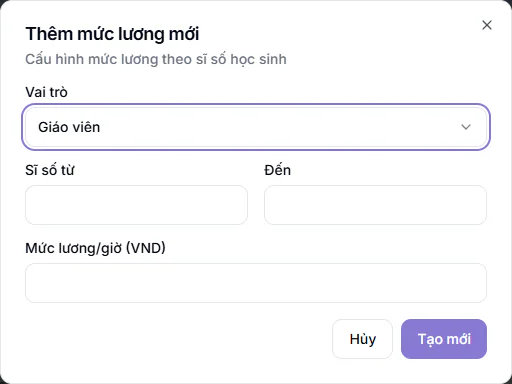
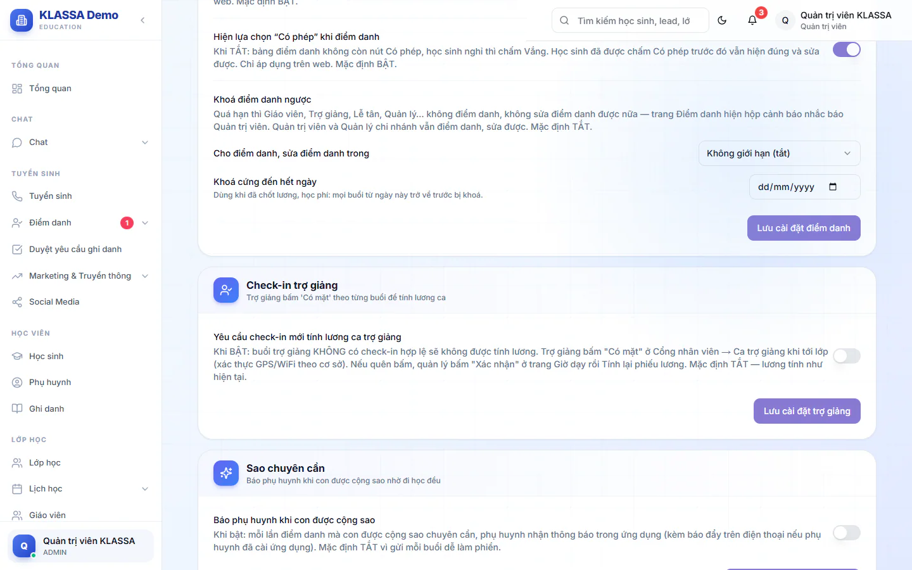

# Bước 4: Hoàn thiện hồ sơ nhân sự và khai cách tính lương

Ở [Bước 3](03-tao-tai-khoan-nhan-vien.md), mỗi nhân viên được tạo tài khoản và hệ thống tự sinh một **hồ sơ nhân sự** cho họ. Hồ sơ tự sinh còn thiếu và mang giá trị đặt sẵn, nên nếu để nguyên thì lương cuối tháng dễ ra sai hoặc ra 0 đồng. Bước này giúp bạn sửa hồ sơ cho đúng và khai cách tính lương dạy ngay từ đầu.

::: tip Phải có hồ sơ nhân sự mới xếp được giáo viên vào lớp không?
Không. Khi tạo lớp ([Bước 7](07-tao-lop-va-lich-hoc.md)), danh sách giáo viên và trợ giảng lấy từ **tài khoản** ở Bước 3. Hồ sơ nhân sự chỉ cần cho lương, chấm công và Cổng nhân viên. Nhưng nên làm bước này trước khi lớp có buổi học đầu tiên, vì lương dạy sẽ được tính từ các buổi đó.
:::

## Mục tiêu

- Hồ sơ nhân sự của mọi người đúng loại hình làm việc, cơ sở và lương cơ bản.
- Đã khai đơn giá dạy cho giáo viên và trợ giảng, đơn giá ca cho lễ tân làm theo ca.
- Đã quyết bật hay tắt công tắc check-in của trợ giảng.

## Cần có trước

- Đã tạo tài khoản cho giáo viên, trợ giảng, lễ tân và các nhân viên khác ([Bước 3](03-tao-tai-khoan-nhan-vien.md)).
- Trung tâm đã có hai gói mở rộng **Nhân sự (HRIS)** và **Lương giáo viên**. Kiểm tra ở **Cài đặt → Plugin Marketplace**. Thiếu gói nào thì mục thuộc gói đó không hiện trong menu **Quản lý HR**. Gói **Nhân sự (HRIS)** lo **Nhân viên**, **Điểm danh nhân viên**, **Cấu hình HR** và các mục nhân sự còn lại. Gói **Lương giáo viên** lo **Quản lý lương** và **Mẫu phiếu lương**. Riêng mục **Dạy thay** luôn hiện. Nếu chưa có đủ hai gói, bạn bỏ qua bước này và [Bước 15](15-chot-luong-cuoi-thang.md), phần còn lại của lộ trình vẫn làm được.
- Biết trung tâm trả lương cho từng người theo kiểu nào: lương tháng cố định, hay trả theo giờ dạy hoặc theo ca.

## A. Sửa hồ sơ nhân sự của từng người

Hồ sơ tự sinh có các giá trị đặt sẵn sau. **Loại hình làm việc** là Bán thời gian với vai Giáo viên, Trợ giảng và Lễ tân, và là Toàn thời gian với các vai còn lại (Quản trị viên, Quản lý chi nhánh, Quản lý, Kế toán, Nhân sự). **Loại hợp đồng** là Thử việc, **Ngày bắt đầu** là ngày hồ sơ được tạo (ngày tạo tài khoản, hoặc ngày duyệt nếu người đó tự đăng ký), **Ngày kết thúc** là 60 ngày sau, **Lương cơ bản** để trống. Chức vụ được gán theo vai tài khoản.

::: steps
1. Vào **Quản lý HR → Nhân viên**. Trang **Quản lý nhân viên** hiện danh sách. Gõ tên vào ô **Tìm kiếm theo tên, mã NV, email...** nếu danh sách dài.
2. Bấm biểu tượng bút (gợi ý **Chỉnh sửa**) ở cuối dòng của người cần sửa. Hộp **Cập nhật thông tin nhân viên** hiện ra.
3. Ở ô **Loại hình làm việc**, chọn **Toàn thời gian** hoặc **Bán thời gian** theo bảng bên dưới.
4. Ở ô **Loại hợp đồng**, chọn **Không xác định thời hạn**, **Có thời hạn** hoặc **Thử việc** cho đúng hợp đồng thật.
5. Sửa **Ngày bắt đầu** thành ngày người đó thật sự vào làm. Sửa **Ngày kết thúc** (đang là 60 ngày sau ngày tạo) theo hạn hợp đồng thật. Nếu cần, chỉnh **Ngày hết thử việc**.
6. Nhập **Lương cơ bản** (ý nghĩa của ô này phụ thuộc loại hình, xem bên dưới).
7. Với giáo viên và trợ giảng, để ô **Cách tính lương dạy (GV/Trợ giảng)** là **Theo mặc định trung tâm**, trừ khi người đó được trả theo cách riêng.
8. Bấm **Cập nhật**. Hộp báo "Đã cập nhật thông tin nhân viên" hiện ra.
:::

Ô bắt buộc: **Họ và tên**, **Email**, **Số điện thoại** (9-11 chữ số), **Chức vụ**, **Loại hình làm việc**, **Ngày bắt đầu**. Ô **Lương cơ bản** có dấu sao nhưng nhập 0 hoặc để trống vẫn lưu được. Thiếu ô nào, hệ thống nhắc "Vui lòng kiểm tra lại thông tin" kèm tên ô còn thiếu. Hồ sơ tự sinh lấy số điện thoại từ tài khoản: nếu tài khoản chưa có số điện thoại, bạn phải nhập vào đây thì mới lưu được.

### Chọn loại hình làm việc

Loại hình điều khiển cách tính tiền thật, nên chọn theo đúng cách trung tâm trả lương.

| Loại hình | Ô **Lương cơ bản** nghĩa là gì | Hệ quả |
| --- | --- | --- |
| **Toàn thời gian** | Lương tháng | Lương nền được tính theo số ngày chấm công và ngày nghỉ phép có lương trên số ngày công chuẩn (mặc định 26). Tháng nào người này không có dữ liệu chấm công thì được trả đủ lương tháng. Khi tạo kỳ lương, ô **Trừ BHXH / BHYT / BHTN + thuế TNCN** mặc định là **Chỉ nhân viên Full-time (đúng luật BHXH)**, nên người này bị trừ BHXH, BHYT, BHTN và thuế thu nhập cá nhân, tính trên cả lương dạy (xem [Bước 15](15-chot-luong-cuoi-thang.md)). Trợ giảng Toàn thời gian không phải bấm **Có mặt** ở ca trợ giảng. |
| **Bán thời gian** | **Đơn giá một giờ**, không phải lương tháng | Tiền nền = đơn giá nhân số giờ chấm công. Với lựa chọn mặc định của kỳ lương, không bị trừ bảo hiểm và thuế. |

Ở cả hai loại hình, giáo viên và trợ giảng được cộng thêm lương dạy theo buổi (khai ở phần C).

::: warning Nhập sai ô Lương cơ bản của người bán thời gian
Với người **Bán thời gian**, nhập 8.000.000 vào **Lương cơ bản** nghĩa là 8 triệu đồng cho MỖI GIỜ. Ô này không có ghi chú nhắc điều đó. Nếu người này chỉ nhận tiền theo buổi dạy (đơn giá khai ở phần C), hãy để **Lương cơ bản** là 0.
:::

Quy ước ai là toàn thời gian, ai là bán thời gian do trung tâm tự quyết. Giáo viên, trợ giảng và lễ tân làm theo buổi hay theo ca thường chọn **Bán thời gian**, còn quản lý, kế toán hưởng lương tháng cố định thường chọn **Toàn thời gian**. Hồ sơ tự sinh đã đặt sẵn đúng quy ước phổ biến này theo vai, nên bạn chỉ cần sửa những người trả lương khác mặc định. Hồ sơ tạo từ trước không tự đổi theo mặc định mới, nên vẫn nên rà lại cả danh sách.

::: tip Mẹo
Làm lần lượt: lọc danh sách theo từng nhóm người (giáo viên, trợ giảng, lễ tân, kế toán) rồi sửa hết một nhóm trước khi sang nhóm khác để không bỏ sót ai.
:::

### Kiểm tra cơ sở và chức vụ

- Ô **Cơ sở** trong hồ sơ phải là chi nhánh của người đó. Khi kỳ lương được tạo riêng cho một chi nhánh, người để trống **Cơ sở** sẽ không có phiếu lương.
- Khi tạo tài khoản, hệ thống dùng lại chức vụ có sẵn cùng tên (ví dụ **Giáo viên**) và không tạo thêm dòng trùng. Nếu danh sách **Chức vụ** của trung tâm bạn đã có hai dòng trùng tên từ trước, khi khai lương theo chức vụ ở **Quản lý HR → Quản lý lương → Cấu hình lương NV**, hãy chọn đúng dòng đang gắn với người đó.
- Ô **Mã nhân viên** trong hộp sửa bị khoá, không đổi được. Mã do hệ thống tự cấp (khi duyệt đăng ký, tạo tài khoản, nhập từ Excel, tuyển ứng viên, hoặc khi bạn để trống ô **Mã nhân viên** ở hộp thêm nhân viên) có dạng NV và bốn chữ số (NV0001, NV0002...), bằng số lớn nhất trong các mã dạng này cộng thêm 1. Mã theo dạng khác (ví dụ chữ cái khác ở đầu) được giữ nguyên và không ảnh hưởng đến mã tự sinh tiếp theo. Riêng giáo viên tạo bằng nút **Thêm giáo viên mới** ở trang **Giáo viên** thì nhận mã dạng GV kèm sáu chữ số.

::: warning Đừng tạo nhân viên mới bằng nút Thêm nhân viên khi chưa có tài khoản
Nút **Thêm nhân viên** ở **Quản lý HR → Nhân viên** nếu gặp email chưa có tài khoản sẽ tạo luôn tài khoản vai **Giáo viên**, dùng mật khẩu mặc định của hệ thống và không gắn chi nhánh. Lễ tân hay kế toán tạo bằng cách này sẽ mang nhầm vai Giáo viên. Hãy tạo tài khoản ở Bước 3 trước, hồ sơ sẽ tự sinh theo, rồi quay lại đây chỉ để sửa.
:::

## B. Lễ tân làm bán thời gian theo ca

Lễ tân muốn tự đăng ký ca Sáng, Chiều, Tối trên **Cổng nhân viên → Đăng ký ca** cần được bật quyền, và ca phải có đơn giá. Làm hai việc sau, mỗi lễ tân một lần.

::: steps
1. Ở hộp **Cập nhật thông tin nhân viên** của lễ tân, kiểm tra **Loại hình làm việc** là **Bán thời gian** (hồ sơ lễ tân tự sinh đã đặt sẵn mức này, hồ sơ tạo từ trước có thể đang là Toàn thời gian thì đổi lại).
2. Tick ô **Đăng ký ca lễ tân (part-time)** (ghi chú "Cho phép NV tự đăng ký ca (Sáng/Chiều/Tối) trên cổng nhân viên"), rồi bấm **Cập nhật**.
3. Vào **Quản lý HR → Cấu hình HR**, mở tab **Ca lễ tân**. Với mỗi ô **Sáng**, **Chiều**, **Tối**, chọn một ca ở danh sách (mục "Chọn ca") và nhập **Đơn giá (đồng/giờ)**. Dưới mỗi ô hiện số giờ của ca và số tiền một ca.
4. Bấm **Lưu khung giờ & đơn giá**. Hộp báo "Đã lưu khung giờ và đơn giá ca lễ tân" hiện ra.
:::

Các điểm cần biết:

- Chưa tick ô **Đăng ký ca lễ tân (part-time)** thì lễ tân thấy thông báo "Tài khoản chưa được bật đăng ký ca. Liên hệ HR."
- Danh sách ca ở tab **Ca lễ tân** lấy từ tab **Ca làm việc** cùng trang. Nếu hiện "Chưa có ca nào", hãy tạo ca ở tab **Ca làm việc** trước. Chỉ Quản trị viên lưu được đơn giá.
- Lương lễ tân bán thời gian tính theo giờ chấm công rơi vào khung nào thì lấy đơn giá khung đó. Giờ ngoài các khung lấy **Lương cơ bản** trong hồ sơ làm đơn giá dự phòng. Thiếu cả hai thì giờ đó ra 0 đồng.
- Người xếp và công bố lịch ca phải nằm trong danh sách ở thẻ **Người được xếp & quản lý ca lễ tân** (cuối tab **Ca lễ tân**). Quản trị viên luôn có quyền; Quản lý chi nhánh và Quản lý phải được tick vào danh sách này. Chi tiết ở [Lịch ca lễ tân](../nhan-su/lich-ca-le-tan.md) và [Đăng ký ca](../cong-nhan-vien/dang-ky-ca.md).

## C. Khai đơn giá dạy cho giáo viên và trợ giảng

Đây là việc quan trọng nhất của bước này. Trung tâm mới chưa có đơn giá dạy nào. Nếu không khai, lương dạy của giáo viên và trợ giảng ra 0 đồng, và hệ thống chỉ ghi một dòng nhỏ trên phiếu lương, ví dụ "N buổi chưa có bảng giá".

Lương một buổi dạy tính bằng **mức lương/giờ nhân số giờ của buổi đó**. Mức lương/giờ được chọn theo **sĩ số** của buổi, nên bạn khai các khoảng sĩ số, mỗi khoảng một mức.

::: steps
1. Vào **Quản lý HR → Quản lý lương** và mở tab **Đơn giá dạy (GV/TG)**.
2. Xem khung **Cách tính lương ca dạy (mặc định trung tâm)** ở đầu trang. Mặc định là **Theo sĩ số học sinh (bảng dưới)**. Chỉ Quản trị viên đổi được ô này. Nếu trung tâm trả theo buổi hoặc theo giờ cố định, chọn **Cố định mỗi buổi** hoặc **Cố định theo giờ**.
3. Bấm **Thêm mức lương**. Hộp **Thêm mức lương mới** hiện ra.

   

4. Chọn **Vai trò**: **Giáo viên** hoặc **Trợ giảng**.
5. Điền **Sĩ số từ**, **Đến** và **Mức lương/giờ (VND)**. Cả ba ô đều bắt buộc, thiếu thì báo "Vui lòng điền đầy đủ thông tin".
6. Bấm **Tạo mới**. Mức vừa tạo xuất hiện trong bảng **Giáo viên** hoặc **Trợ giảng** ở dưới.
7. Lặp lại cho các khoảng sĩ số còn lại, rồi làm tương tự cho vai còn lại.
:::

Ví dụ cho giáo viên: 1-5 học sinh, 100.000 đồng/giờ; 6-10 học sinh, 130.000 đồng/giờ; 11-20 học sinh, 160.000 đồng/giờ. Buổi học 1,5 giờ có 8 em có mặt được 130.000 nhân 1,5 bằng 195.000 đồng. Đây là số minh hoạ, bạn tự đặt mức theo chính sách của trung tâm.

Bảng đơn giá giáo viên và bảng đơn giá trợ giảng tách riêng. Khai đủ giáo viên mà quên trợ giảng thì trợ giảng vẫn ra 0 đồng.

Trang này còn khung **Đơn giá trợ giảng dạy thay giáo viên (mỗi ca)** với một ô nhập số tiền (gợi ý "VD 300000", đơn vị đ/ca) và nút **Lưu**. Dùng khi giáo viên nghỉ, đơn dạy thay chọn "Không có GV" và trợ giảng đứng lớp: trợ giảng được tính đúng số tiền này cho ca đó, thay cho đơn giá theo sĩ số. Để trống thì trợ giảng tính như bình thường. Chỉ Quản trị viên đổi được, và số mới chỉ áp dụng cho phiếu lương tính từ lúc lưu.

::: warning Những điều dễ sai
- Các khoảng sĩ số của cùng một vai không được chồng lên nhau, và nên nối liền nhau từ sĩ số nhỏ nhất tới lớn nhất mà lớp có thể có. Buổi có sĩ số rơi vào khoảng trống (hoặc vượt mức cao nhất) thì không có mức nào khớp và không được tính lương. Nếu **Sĩ số từ** lớn hơn **Đến**, hệ thống không cho lưu và báo "Số học sinh tối thiểu không được lớn hơn số học sinh tối đa". Khi thêm mức mới chồng lên một mức đã có, hệ thống thường báo "Khoảng sĩ số này bị trùng với một mức lương đã có". Chỉnh lại số cho đúng rồi lưu lại. Hệ thống không bắt được mọi trường hợp (ví dụ khoảng mới bao trùm cả mức cũ, hoặc khi sửa một mức có sẵn), nên sau khi lưu hãy tự rà bảng để các khoảng không chồng nhau.
- Sĩ số chỉ đếm học sinh được điểm danh **Có mặt**. Em **Trễ**, **Học bù**, **Phép** hay **Vắng** không được đếm. Lớp sát ranh giới giữa hai mức có thể ra mức thấp hơn giáo viên tưởng. Buổi không em nào **Có mặt** thì không có mức nào khớp và buổi đó không được tính lương.
- Chỉ buổi đã điểm danh xong mới được trả. Xem thêm ở [Bước 10](10-diem-danh-buoi-dau.md).
- Chọn **Cố định mỗi buổi** hoặc **Cố định theo giờ** mà tiền để 0 thì buổi đó cũng bị bỏ qua. Tiền cố định nhập ở hồ sơ từng người (ô **Tiền/buổi dạy (cố định)** hoặc **Tiền/giờ dạy (cố định)**) hoặc riêng cho từng lớp ở [Bước 7](07-tao-lop-va-lich-hoc.md). Khi trung tâm chọn chế độ cố định, bảng sĩ số chỉ áp cho người được đặt riêng **Theo sĩ số học sinh**.
- Học trực tuyến chỉ giảm học phí, không làm giảm lương giáo viên.
:::

Thứ tự ưu tiên khi nhiều mức cùng áp dụng: mức đặt riêng cho một người, rồi mức riêng cho một lớp, rồi mức của chi nhánh, cuối cùng là mức chung. Màn hình này chỉ tạo mức chung cho cả trung tâm. Muốn đặt mức riêng cho một người, mở hộp **Cập nhật thông tin nhân viên** của người đó, chọn **Cách tính lương dạy (GV/Trợ giảng)** là **Theo sĩ số học sinh**, khung bậc riêng hiện ngay bên dưới với nút **Thêm bậc**. Chi tiết xem [Cấu hình lương](../nhan-su/cau-hinh-luong.md).

## D. Quyết định công tắc check-in của trợ giảng

Câu hỏi: trợ giảng có phải bấm **Có mặt** trên Cổng nhân viên mới được tính lương ca không?

- **Mặc định tắt.** Trợ giảng được tính lương mọi buổi trong thời gian được xếp vào lớp, dù có bấm hay không.
- **Khi bật.** Trợ giảng không phải Toàn thời gian mà quên bấm **Có mặt** sẽ mất lương buổi đó. Muốn trả lại, Quản trị viên hoặc Quản lý chi nhánh vào **Quản lý HR → Giờ dạy**, mở thẻ **Check-in trợ giảng**, bấm **Xác nhận có mặt** ở buổi đó rồi tính lại phiếu lương. Trợ giảng Toàn thời gian luôn được miễn.

::: steps
1. Chỉ Quản trị viên làm được. Vào **Cài đặt → Tổng quan**, mở tab **Cấu hình**, rồi mục **Điểm danh**.
2. Tìm khối **Check-in trợ giảng**, bật hoặc tắt công tắc **Yêu cầu check-in mới tính lương ca trợ giảng**.

   

3. Bấm **Lưu cài đặt trợ giảng**.
:::

Nên quyết ngay từ đầu. Đổi giữa chừng sẽ làm đổi cách tính của những kỳ lương tính lại. Nếu bật, hãy dặn trợ giảng xem bài [Ca trợ giảng](../nhan-su/ca-tro-giang.md).

## E. Chấm công nhân viên: một lưu ý

Chưa khai WiFi hoặc vùng GPS thì ai cũng chấm công được từ bất cứ đâu, hệ thống không kiểm tra vị trí. Nếu trung tâm cần chặn chấm công từ xa, vào **Quản lý HR → Điểm danh nhân viên**, bấm nút **Cài đặt**, rồi khai ở các tab **WiFi cho phép** và **Phạm vi GPS**. Hướng dẫn chi tiết ở [Cấu hình chấm công](../nhan-su/cau-hinh-cham-cong.md). Nút chấm công vào ca, ra ca của nhân viên, cả trên web (**Cổng nhân viên → Chấm công của tôi**) lẫn app điện thoại, cần thêm gói **Ứng dụng Di động (PWA)**. Thiếu gói này thì nhân viên không tự chấm công được, nên người **Bán thời gian** và lễ tân theo ca không có giờ công để tính lương nền.

## Kiểm tra đã xong

- [ ] Mọi giáo viên, trợ giảng, lễ tân và nhân viên khác đã đúng **Loại hình làm việc**, **Cơ sở** và **Chức vụ**.
- [ ] Người **Toàn thời gian** có **Lương cơ bản** là lương tháng. Người **Bán thời gian** nhập đơn giá giờ, hoặc để 0 nếu chỉ nhận tiền theo buổi dạy.
- [ ] Lễ tân làm theo ca đã tick **Đăng ký ca lễ tân (part-time)** và tab **Ca lễ tân** đã có đơn giá cho ba ca.
- [ ] Tab **Đơn giá dạy (GV/TG)** có ít nhất một mức cho **Giáo viên** và một mức cho **Trợ giảng**.
- [ ] Đã quyết bật hay tắt công tắc check-in trợ giảng.

## Câu hỏi thường gặp

::: details Tôi sửa loại hình xong thì phiếu lương đã tính có đổi theo không?
Không tự đổi. Phiếu đã tính giữ số cũ. Sau khi sửa hồ sơ hoặc đơn giá, bạn cần tính lại kỳ lương, xem [Bước 15](15-chot-luong-cuoi-thang.md). Lưu ý tính lại sẽ ghi đè các dòng đã sửa tay.
:::

::: details Hộp Cập nhật không có lựa chọn Hợp đồng ở ô Loại hình làm việc, tôi làm sao?
Hộp sửa hồ sơ chỉ cho chọn **Toàn thời gian** và **Bán thời gian**. Với người làm theo hợp đồng cộng tác, chọn **Bán thời gian** (trả theo giờ hoặc theo buổi). Loại hợp đồng thật ghi ở ô **Loại hợp đồng**.
:::

::: details Tôi không thấy mục Quản lý HR, hoặc thiếu mục bên trong?
Có hai lý do. Thứ nhất, menu này chỉ hiện với Quản trị viên, Quản lý chi nhánh và Quản lý. Việc sửa hồ sơ và thêm mức đơn giá dạy chỉ Quản trị viên và Quản lý chi nhánh làm được. Vai Quản lý chỉ vào được **Dạy thay** và **Giao việc** (cùng **Lịch ca lễ tân** khi được giao quyền), không mở được danh sách nhân viên hay bảng lương (xem bảng vai ở [Bước 3](03-tao-tai-khoan-nhan-vien.md)). Thứ hai, nếu menu có nhưng thiếu mục bên trong, đó là do trung tâm chưa có gói: **Nhân viên** cần gói **Nhân sự (HRIS)**, **Quản lý lương** cần gói **Lương giáo viên**, **Giao việc** cần gói **Giao việc Nội bộ**.
:::

::: details Có phải khai lương cho cả quản lý và kế toán không?
Mọi hồ sơ đang làm việc đều có phiếu lương. Người hưởng lương tháng thì nhập **Lương cơ bản** ở bước A. Người không nhận lương qua hệ thống thì để 0, phiếu của họ sẽ ra 0 đồng và bạn bỏ qua khi soát lương.
:::

## Bước tiếp theo

Tiếp tục với [Bước 5: Cấu hình học phí, ưu đãi và mẫu hoá đơn](05-cau-hinh-hoc-phi.md). Muốn xem kỹ từng màn nhân sự, đọc thêm [Danh sách nhân viên](../nhan-su/danh-sach-nhan-vien.md), [Cấu hình nhân sự](../nhan-su/cau-hinh-hr.md) và [Hợp đồng lao động](../nhan-su/hop-dong.md).
