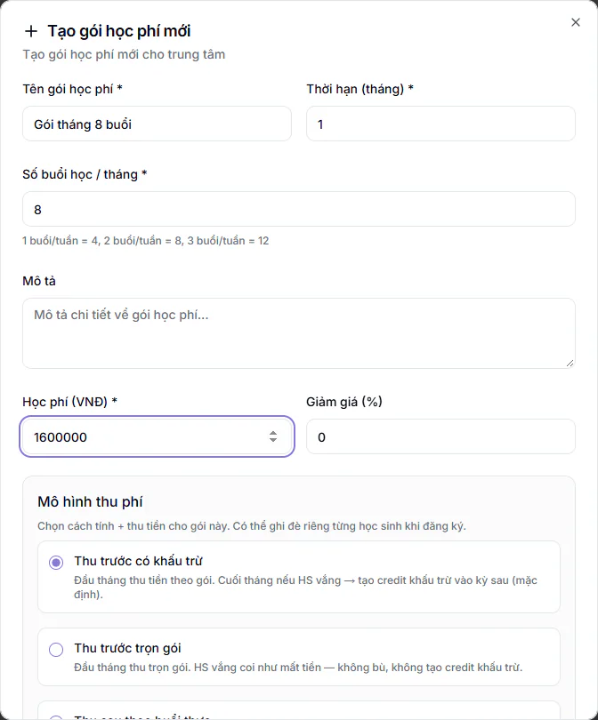
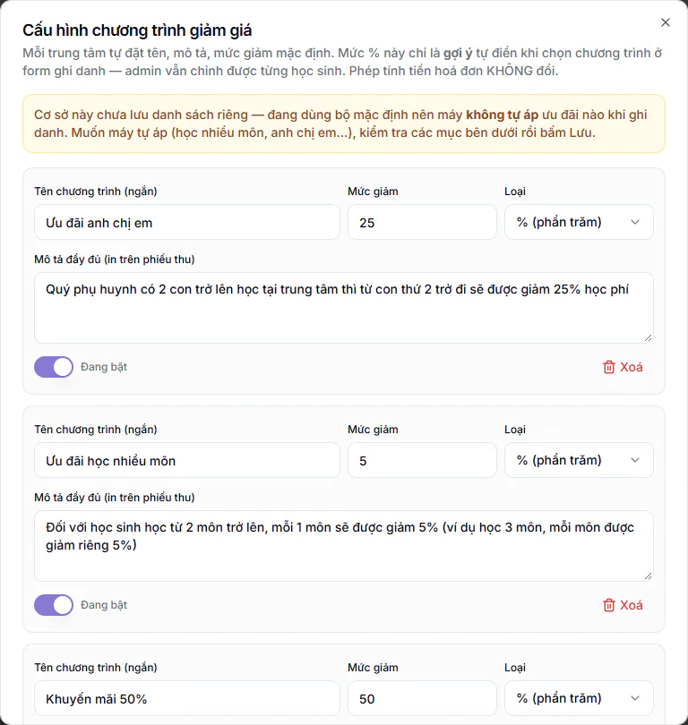
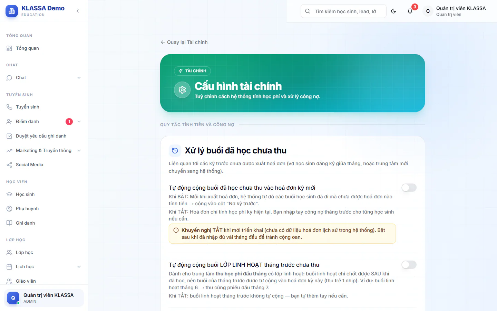

# Bước 5: Cấu hình học phí, ưu đãi và mẫu hoá đơn

Mỗi lần ghi danh học sinh vào lớp, bạn phải chọn một **gói học phí**. Phiếu gửi phụ huynh cuối tháng cũng lấy tên, địa chỉ và tài khoản nhận tiền từ **mẫu hoá đơn** của trung tâm. Vì vậy cả hai cần xong trước các bước sau. Bài này hướng dẫn tạo gói học phí, lưu danh sách ưu đãi, điền mẫu hoá đơn và xem qua những công tắc tài chính quan trọng nhất.

## Mục tiêu

- Có ít nhất một gói học phí đúng bảng giá trung tâm, gói mẫu có sẵn đã sửa hoặc tắt.
- Hiểu ba cách thu tiền để chọn đúng cho trung tâm.
- Đã lưu danh sách chương trình ưu đãi để hệ thống gợi ý ưu đãi khi ghi danh.
- Mẫu hoá đơn mang thông tin thật của trung tâm, có mã QR nhận tiền.
- Biết các công tắc tự động trong Cấu hình tài chính đang bật hay tắt.

## Cần có trước

- Đã xong [Bước 3: tạo tài khoản nhân viên](03-tao-tai-khoan-nhan-vien.md).
- Đăng nhập bằng vai **Quản trị viên** hoặc **Quản lý chi nhánh**. Chỉ hai vai này tạo được gói học phí.
- Biết trước: học phí một tháng là bao nhiêu và mỗi tháng học mấy buổi (1 buổi mỗi tuần là 4 buổi, 2 buổi mỗi tuần là 8 buổi, 3 buổi mỗi tuần là 12 buổi).
- Có sẵn tên, địa chỉ, số điện thoại của trung tâm và thông tin tài khoản ngân hàng nhận học phí (ngân hàng, số tài khoản, tên chủ tài khoản).

::: warning Tab Gói học phí đã có 4 gói mẫu
Phần mềm tạo sẵn bốn gói mẫu: **Buổi lẻ**, **Gói Tuần**, **Gói Tháng**, **Gói Quý**. Các gói này không đặt số buổi, nên hệ thống tự coi là 8 buổi mỗi kỳ và lấy đơn giá một buổi bằng học phí chia 8. Ví dụ ở bộ gói mẫu ban đầu, **Buổi lẻ** (200.000đ) ra 25.000đ một buổi, **Gói Quý** (4.320.000đ) ra 540.000đ một buổi. Tên, số tiền và số buổi của các gói mẫu có thể khác ở từng trung tâm (có nơi được dựng sẵn thêm gói như **Gói Tháng x2 môn** và đã ghi số buổi), nên hãy xem thẻ gói thật trong tab trước khi dùng. Nếu chọn nhầm một gói mẫu khi ghi danh, phiếu sẽ sai tiền. **Gói Tháng** và **Gói Quý** còn có sẵn mức giảm giá 5% và 10%. Bạn hãy mở từng gói bấm **Sửa** cho đúng bảng giá, hoặc bấm **Tắt** gói không dùng (xem phần "Sửa, tắt hoặc xoá gói" bên dưới).
:::

## Tạo gói học phí đầu tiên

::: steps
1. Vào **Tài chính → Học phí**, mở tab **Gói học phí**.
2. Bấm **Thêm gói mới** (hoặc **Tạo gói học phí đầu tiên** nếu danh sách đang trống). Cũng có thể bấm **Tạo gói học phí** ở đầu trang. Hộp **Tạo gói học phí mới** hiện ra.
   

3. Điền **Tên gói học phí**, ví dụ "Gói tháng 8 buổi". Ô này bắt buộc.
4. Điền **Thời hạn (tháng)**, ví dụ 1 (ô này nằm cùng hàng với tên gói). Ô này bắt buộc nhưng hiện chỉ để ghi nhận gói, không đổi cách tính tiền.
5. Điền **Số buổi học / tháng**, ví dụ 8. Ô này bắt buộc. Hệ thống dùng số này để tính đơn giá một buổi.
6. Điền **Học phí (VNĐ)** cho một tháng, ví dụ 1600000. Ô này bắt buộc.
7. Nếu gói có giảm giá cố định, nhập **Giảm giá (%)**. Để 0 nếu không giảm. Khung xanh bên dưới tự tính **Đơn giá/buổi** và **Học phí cuối cùng** để bạn kiểm tra.
8. Chọn **Mô hình thu phí** (xem phần bên dưới). Mặc định là **Thu trước có khấu trừ**.
9. Để công tắc **Trạng thái hoạt động** bật, rồi bấm **Tạo gói học phí**.
:::

Khi lưu xong, thông báo **Đã tạo gói học phí mới** hiện lên và gói xuất hiện dưới dạng thẻ trong tab **Gói học phí**. Ô **Mô tả** và **Quyền lợi** hiện chưa được lưu cùng gói, bạn có thể bỏ trống. Muốn phân biệt các gói, hãy đặt **Tên gói học phí** thật rõ.

::: warning Lưu ý
Nếu bấm lưu mà thấy **Vui lòng điền đầy đủ thông tin**, bạn đang thiếu tên gói, học phí hoặc thời hạn. Nếu thấy **Vui lòng nhập số buổi/tháng**, hãy nhập số buổi lớn hơn 0.
:::

## Chọn mô hình thu phí

Mỗi gói thuộc một trong ba mô hình. Mô hình quyết định cách lập hoá đơn ở các bước sau.

| Mô hình | Cách thu |
|---|---|
| **Thu trước có khấu trừ** | Đầu tháng thu tiền theo gói. Cuối tháng nếu học sinh vắng thì tạo khoản khấu trừ (credit) trừ vào kỳ sau. Đây là mặc định. |
| **Thu trước trọn gói** | Đầu tháng thu đủ. Học sinh vắng thì coi như mất, không bù. |
| **Thu sau theo buổi thực** | Không thu đầu tháng. Cuối tháng tính theo số buổi học sinh thật sự đã học. |

Nếu chưa chắc, chọn **Thu trước có khấu trừ**. Khi ghi danh, bạn vẫn đổi được cách thu riêng cho từng học sinh (xem [Bước 9](09-ghi-danh-vao-lop.md)).

## Sửa, tắt hoặc xoá gói

Trên mỗi thẻ gói có các nút:

- **Sửa**: mở lại hộp **Sửa gói học phí** để đổi thông tin, rồi bấm **Cập nhật**. Nếu bạn đổi học phí hoặc số buổi, các ghi danh đang học dùng gói này được cập nhật số buổi và đơn giá theo.
- **Tạo HĐ**: mở hộp tạo một hoá đơn lẻ theo gói này. Bước này chưa cần dùng, hoá đơn cả tháng xuất ở [Bước 13](13-xuat-phieu-hoc-phi.md).
- **Bật** hoặc **Tắt**: gói tắt sẽ không còn xuất hiện khi ghi danh mới. Bật công tắc **Hiện gói không hoạt động** ở đầu tab để xem lại các gói đã tắt.
- Nút thùng rác: xoá gói, có hộp hỏi xác nhận. Chỉ Quản trị viên xoá được. Gói đã có học sinh ghi danh thường không xoá được, khi đó hãy bấm **Tắt** thay vì xoá.

::: warning Khi bấm Sửa, ô Giảm giá (%) luôn hiện 0
Hộp **Sửa gói học phí** chưa nạp lại mức giảm giá cũ của gói: ô **Giảm giá (%)** luôn hiện 0 dù thẻ gói đang ghi "Giảm 5%". Bấm **Cập nhật** mà không nhập lại thì gói mất giảm giá. Vì vậy mỗi lần sửa gói, hãy nhập lại mức giảm mong muốn ở ô này (để 0 nếu gói không giảm), rồi đối chiếu thẻ gói sau khi lưu.
:::

## Lưu danh sách chương trình ưu đãi

Ưu đãi anh chị em (từ con thứ hai) và ưu đãi học nhiều môn chỉ được hệ thống **gợi ý và tự áp khi ghi danh** sau khi cơ sở đã lưu danh sách chương trình ưu đãi ít nhất một lần. Chưa lưu thì khung gợi ý ở form ghi danh không hiện và phiếu ra giá gốc. Anh chị em và em học hai môn sẽ mất ưu đãi nếu không ai chọn tay. Vì vậy hãy lưu danh sách ngay từ bây giờ.

::: steps
1. Vào **Tài chính → Kế toán → Quản lý khuyến mãi**.
2. Bấm **Cấu hình chương trình giảm giá**. Hộp cùng tên hiện ra. Nếu cơ sở chưa lưu lần nào, đầu hộp có dòng cảnh báo vàng nói đang dùng bộ mặc định và máy không tự áp ưu đãi.
   

3. Xem từng chương trình: **Tên chương trình (ngắn)**, **Mức giảm**, **Loại** (% hoặc đ), **Mô tả đầy đủ (in trên phiếu thu)**. Sửa cho đúng chính sách trung tâm, ví dụ mức giảm anh chị em. Chương trình trung tâm không dùng thì gạt công tắc sang **Đã tắt (ẩn khỏi form chọn)**, hệ thống sẽ không gợi ý chương trình đó và nó cũng biến khỏi danh sách chọn tay. Muốn thêm chương trình riêng thì bấm **Thêm chương trình** (chương trình thêm vào chỉ để chọn tay khi ghi danh, hệ thống không tự áp).
4. Bấm **Lưu tất cả**. Thông báo **Đã lưu cấu hình chương trình giảm giá** hiện lên.
:::

Sau khi lưu, mỗi ghi danh chỉ nhận **một ưu đãi cao nhất**, không cộng dồn, và anh chị em được nhận ra qua số điện thoại phụ huynh. Các luật tự áp đầy đủ nằm ở phần "Khi nào hệ thống tự gợi ý và tự áp ưu đãi" của [Bước 9](09-ghi-danh-vao-lop.md).

Mức giảm trong hộp này chỉ là gợi ý tự điền, bạn vẫn chỉnh được từng học sinh khi ghi danh. Mô tả đầy đủ về các chương trình có ở [Quản lý khuyến mãi](../ke-toan/khuyen-mai.md).

::: warning Lưu ý
- Hệ thống chỉ tự gợi ý hai chương trình **Ưu đãi anh chị em** và **Ưu đãi học nhiều môn**, và chỉ khi mức giảm của chương trình đó lớn hơn 0 và đang bật. Đừng bấm **Xoá** hai chương trình này.
- Danh sách lưu riêng cho cơ sở của tài khoản đang đăng nhập. Trung tâm có nhiều cơ sở thì mỗi cơ sở lưu một lần, bằng tài khoản thuộc cơ sở đó.
- Nếu bấm **Lưu tất cả** mà thấy **Không xác định được cơ sở của người dùng**, tài khoản chưa gắn cơ sở. Xem [Cơ sở](../cai-dat/co-so.md) rồi lưu lại.
:::

::: tip Mẹo
Khi nhập học sinh ở [Bước 8](08-them-hoc-sinh-phu-huynh.md), hãy nhập các em cùng nhà chung một số điện thoại phụ huynh để hệ thống nhận ra anh chị em.
:::

## Điền mẫu hoá đơn và tài khoản nhận tiền

Phiếu học phí in, xuất PDF hoặc gửi qua Zalo lấy tên, địa chỉ, số điện thoại và tài khoản nhận tiền từ mẫu này. Tên trung tâm và ngân hàng trên tin nhắc nộp tiền và khối thanh toán trong cổng phụ huynh cũng lấy từ đây. Khi chưa lưu mẫu, phiếu mang thông tin mẫu có sẵn, chưa phải của trung tâm bạn: địa chỉ và số điện thoại lạ, ngân hàng và số tài khoản giả, không có mã QR. Phụ huynh nhận phiếu như vậy sẽ không biết chuyển tiền đi đâu.

::: steps
1. Vào **Tài chính → Kế toán → Mẫu hóa đơn**. Trang **Cài đặt mẫu phiếu học phí** hiện ra, chỉ Quản trị viên và Quản lý chi nhánh vào được. Các ô đã điền sẵn thông tin mẫu, bạn nhập đè lên.
2. Ở tab **Thông tin trung tâm**, điền **Tên trung tâm**, **Số điện thoại**, **Địa chỉ**, **Email** và **Website**. Cả năm ô này đều phải có thông tin thật: ô nào để trống thì phiếu vẫn in thông tin mẫu có sẵn. **Địa chỉ dòng 2** chỉ điền khi cần. Có thể tải thêm **Logo** (dưới 2MB).
3. Mở tab **Nội dung**. Giữ công tắc **Hiển thị QR Code** bật và chọn **Kiểu QR thanh toán** là **QR động VietQR (khuyến nghị)**. Mỗi phiếu sinh một mã QR riêng đã có sẵn số tiền và nội dung chuyển khoản.
4. Ở khung hiện ra, chọn **Ngân hàng nhận** trong danh sách.
5. Bật **Hiển thị thông tin ngân hàng**, rồi điền **Số tài khoản** và **Chủ tài khoản**. Ô **Tên ngân hàng** tự điền theo ngân hàng đã chọn, nên kiểm tra lại.
6. Khi đã có ngân hàng và số tài khoản, khung **Xem trước QR (số tiền 500.000đ mẫu)** hiện ra. Quét thử bằng ứng dụng ngân hàng để chắc số tài khoản đúng.
7. Vẫn ở tab **Nội dung**, đọc **Dòng chân trang** và **Đoạn hướng dẫn thanh toán**. Hai ô này có sẵn lời mẫu, trong đó có câu "Học phí được thu từ ngày 05 đến 10 hàng tháng" và câu nói hệ thống tự đối chiếu tiền, không cần báo lại. Sửa cho đúng lịch thu của trung tâm. Câu đối chiếu tự động chỉ đúng sau khi bạn nối ngân hàng ở [Bước 6](06-ket-noi-zalo-ngan-hang-email.md), chưa nối thì hãy xoá câu đó.
8. Bấm **Xem trước** ở đầu trang để xem cả tờ phiếu bằng dữ liệu mẫu. Kiểm tra tên, địa chỉ, số điện thoại, số tài khoản và mã QR.
9. Bấm **Lưu cài đặt**. Thông báo **Đã lưu cài đặt mẫu phiếu** hiện lên.
:::

::: warning Lưu ý
Nếu ở khung chọn ngân hàng còn dòng cảnh báo cần chọn ngân hàng và điền số tài khoản thì mã QR chưa tạo được. Đừng bấm **Khôi phục** nếu không cần: nút này đưa toàn bộ các ô trên màn hình về thông tin mẫu có sẵn (chỉ lưu thật khi bạn bấm **Lưu cài đặt**).
:::

Hai kiểu QR còn lại là **VNPay (tự động)** (cần đăng ký tài khoản VNPay cho trung tâm) và **QR ảnh tĩnh** (một ảnh cố định cho mọi phiếu, phụ huynh tự nhập số tiền). Với **QR động VietQR**, hệ thống không tự ghi nhận tiền vào. Cách ghi nhận thanh toán xem ở [Bước 14](14-gui-phieu-va-thu-tien.md) và [Mẫu hoá đơn](../hoc-phi/mau-hoa-don.md).

## Xem lại Cấu hình tài chính

Trang này gom các công tắc quyết định hệ thống tự làm gì với tiền. Vào **Tài chính → Kế toán → Cấu hình tài chính**. Quản trị viên, Quản lý chi nhánh và Kế toán gạt được các công tắc này. Mỗi công tắc lưu ngay khi bạn gạt và báo **Đã lưu cấu hình**.

::: warning Cần gắn cơ sở
Nếu trang báo tài khoản của bạn chưa gắn với cơ sở nào thì không lưu được. Nhờ Quản trị viên gắn cơ sở cho tài khoản trước (xem [Cơ sở](../cai-dat/co-so.md)).
:::

Với trung tâm mới, bạn chỉ cần để ý các mục sau:

| Mục | Mặc định | Gợi ý khi mới dùng |
|---|---|---|
| **Tự động cộng buổi đã học chưa thu vào hoá đơn kỳ mới** | Tắt | Giữ tắt. Chỉ bật khi hệ thống đã có vài tháng hoá đơn, để tránh cộng nợ oan. |
| **Tự động tạo hoá đơn mỗi khi ghi danh học sinh vào lớp** | Bật | Giữ bật nếu muốn có phiếu ngay khi ghi danh. Tắt khi bạn muốn tự xuất phiếu cả đợt vào cuối tháng. |
| **Ghi danh giữa tháng: chỉ tính số buổi còn lại** | Tắt | Tắt thì phiếu đầu thu tròn gói, phần chưa học được hoàn ở kỳ sau. Bật nếu muốn phiếu đầu sát số buổi thực tế. |
| **Phụ huynh chỉ thấy phiếu đã gửi** | Tắt | Tắt thì phụ huynh thấy phiếu ngay khi xuất. Bật nếu muốn soát phiếu xong rồi mới cho phụ huynh thấy. |
| **Cách tính hạn nộp** | Tự động | Giữ mặc định. Còn có hai lựa chọn: ngày cố định hàng tháng, hoặc số ngày sau khi xuất phiếu. |
| **Bật phụ thu trên hoá đơn** | Tắt | Chỉ bật nếu trung tâm thu thêm một khoản cố định trên mọi phiếu. |
| **Buổi bù lớp linh hoạt tính là "đã đi"** | Tắt | Giữ tắt khi mới dùng. Chỉ bật nếu trung tâm dùng [lớp linh hoạt](../lop-hoc/lop-linh-hoat.md) làm buổi học bù cho lớp thường. Tắt thì buổi linh hoạt tính tiền riêng và buổi vắng ở lớp thường vẫn được hoàn. |

Các mục còn lại (ngày nghỉ, hoá đơn thu sau, mẫu email hoá đơn, thông tin học phí hiển thị) bạn có thể xem sau. Phần thông tin trung tâm trên phiếu đã nằm ở mục "Điền mẫu hoá đơn" phía trên, đừng tìm ở đây. Mô tả đầy đủ có ở [Cấu hình tài chính](../hoc-phi/cai-dat.md).

::: tip Mẹo
Nên tắt **Tự động tạo hoá đơn mỗi khi ghi danh** trong những ngày bạn đang rà soát và xuất phiếu cả tháng, để nhân viên thêm học sinh mới không tạo ra phiếu lẻ ngoài đợt. Xong đợt thì bật lại.
:::

## Kiểm tra đã xong

- [ ] Tab **Gói học phí** có ít nhất một gói ở trạng thái hoạt động.
- [ ] Số tiền, số buổi và **Đơn giá/buổi** của gói đúng với bảng giá trung tâm.
- [ ] Thẻ gói ghi đúng mức **Giảm** (nếu có) sau khi sửa.
- [ ] Bạn đã chọn **Mô hình thu phí** phù hợp.
- [ ] Bốn gói mẫu (**Buổi lẻ**, **Gói Tuần**, **Gói Tháng**, **Gói Quý**) đã được sửa đúng bảng giá hoặc đã **Tắt**.
- [ ] Đã bấm **Lưu tất cả** trong hộp **Cấu hình chương trình giảm giá**.
- [ ] Bấm **Xem trước** ở trang mẫu hoá đơn thấy đúng tên, địa chỉ, số điện thoại, số tài khoản và có mã QR, rồi đã bấm **Lưu cài đặt**.
- [ ] Đã mở **Cấu hình tài chính** và biết các công tắc tự động đang bật hay tắt.

## Câu hỏi thường gặp

::: details Quản lý, Lễ tân hay Kế toán có tạo được gói học phí không?
Không. Chỉ Quản trị viên và Quản lý chi nhánh tạo và sửa được gói. Quản lý và Lễ tân không vào được trang **Học phí**. Kế toán vẫn thấy nút tạo gói nhưng khi bấm lưu hệ thống báo lỗi và không tạo.
:::

::: details Ô Thời hạn (tháng) có làm tính tiền theo quý hoặc năm không?
Chưa. Ô này chỉ để ghi nhận. Học phí vẫn thu theo số tiền và số buổi bạn nhập. Đừng tạo gói quý hoặc gói năm bằng cách đổi ô này.
:::

::: details Có cần tạo gói riêng cho từng lớp không?
Không bắt buộc. Một gói dùng được cho nhiều lớp. Bạn chọn gói cho từng học sinh lúc ghi danh.
:::

::: details Tôi chưa lưu danh sách ưu đãi thì sao?
Khi ghi danh hệ thống không gợi ý và không tự áp ưu đãi anh chị em hoặc học nhiều môn. Bạn vẫn chọn tay được chương trình trong form ghi danh. Lưu danh sách một lần để hệ thống tự làm.
:::

::: details Phụ huynh nhận phiếu có địa chỉ và số tài khoản lạ?
Mẫu hoá đơn chưa được lưu. Vào **Tài chính → Kế toán → Mẫu hóa đơn**, điền thông tin thật rồi bấm **Lưu cài đặt**.
:::

::: details Học sinh học thêm buổi ngoài gói thì tính sao?
Buổi học dư được tính thêm theo **Đơn giá/buổi** của gói.
:::

## Bước tiếp theo

Gói học phí, ưu đãi và mẫu hoá đơn đã sẵn sàng. Sang [Bước 6: kết nối Zalo, ngân hàng và email gửi đi](06-ket-noi-zalo-ngan-hang-email.md).
