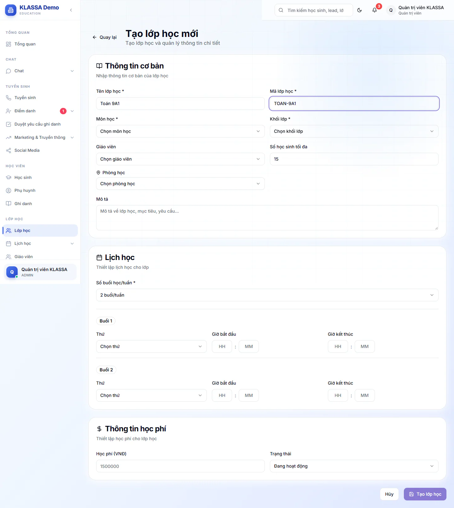
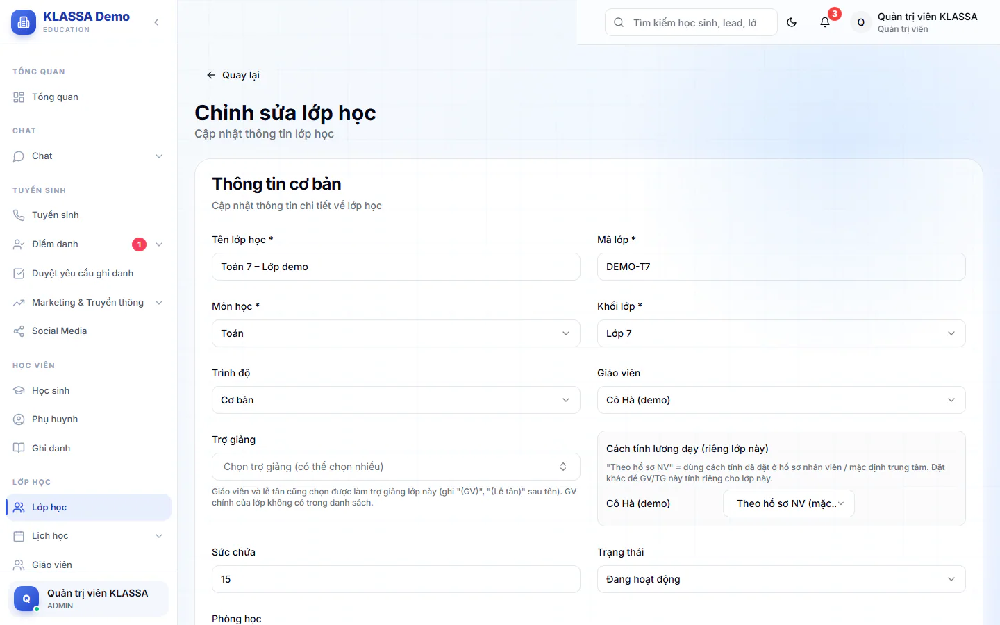
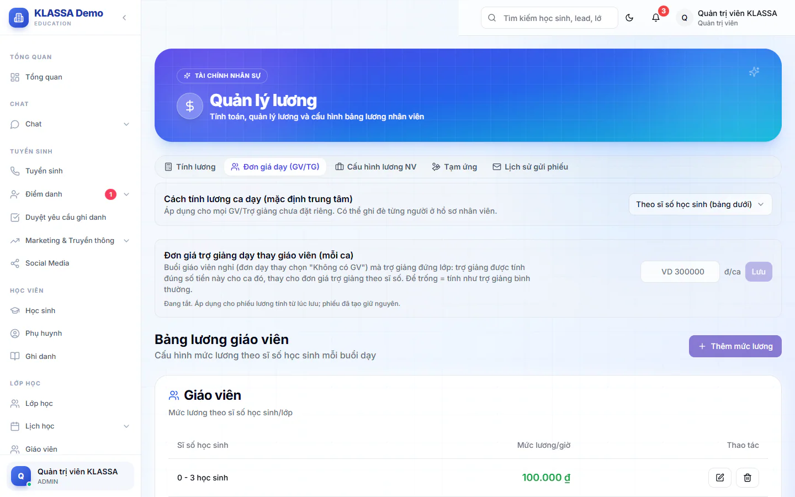

# Bước 7: Tạo lớp, xếp giáo viên, trợ giảng và lịch học

Lớp học là nơi học sinh được xếp vào, điểm danh và tính học phí. Lịch học của lớp quyết định buổi học nào xuất hiện trong thời khoá biểu và trong danh sách điểm danh mỗi ngày. Giáo viên và trợ giảng được xếp vào lớp ở bước này cũng là căn cứ để tính lương cuối tháng, nên cần xếp đúng người và đúng ngày.

## Mục tiêu

- Tạo xong một lớp có lịch học hằng tuần.
- Xếp giáo viên chính và trợ giảng cho lớp, biết ngày nhận lớp ảnh hưởng thế nào đến lương.
- Biết trước kỳ lương đầu tiên cần khai bảng đơn giá dạy ở đâu.

## Cần có trước

- Nên xong [Bước 5: cấu hình học phí](05-cau-hinh-hoc-phi.md). Tạo lớp không cần gói học phí, nhưng đến lúc ghi danh học sinh bạn sẽ chọn gói học phí cho lớp.
- Trung tâm đã có ít nhất một chi nhánh (cơ sở) đang hoạt động và có môn học ([Bước 2](02-thiet-lap-trung-tam.md)). Chưa có chi nhánh thì hệ thống từ chối tạo lớp và báo cần tạo cơ sở trước.
- Giáo viên và trợ giảng đã có tài khoản đang hoạt động, đúng chi nhánh (làm ở [Bước 3](03-tao-tai-khoan-nhan-vien.md)). Nên xong [Bước 4](04-ho-so-nhan-su-va-cach-tinh-luong.md) nếu bạn sẽ tính lương cho họ trên phần mềm. Nếu chưa có thì vẫn tạo được lớp, chọn **Chưa phân công** rồi xếp sau.
- Đăng nhập bằng vai **Quản trị viên**, **Quản lý chi nhánh** hoặc **Quản lý**. Các vai khác chỉ xem lớp, không thấy nút tạo lớp.

## Môn học và phòng học

Mỗi lớp thuộc về một môn học. Môn học và phòng học đã được khai ở [Bước 2](02-thiet-lap-trung-tam.md) (mục **Thêm môn học** và **Thêm phòng học**). Nếu danh sách môn đang trống, hộp chọn môn khi tạo lớp sẽ báo **Chưa có môn học nào**: quay lại Bước 2 để thêm. Phòng học không bắt buộc khi tạo lớp. Quản lý chi nhánh và Quản lý cũng thêm được phòng ở mục **Phòng học**, phòng tự thuộc chi nhánh của họ.

## Tạo lớp mới

::: steps
1. Vào **Lớp học**, bấm **Tạo lớp mới**. Trang **Tạo lớp học mới** mở ra.
   

2. Ở khối **Thông tin cơ bản**, điền:
   - **Tên lớp học** (bắt buộc), ví dụ "Toán 9A1".
   - **Mã lớp học** (bắt buộc), ví dụ "TOAN-9A1". Mã không được trùng với lớp khác.
   - **Môn học** (bắt buộc), chọn từ danh sách.
   - **Khối lớp** (bắt buộc), từ **Lớp Tiền tiểu học** đến **Lớp 12**, hoặc **Không theo khối** nếu lớp ghép nhiều khối.
3. Chọn **Giáo viên** nếu đã biết. Danh sách chỉ hiện tài khoản vai Giáo viên đang hoạt động (người đã nghỉ việc không hiện). Quản lý chi nhánh và Quản lý chỉ thấy giáo viên cùng chi nhánh với mình. Chưa biết thì giữ **Chưa phân công**.
4. Điền **Số học sinh tối đa** (mặc định 15, tối đa 50). Khi lớp đủ số này, không ghi danh thêm được.
5. Chọn **Phòng học** nếu có, hoặc giữ **Chưa phân phòng**.
6. Ở khối **Lịch học**, chọn **Số buổi học/tuần** (từ 1 đến 5, mặc định 2 buổi/tuần). Hệ thống hiện đúng số dòng **Buổi 1**, **Buổi 2**...
7. Với mỗi buổi, chọn **Thứ**, **Giờ bắt đầu** và **Giờ kết thúc**. Giờ hiển thị theo dạng 24 giờ.
8. Bấm **Tạo lớp học**.
:::

Khi lưu xong, thông báo **Tạo lớp học thành công!** hiện lên và bạn được đưa về danh sách lớp.

::: tip Lớp thuộc cơ sở nào
Trang tạo lớp không có ô chọn cơ sở. Lớp do Quản lý chi nhánh hoặc Quản lý tạo sẽ thuộc cơ sở của người tạo. Lớp do Quản trị viên tạo được gắn vào một cơ sở đang hoạt động của trung tâm, nên nếu trung tâm có nhiều cơ sở, hãy để người quản lý của từng cơ sở tạo lớp cho cơ sở mình.
:::

::: warning Lưu ý về lịch học
Phải có ít nhất một buổi điền đủ cả **Thứ**, **Giờ bắt đầu** và **Giờ kết thúc**, nếu không hệ thống báo **Vui lòng thiết lập ít nhất 1 lịch học!**. Dòng buổi nào còn thiếu thông tin sẽ bị bỏ qua, nên hãy kiểm tra kỹ từng dòng. Trang tạo lớp không tự kiểm giờ kết thúc phải sau giờ bắt đầu, bạn tự soát.
:::

::: warning Ba ô chưa có tác dụng khi tạo lớp
Ô **Mô tả** ở khối **Thông tin cơ bản**, cùng ô **Học phí (VNĐ)** và **Trạng thái** ở khối **Thông tin học phí**, hiện chưa được lưu cùng lớp. Lớp mới luôn ở trạng thái **Đang hoạt động**, còn học phí do **gói học phí** chọn lúc ghi danh quyết định. Bạn không cần điền ba ô này.
:::

### Nếu phòng bị trùng giờ

Nếu bạn đã chọn phòng, khi bấm **Tạo lớp học** hệ thống kiểm các lớp khác trong phòng đó. Nếu trùng giờ, một hộp hỏi hiện ra liệt kê lớp trùng và hỏi **Vẫn tiếp tục gán phòng?**. Bấm đồng ý để tạo lớp, hoặc huỷ để quay lại đổi giờ hoặc đổi phòng. Đây chỉ là cảnh báo, hệ thống không chặn.

## Xếp giáo viên, trợ giảng và chỉnh thêm

Trang tạo lớp chỉ chọn được giáo viên chính. Trợ giảng và các chi tiết khác được thêm ở trang sửa lớp.

::: steps
1. Vào **Lớp học**, mở lớp vừa tạo, bấm **Chỉnh sửa**. Quản trị viên và Quản lý chi nhánh cũng có thể bấm nút ba chấm trên lớp rồi chọn **Chỉnh sửa lớp học**.
2. Ở ô **Giáo viên**, chọn người dạy chính. Muốn thay người dạy, chọn giáo viên mới. Đừng dùng lựa chọn **Không phân công** để gỡ giáo viên: lưu xong, giáo viên cũ vẫn còn trong lớp.
3. Khi bạn chọn một giáo viên khác với người đang giữ lớp (hoặc chọn người đầu tiên cho lớp còn trống giáo viên), một ô **Ngày nhận lớp** hiện ra, mặc định là hôm nay. Chọn đúng ngày giáo viên đó bắt đầu dạy.
4. Ở ô **Trợ giảng**, chọn một hoặc nhiều người. Danh sách gồm Trợ giảng, Giáo viên (ghi "(GV)" sau tên) và Lễ tân (ghi "(Lễ tân)" sau tên) để bố trí người kiêm nhiệm. Giáo viên chính của lớp không xuất hiện ở đây.
   

5. Muốn tính lương dạy riêng cho lớp này, dùng khối **Cách tính lương dạy (riêng lớp này)**. Giữ **Theo hồ sơ NV (mặc định)** nếu không cần khác.
6. Ở khối **Lịch học**, bấm **Thêm lịch học** để thêm buổi, hoặc nút thùng rác để bỏ buổi.
7. Bấm **Lưu thay đổi**.
:::

Ở trang này, mọi dòng lịch phải đủ hai mốc giờ (nếu thiếu, hệ thống báo **Vui lòng điền đầy đủ thời gian cho tất cả lịch học**) và giờ bắt đầu phải trước giờ kết thúc (nếu không, hệ thống báo **Giờ bắt đầu phải trước giờ kết thúc**). Số học sinh tối đa ở trang này có tên ô là **Sức chứa** (tối đa 100).

Trạng thái lớp chỉ đổi được ở trang sửa: **Đang hoạt động**, **Tạm dừng** hoặc **Hoàn thành**. Chỉ lớp **Đang hoạt động** mới chọn được khi ghi danh.

### Ngày nhận lớp quyết định tiền lương

Giáo viên và trợ giảng chỉ được tính lương cho những buổi nằm trong thời gian họ được xếp vào lớp. Vì vậy ngày xếp người vào lớp không chỉ là thủ tục.

- **Khi tạo lớp**, trang không có ô ngày bắt đầu, nên giáo viên chính được xếp từ ngày bạn tạo lớp. Nếu lớp chỉ có một giáo viên chính đang giữ và chưa từng bàn giao, các buổi trước ngày xếp vẫn tính cho người đó. Ngày nhận lớp chỉ chia buổi khi có đổi giáo viên.
- **Khi đổi giáo viên giữa tháng**, người cũ dừng đúng vào ngày bạn chọn ở **Ngày nhận lớp**, người mới bắt đầu từ ngày đó. Nếu để trống, hệ thống lấy hôm nay. Nếu hai người bàn giao cùng một ngày, buổi hôm đó thuộc giáo viên mới, không trả trùng cho cả hai.
- **Khi thêm trợ giảng** ở trang sửa lớp, hệ thống luôn lấy ngày hôm nay làm ngày bắt đầu, không có ô để chọn ngày khác. Các buổi trước ngày đó, trợ giảng không có lương trên phiếu. Nếu thực tế họ đã làm, người chốt lương phải sửa tay phiếu (xem [Bước 15](15-chot-luong-cuoi-thang.md)).

::: warning Chỉ buổi đã điểm danh mới có tiền
Buổi học chỉ được tính lương khi đã có người lưu điểm danh cho buổi đó. Giáo viên hoặc trợ giảng cũng phải đang được xếp vào lớp thì mới điểm danh được, nếu không hệ thống báo **Không có quyền điểm danh lớp này**. Buổi không ai điểm danh thì không có tiền, dù lớp vẫn học. Xem [Bước 10: điểm danh buổi đầu](10-diem-danh-buoi-dau.md).
:::

### Trước kỳ lương đầu tiên: khai bảng đơn giá dạy

Chưa khai bảng đơn giá dạy thì buổi dạy không có mức nào khớp, phần mềm bỏ qua buổi đó và phiếu lương giáo viên, trợ giảng sẽ thiếu tiền. Cách khai nằm ở phần C của [Bước 4](04-ho-so-nhan-su-va-cach-tinh-luong.md) (**Quản lý HR → Quản lý lương**, tab **Đơn giá dạy (GV/TG)**). Hãy kiểm lại trước khi lớp đầu tiên học đủ tháng.

### Lớp linh hoạt

Lớp linh hoạt (học bù, học kèm, học theo nhu cầu từng buổi) không tạo ở trang này. Hệ thống tự lập một lớp chung cho mỗi môn trong mỗi cơ sở khi bạn tạo buổi học linh hoạt, xem [Lớp linh hoạt](../lop-hoc/lop-linh-hoat.md).

## Lỗi hay gặp

| Thông báo | Cách xử lý |
|---|---|
| **Vui lòng điền đầy đủ thông tin bắt buộc!** | Còn thiếu tên lớp, mã lớp, môn học hoặc khối lớp. |
| **Vui lòng thiết lập ít nhất 1 lịch học!** | Chưa có buổi nào điền đủ Thứ và hai mốc giờ. |
| **Class code already exists** (mã lớp đã có) | Đổi **Mã lớp học** sang mã khác. |
| **No campus available. Please create a campus first.** (chưa có cơ sở) | Tạo cơ sở trước rồi quay lại. |
| **Gói đã hết hạn. Liên hệ KLASSA để gia hạn.** | Gói của trung tâm đã hết hạn nên không tạo được lớp mới. Liên hệ KLASSA để gia hạn. |
| Báo phòng không thuộc chi nhánh của lớp | Chọn phòng cùng chi nhánh với lớp. |
| Không thấy giáo viên trong ô **Giáo viên** | Kiểm tra tài khoản có vai Giáo viên, đang hoạt động, và (nếu bạn là Quản lý chi nhánh) cùng chi nhánh với bạn. Tài khoản tạo ở Bước 3 mà để ô **Chi nhánh** là **Không gán** sẽ không hiện cho Quản lý chi nhánh. |
| **Không có quyền điểm danh lớp này** (giáo viên báo khi điểm danh) | Giáo viên hoặc trợ giảng chưa được xếp vào lớp, hoặc đã bị gỡ. Xếp lại ở trang sửa lớp. |

## Kiểm tra đã xong

- [ ] Trong **Lớp học** thấy lớp mới ở trạng thái **Đang hoạt động**.
- [ ] Mở chi tiết lớp, lịch học đúng thứ và giờ.
- [ ] Giáo viên chính, và trợ giảng nếu có, đã được xếp đúng ngày.
- [ ] Biết nơi khai bảng đơn giá dạy trước kỳ lương đầu tiên.

## Câu hỏi thường gặp

::: details Có tạo hàng loạt nhiều lớp một lúc được không?
Trang này tạo từng lớp một. Hãy tạo lớp đầu tiên, kiểm tra xong rồi tạo các lớp còn lại tương tự.
:::

::: details Trợ giảng vào lớp sau mà muốn tính lương cả các buổi trước đó thì sao?
Phần mềm chỉ tính từ ngày trợ giảng được thêm vào lớp. Các buổi trước đó cần sửa tay trên phiếu lương khi chốt kỳ.
:::

::: details Tôi không thấy nút Tạo lớp mới?
Chỉ Quản trị viên, Quản lý chi nhánh và Quản lý có nút này. Vai Lễ tân, Giáo viên, Trợ giảng và Kế toán chỉ xem lớp.
:::

::: details Môn học cần có chưa nằm trong danh sách mặc định?
Quản trị viên thêm môn mới bằng nút **Thêm môn học**, xem mục **Thêm môn học** ở [Bước 2](02-thiet-lap-trung-tam.md). Không nên bấm **Thêm mặc định** khi danh sách đã có môn, vì dễ sinh môn trùng.
:::

## Bước tiếp theo

Lớp đã sẵn sàng. Sang [Bước 8: thêm học sinh và phụ huynh](08-them-hoc-sinh-phu-huynh.md). Muốn tìm hiểu sâu hơn về lớp, xem [Tạo lớp](../lop-hoc/tao-moi.md), [Chỉnh sửa lớp](../lop-hoc/chinh-sua.md), [Lịch dạy](../lop-hoc/lich-day.md) và [Giờ dạy](../nhan-su/buoi-day.md).
