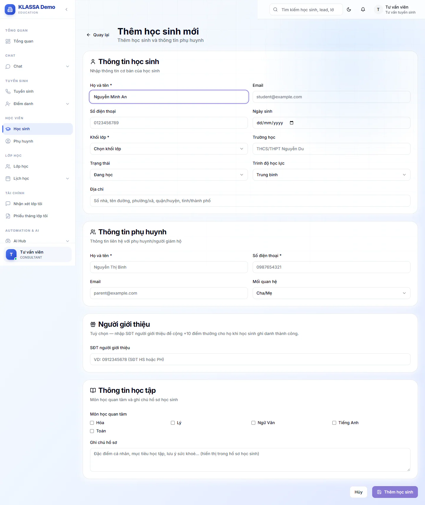
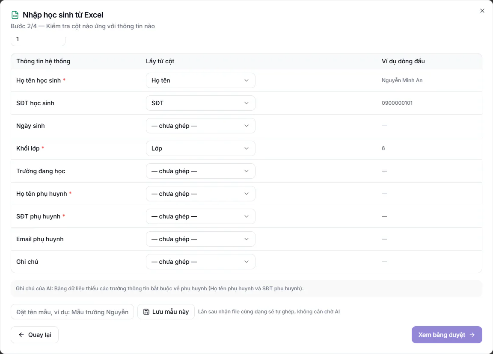

# Bước 8: Thêm học sinh và phụ huynh

Mỗi học sinh cần có hồ sơ và ít nhất một phụ huynh trước khi ghi danh vào lớp. Khi bạn lưu hồ sơ, hệ thống tự tạo luôn tài khoản cho phụ huynh, nên không phải làm thêm thao tác nào cho phần này.

## Mục tiêu

- Tạo được hồ sơ học sinh kèm thông tin phụ huynh.
- Biết hệ thống cảnh báo trùng hồ sơ như thế nào.
- Nhập được nhiều học sinh một lần từ file Excel.
- Biết tài khoản phụ huynh mới phải được duyệt thì phụ huynh mới đăng nhập và nhận thông báo.

## Nếu em đến từ lead

Em đã được tư vấn hoặc học thử ở trang **Tuyển sinh** thì không cần gõ lại hồ sơ. Mở hồ sơ lead và bấm **Chuyển thành học sinh**, xem [Chuyển lead thành học sinh](../tuyen-sinh/chuyen-lead-thanh-hoc-sinh.md) và [Lịch học thử](../tuyen-sinh/lich-hoc-thu.md). Trang **Tuyển sinh** cần gói mở rộng **CRM Tuyển sinh + AI**.

::: warning Lưu ý
**Chuyển thành học sinh** chỉ tạo học sinh và phụ huynh, KHÔNG ghi danh vào lớp. Bạn vẫn phải làm [Bước 9](09-ghi-danh-vao-lop.md) cho em đó.
:::

## Cần có trước

- Đã xong [Bước 7: tạo lớp và lịch học](07-tao-lop-va-lich-hoc.md). Thật ra hồ sơ học sinh tạo trước lớp cũng được, nhưng làm theo thứ tự này sẽ ghi danh liền mạch ở bước sau.
- Đăng nhập bằng vai **Quản trị viên**, **Quản lý chi nhánh**, **Quản lý** hoặc **Lễ tân**. Các vai khác chỉ xem học sinh.
- Đã đặt **Tiền tố mã học viên** ở [Bước 2](02-thiet-lap-trung-tam.md), vì mã học sinh mới bắt đầu bằng tiền tố này và mã đã tạo không đổi theo.
- Có sẵn họ tên học sinh, khối lớp, họ tên và số điện thoại phụ huynh.

## Thêm một học sinh

::: steps
1. Vào **Học sinh**, bấm **Thêm học sinh**. Trang **Thêm học sinh mới** mở ra.
   

2. Ở khối **Thông tin học sinh**, điền:
   - **Họ và tên** (bắt buộc).
   - **Khối lớp** (bắt buộc), từ **Lớp Tiền tiểu học** đến **Lớp 12**.
   - Các ô không bắt buộc: **Email**, **Số điện thoại**, **Ngày sinh**, **Trường học**, **Địa chỉ**, **Trình độ học lực**.
   - Ô **Trạng thái** bạn cứ để mặc định **Đang học**: hồ sơ mới luôn được lưu ở trạng thái **Đang học**, dù chọn **Tạm nghỉ** hay **Đình chỉ**. Cần đổi thì mở hồ sơ, bấm **Chỉnh sửa** sau khi lưu.
3. Ở khối **Thông tin phụ huynh**, điền:
   - **Họ và tên** (bắt buộc).
   - **Số điện thoại** (bắt buộc). Gõ liền 10 số, không dấu cách hay dấu chấm, ví dụ 0912345678.
   - **Email**. Nên nhập email, vì phụ huynh đăng nhập bằng email tài khoản.
   - Ô **Mối quan hệ** (Cha/Mẹ, Người giám hộ, Ông/Bà, Họ hàng, Khác) hiện chưa được lưu vào hồ sơ, bạn không cần chọn.
4. Khối **Thông tin học tập** cho phép tick **Môn học quan tâm** và ghi **Ghi chú hồ sơ**. Không bắt buộc.
5. Để trống khối **Người giới thiệu**. Nếu bạn nhập số mà không khớp học sinh hoặc phụ huynh nào đang học, hệ thống báo **Không tìm thấy học sinh / phụ huynh nào với SĐT này** và không lưu hồ sơ.
6. Bấm **Thêm học sinh**.
:::

Khi xong, thông báo **Thêm học sinh thành công!** hiện lên và bạn được đưa về danh sách **Học sinh**. Hồ sơ mới được cấp mã học sinh tự động.

::: warning Lưu ý
Thiếu một trong bốn ô bắt buộc (họ tên học sinh, khối lớp, họ tên phụ huynh, số điện thoại phụ huynh) thì hệ thống báo **Vui lòng điền đầy đủ thông tin bắt buộc!**.
:::

## Khi hệ thống cảnh báo trùng số điện thoại

Khi bạn nhập số điện thoại học sinh hoặc phụ huynh, hệ thống tự tìm hồ sơ đã có cùng số. Nếu thấy, một khung vàng hiện ra liệt kê mã, tên, trạng thái và lớp đang học của các học sinh đó.

- Nếu đúng là **chính em này** đang đăng ký thêm lớp: đừng tạo hồ sơ mới. Bấm mã học sinh trong khung vàng để mở hồ sơ cũ rồi ghi danh thêm từ đó.
- Nếu là **anh chị em** hoặc em khác: cứ thêm bình thường.

Khi bấm **Thêm học sinh** mà vẫn còn trùng, hộp **Vẫn tạo hồ sơ mới?** hiện ra. Bấm **Quay lại kiểm tra** để xem lại, hoặc **Vẫn tạo hồ sơ mới** nếu chắc chắn đây là em khác.

Nếu trùng hoàn toàn (cùng tên, cùng số điện thoại, cùng phụ huynh) hệ thống chặn và báo **Học sinh đã tồn tại trong hệ thống** kèm mã hồ sơ đã có.

## Phụ huynh được tạo thế nào

- Phụ huynh chưa có trong hệ thống: tự tạo tài khoản mới, mật khẩu mặc định là 12345678. Hãy dặn phụ huynh đổi mật khẩu sau khi đăng nhập lần đầu.
- Phụ huynh đã có (trùng email hoặc số điện thoại): hệ thống gắn học sinh mới vào tài khoản cũ. Vì vậy hai anh chị em dùng chung một tài khoản phụ huynh nếu bạn nhập cùng số điện thoại. Hệ thống cũng dựa vào đó để nhận ra anh chị em và áp ưu đãi anh chị em, với điều kiện đã lưu danh sách ưu đãi ở [Bước 5](05-cau-hinh-hoc-phi.md). Vì tài khoản phụ huynh được nhận ra theo số đúng như bạn gõ, hãy gõ số của phụ huynh giống hệt nhau cho các em.
- Bỏ trống email phụ huynh thì email đăng nhập là địa chỉ dạng số điện thoại kèm tên miền của trung tâm. Phụ huynh không biết địa chỉ này, nên hãy nhập email thật.
- Tài khoản phụ huynh mới ở trạng thái **chờ duyệt**: phụ huynh chưa đăng nhập được và cũng không nhận thông báo trong ứng dụng (phiếu học phí, vắng học, nhận xét, điểm, phiếu tháng). Gửi phiếu qua Zalo hoặc email thì không cần phụ huynh được duyệt. Tài khoản phụ huynh tạo từ lead bằng **Chuyển thành học sinh** cũng ở trạng thái chờ duyệt.
- Quản trị viên duyệt ở **Quản trị hệ thống → Quản lý Đăng ký** (màn hình chỉ Quản trị viên vào được). Nên duyệt khi **Mẫu hoá đơn** ở [Bước 5](05-cau-hinh-hoc-phi.md) và Cổng Phụ huynh đã sẵn sàng (cần gói mở rộng **Cổng Phụ huynh**), xem [Duyệt đăng ký](../cai-dat/duyet-dang-ky-nguoi-dung.md) và [Cài đặt cổng phụ huynh](../cong-phu-huynh/cai-dat-cong.md). Duyệt xong, phụ huynh đăng nhập bằng email và mật khẩu mặc định.

::: steps
1. Vào **Quản trị hệ thống → Quản lý Đăng ký**. Trang mở sẵn ở trạng thái **Chờ duyệt**.
2. Trong **Bộ lọc nâng cao**, ở ô **Vai trò** chọn **Phụ huynh** để chỉ còn phụ huynh.
3. Tích chọn các dòng cần duyệt, bấm **Phê duyệt hàng loạt**.
4. Trong hộp hiện ra, bấm **Phê duyệt**. Lô chỉ có phụ huynh thì không cần chọn **Chi nhánh**.
:::

::: tip Mẹo
Đã nối Zalo ở [Bước 6](06-ket-noi-zalo-ngan-hang-email.md) (gói **Zalo (Cá nhân + OA)** đang bật) thì mỗi lần thêm từng em, hệ thống tự tìm Zalo phụ huynh theo số điện thoại và gửi lời mời kết bạn. Nhập từ Excel thì không có việc này.
:::

::: tip Mẹo
Nếu bạn nhập số điện thoại học sinh, hệ thống còn cấp sẵn tài khoản cho học sinh, cũng ở trạng thái chờ duyệt. Quản trị viên và Quản lý chi nhánh quản lý các tài khoản này ở nút **Tài khoản học sinh** trên trang **Học sinh**. Bạn chưa cần làm gì ở bước này.
:::

## Nhập nhiều học sinh từ Excel

Dùng cách này khi chuyển từ sổ sách cũ sang, thay vì gõ từng em.

::: steps
1. Vào **Học sinh**, bấm **Nhập Excel**. Hộp **Nhập học sinh từ Excel** mở ra.
2. Bấm **Tải file mẫu** để lấy file chuẩn, điền dữ liệu rồi lưu lại. Mỗi lần nhập tối đa 500 dòng, file tối đa 10MB, định dạng .xlsx, .xls hoặc .csv.
3. Bấm **Chọn file** rồi chọn file của bạn, hoặc bấm **Dán bảng** để dán vùng dữ liệu copy từ Excel (dòng đầu là tên cột). Bấm **Tiếp tục**.
4. Ở bước 2/4, kiểm tra cột nào của file ứng với thông tin nào. Tên cột đặt kiểu gì cũng được, hệ thống tự ghép và bạn sửa lại được. Nếu có dòng **Ghi chú của AI**, đọc qua cho biết hệ thống đã ghép theo cách nào. Muốn lần sau nhận file cùng dạng tự ghép luôn, đặt tên mẫu rồi bấm **Lưu mẫu này**. Bấm **Xem bảng duyệt**.
   

5. Ở bước 3/4, xem nhãn của từng dòng: **Hợp lệ**, **Có thể trùng** hoặc **Trùng** (em đã có hồ sơ, hoặc lặp dòng trong file), và **Lỗi**. Bạn sửa được từng ô ngay trong bảng. Chỉ các dòng **Hợp lệ** được chọn sẵn. Dòng trùng vẫn tick chọn được nếu bạn chắc đó là em khác; dòng **Lỗi** thì phải sửa xong mới chọn được.
6. Bấm **Xác nhận nhập N dòng**. Hệ thống chỉ ghi dữ liệu ở bước này.
7. Bước 4/4 báo số **dòng đã tạo** và **dòng bỏ qua**, kèm lý do từng dòng bị bỏ. Bấm **Đóng**, hoặc **Nhập tiếp file khác**.
:::

Các cột bắt buộc là **Họ tên học sinh**, **Khối lớp**, **Họ tên phụ huynh** và **SĐT phụ huynh**. Thiếu cột nào hệ thống báo **Còn thiếu cột bắt buộc** kèm tên cột. Các cột nên có thêm: **SĐT học sinh**, **Ngày sinh** (dạng ngày/tháng/năm), **Trường đang học**, **Email phụ huynh**, **Ghi chú**.

Nhập từ Excel cũng tạo tài khoản phụ huynh giống như thêm từng em. Hướng dẫn chi tiết hơn về hộp nhập dữ liệu có ở [Nhập dữ liệu hàng loạt](../tai-khoan/nhap-du-lieu-hang-loat.md).

::: warning Lỗi hay gặp khi nhập file
- **Khối không hợp lệ**: ghi khối theo dạng "6", "Lớp 6" hoặc "Tiền tiểu học".
- **SĐT phụ huynh không hợp lệ**: số điện thoại cần đủ 10 số và bắt đầu bằng 0.
- **Ngày sinh không hợp lệ**: dùng dạng ngày/tháng/năm, ví dụ 15/03/2014.
:::

## Kiểm tra đã xong

- [ ] Học sinh mới xuất hiện trong danh sách **Học sinh**, trạng thái **Đang học**.
- [ ] Mở hồ sơ học sinh thấy đúng họ tên, khối lớp và thông tin phụ huynh.
- [ ] Không có hồ sơ trùng cho cùng một em.
- [ ] Quản trị viên đã duyệt tài khoản phụ huynh ở **Quản lý Đăng ký**.
- [ ] Nếu nhập từ Excel: số dòng đã tạo khớp số dòng bạn mong đợi, các dòng bỏ qua đã được xử lý.

## Câu hỏi thường gặp

::: details Hệ thống báo đã dùng hết số học sinh của gói thì sao?
Thông báo có dạng "Đã sử dụng .../... học sinh của gói hiện tại". Gói KLASSA của trung tâm đã đạt giới hạn số học sinh, bạn cần liên hệ KLASSA để nâng gói. Nếu gói hết hạn, hệ thống cũng không cho tạo học sinh mới.
:::

::: details Học sinh chưa có phụ huynh thì sao?
Hệ thống bắt buộc có ít nhất một phụ huynh với họ tên và số điện thoại khi tạo hồ sơ.
:::

::: details Nhập nhầm khối lớp thì sửa ở đâu?
Mở hồ sơ học sinh, bấm **Chỉnh sửa** rồi đổi **Khối lớp**. Nên sửa trước khi ghi danh.
:::

## Bước tiếp theo

Học sinh đã có hồ sơ. Sang [Bước 9: ghi danh vào lớp](09-ghi-danh-vao-lop.md). Xem thêm [Thêm học sinh mới](../hoc-sinh/tao-moi.md) và [Phụ huynh](../hoc-sinh/phu-huynh.md).
