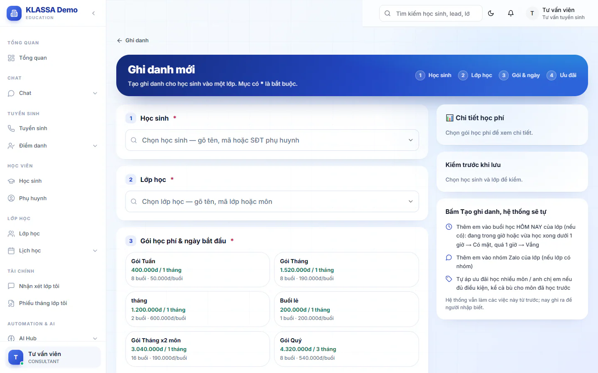
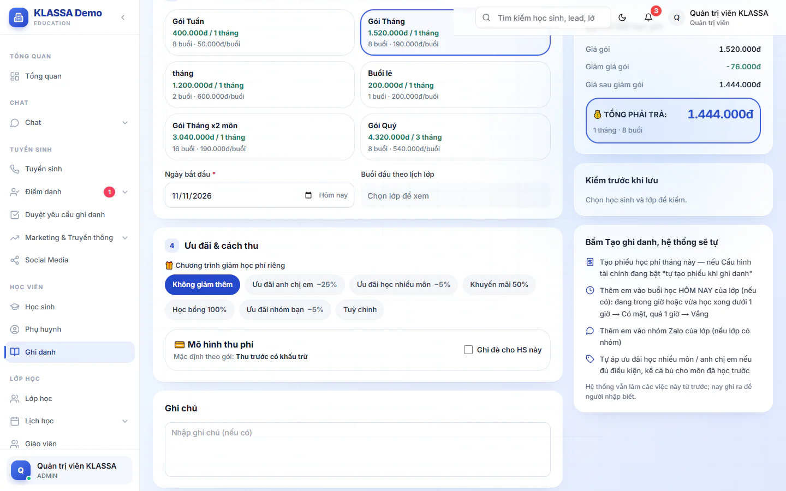
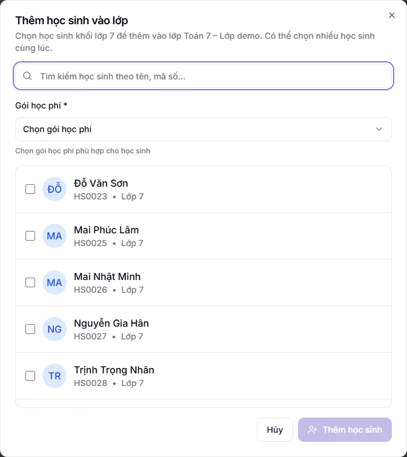

# Bước 9: Ghi danh học sinh vào lớp

Ghi danh là việc gắn một học sinh với một lớp và một gói học phí. Sau khi ghi danh, học sinh có tên trong danh sách điểm danh của lớp và được tính học phí theo gói đã chọn.

## Mục tiêu

- Ghi danh được ít nhất một học sinh vào một lớp.
- Chọn đúng gói học phí và ưu đãi (nếu có).
- Biết hệ thống tự làm gì ngay sau khi ghi danh.

## Cần có trước

- Đã có gói học phí đang hoạt động ([Bước 5](05-cau-hinh-hoc-phi.md)). Không có gói thì không chọn được và không ghi danh được.
- Đã có lớp ở trạng thái **Đang hoạt động** còn chỗ trống ([Bước 7](07-tao-lop-va-lich-hoc.md)).
- Học sinh đã có hồ sơ và đang ở trạng thái **Đang học** ([Bước 8](08-them-hoc-sinh-phu-huynh.md)).
- Đăng nhập bằng vai **Quản trị viên**, **Quản lý chi nhánh**, **Quản lý** hoặc **Lễ tân**.

Có hai đường ghi danh, tuỳ vai của bạn:

| Vai | Đường ghi danh |
|---|---|
| Quản trị viên, Quản lý chi nhánh, Quản lý | **Học viên → Ghi danh → Ghi danh mới** (xem "Ghi danh một học sinh" ngay dưới), hoặc đường qua trang lớp |
| Lễ tân | Đường qua trang lớp: **Lớp học** → mở lớp → **Thêm học sinh** (xem "Ghi danh từ trang lớp") |

::: warning Lễ tân không có mục Ghi danh
Mục **Ghi danh** trên menu không hiện với Lễ tân. Nếu bạn là Lễ tân, đi thẳng tới phần "Ghi danh từ trang lớp".
:::

## Ghi danh một học sinh

Cách này dành cho Quản trị viên, Quản lý chi nhánh và Quản lý.

::: steps
1. Vào **Học viên → Ghi danh**, bấm **Ghi danh mới**. Trang **Ghi danh mới** mở ra, các mục có dấu * là bắt buộc. Phía trên có bốn chặng: **Học sinh**, **Lớp học**, **Gói & ngày**, **Ưu đãi**, chặng nào xong sẽ được đánh dấu.
   

2. Ở mục **Học sinh**, bấm vào ô **Chọn học sinh**, gõ tên, mã học sinh hoặc số điện thoại phụ huynh vào ô tìm hiện ra rồi bấm chọn. Danh sách chỉ có học sinh đang học.
3. Ở mục **Lớp học**, bấm vào ô **Chọn lớp học**, gõ tên lớp, mã lớp hoặc môn rồi chọn. Danh sách chia thành **LỚP CỐ ĐỊNH** và **LỚP LINH HOẠT**, và chỉ có lớp đang hoạt động. Lớp mà em đã học, hoặc đã đủ sĩ số, bị làm mờ kèm chú thích **Em đang học lớp này** hoặc **Đã đủ** số chỗ, nên không chọn được.
4. Ở mục **Gói học phí & ngày bắt đầu**, bấm chọn một thẻ gói. Nếu chưa thấy thẻ nào, trung tâm chưa có gói đang dùng: quay lại [Bước 5](05-cau-hinh-hoc-phi.md) để tạo gói.
5. Chọn **Ngày bắt đầu** (mặc định là hôm nay). Ô bên cạnh **Buổi đầu theo lịch lớp** cho biết buổi học đầu tiên kể từ ngày đó.
6. Ở mục **Ưu đãi & cách thu**, chọn chương trình giảm giá nếu có (xem phần dưới). Không có thì để **Không giảm thêm**.
   

7. Ô **Ghi chú** dùng để ghi lý do hoặc lưu ý riêng, không bắt buộc.
8. Nhìn khung bên phải: **Chi tiết học phí** tính sẵn giá gốc, phần giảm và tổng cộng. **Kiểm trước khi lưu** báo ba điều: học sinh đang học, em chưa học lớp này, lớp còn chỗ. Khi bạn chưa chọn học sinh và lớp, khung chỉ ghi **Chọn học sinh và lớp để kiểm.**
9. Bấm **Tạo ghi danh**.
:::

Khi xong, hộp **Ghi danh thành công!** hiện ra. Bạn chọn **Về danh sách**, **Ghi danh tiếp** (làm tiếp học sinh khác) hoặc **Xem ghi danh**.

Ba mục **Học sinh**, **Lớp học** và **Gói học phí & ngày bắt đầu** là bắt buộc. Thiếu một trong số đó, hệ thống báo **Vui lòng điền đầy đủ thông tin bắt buộc**.

## Ghi danh từ trang lớp

Đây là đường dành cho Lễ tân, và Quản trị viên, Quản lý chi nhánh, Quản lý cũng dùng được. Hợp khi bạn đang xem một lớp và muốn xếp nhiều em vào cùng lúc.

::: steps
1. Vào **Lớp học** và bấm vào lớp cần xếp em vào. Trang chi tiết lớp mở ra.
2. Bấm **Thêm học sinh**. Hộp **Thêm học sinh vào lớp** hiện ra.
3. Gõ tên hoặc mã số vào ô **Tìm kiếm học sinh theo tên, mã số...** để lọc danh sách học sinh.
   

4. Chọn **Gói học phí** (ô bắt buộc, có dấu *), nằm ngay dưới ô tìm kiếm. Gói này áp cho mọi em bạn chọn trong lần này.
5. Tick vào một hoặc nhiều học sinh trong danh sách. Phía trên danh sách hiện số em đã chọn.
6. Bấm nút **Thêm N học sinh** ở cuối hộp (N là số em đã tick). Nút chỉ bấm được khi bạn đã chọn gói và tick ít nhất một em.
:::

Hệ thống báo **Đã thêm N học sinh vào lớp**, và danh sách học sinh của lớp được tải lại.

Ở cách này có ba điểm khác với trang **Ghi danh mới**:

- Không có ô chọn **Ngày bắt đầu**, ưu đãi hay cách thu. Ưu đãi anh chị em và học nhiều môn chỉ được áp tự động khi trung tâm đã lưu danh sách ưu đãi (xem phần dưới). Muốn chọn ưu đãi khác cho một em, mở lượt ghi danh của em đó để chỉnh sau (Quản trị viên, Quản lý chi nhánh, Quản lý).
- Hộp chỉ liệt kê học sinh đang học cùng khối với lớp. Quản trị viên có thể cho phép thêm học sinh khác khối: vào **Cài đặt → Tổng quan**, tab **Cấu hình**, mục **Môn học**, gạt công tắc **Cho phép thêm học sinh khác khối vào lớp** rồi bấm **Lưu chính sách ghi danh**. Khi công tắc bật, hộp có thêm ô tick hiện học sinh tất cả các khối.
- Hệ thống không thêm em vào buổi học hôm nay và không thêm vào nhóm Zalo của lớp. Em vẫn có tên trong danh sách điểm danh những buổi sau.

::: warning Chọn đúng gói đang dùng
Ô **Gói học phí** ở hộp này liệt kê cả gói bạn đã tắt ở [Bước 5](05-cau-hinh-hoc-phi.md), kể cả các gói mẫu có sẵn. Hãy chỉ chọn gói trung tâm đang dùng. Chọn nhầm gói tắt hoặc gói mẫu thì phiếu học phí của em sẽ sai tiền.
:::

## Chọn ưu đãi khi ghi danh

Mục **Chương trình giảm học phí riêng** hiện các lựa chọn dạng nút bấm, mỗi nút kèm mức giảm. Danh sách này theo cấu hình của trung tâm, quản lý ở **Tài chính → Kế toán → Quản lý khuyến mãi** (xem [Quản lý khuyến mãi](../ke-toan/khuyen-mai.md)). Khi trung tâm chưa lưu danh sách riêng, bạn thấy bộ có sẵn:

- **Không giảm thêm**.
- **Ưu đãi anh chị em**: giảm 25%, từ con thứ hai trở đi.
- **Ưu đãi học nhiều môn**: giảm 5% mỗi môn khi học từ hai môn trở lên.
- **Khuyến mãi 50%** và **Học bổng 100%**.
- **Ưu đãi nhóm bạn**: giảm 5% cho nhóm bạn đăng ký cùng.
- **Tuỳ chỉnh**: tự nhập mức giảm.

Khi chọn **Tuỳ chỉnh**, bạn chọn **Loại giảm giá** là **Phần trăm (%)** hoặc **Số tiền (VNĐ)**, nhập **Giá trị giảm**, và điền **Diễn giải giảm giá (sẽ hiện trên hoá đơn)** để phụ huynh hiểu vì sao được giảm.

### Khi nào hệ thống tự gợi ý và tự áp ưu đãi

Khi chọn chương trình có điều kiện (anh chị em, học nhiều môn), hệ thống kiểm tra ngay và báo học sinh có đủ điều kiện hay không. Nếu chưa đủ, đó chỉ là thông báo, bạn vẫn tạo ghi danh được.

Phần gợi ý và tự áp chỉ chạy khi **trung tâm đã lưu danh sách chương trình ưu đãi** ở **Tài chính → Kế toán → Quản lý khuyến mãi**, nút **Cấu hình chương trình giảm giá**, rồi **Lưu tất cả** (làm ở [Bước 5](05-cau-hinh-hoc-phi.md)). Trung tâm chưa lưu thì:

- Bộ ưu đãi có sẵn ở trên chỉ để bạn **chọn tay**. Hệ thống không gợi ý và không tự áp.
- Em có anh chị em hoặc học hai môn vẫn ra phiếu giá gốc nếu bạn quên chọn.

Khi đã lưu, hệ thống làm theo các luật sau:

- Chỉ áp **một** ưu đãi cao nhất cho mỗi ghi danh, không cộng dồn. Em đã hưởng mức bằng hoặc cao hơn mức **Ưu đãi anh chị em** (hoặc đang giảm theo số tiền) thì không áp thêm.
- Học nhiều môn: tính từ hai môn trở lên. Hai lớp cùng một môn chỉ tính là một môn, và lớp linh hoạt không tính là môn.
- Anh chị em: hệ thống nhận ra qua phụ huynh (cùng tài khoản phụ huynh hoặc cùng số điện thoại phụ huynh), nên khi thêm học sinh ở [Bước 8](08-them-hoc-sinh-phu-huynh.md) hãy nhập đúng số điện thoại phụ huynh cho các em. Nhà có n con đang học thì có n-1 suất ưu đãi. Em chỉ còn thẻ lớp linh hoạt không tính là con đang học.
- Chương trình đang ở trạng thái **Đã tắt (ẩn khỏi form chọn)** hoặc mức giảm bằng 0 thì không được gợi ý.

Nếu học sinh đủ điều kiện mà bạn chưa chọn, trên trang **Ghi danh mới** một khung xanh gợi ý hiện ra, bấm vào để chọn.

### Cách thu riêng cho một học sinh

Khối **Mô hình thu phí** cho biết cách thu mặc định theo gói. Tick **Ghi đè cho HS này** nếu học sinh này cần cách thu khác (thu trước có khấu trừ, thu trước trọn gói hoặc thu sau theo buổi thực). Không tick thì học sinh theo đúng gói.

## Sau khi ghi danh, hệ thống tự làm gì

Khung **Bấm Tạo ghi danh, hệ thống sẽ tự** ở bên phải trang **Ghi danh mới** liệt kê:

- Tạo phiếu học phí tháng này (dòng này chỉ hiện với Quản trị viên, Quản lý chi nhánh, Quản lý và Kế toán), nếu công tắc **Tự động tạo hoá đơn mỗi khi ghi danh học sinh vào lớp** trong **Cấu hình tài chính** đang bật (mặc định bật, xem [Bước 5](05-cau-hinh-hoc-phi.md)). Nếu đang tắt, phiếu sẽ có khi bạn xuất phiếu tháng ([Bước 13](13-xuat-phieu-hoc-phi.md)).
- Thêm học sinh vào buổi học hôm nay của lớp, nếu buổi đó đã có trong hệ thống. Buổi học chỉ xuất hiện khi có người mở điểm danh cho lớp, nên em ghi danh sớm trong ngày thường chưa được thêm. Đang trong giờ hoặc vừa học xong dưới 1 giờ thì ghi **Có mặt**, quá 1 giờ thì ghi **Vắng**. Ghi danh trước giờ học thì chưa ghi gì, giáo viên tự chọn khi điểm danh.
- Thêm học sinh vào nhóm Zalo của lớp, nếu lớp có nhóm.
- Tự áp ưu đãi anh chị em hoặc học nhiều môn nếu đủ điều kiện, và chỉ khi trung tâm đã lưu danh sách ưu đãi (xem phần trên).

Hộp **Ghi danh thành công!** nhắc lại những việc đã làm, ví dụ phiếu đã tạo hay chưa. Dòng nói về phiếu học phí chỉ hiện với Quản trị viên, Quản lý chi nhánh, Quản lý và Kế toán.

Ghi danh từ trang lớp chỉ tạo phiếu (nếu công tắc bật) và tự áp ưu đãi (nếu đủ điều kiện). Khi có ưu đãi được tự áp, bạn thấy thêm thông báo **Đã tự động áp ưu đãi** kèm mức giảm.

::: warning Giáo viên và Trợ giảng
Khi Giáo viên hoặc Trợ giảng thêm học sinh vào lớp, hệ thống chỉ tạo yêu cầu chờ duyệt (thông báo **Yêu cầu đã được gửi**). Người có quyền duyệt xử lý ở **Duyệt yêu cầu ghi danh** trong menu, xem [Duyệt yêu cầu ghi danh](../hoc-sinh/duyet-yeu-cau-ghi-danh.md).
:::

## Lỗi hay gặp

Các thông báo có chữ in đậm đầy đủ hiện ở trang **Ghi danh mới**. Hộp **Thêm học sinh vào lớp** chỉ báo chung một câu, ở dòng cuối.

| Thông báo | Cách xử lý |
|---|---|
| **Lớp đã đủ sĩ số. Chọn lớp khác hoặc tăng sĩ số ở trang lớp.** | Tăng ô **Sức chứa** ở trang sửa lớp, hoặc chọn lớp khác. |
| **Học sinh đã có trong lớp này rồi.** | Em đã được ghi danh. Mở danh sách học sinh của lớp (hoặc **Học viên → Ghi danh** nếu vai bạn có mục này) để xem lại. |
| **Gói học phí không còn dùng. Chọn gói khác.** | Gói đã bị tắt. Chọn gói đang hoạt động. |
| Báo học sinh đã nghỉ học | Đổi trạng thái học sinh về **Đang học** trước khi ghi danh. |
| **Không tìm thấy lớp (hoặc lớp thuộc cơ sở khác).** | Chọn lớp thuộc cơ sở của bạn. |
| **Không thể thêm một số học sinh** (ở hộp **Thêm học sinh vào lớp**) | Hộp không nói rõ lý do. Nguyên nhân thường gặp: lớp đã đủ sĩ số, em đã có trong lớp, em đã nghỉ học, hoặc em khác khối khi công tắc cho phép khác khối đang tắt. Hộp vẫn mở nên bạn kiểm lại từng điều, rồi mở danh sách học sinh của lớp xem em nào đã vào. |

## Kiểm tra đã xong

- [ ] Quản trị viên, Quản lý chi nhánh, Quản lý: vào **Học viên → Ghi danh** thấy ghi danh mới trong danh sách. Lễ tân: mở lớp ở **Lớp học** và thấy em có tên trong danh sách học sinh.
- [ ] Mở lớp, học sinh có tên trong danh sách học sinh của lớp.
- [ ] Gói học phí và mức giảm hiển thị đúng ở **Xem ghi danh** (Quản trị viên, Quản lý chi nhánh, Quản lý). Lễ tân kiểm mức giảm với người có quyền này.
- [ ] Nếu bật tự tạo phiếu: học sinh đã có phiếu học phí tháng này.
- [ ] Em có anh chị em hoặc học từ hai môn: mức giảm đúng như trung tâm định (nhớ rằng chưa lưu danh sách ưu đãi thì hệ thống không tự áp).

## Câu hỏi thường gặp

::: details Ghi danh khác gì với Thêm học sinh ở Bước 8?
Thêm học sinh chỉ tạo hồ sơ. Ghi danh mới xếp học sinh vào một lớp cụ thể kèm gói học phí. Học sinh chưa ghi danh thì chưa có trong điểm danh và chưa tính học phí.
:::

::: details Học sinh học hai lớp thì làm thế nào?
Ghi danh hai lần, mỗi lần một lớp. Nếu hai lớp khác môn và trung tâm đã lưu danh sách ưu đãi, hệ thống tự kiểm điều kiện ưu đãi học nhiều môn.
:::

::: details Ghi danh nhầm lớp thì sửa ra sao?
Trang **Chỉnh sửa** ghi danh không đổi được lớp, chỉ đổi được trạng thái, gói học phí, ngày, ưu đãi và ghi chú. Nếu em cần sang lớp khác, Quản trị viên hoặc Quản lý chi nhánh mở hồ sơ học sinh, bấm **Hành động → Chuyển lớp học**. Phiếu học phí đổi thế nào khi chuyển giữa tháng xem ở [Bước 11](11-thay-doi-trong-thang.md). Chuyển cả lớp lên khối mới thì xem [Lên lớp và chuyển lớp](../lop-hoc/len-lop-chuyen-lop.md).
:::

::: details Ghi danh giữa tháng có thu tròn gói không?
Mặc định thu tròn gói. Nếu muốn phiếu đầu chỉ tính số buổi còn lại, bật **Ghi danh giữa tháng: chỉ tính số buổi còn lại** trong **Cấu hình tài chính**.
:::

## Bước tiếp theo

Học sinh đã vào lớp. Sang [Bước 10: điểm danh buổi đầu](10-diem-danh-buoi-dau.md). Xem thêm [Ghi danh](../hoc-sinh/ghi-danh.md) và [Chi tiết lớp](../lop-hoc/chi-tiet.md).
