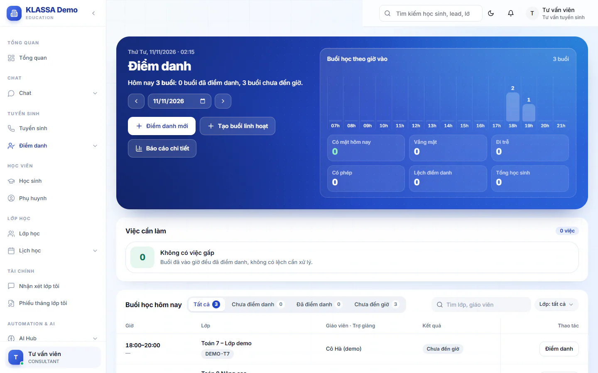
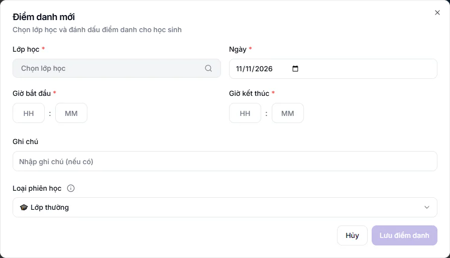

# Bước 10: Điểm danh buổi học đầu tiên

Điểm danh là dữ liệu gốc của cả hệ thống. Cuối tháng, số buổi học sinh đã đi học quyết định phiếu học phí tháng sau có phải hoàn tiền buổi vắng hay không, và việc lưu điểm danh còn quyết định buổi dạy đó có được tính lương cho giáo viên, trợ giảng hay không. Vì vậy hãy làm bước này kỹ ngay từ buổi đầu.

## Mục tiêu

Sau bước này, bạn đã điểm danh xong một buổi học thật, biết cách xem lại kết quả và biết cách xử lý khi giáo viên và lễ tân chấm khác nhau.

## Cần có trước

- Lớp đã được tạo và có lịch học (xem [Bước 7](07-tao-lop-va-lich-hoc.md)).
- Học sinh đã được ghi danh vào lớp (xem [Bước 9](09-ghi-danh-vao-lop.md)). Lớp chưa có học sinh nào thì hộp điểm danh báo **Không có học sinh nào trong lớp này**.
- Bạn đăng nhập bằng vai có quyền điểm danh: Giáo viên, Trợ giảng, Lễ tân, Quản lý, Quản lý chi nhánh hoặc Quản trị viên. Giáo viên và Trợ giảng chỉ điểm danh được lớp mình phụ trách.

## Nguyên tắc cần nhớ trước khi bấm

::: warning Mặc định là Vắng
Khi mở hộp điểm danh, cả lớp được điền sẵn **Vắng**. Bạn chỉ cần bấm **Có mặt** cho em đi học. Nếu bấm **Lưu điểm danh** mà chưa chấm ai, cả lớp được ghi vắng. Phiếu học phí tháng sau sẽ hoàn tiền các buổi này cho phụ huynh.
:::

Bốn trạng thái và cách hệ thống tính tiền:

| Nút | Tính là đã học? | Ảnh hưởng đến học phí |
| --- | --- | --- |
| **Có mặt** | Có | Không hoàn buổi nào |
| **Trễ** | Có | Vẫn tính như đi học |
| **Vắng** | Không | Hoàn buổi này vào phiếu tháng sau |
| **Phép** | Không | Hoàn buổi này vào phiếu tháng sau, giống Vắng |

::: warning Điểm danh quyết định cả lương giáo viên và trợ giảng
- Buổi chỉ được tính lương khi có người **lưu điểm danh**: lúc đó buổi mới chuyển sang trạng thái đã hoàn thành. Quên điểm danh thì buổi đó có thể không có để tính lương, quản lý phải thêm lại hoặc sửa tay ở cuối tháng (xem [Giờ dạy](../nhan-su/buoi-day.md)).
- Giáo viên và trợ giảng chỉ điểm danh được lớp mà họ đang được phân công. Chưa được xếp vào lớp thì hệ thống từ chối. Trợ giảng chỉ được tính lương các buổi nằm trong thời gian được gán lớp, nên người xếp lớp cần chọn đúng ngày (xem [Bước 7](07-tao-lop-va-lich-hoc.md)).
- Nếu lương dạy của trung tâm tính theo sĩ số, chỉ em bấm **Có mặt** được đếm vào sĩ số. Em **Trễ** vẫn được tính là đã học về học phí, nhưng không được đếm khi chọn mức lương theo sĩ số. Lớp đang sát ranh giới giữa hai mức có thể ra mức thấp hơn bạn tưởng.
- Khai mức lương theo sĩ số ở [Bước 4](04-ho-so-nhan-su-va-cach-tinh-luong.md). Chốt lương cuối tháng ở [Bước 15](15-chot-luong-cuoi-thang.md).
:::

::: tip Vắng, Phép, đơn xin nghỉ và học bù: tiền thay đổi thế nào
- Duyệt **Đơn xin nghỉ** chỉ đổi nhãn **Vắng** thành **Vắng có phép**, không đổi tiền. Phụ huynh không cần có đơn thì buổi vắng mới được hoàn. Xem [Đơn xin nghỉ](../diem-danh/don-xin-nghi.md).
- Buổi **Học bù** được tính là đã đi học. Em vắng một buổi rồi học bù trong cùng kỳ thì đủ buổi, phiếu sau không hoàn buổi vắng đó. Xem [Điểm danh bù](../diem-danh/diem-danh-bu.md).
- Với [lớp linh hoạt](../lop-hoc/lop-linh-hoat.md), buổi bù mặc định tính tiền riêng và buổi vắng ở lớp chính vẫn được hoàn. Muốn coi buổi bù là đã đi, Quản trị viên bật công tắc **Buổi bù lớp linh hoạt tính là "đã đi"** ở **Tài chính → Kế toán → Cấu hình tài chính** (mặc định tắt, xem [Cấu hình tài chính](../hoc-phi/cai-dat.md)).
:::

## Mở trang Điểm danh

::: steps
1. Vào **Điểm danh → Điểm danh cơ bản**. Trang **Điểm danh** hiện ra, mặc định là ngày hôm nay.
2. Muốn xem ngày khác, bấm mũi tên ngày trước, ngày sau hoặc chọn ngày ở ô ngày. Bấm **Hôm nay** để quay về hôm nay.
3. Nhìn bảng **Buổi học hôm nay**. Mỗi dòng là một buổi theo thời khoá biểu, gồm các cột **Giờ**, **Lớp**, **Giáo viên · Trợ giảng**, **Kết quả**, **Thao tác**.

   

4. Dùng các ô lọc phía trên bảng khi danh sách dài: **Tất cả**, **Chưa điểm danh**, **Đã điểm danh**, **Chưa đến giờ**. Có ô **Tìm lớp, giáo viên** và ô lọc theo lớp.
:::

Cột **Kết quả** của buổi chưa chấm hiện nhãn **Chưa điểm danh** (hoặc **Chưa đến giờ** nếu chưa tới giờ học). Buổi đã chấm hiện số em ở từng trạng thái, ví dụ **Có mặt 8**, **Vắng 2**.

## Điểm danh một buổi theo lịch

::: steps
1. Ở dòng của lớp cần điểm danh, bấm **Điểm danh**. Hộp **Điểm danh mới** hiện ra, đã chọn sẵn đúng lớp, ngày và giờ.
2. Kiểm tra bốn ô có dấu sao đỏ: **Lớp học**, **Ngày**, **Giờ bắt đầu**, **Giờ kết thúc**. Giờ được điền theo thời khoá biểu của đúng thứ trong tuần. Sửa lại nếu hôm nay lớp học lệch giờ.
3. Để nguyên ô **Loại phiên học** là **Lớp thường** nếu đây là buổi học bình thường.
4. Nhìn mục **Danh sách học sinh**. Phía trên có hai bộ đếm **Có mặt** và **Vắng** cho biết bạn đã chấm bao nhiêu em.
5. Với từng học sinh, bấm một trong bốn nút **Có mặt**, **Vắng**, **Trễ**, **Phép**. Nếu cả lớp gần như đi đủ, bấm **Tất cả có mặt** trước, rồi đổi riêng những em vắng.
6. Tìm nhanh một em bằng ô **Tìm kiếm tên học sinh...**.
7. Có thể ghi chú chung cho buổi ở ô **Ghi chú**.
8. Bấm **Lưu điểm danh**. Thông báo **Điểm danh thành công!** hiện lên và hộp đóng lại.
:::

::: tip Mẹo
- **Sao chép từ buổi trước** điền trạng thái của các em giống buổi gần nhất của lớp. Hữu ích với lớp ít thay đổi. Bạn vẫn phải soát lại rồi bấm **Lưu điểm danh**.
- Nút **Trễ** và **Phép** có thể bị ẩn nếu Quản trị viên tắt hai công tắc **Hiện lựa chọn “Trễ” khi điểm danh** và **Hiện lựa chọn “Có phép” khi điểm danh** ở **Cài đặt → Tổng quan**, thẻ **Cấu hình**, mục **Điểm danh** (mặc định bật, chỉ áp dụng trên web). Khi đó chỉ còn **Có mặt** và **Vắng**.
- Chấm dở dang mà đóng trình duyệt, nếu quay lại trong vòng 1 giờ thì trình duyệt hỏi **Phát hiện bản nháp chưa lưu**. Đồng ý để làm tiếp phần đã chấm.
:::

### Nếu muốn đóng hộp giữa chừng

Bấm **Hủy** hoặc dấu X khi đã chấm mà chưa lưu, hộp **Có thay đổi chưa lưu** hiện ra. Chọn **Quay lại chỉnh sửa** để làm tiếp hoặc **Đóng không lưu** để bỏ.

## Điểm danh buổi phát sinh ngoài lịch

Buổi học bù, buổi bổ trợ hay buổi học online không nằm trong thời khoá biểu thì làm như sau.

::: steps
1. Ở đầu trang **Điểm danh**, bấm **Điểm danh mới**.

   

2. Bấm ô **Lớp học**, gõ tên hoặc mã lớp vào ô **Tìm kiếm lớp học...** rồi chọn lớp.
3. Chọn **Ngày** và nhập **Giờ bắt đầu**, **Giờ kết thúc**.
4. Mở ô **Loại phiên học** và chọn đúng loại: **Lớp thường**, **Học bù**, **Bổ trợ/Tăng cường**, **Bổ trợ miễn phí** hoặc **Học online**. Bấm biểu tượng chữ i cạnh nhãn để xem giải thích từng loại.
5. Nếu chọn **Học bù**, ô **Buổi học gốc (bị vắng)** hiện ra và bắt buộc phải chọn. Danh sách lấy các buổi của lớp trong 60 ngày gần đây.
6. Chấm từng em rồi bấm **Lưu điểm danh**.
:::

::: warning Lưu ý
Loại phiên học ảnh hưởng đến tiền. **Học online** chỉ giảm 50% học phí, không giảm lương giáo viên: nếu trung tâm muốn trả lương buổi online thấp hơn thì phải sửa tay phiếu lương. **Bổ trợ miễn phí** miễn phí cho học sinh. **Học bù** tính học phí như buổi chính và được tính là đã đi học. Chọn sai loại sẽ làm sai phiếu cuối tháng.
:::

## Thêm học sinh ngoài lớp vào buổi

Khi có em học hỗ trợ từ lớp khác cùng khối, trong hộp điểm danh bấm **Thêm học sinh ngoài**, tìm em trong ô **Tìm học sinh cùng khối...** rồi bấm **Thêm**. Hộp **Xác nhận thêm học sinh ngoài** hỏi hình thức học phí: **Tính theo lớp chính** hoặc **Miễn phí buổi này**. Chọn xong bấm **Xác nhận thêm**. Phụ thu (nếu tính) cộng vào phiếu lớp chính của em ở kỳ tới.

## Giáo viên chấm, lễ tân đối chiếu

Trung tâm có thể chấm điểm danh hai lần cho cùng một buổi: giáo viên (hoặc trợ giảng) chấm trong lớp, lễ tân chấm đối chiếu sau đó. Hệ thống ghép hai lần chấm vào cùng một buổi, không tạo buổi thứ hai.

::: steps
1. Giáo viên chấm và lưu như phần trên.
2. Lễ tân mở trang **Điểm danh**. Ở khung **Việc cần làm** có dòng **Lễ tân chưa chấm đối chiếu**, bấm **Chấm đối chiếu** để mở đúng buổi.
3. Trong hộp, dòng bên dưới tên mỗi em cho thấy bên kia đã chấm gì, ví dụ **Giáo viên: Có mặt**. Banner trên đầu ghi **Điểm danh của bạn sẽ được đối chiếu với Giáo viên/Trợ giảng**.
4. Lễ tân chấm theo thực tế rồi bấm **Lưu điểm danh**.
5. Hai bên khớp nhau thì buổi được chốt tự động. Nếu có em bị lệch, hộp **Phát hiện xung đột điểm danh** hiện ra.
:::

Trong hộp xung đột:

- Giáo viên, Trợ giảng, Quản lý, Quản lý chi nhánh và Quản trị viên chọn **Sửa theo** (bên đã chấm trước) hoặc **Giữ nguyên** (theo chấm của bạn). Nếu giữ nguyên, quản lý sẽ xem xét sau.
- Lễ tân không tự chốt được. Hộp ghi **Đã ghi nhận lệch. Quản lý sẽ xem và chốt trạng thái đúng cho em này.**

Buổi còn em bị lệch hiện nhãn **Lệch** ở cột **Kết quả**, và khung **Việc cần làm** có dòng **Lệch điểm danh cần xử lý**. Xem thêm [Đối chiếu điểm danh](../diem-danh/doi-chieu.md).

## Xem lại và sửa điểm danh đã lưu

::: steps
1. Ở dòng của buổi đã chấm, bấm **Chi tiết**. Hộp **Chi tiết điểm danh** hiện danh sách từng em.
2. Bấm biểu tượng bút ở dòng của em cần sửa. Hộp **Sửa điểm danh** hiện ra.
3. Chọn **Trạng thái** mới (ô bắt buộc, danh sách ghi **Có mặt**, **Vắng mặt**, **Đi trễ**, **Có phép**), nhập **Lý do chỉnh sửa** (ô bắt buộc) và **Ghi chú** nếu cần.
4. Bấm **Lưu thay đổi**.
:::

Bấm biểu tượng xem lịch sử ở dòng của em để biết ai đã sửa gì và vì sao. Chi tiết xem [Sửa lỗi điểm danh](../diem-danh/sua-loi.md).

::: warning Khoá điểm danh
Nếu Quản trị viên bật **Khoá điểm danh ngược** ở **Cài đặt → Tổng quan**, thẻ **Cấu hình**, mục **Điểm danh**, buổi quá hạn không điểm danh hay sửa được nữa. Hộp **Không điểm danh ngược được** hiện ra, bấm **Đã hiểu** và báo Quản trị viên hoặc Quản lý chi nhánh. Hai vai này vẫn sửa được. Tính năng này mặc định tắt. Xem [Khoá điểm danh](../diem-danh/khoa-diem-danh.md).
:::

## Viết nhận xét cho buổi học

Nhận xét giúp phụ huynh biết con học thế nào. Nên viết ngay sau buổi học. Ở trang chủ của Quản trị viên và Quản lý chi nhánh, mục **Giáo viên còn thiếu nhận xét** cho biết bao nhiêu buổi hôm qua chưa có nhận xét.

::: steps
1. Ở dòng của buổi đã điểm danh, bấm **Nhận xét**. Hộp **Nhận xét buổi học** hiện ra.
2. Chọn từng học sinh trong danh sách (có ô **Tìm học sinh...** nếu lớp đông).
3. Chấm ba tiêu chí theo thang 5 mức ở mục **Đánh giá theo 5 mức**: **Hăng hái**, **Hiểu bài**, **Tập trung**.
4. Điền **Bài tập về nhà** và **Nhận xét chung** cho buổi. Muốn ghi **Điểm mạnh** và **Cần cải thiện** cho riêng từng em, mở mục **Nhận xét nâng cao (điểm mạnh / cần cải thiện)**.
5. Bấm **Lưu tất cả**. Phải có ít nhất một nhận xét, nếu không hệ thống báo **Vui lòng nhập ít nhất 1 nhận xét**.
:::

## Lỗi hay gặp

| Thông báo | Nguyên nhân | Cách xử lý |
| --- | --- | --- |
| **Không có học sinh nào trong lớp này** | Lớp chưa có ghi danh đang học | Ghi danh học sinh ở [Bước 9](09-ghi-danh-vao-lop.md) |
| **Không mở được lớp này: lớp không có trong danh sách bạn được điểm danh** | Giáo viên hoặc trợ giảng chưa được phân công lớp | Nhờ quản lý phân công ở trang lớp |
| **Không có quyền điểm danh lớp này** | Giáo viên hoặc trợ giảng lưu điểm danh cho lớp mà mình không được xếp vào | Nhờ quản lý xếp lại ở trang lớp |
| **Vui lòng nhập thời gian bắt đầu và kết thúc** | Để trống giờ | Nhập đủ hai giờ |
| **Vui lòng chọn buổi học gốc cho buổi học bù** | Chọn **Học bù** nhưng chưa chọn buổi gốc | Chọn buổi bị vắng ở ô **Buổi học gốc (bị vắng)** |
| **Không điểm danh ngược được** | Buổi đã quá hạn khoá điểm danh | Báo Quản trị viên hoặc Quản lý chi nhánh |

## Kiểm tra đã xong

- [ ] Buổi học đã nằm trong bộ lọc **Đã điểm danh** ở bảng **Buổi học hôm nay**.
- [ ] Số **Có mặt** và **Vắng** ở cột **Kết quả** đúng với thực tế.
- [ ] Nếu trung tâm dùng đối chiếu, buổi không còn nhãn **Lệch**.
- [ ] Đã viết nhận xét cho các em (nếu trung tâm yêu cầu).

## Câu hỏi thường gặp

::: details Lớp hôm nay có học nhưng không thấy trong bảng thì sao?
Lớp chưa có lịch cho thứ này, hoặc bạn không phải người được phân công. Bấm **Điểm danh mới** và chọn lớp thủ công. Nhờ quản lý kiểm tra lại lịch học của lớp nếu thiếu thường xuyên.
:::

::: details Em đến muộn thì bấm nút nào?
Bấm **Trễ**. Em vẫn được tính là đã học, không bị hoàn buổi. Riêng lương dạy theo sĩ số thì em Trễ không được đếm vào sĩ số.
:::

::: details Giáo viên nghỉ buổi này thì làm sao?
Quản lý hoặc Lễ tân tạo yêu cầu **Dạy thay** ở trang **Điểm danh** để đổi người đứng lớp, rồi quản lý duyệt. Menu **⋯** chứa mục **Dạy thay** chỉ hiện ở dòng buổi đã được mở trong hệ thống (đã có người điểm danh, hoặc trợ giảng đã bấm **Có mặt**), dòng **Chưa điểm danh** theo thời khoá biểu thì chưa có. Cách làm ở [Dạy thay](../nhan-su/dan-day-thay.md) và [Bước 11](11-thay-doi-trong-thang.md).
:::

::: details Lỡ lưu nhầm cả lớp là Vắng thì sao?
Bấm **Chi tiết** ở buổi đó và sửa từng em, mỗi lần phải nhập **Lý do chỉnh sửa**. Làm trước khi xuất phiếu học phí để phiếu không hoàn tiền sai.
:::

## Bước tiếp theo

Sang [Bước 11: Xử lý thay đổi trong tháng](11-thay-doi-trong-thang.md) để biết cách làm khi học sinh nghỉ, chuyển lớp hoặc giáo viên nghỉ. Điểm danh đủ cả tháng thì tới [Bước 13: Xuất phiếu học phí](13-xuat-phieu-hoc-phi.md). Muốn tìm hiểu sâu hơn về điểm danh hằng ngày, xem [Điểm danh hằng ngày](../diem-danh/cham-hang-ngay.md).
