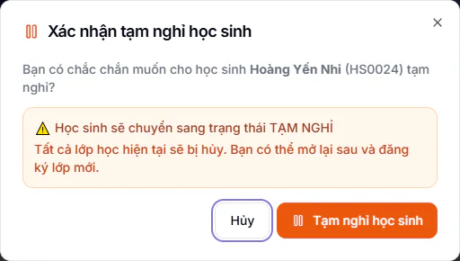
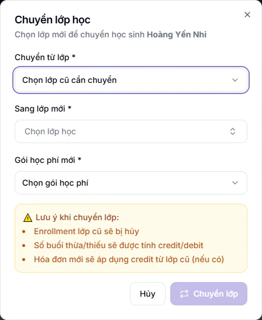

# Bước 11: Xử lý thay đổi trong tháng

Lớp đã chạy thì gần như tháng nào cũng có chuyện: phụ huynh báo con nghỉ, em muốn đổi lớp, giáo viên ốm, có người xin thôi việc. Bài này là bảng tra nhanh: gặp chuyện gì thì bấm nút nào, và tiền thay đổi thế nào. Đọc trước khi bấm, vì mỗi nút tác động đến phiếu học phí hoặc phiếu lương khác nhau. Các thao tác chi tiết đã có bài riêng, bài này chỉ chỉ đường và nói rõ hệ quả.

## Mục tiêu

- Biết bấm nút nào khi học sinh nghỉ, chuyển lớp, giáo viên nghỉ một buổi hoặc nhân viên thôi việc.
- Biết mỗi việc làm đổi phiếu học phí và phiếu lương ra sao, để báo đúng người xử lý trước khi xuất phiếu ([Bước 13](13-xuat-phieu-hoc-phi.md)) và chốt lương ([Bước 15](15-chot-luong-cuoi-thang.md)).

## Cần có trước

- Đã làm xong [Bước 10: điểm danh buổi học đầu tiên](10-diem-danh-buoi-dau.md), lớp đã chạy và học sinh đã được ghi danh.
- Nút **Hành động** trong hồ sơ học sinh chỉ có với Quản trị viên và Quản lý chi nhánh. Các vai khác phải nhờ hai vai này.

## Gặp chuyện gì thì làm gì

| Chuyện xảy ra | Việc cần làm | Tiền thay đổi thế nào |
| --- | --- | --- |
| Học sinh nghỉ một thời gian hoặc nghỉ hẳn | **Hành động → Tạm nghỉ học sinh** ở hồ sơ | Huỷ mọi lớp em đang học. Phần đã đóng cho buổi chưa học không tự hoàn |
| Học sinh bỏ một lớp nhưng vẫn học lớp khác | Sửa ghi danh của lớp đó, chọn **Hủy bỏ**, điền **Ngày kết thúc** | Chỉ ảnh hưởng lớp đó |
| Học sinh đổi sang lớp khác | **Hành động → Chuyển lớp học** | Giữ nguyên phiếu hoặc tách phiếu theo ngày chuyển, xem mục dưới |
| Giáo viên hoặc trợ giảng nghỉ một buổi | Tạo yêu cầu **Dạy thay**, quản lý duyệt | Lương buổi đó chuyển sang người dạy thay |
| Nhân viên nghỉ việc | Chuyển hồ sơ sang **Đã nghỉ việc**, hệ thống tự gỡ người đó khỏi các lớp. Nên giao lớp cho người mới ở **Chỉnh sửa** lớp | Buổi đã dạy trước ngày nghỉ vẫn được trả. Chốt lương các tháng đã làm của người đó trước, không tính lại kỳ cũ sau khi cho nghỉ |

## Học sinh nghỉ hoặc tạm nghỉ

Có hai cách, chọn theo việc em còn học lớp nào.

**Em nghỉ hẳn hoặc nghỉ một thời gian, không học lớp nào:**

::: steps
1. Vào **Học viên → Học sinh**, mở hồ sơ của em.
2. Bấm **Hành động**, chọn **Tạm nghỉ học sinh**.

   

3. Trong hộp **Xác nhận tạm nghỉ học sinh**, bấm **Tạm nghỉ học sinh**.
:::

Mọi ghi danh đang học của em bị huỷ cùng lúc và ngày kết thúc là giờ bạn bấm. Em biến khỏi danh sách điểm danh các lớp đó. Khi em quay lại, bấm **Hành động → Mở lại học sinh**, hệ thống bật lại đúng các lớp bị huỷ đợt đó. Chi tiết xem [Tạm nghỉ, mở lại và xoá học sinh](../hoc-sinh/nghi-hoc.md).

**Em bỏ một lớp nhưng còn học lớp khác:**

::: steps
1. Vào **Học viên → Ghi danh**, bấm biểu tượng cây bút ở dòng ghi danh của lớp đó.
2. Ở mục **Trạng thái**, chọn **Hủy bỏ** (nghỉ hẳn lớp này) hoặc **Tạm dừng (HS xin nghỉ)** (nghỉ một thời gian).
3. Điền **Ngày kết thúc** là ngày em học buổi cuối. Ô này để trống sẵn, bạn tự điền.
4. Bấm **Lưu thay đổi**.
:::

Chỉ lớp đó bị ảnh hưởng, các lớp khác của em vẫn chạy bình thường. Xem thêm [Ghi danh học sinh](../hoc-sinh/ghi-danh.md).

::: warning Trạng thái Đình chỉ và Đã tốt nghiệp không huỷ ghi danh
Đổi hồ sơ sang **Đình chỉ** hoặc **Đã tốt nghiệp** không đụng đến ghi danh. Em vẫn nằm trong lớp, nhưng khi xuất phiếu hàng loạt hệ thống chỉ lấy học sinh ở trạng thái **Đang học**, nên em sẽ không có phiếu mới. Muốn em rời lớp, dùng **Tạm nghỉ học sinh** hoặc huỷ từng ghi danh như trên.
:::

::: warning Đừng dùng Xóa học sinh để cho em nghỉ
Trong cùng menu **Hành động** còn có **Xóa học sinh**. Nút này xoá vĩnh viễn và không hoàn tác được. Cho em nghỉ thì chỉ dùng **Tạm nghỉ học sinh**.
:::

::: warning Đơn Xin nghỉ hẳn của phụ huynh không tự huỷ ghi danh
Loại đơn **Xin nghỉ hẳn** mặc định tắt, Quản trị viên bật ở nút **Cài đặt** của trang **Điểm danh → Yêu cầu phụ huynh**. Khi phụ huynh đã gửi đơn và người nhận đơn chốt **Nghỉ hẳn**, hệ thống chỉ báo giáo viên lớp. Bạn vẫn phải tự làm một trong hai cách trên. Xem [Yêu cầu phụ huynh](../hoc-sinh/yeu-cau-phu-huynh.md).
:::

### Tiền đã đóng cho buổi chưa học

Hệ thống chỉ tính phiếu cho học sinh còn ít nhất một ghi danh **Đang học**. Em đã nghỉ hết mọi lớp thì bị bỏ qua khi xuất phiếu. Vì vậy phần phụ huynh đã đóng cho những buổi chưa học của tháng cuối không tự biến thành khoản hoàn hay credit ở phiếu tháng sau.

Hệ thống không tự hoàn. Việc này giao cho Kế toán, xử lý bằng một trong hai cách:

- Ghi một khoản credit cho em ở **Tài chính → Kế toán → Sổ cái công nợ** (bấm **Thêm credit**), xem [Sổ credit](../ke-toan/so-cai-credit.md). Credit được trừ vào phiếu kế tiếp của em.
- Sửa phiếu của tháng đó ở **Tài chính → Kế toán → Hoá đơn chi tiết**, xem [Hoá đơn chi tiết](../ke-toan/hoa-don-chi-tiet.md).

Hãy báo kế toán ngay khi cho em nghỉ, kèm ngày học cuối. Nếu em còn học một lớp khác thì không có việc này, vì phần đối chiếu tháng trước vẫn chạy khi xuất phiếu.

::: warning Nút Xóa ghi danh có thể bị chặn
Nút **Xóa ghi danh** không xoá thật mà chuyển ghi danh sang **Hủy bỏ** với ngày kết thúc là hôm nay. Nếu học sinh còn bất kỳ phiếu nào ở trạng thái chưa thanh toán hoặc thanh toán một phần (kể cả phiếu của lớp khác), hệ thống từ chối và báo "Không thể xóa ghi danh do có ... hoá đơn chưa thanh toán". Hãy thu hoặc xử lý phiếu trước, hoặc đổi **Trạng thái** thành **Hủy bỏ** rồi điền **Ngày kết thúc** ở trang sửa ghi danh.
:::

## Chuyển lớp cho một học sinh

Dùng khi một em đổi sang lớp khác giữa tháng. Nếu cần chuyển cả nhóm hoặc lên lớp cuối năm, xem [Lên lớp và chuyển lớp hàng loạt](../lop-hoc/len-lop-chuyen-lop.md). Trang **Sửa ghi danh** không đổi lớp được.

::: steps
1. Vào **Học viên → Học sinh**, mở hồ sơ của em.
2. Bấm **Hành động**, chọn **Chuyển lớp học**. Hộp **Chuyển lớp học** hiện ra.

   

3. Ở ô **Chuyển từ lớp** (bắt buộc), chọn lớp em đang học và muốn rời.
4. Ở ô **Sang lớp mới** (bắt buộc), chọn lớp mới. Lớp cùng môn, cùng khối được đưa lên đầu danh sách. Các lớp em đang học không có trong danh sách.
5. Ở ô **Gói học phí mới** (bắt buộc), chọn gói áp dụng cho lớp mới.
6. Bấm **Chuyển lớp**. Nút này chỉ bấm được khi đã chọn đủ ba ô trên.
:::

### Phiếu thay đổi thế nào

Hệ thống chọn một trong hai cách, bạn không phải chọn.

**Giữ nguyên phiếu của kỳ này.** Xảy ra khi đủ cả năm điều kiện: hai lớp cùng môn, cùng đơn giá mỗi buổi, cả hai đều là lớp thường (không phải lớp linh hoạt), cả hai gói đều không đặt cách thu **Thu sau theo buổi thực**, và từ kỳ này trở đi em đã có phiếu chứa lớp cũ. Khi đó số tiền và số buổi trên phiếu không đổi, từ tháng sau tính theo lớp mới. Phần học thừa hay thiếu so với số buổi đã đóng được đối chiếu theo cả môn ở các lần xuất phiếu sau, xem [Bước 13](13-xuat-phieu-hoc-phi.md).

**Tách phiếu theo ngày chuyển.** Mọi trường hợp còn lại. Lớp cũ giữ số buổi em đã học, phần đã đóng cho buổi chưa học được hoàn, lớp mới tính từ ngày chuyển.

Ở cách thứ hai, nếu phiếu kỳ này đã gửi phụ huynh, hộp **Phiếu đã gửi phụ huynh** hiện ra, báo số phiếu và mã phiếu sẽ bị điều chỉnh. Bấm **Vẫn chuyển lớp** nếu chắc chắn, hoặc **Huỷ** để dừng. Nên báo kế toán và phụ huynh về con số mới.

Ưu đãi của ghi danh cũ được chuyển sang ghi danh mới, không phải nhập lại.

::: tip Mẹo
Trước khi chuyển, mở **Tài chính → Kế toán → Hoá đơn chi tiết**, tìm phiếu kỳ này của em và xem cột **Đã gửi** để biết đã gửi cho phụ huynh chưa. Đã gửi thì hỏi trước phụ huynh, tránh phiếu đổi số khi họ đã cầm bản cũ.
:::

## Giáo viên hoặc trợ giảng nghỉ một buổi

Duyệt đơn **Nghỉ phép** của giáo viên không tự đổi người dạy buổi đó. Ô "Nhân viên thay thế" trong đơn nghỉ chỉ ghi chú trên đơn. Nếu không làm yêu cầu dạy thay, giáo viên chính vẫn được tính lương buổi đó, còn người đứng lớp thay thiếu tiền.

::: steps
1. Vào **Điểm danh → Điểm danh cơ bản**, chọn ngày của buổi và tìm dòng lớp cần đổi người.
2. Bấm nút ba chấm ở cuối dòng, chọn **Dạy thay**. Hộp **Dạy thay** hiện ra.
3. Chọn người thay ở ô **GV dạy thay** hoặc **TG dạy thay**. Để cả hai ô ở **Giữ nguyên GV** và **Giữ nguyên TG** thì hệ thống nhắc "Vui lòng chọn ít nhất 1 hành động".
4. Điền **Lý do dạy thay** (bắt buộc), bấm **Gửi yêu cầu**.
5. Quản trị viên, Quản lý chi nhánh hoặc Quản lý vào **Quản lý HR → Dạy thay**, bấm **Duyệt** ở yêu cầu **Chờ duyệt**.
:::

Quản trị viên, Quản lý chi nhánh, Quản lý và Lễ tân tạo được yêu cầu. Giáo viên và trợ giảng không thấy nút trên web, họ xin cho chính mình trên app điện thoại hoặc báo quản lý. Chỉ khi yêu cầu được duyệt, lương buổi đó mới chuyển sang người thay. Chọn **Giữ nguyên GV** thì giáo viên chính vẫn được tính buổi đó. Xem đầy đủ ở [Dạy thay](../nhan-su/dan-day-thay.md).

::: warning Nút ba chấm chỉ có ở dòng buổi đã có bản ghi điểm danh
Buổi chỉ được ghi vào hệ thống khi có người điểm danh hoặc trợ giảng vào ca. Dòng nào mới chỉ có nút **Điểm danh** (chưa ai chấm) thì chưa có nút ba chấm. Muốn tạo yêu cầu trước ngày học, nhờ giáo viên hoặc trợ giảng xin trên app điện thoại. Sau khi buổi có bản ghi điểm danh, bạn tạo yêu cầu như các bước trên.
:::

## Nhân viên nghỉ việc

Chuyển nhân viên sang **Đã nghỉ việc** khoá tài khoản của họ và tự gỡ họ khỏi mọi lớp họ đang dạy hoặc làm trợ giảng. Phân công không bị xoá mà được đóng lại, **Ngày kết thúc** của phân công là ngày nghỉ, nên các buổi người đó đã dạy trước ngày nghỉ vẫn được tính lương như cũ. Ngày nghỉ là ngày bạn điền ở ô **Ngày kết thúc** của hồ sơ, với điều kiện bạn vừa sửa ô này trong chính lần lưu đó và ngày ấy không ở tương lai. Không thì hệ thống lấy ngày hôm nay. Nếu sau này người đó quay lại làm (đổi về **Đang làm việc**), các lớp cũ không tự gắn lại, bạn phải xếp lớp bằng tay.

Vì vậy bạn không còn bắt buộc phải đổi người ở từng lớp trước khi cho nghỉ. Nhưng nên làm, để phụ huynh luôn thấy đúng giáo viên và lớp không bị trống người dạy. Thứ tự gợi ý:

::: steps
1. Vào **Lớp học**, dùng bộ lọc **Giáo viên** chọn tên người đó (lọc cả lớp dạy chính lẫn lớp làm trợ giảng). Mở từng lớp, bấm **Chỉnh sửa**.
2. Nếu là giáo viên chính: chọn người khác ở ô **Giáo viên**, rồi điền **Ngày nhận lớp** (ô này hiện ra sau khi bạn chọn người mới) là ngày người mới bắt đầu dạy. Nếu là trợ giảng: mở ô **Trợ giảng** và bỏ tích người đó. Bấm **Lưu thay đổi**.
3. Xử lý các buổi sắp tới của người đó bằng yêu cầu **Dạy thay** nếu chưa kịp đổi lớp.
4. Nếu tháng làm việc cuối của người đó đã kết thúc, chốt lương tháng đó ở [Bước 15](15-chot-luong-cuoi-thang.md) trước khi chuyển trạng thái. Nếu người đó nghỉ giữa tháng và chưa tới ngày chốt lương thì bỏ qua bước này, xem lưu ý bên dưới.
5. Quản trị viên vào **Quản lý HR → Nhân viên**, bấm biểu tượng thùng rác ở dòng người đó. Trình duyệt hỏi xác nhận chuyển sang **Đã nghỉ việc**, bấm xác nhận (OK).
:::

Biểu tượng thùng rác chỉ Quản trị viên dùng được, và ngày nghỉ khi đó là ngày bạn bấm. Quản lý chi nhánh đổi **Trạng thái** thành **Đã nghỉ việc** bằng nút chỉnh sửa (hình cây bút) ở dòng nhân viên, đồng thời sửa ô **Ngày kết thúc** thành ngày làm việc cuối cùng thật của người đó trong cùng lần lưu (ô này có thể đang giữ hạn hợp đồng cũ), rồi bấm **Cập nhật**. Nếu ngày làm việc cuối cùng còn ở tương lai, hệ thống dùng ngày hôm nay để đóng lớp, nên hãy đổi trạng thái đúng vào ngày người đó nghỉ. Danh sách việc cần làm khi nghỉ việc (bàn giao, thu hồi tài khoản) ở [Onboarding và nghỉ việc](../nhan-su/onboarding.md) không có mục đổi người ở lớp, nên bước 1-3 bạn tự làm.

::: tip Mẹo
Đã đổi trạng thái rồi mới nhớ chưa giao lớp thì người đó không còn trong bộ lọc **Giáo viên** của **Lớp học** nữa. Lớp thường mất giáo viên chính sẽ hiện ở việc **Chưa có giáo viên chính** trong thẻ **Việc cần làm** của trang **Lớp học**, bạn mở lớp và chọn giáo viên mới ở ô **Giáo viên**. Lớp mà người đó làm trợ giảng thì không có mục nhắc, nên nếu muốn chắc, hãy ghi lại các lớp của họ trước khi đổi trạng thái.
:::

::: danger Không bấm thùng rác lần hai
Sau khi người đó đã ở **Đã nghỉ việc**, biểu tượng thùng rác ở dòng đó chuyển thành **Xóa vĩnh viễn**, không khôi phục được. Chỉ bấm khi chắc chắn.
:::

::: warning Đừng tính lại bảng lương của tháng trước tháng nghỉ việc
Bảng lương một tháng lấy nhân viên đang làm việc, hoặc đã nghỉ việc nhưng **Ngày kết thúc** trong hồ sơ rơi vào đúng tháng đó. Cho nghỉ bằng biểu tượng thùng rác thì **Ngày kết thúc** là ngày bạn bấm. Cho nghỉ bằng nút chỉnh sửa thì là ngày bạn điền vào ô đó. Vì vậy nếu bạn cho người đó nghỉ ở tháng 11 mà sau đó bấm tính lại bảng lương tháng 10, người đó có thể không còn phiếu ở tháng 10. Hãy chốt xong lương các tháng đã làm rồi mới cho nghỉ, và không tính lại kỳ cũ sau đó.
:::

## Kiểm tra đã xong

- [ ] Học sinh nghỉ: hồ sơ ở **Tạm nghỉ** hoặc ghi danh đã **Hủy bỏ** kèm **Ngày kết thúc**, và đã báo kế toán xử lý phần tiền đã đóng.
- [ ] Học sinh chuyển lớp: mở hồ sơ thấy lớp cũ đã huỷ và lớp mới đang học.
- [ ] Buổi giáo viên nghỉ: yêu cầu **Dạy thay** ở trạng thái **Đã duyệt**, trang **Điểm danh** hiện nhãn **Dạy thay** kèm tên người thay.
- [ ] Nhân viên nghỉ việc: các lớp người đó phụ trách đã có người mới, lương các tháng đã làm đã chốt.

## Câu hỏi thường gặp

::: details Hệ thống có trạng thái "bảo lưu" không?
Không. Dùng **Tạm nghỉ** cho mọi trường hợp em nghỉ một thời gian rồi quay lại.
:::

::: details Em tạm nghỉ rồi mở lại nhưng không có lớp nào được khôi phục?
Hệ thống chỉ bật lại các lớp bị huỷ đúng lúc tạm nghỉ và lớp đó còn mở. Khi đó thông báo nhắc bạn ghi danh lại em vào lớp đang học, xem [Bước 9](09-ghi-danh-vao-lop.md).
:::

::: details Chuyển lớp xong, phiếu tháng này đã xuất thì ai sửa?
Nếu phiếu chưa gửi, hệ thống tự điều chỉnh. Nếu đã gửi, bạn xác nhận ở hộp **Phiếu đã gửi phụ huynh**. Sau đó nhờ Kế toán xem lại phiếu ở bước xuất phiếu cuối tháng, [Bước 13](13-xuat-phieu-hoc-phi.md).
:::

## Bước tiếp theo

Sang [Bước 12: báo kết quả học tập cho phụ huynh](12-bao-ket-qua-hoc-tap.md).
