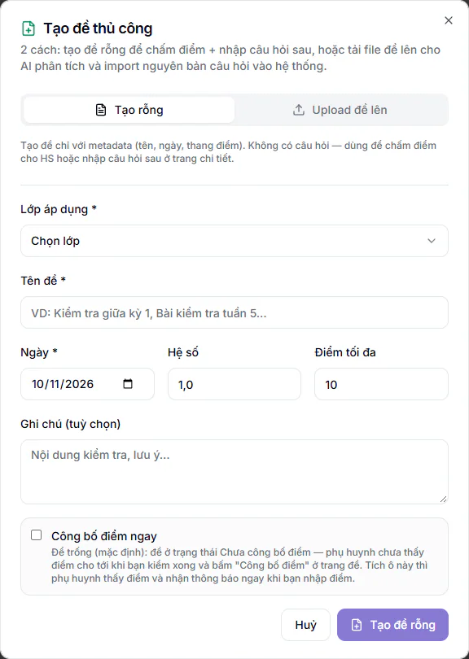
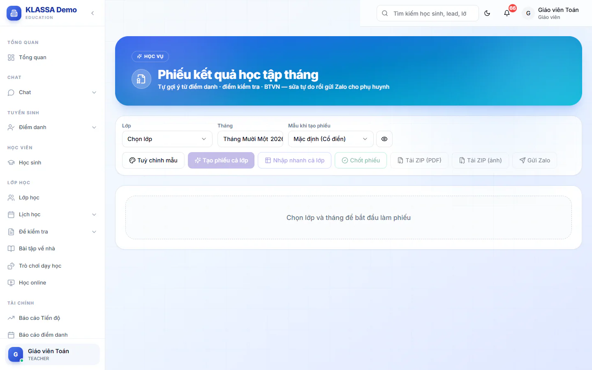

# Bước 12: Báo kết quả học tập cho phụ huynh

Phụ huynh là người đóng tiền, hết tháng họ chỉ hỏi một câu: con học thế nào. Bước này dạy bạn cho phụ huynh thấy câu trả lời: nhận xét sau mỗi buổi, điểm bài tập, điểm kiểm tra trong tháng, rồi cuối tháng là một tờ **Phiếu kết quả học tập tháng**.

::: warning Đừng nhầm hai loại phiếu
**Phiếu kết quả học tập tháng** (bài này, menu **Phiếu tháng**) là tờ tổng kết việc học của con. Nó khác **phiếu học phí** ở [Bước 13](13-xuat-phieu-hoc-phi.md) và [Bước 14](14-gui-phieu-va-thu-tien.md), nơi phụ huynh xem là mục **Phiếu thu** trong cổng phụ huynh. Hai loại phiếu độc lập, làm cái nào không ảnh hưởng cái kia.
:::

## Mục tiêu

- Phụ huynh nhận được nhận xét buổi học, điểm bài tập và điểm kiểm tra trong tháng.
- Cuối tháng, mỗi học sinh của lớp có một Phiếu kết quả học tập tháng đã chốt, phụ huynh xem được trong cổng phụ huynh.

## Cần có trước

- Học sinh đã ghi danh vào lớp ([Bước 9](09-ghi-danh-vao-lop.md)) và lớp đã có buổi điểm danh ([Bước 10](10-diem-danh-buoi-dau.md)). Phiếu tháng lấy số buổi đi học từ điểm danh.
- **Tài khoản phụ huynh đã được duyệt.** Tài khoản mới tạo ở trạng thái chờ duyệt: phụ huynh chưa đăng nhập được và không nhận thông báo nào (nhận xét, điểm, bài tập, phiếu tháng). Quản trị viên duyệt ở **Quản trị hệ thống → Quản lý Đăng ký**, xem [Bước 8](08-them-hoc-sinh-phu-huynh.md).
- Trung tâm đã bật gói mở rộng **Cổng Phụ huynh**. Mục **Bài tập về nhà** vẫn hiện trong menu dù chưa có gói, nhưng bấm vào hoặc giao bài sẽ bị báo gói chưa bật. Nhờ Quản trị viên kiểm ở **Cài đặt → Plugin Marketplace**.
- Muốn gửi phiếu qua Zalo: cần gói **Zalo (Cá nhân + OA)**. Giáo viên và Trợ giảng cần liên kết Zalo cá nhân ở **Zalo của tôi** ([Bước 6](06-ket-noi-zalo-ngan-hang-email.md)); các vai quản lý và Lễ tân gửi bằng nick Zalo chung của trung tâm.
- Giáo viên và trợ giảng chỉ làm được với lớp mình phụ trách. Lễ tân chỉ làm được ở lớp mình được xếp làm trợ giảng, và chỉ với nhận xét buổi và Phiếu tháng. **Bài tập về nhà** và **Đề kiểm tra** không dành cho lễ tân.

## Trong tháng: ba việc đều đặn

Ba việc này làm theo nhịp riêng, không cần chờ cuối tháng. Làm đều thì cuối tháng phiếu tháng gần như tự đầy.

### Việc 1: Viết nhận xét sau mỗi buổi

Sau khi điểm danh xong, bấm **Nhận xét** ở dòng của buổi để viết cho từng em (làm từng bước ở [Bước 10](10-diem-danh-buoi-dau.md)). Lưu xong, phụ huynh nhận thông báo "Nhận xét buổi học mới". Xem lại nhận xét đã viết ở **Nhận xét buổi học** (Quản lý trở lên) hoặc **Nhận xét lớp tôi** (giáo viên, trợ giảng, lễ tân kiêm trợ giảng). Chi tiết: [Nhận xét buổi học](../diem-danh/nhan-xet-buoi-hoc.md).

Nhận xét buổi chỉ làm gợi ý cho phiếu tháng (hệ thống lấy tối đa 3 nhận xét gần nhất làm câu nháp). Bạn vẫn đọc và sửa lại khi lập phiếu.

### Việc 2: Giao và chấm bài tập về nhà

::: steps
1. Vào **Bài tập về nhà**, bấm **Tạo mới**.
2. Chọn **Lớp học** (bắt buộc), nhập **Tiêu đề** (bắt buộc) và **Hạn nộp** (bắt buộc). Ở mục **Giao cho**, chọn **Cả lớp** hoặc **Chọn học sinh** rồi tích từng em.
3. Giữ **Thang điểm** mặc định 10 và **Hệ số** mặc định 1, hoặc đổi nếu cần.
4. Bấm **Giao bài**. Phụ huynh của các em được giao nhận thông báo "Bài tập về nhà mới".
5. Khi em nộp bài, mở bài, bấm **Chấm** ở dòng của em, nhập **Điểm** và **Nhận xét**, rồi bấm **Lưu nhận xét + điểm**.
:::

Hai điều cần biết về điểm bài tập:

- Chỉ bài có trạng thái **Đã chấm** và có điểm mới được đưa vào phiếu tháng. Bài chưa chấm không lên phiếu. Bài thuộc tháng nào là theo **Hạn nộp**.
- Điểm bài tập đã chấm được tính vào điểm trung bình môn phụ huynh thấy, giống một bài kiểm tra, theo **Hệ số**. Muốn bài này chỉ hiển thị mà không kéo điểm trung bình, đặt **Hệ số** là 0.

Chi tiết: [Giao và chấm bài tập về nhà](../hoc-tap/bai-tap-ve-nha.md).

### Việc 3: Tạo đề kiểm tra, nhập điểm và Công bố điểm

::: steps
1. Vào **Đề kiểm tra → Danh sách đề**, bấm **Tạo đề thủ công**. Ở tab **Tạo rỗng**, chọn **Lớp áp dụng**, nhập **Tên đề**, **Ngày** (mặc định hôm nay) và **Điểm tối đa** (mặc định 10), bấm **Tạo đề rỗng**. Hộp còn có ô **Hệ số** (mặc định 1,0), ô **Ghi chú** (không bắt buộc) và ô tích **Công bố điểm ngay** (mặc định không tích). Tab **Upload đề lên** dùng khi bạn có file đề để hệ thống đọc câu hỏi vào. (Còn hai cách tạo khác, xem [Đề kiểm tra](../hoc-tap/bai-danh-gia.md).)

   

2. Mở đề vừa tạo, ở tab **Chấm điểm** gõ điểm từng em rồi bấm **Lưu điểm**. Em vắng thì để trống.
3. Kiểm lại điểm, bấm **Công bố điểm**, rồi bấm **Công bố điểm** lần nữa trong hộp xác nhận.
:::

::: warning Ai tạo đề thì người đó nhập điểm và công bố
Chỉ người tạo đề (và phải là người từng dạy lớp đó) hoặc Quản lý, Quản lý chi nhánh, Quản trị viên mới nhập điểm và Công bố điểm được. Giáo viên mở đề do người khác tạo chỉ xem, nếu cố lưu điểm sẽ bị báo không tìm thấy đề. Cần nhập điểm cho đề đó thì nhờ người tạo hoặc quản lý.
:::

Đề mới tạo luôn ở trạng thái **Chưa công bố** (trừ khi bạn tích **Công bố điểm ngay** lúc tạo). Cho tới khi bấm **Công bố điểm**, phụ huynh chưa thấy điểm và Phiếu tháng cũng chưa có cột điểm của đề đó. Chi tiết: [Nhập điểm và công bố điểm](../hoc-tap/cong-bo-diem.md).

Có xấp bài giấy cần chấm nhanh thì dùng **Đề kiểm tra → Chấm bài AI** (cần gói mở rộng **AI — Gợi ý & Trợ lý Vận hành** và công tắc **Chấm bài kiểm tra bằng AI** đang bật). Kết quả chỉ chính thức sau khi bạn duyệt, xem [Chấm bài kiểm tra bằng AI từ ảnh](../hoc-tap/cham-bai-ai.md).

## Cuối tháng: lập Phiếu kết quả học tập tháng

Phiếu tháng là bản **đóng băng** lúc tạo: hệ thống kéo điểm danh, điểm kiểm tra, điểm bài tập và nhận xét về một lần, sau đó phiếu không tự đổi theo dữ liệu gốc. Vì vậy phải làm đúng thứ tự.

::: danger Làm xong ba việc này TRƯỚC khi bấm Tạo phiếu cả lớp
1. Mọi nhận xét buổi trong tháng đã viết xong.
2. Mọi bài tập của tháng đã chấm.
3. Mọi đề kiểm tra của tháng đã nhập điểm **và đã Công bố điểm**.

Tạo phiếu sớm thì cột điểm và nhận xét trống. Điểm công bố sau không tự chạy vào phiếu đã tạo.
:::

### Tạo phiếu cho cả lớp

::: steps
1. Vào **Phiếu tháng** trong nhóm **Lớp học** của menu. Giáo viên, trợ giảng và lễ tân kiêm trợ giảng vào **Phiếu tháng lớp tôi**.
2. Quản lý trở lên đang ở tab **Theo lớp**. Chọn **Lớp** và **Tháng**.
3. Ở ô **Mẫu khi tạo phiếu**, chọn mẫu. Bấm biểu tượng con mắt (**Xem trước mẫu**) để xem thử.

   

4. Bấm **Tạo phiếu cả lớp**. Hệ thống dựng phiếu **Nháp** cho mọi học sinh trong lớp.
:::

Bấm lại nhiều lần không sao: học sinh đã có phiếu được bỏ qua. Em nào chưa có phiếu thì dòng đó có nút **Tạo phiếu**.

### Nhập nhanh và sửa

::: steps
1. Bấm **Nhập nhanh cả lớp**. Bảng hiện ra, mỗi hàng một học sinh.
2. Soát cột **Chuyên cần**, điểm và **Nhận xét**, sửa chỗ cần sửa. Có thể điền hàng loạt bằng câu mẫu hoặc bấm **AI soạn riêng từng em**, nhớ đọc lại nội dung AI viết. Nút AI chỉ hiện khi trung tâm có hai gói mở rộng **Nền tảng AI** và **AI — Gợi ý & Trợ lý Vận hành**. Nút chỉ chạy được khi công tắc **AI viết nhận xét phiếu tháng** đang bật ở **Cài đặt → AI & Tự động → Tính năng AI** (mặc định bật, Quản trị viên chỉnh). Không thấy nút hoặc nút bị khoá thì bạn nhập tay hoặc dùng câu mẫu.
3. Bấm **Lưu tất cả**. Bảng chưa lưu cho tới khi bạn bấm nút này.
:::

Muốn sửa kỹ một em, bấm biểu tượng bút chì ở dòng của em đó. Cách dùng đầy đủ nằm ở [Phiếu kết quả học tập tháng](../hoc-tap/phieu-thang.md).

Nếu sau khi tạo phiếu bạn mới sửa điểm hoặc công bố thêm đề, bấm **Tạo lại từ dữ liệu gốc** ở dòng của em (chỉ có ở phiếu nháp). Thao tác này **đè mọi chỉnh sửa tay** trên phiếu đó, nên làm trước khi nhập nhận xét tay.

### Chốt và gửi

::: steps
1. Đọc lại từng phiếu nháp.
2. Bấm **Chốt** ở dòng một em, hoặc tích chọn nhiều em rồi bấm **Chốt phiếu**. **Không chọn ai thì chốt tất cả phiếu nháp** của lớp, nên đọc kỹ trước khi bấm.
3. Muốn gửi ngay cho phụ huynh, tích chọn các em rồi bấm **Gửi Zalo**, sau đó bấm **Bắt đầu gửi** trong hộp **Gửi phiếu qua Zalo cho phụ huynh**. Không tích ai thì nút gửi cho **tất cả** học sinh đã có phiếu, và phiếu nháp nào trong đó cũng bị chốt luôn. Có phiếu nháp thì hệ thống hỏi xác nhận trước khi chốt.
:::

Hai hậu quả cần nhớ:

- **Chốt xong là phụ huynh được báo.** Phụ huynh có tài khoản đã duyệt nhận thông báo "Phiếu kết quả tháng" ngay lúc chốt và thấy phiếu ở mục **Phiếu tháng** trong cổng phụ huynh.
- **Bấm Gửi Zalo là chốt luôn.** Phiếu nháp được chốt trước khi gửi ảnh, nên dù tin Zalo gửi lỗi, phiếu vẫn đã chốt và phụ huynh vẫn thấy phiếu trong app và nhận thông báo. Hộp xác nhận lúc bấm **Bắt đầu gửi** đã nhắc điều này. Khi Zalo lỗi, phiếu ở trạng thái **Đã chốt**, không chuyển thành **Đã gửi Zalo**, và dòng của em đó ghi lý do bằng tiếng Việt kèm lời giải thích rằng phụ huynh vẫn xem được trong app nhưng chưa gửi qua Zalo (ví dụ bạn chưa liên kết Zalo cá nhân, hoặc không tìm thấy Zalo của phụ huynh vì chưa có số điện thoại hay phụ huynh không dùng Zalo). Gửi xong, danh sách phiếu tự tải lại.

::: warning Lỡ chốt thiếu điểm
Phiếu đã chốt không sửa trực tiếp được và không bị **Tạo phiếu cả lớp** tạo lại đè. Giáo viên và trợ giảng không tự mở lại được: chỉ Quản lý, Quản lý chi nhánh và Quản trị viên có nút **Mở lại** ở dòng của em. Phụ huynh đã nhận thông báo lúc chốt, nên hãy chốt khi chắc chắn. Nếu phiếu đã gửi Zalo mà phải sửa, nhớ gửi lại bản mới.
:::

## Kiểm tra đã xong

- [ ] Tài khoản phụ huynh của lớp đã được duyệt, gói **Cổng Phụ huynh** đã bật.
- [ ] Nhận xét buổi trong tháng đã viết, bài tập đã chấm.
- [ ] Mọi đề kiểm tra của tháng đã nhập điểm và Công bố điểm.
- [ ] Mỗi học sinh của lớp có phiếu ở trạng thái **Đã chốt** (hoặc **Đã gửi Zalo**).
- [ ] Mở thử cổng phụ huynh của một em, mục **Phiếu tháng** hiện phiếu vừa chốt.

## Câu hỏi thường gặp

::: details Phiếu không có điểm của đề tôi vừa nhập?
Phiếu chỉ lấy điểm của đề đã Công bố điểm. Công bố đề rồi bấm **Tạo lại từ dữ liệu gốc** ở phiếu nháp. Phiếu đã chốt thì nhờ quản lý **Mở lại** trước.
:::

::: details Phụ huynh nói không nhận được thông báo gì?
Kiểm tài khoản phụ huynh đã được duyệt chưa. Tài khoản chờ duyệt không nhận nhận xét, điểm hay phiếu tháng. Nếu đã duyệt mà vẫn không thấy, mở cổng phụ huynh của em đó xem phiếu đã có ở mục **Phiếu tháng** chưa. Mục nào không hiện trong cổng thì nhờ Quản trị viên kiểm công tắc từng mục, xem [Tuỳ chỉnh và bật tắt Cổng Phụ huynh](../cong-phu-huynh/cai-dat-cong.md).
:::

::: details Phụ huynh xem điểm bài tập ở đâu?
Điểm bài tập và điểm kiểm tra nằm ở mục điểm trong cổng phụ huynh, xem [Điểm số](../cong-phu-huynh/diem-so.md). Phiếu tháng tổng kết hằng tháng nằm ở mục **Phiếu tháng**, xem [Phiếu tháng và Thẻ Năng Lực](../cong-phu-huynh/ket-qua-thang.md).
:::

::: details Gửi Zalo báo lỗi thì có cần chốt lại không?
Không. Phiếu đã chốt rồi và phụ huynh vẫn xem được trong app, chỉ chưa được ghi là **Đã gửi Zalo**. Sửa nguyên nhân (liên kết Zalo, kiểm số Zalo của phụ huynh) rồi chọn đúng em lỗi bấm **Gửi Zalo** lại, xem [Zalo của tôi](../tin-nhan/zalo-cua-toi.md).
:::

## Bước tiếp theo

Phiếu kết quả đã tới tay phụ huynh. Giờ sang phần tiền: [Bước 13: Xuất phiếu học phí cuối tháng](13-xuat-phieu-hoc-phi.md).
