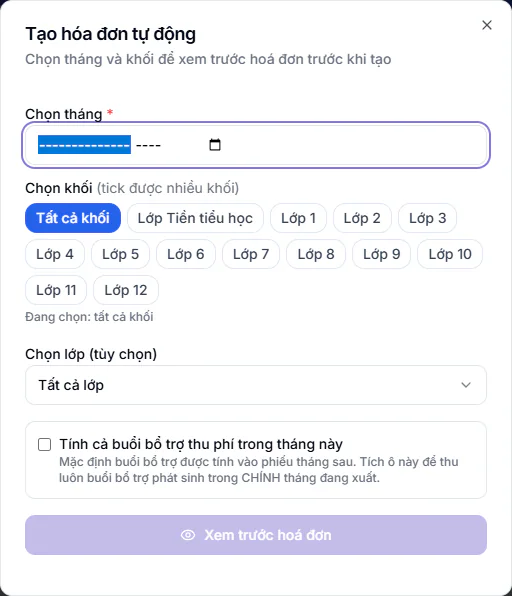
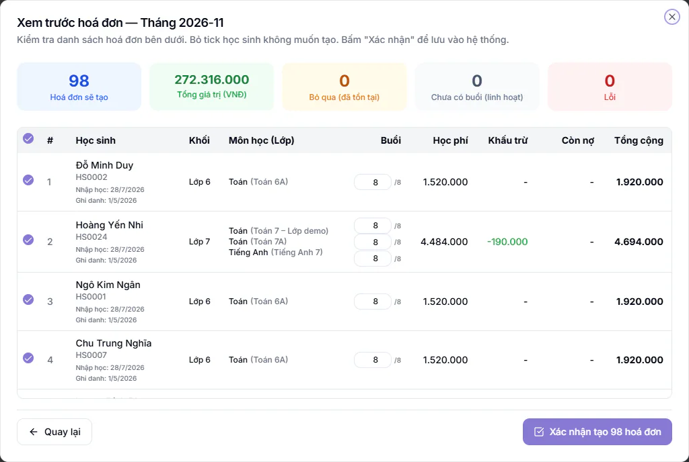

# Bước 13: Xuất phiếu học phí cuối tháng

Phiếu học phí cho biết phụ huynh phải đóng bao nhiêu cho tháng tới. Bạn xuất phiếu vào cuối tháng, soát cho kỹ rồi mới gửi ([Bước 14](14-gui-phieu-va-thu-tien.md)). Xuất phiếu không tự nhắn tin nào cho phụ huynh.

::: tip Đừng nhầm hai loại phiếu
Bài này nói về **phiếu học phí** (phiếu thu tiền). **Phiếu kết quả học tập tháng**, ở menu **Phiếu tháng**, là phiếu điểm và nhận xét, làm ở [Bước 12](12-bao-ket-qua-hoc-tap.md). Ở cổng phụ huynh, tiền học nằm ở mục **Phiếu thu**, còn kết quả học tập nằm ở mục **Phiếu tháng**.
:::

## Mục tiêu

Sau bước này, mọi học sinh đang học đều có một phiếu học phí đúng số buổi, đúng tiền, đã được soát và sẵn sàng gửi.

## Cần có trước

- Vai của bạn là Kế toán, Quản lý chi nhánh hoặc Quản trị viên. Các vai khác không thấy mục **Học phí**.
- Mỗi học sinh đã ghi danh vào lớp, ghi danh gắn với một gói học phí (xem [Bước 5](05-cau-hinh-hoc-phi.md) và [Bước 9](09-ghi-danh-vao-lop.md)). Học sinh không có ghi danh đang học sẽ bị bỏ qua với lý do **Không có ghi danh đang học**.
- Điểm danh của tháng này đã đủ (xem [Bước 10](10-diem-danh-buoi-dau.md)). Đây là điều kiện quan trọng nhất, vì phiếu tháng sau trừ tiền các buổi vắng của tháng này. Xuất khi tháng chưa hết thì các buổi chưa diễn ra bị coi là chưa học, nên dễ khấu trừ dư. Hãy đợi tháng kết thúc và điểm danh xong rồi mới xuất.
- Các thay đổi trong tháng đã được xử lý ([Bước 11](11-thay-doi-trong-thang.md)): em nghỉ đã được tạm nghỉ hoặc huỷ ghi danh, em đổi lớp đã được chuyển lớp. Làm sau khi xuất thì phiếu phải sửa lại.
- **Mẫu hoá đơn** đã lưu thông tin thật của trung tâm (tên, địa chỉ, số điện thoại, ngân hàng nhận tiền, kiểu mã QR) ở [Bước 5](05-cau-hinh-hoc-phi.md). Chưa lưu thì phiếu không có khung ngân hàng và không có mã QR, còn địa chỉ và số điện thoại lấy theo thông tin công ty nếu đã khai, chưa khai thì để trống. Chi tiết xem [Mẫu hoá đơn](../hoc-phi/mau-hoa-don.md).
- Nút **Tạo hoá đơn tự động** (tạo cho cả khối) cần gói mở rộng **Tự động hoá đơn học phí**. Chưa có gói này thì hệ thống báo gói chưa được kích hoạt. Khi đó bạn vẫn tạo được phiếu cho từng học sinh (phần "Tạo phiếu cho một học sinh").
- Kỳ cần xuất chưa bị **Khoá sổ**. Kỳ đã khoá thì học sinh bị bỏ qua với lý do **Kỳ ... đã khoá sổ**.

## Ví dụ một tháng với số đơn giản

Lớp Toán 9A1, cơ sở Cầu Giấy. Gói học phí là 8 buổi mỗi tháng, giá 200.000đ một buổi, tức 1.600.000đ một tháng. Học sinh Nguyễn Minh An không có ưu đãi và không nợ cũ.

| Mốc | Việc xảy ra | Số tiền |
| --- | --- | --- |
| Đầu tháng 11 | Phiếu học phí tháng 11 thu 8 buổi | 1.600.000đ |
| Trong tháng 11 | An đi 6 buổi, vắng 2 buổi (1 buổi **Vắng**, 1 buổi **Phép**) | |
| Cuối tháng 11 | Bạn xuất phiếu học phí tháng 12. Học phí 8 buổi | 1.600.000đ |
| | Khấu trừ 2 buổi vắng của tháng 11 (2 x 200.000đ) | trừ 400.000đ |
| | **Tổng cộng** phụ huynh phải đóng | **1.200.000đ** |

Trên phiếu của An sẽ có dòng ghi chú dạng: Học phí tháng 11/2026 thu 8 buổi, học 6/8, hoàn 2 buổi = 400.000đ. Hai tháng An đóng 1.600.000đ cộng 1.200.000đ bằng 2.800.000đ, đúng bằng 6 buổi đã học tháng 11 cộng 8 buổi tháng 12.

::: tip Mẹo
Cách tính này là chế độ **Thu trước có khấu trừ**, mặc định của gói học phí. Gói đặt **Thu trước trọn gói** thì buổi vắng không được hoàn. Gói đặt **Thu sau theo buổi thực** thì không thu đầu tháng, cuối tháng đếm số buổi đã đi rồi mới tính (xem phần cuối bài).
:::

## Trước khi tạo: bật công tắc cho phụ huynh

Mặc định phụ huynh thấy phiếu trên web và app ngay khi bạn xuất. Nếu muốn soát xong mới cho xem, bật công tắc sau trước khi tạo phiếu.

::: steps
1. Vào **Tài chính → Kế toán → Cấu hình tài chính**.
2. Tìm thẻ **Phiếu hiện cho phụ huynh**.
3. Bật công tắc **Phụ huynh chỉ thấy phiếu đã gửi**. Công tắc áp dụng theo từng cơ sở và mặc định tắt. Tài khoản của bạn phải được gắn với một cơ sở thì mới bật được.
:::

Khi bật, phiếu ở cột **Đã gửi** còn ghi **Chưa gửi** thì phụ huynh chưa thấy. Phiếu hiện ra khi bạn đã gửi Zalo hoặc email thành công, bấm **Báo phụ huynh qua app**, hoặc đánh dấu đã gửi tay hay in giấy. Phiếu đã có tiền thu thì luôn hiện. Tin nhắc học phí tự động cũng bỏ qua phiếu chưa gửi.

## Tạo phiếu cho cả khối

::: steps
1. Vào **Tài chính → Kế toán → Hoá đơn chi tiết**. Trang **Quản lý Hoá đơn** hiện ra.
2. Nhìn dải vàng ở đầu trang (nếu có). Dải ghi tháng còn ghi danh chưa xuất phiếu, gồm hai nhóm: em mới ghi danh chưa có phiếu, và em đã có phiếu nhưng thiếu môn mới ghi danh. Bấm vào dải để xem danh sách từng em.
3. Bấm **Tạo hoá đơn tự động**. Hộp **Tạo hóa đơn tự động** hiện ra.

   

4. Ở ô **Chọn tháng** (bắt buộc), chọn tháng của phiếu. Phiếu tháng 12 thì chọn tháng 12.
5. Ở mục **Chọn khối**, bấm tên từng khối để tick, được tick nhiều khối cùng lúc. Bấm **Tất cả khối** để chọn mọi khối, bấm **Bỏ chọn** để xoá lựa chọn. Dòng bên dưới ghi rõ **Đang chọn** những khối nào.
6. Nếu chỉ muốn một lớp, mở ô **Chọn lớp (tùy chọn)** và chọn lớp. Để **Tất cả lớp** nếu không cần lọc.
7. Tick ô **Tính cả buổi bổ trợ thu phí trong tháng này** chỉ khi muốn thu luôn buổi bổ trợ phát sinh trong chính tháng đang xuất. Mặc định buổi bổ trợ được tính vào phiếu tháng sau.
8. Bấm **Xem trước hoá đơn**. Hệ thống tính toàn bộ nhưng chưa ghi gì.
:::

::: warning Lưu ý về cảnh báo khoá kỳ
Nếu hộp hiện cảnh báo vàng ghi tháng trước chưa **KHOÁ** kỳ, bạn vẫn xuất phiếu bình thường. Khấu trừ buổi vắng do hệ thống tự tính. Nên khoá kỳ ở **Khoá sổ kỳ** sau khi đối soát xong để chốt số liệu (xem [Khoá sổ kỳ](../ke-toan/khoa-so-ky.md)).
:::

### Đọc màn xem trước

Màn **Xem trước hoá đơn** có các ô tổng hợp: **Hoá đơn sẽ tạo**, **Tổng giá trị (VNĐ)**, **Bỏ qua (đã tồn tại)**, **Chưa có buổi (linh hoạt)** và **Lỗi**. Bên dưới là bảng từng học sinh với các cột **Học sinh**, **Khối**, **Môn học (Lớp)**, **Buổi**, **Học phí**, **Khấu trừ**, **Còn nợ**, **Tổng cộng**.

- **Bỏ qua (đã tồn tại)**: em đã có phiếu kỳ này, hệ thống không tạo trùng. Công tắc **Tự động tạo hoá đơn mỗi khi ghi danh học sinh vào lớp** ở **Cấu hình tài chính** mặc định bật (xem [Bước 5](05-cau-hinh-hoc-phi.md)), nên em mới ghi danh thường đã có sẵn phiếu của tháng đang diễn ra.
- **Chưa có buổi (linh hoạt)**: em học lớp linh hoạt chưa có buổi nào trong kỳ. Đây không phải lỗi, tiền sẽ được tính cuối kỳ theo buổi thực.
- **Lỗi**: danh sách đỏ bên dưới ghi lý do từng em, ví dụ chưa có ghi danh đang học.

::: steps
1. Soát từng dòng. Cột **Khấu trừ** là số tiền được trừ cho em, gồm tiền hoàn buổi vắng tháng trước và credit đang có. Cột **Còn nợ** là nợ phiếu cũ cộng sang (xem ngay bên dưới).
2. Bỏ tick ở đầu dòng của em chưa muốn tạo phiếu. Ô tick ở tiêu đề cột chọn hoặc bỏ cả danh sách.
3. Nếu em được nghỉ một số buổi trong tháng, sửa số ở cột **Buổi** (từ 0 đến số buổi của gói, ví dụ 8). Cột tiền tự tính lại. Ô số buổi đã sửa đổi màu cam. Dòng lớp linh hoạt và dòng buổi bổ trợ không có ô để sửa, vì thu theo buổi thực.
4. Bấm **Xác nhận tạo** (nút ghi rõ số phiếu, ví dụ **Xác nhận tạo 25 hoá đơn**). Muốn quay lại đổi tháng hay khối, bấm **Quay lại**.
5. Chờ hộp **Đang tạo hoá đơn...** chạy xong. Không đóng trang trong lúc này. Cần dừng giữa chừng thì bấm **Dừng tạo hoá đơn**.
6. Cuối cùng hệ thống báo **Đã tạo ... hoá đơn**, kèm số phiếu bị bỏ qua nếu có.
:::

::: info Nợ cũ được gộp vào phiếu mới
Khi phiếu mới cộng đủ nợ của phiếu kỳ trước, phiếu cũ chuyển sang nhãn **Đã gộp** và không còn hiệu lực: phụ huynh chỉ đóng theo phiếu mới nhất. Nếu bạn xoá phiếu mới, phiếu cũ tự mở lại để không mất nợ. Phiếu cũ đã phát hành hoá đơn điện tử thì không gộp, nợ vẫn nằm ở phiếu cũ. Chi tiết xem [Tạo hoá đơn](../hoc-phi/tao-hoa-don.md) và [Hoá đơn chi tiết](../ke-toan/hoa-don-chi-tiet.md).
:::

::: tip Mẹo
Bấm **Rà soát phiếu chưa tạo** để mở sẵn màn xem trước của tháng đang diễn ra (không phải tháng sau). Hệ thống tự xem trước một lần, bạn thấy ngay em nào còn thiếu phiếu. Cần tháng khác thì bấm **Quay lại** rồi đổi ô **Chọn tháng**.
:::

## Tạo phiếu cho một học sinh

Dùng khi em mới ghi danh giữa tháng, cần phiếu bổ sung hoặc phiếu lẻ.

::: steps
1. Vào **Tài chính → Học phí**.
2. Bấm **Tạo hóa đơn**. Hộp **Tạo hóa đơn học phí** hiện ra.
3. Mở ô **Hình thức tạo hóa đơn** và chọn dòng bắt đầu bằng **Theo gói học phí 1 môn** (dòng có chữ đầy đủ khấu trừ, khuyên dùng). Nếu em học nhiều môn, chọn dòng bắt đầu bằng **Nhiều môn**.
4. Chọn **Học sinh** (bắt buộc) và **Kỳ hóa đơn** (bắt buộc, chọn tháng).
5. Chọn môn cần xuất phiếu (hình thức một môn) hoặc tick các môn (hình thức nhiều môn). Em chưa có môn nào đang học thì hộp báo học sinh chưa có môn đang hoạt động.
6. Điền **Ghi chú** nếu cần, rồi bấm **Tạo hóa đơn**.
7. Hộp **Đã tạo hoá đơn thành công** hiện ra. Bấm **Mở phiếu ngay** để kiểm tra, hoặc **Để sau**.
:::

::: warning Lưu ý
Ô **Hình thức tạo hóa đơn** đang chọn sẵn hình thức **Theo gói học phí (1 mục)**. Hình thức này chỉ thu giá gói trừ giảm giá, không tính hoàn buổi vắng, nợ kỳ trước hay phụ thu. Hãy đổi sang hình thức có chữ **đầy đủ khấu trừ** để phiếu ra giống phiếu tạo tự động.
:::

Nếu em đã có phiếu kỳ đó, hệ thống báo trùng kèm nút **Xem hoá đơn cũ**.

## Tạo phiếu cho học sinh dùng gói thu sau

Gói **Thu sau theo buổi thực** không thu đầu tháng. Cuối tháng bạn tạo phiếu theo số buổi em đã học, nhân giá, nhân hệ số loại buổi (online tính 50%, buổi miễn phí tính 0%).

::: steps
1. Vào **Tài chính → Kế toán → Hoá đơn chi tiết** và bấm **Tạo hoá đơn thu sau**.
2. Chọn **Kỳ (tháng đã học)**. Có thể chọn một em ở ô **Học sinh (không bắt buộc)**, để trống là tất cả học sinh thu sau.
3. Bấm **Xem trước**, soát từng phiếu.
4. Bấm **Tạo** (nút ghi số phiếu, ví dụ **Tạo 5 hoá đơn**).
:::

::: warning Đợi hết tháng rồi mới tạo
Nếu tháng chưa kết thúc, hộp báo hệ thống chỉ tính các buổi đã học đến hôm nay. Em nào đã có phiếu kỳ này thì lần tạo cả tháng sau đó sẽ bỏ qua em ấy, nên chỉ tạo sớm cho học sinh nghỉ giữa tháng.
:::

Ví dụ: Minh học tháng 6 được 6 buổi thường (200.000đ) cộng 1 buổi online (tính 50%, 100.000đ). Phiếu cuối tháng là 6 x 200.000đ + 100.000đ = 1.300.000đ. Tháng chưa có buổi nào thì không có phiếu.

## Rà phiếu trước khi gửi

::: steps
1. Ở trang **Quản lý Hoá đơn**, bấm **Rà soát phiếu**. Hộp **Rà soát phiếu học phí** hiện ra.
2. Chọn **Kỳ (tháng)** và **Khối**, bấm **Quét ngay**. Hệ thống quét 12 loại kiểm tra và chỉ đọc, chưa sửa gì.
3. Với từng phiếu nghi lỗi, bấm **Mở phiếu** để xem. Nếu có nút **Sửa**, bấm để xem trước và sau, rồi xác nhận mới ghi.
4. Hệ thống cũng tự rà từng phiếu ngay khi tạo. Phiếu nghi lỗi hiện nhãn **Cần xem**, và danh sách có thêm tab **Cần xem** khi có phiếu như vậy.
5. Muốn soát tay một phiếu, bấm biểu tượng **Xem chi tiết** ở cuối dòng. Hộp **Chi tiết hóa đơn** hiện ra với các dòng môn, khấu trừ, nợ cũ và tổng.
6. Cần sửa số, bấm **Sửa hóa đơn**, chỉnh rồi bấm **Lưu thay đổi**.
:::

::: danger Không thể hoàn tác
Chỉ Quản trị viên và Quản lý chi nhánh xoá được hoá đơn: **Xoá hoá đơn** ở menu của dòng, hoặc **Xoá** khi chọn nhiều phiếu. Xoá nhiều phiếu luôn phải nhập mật khẩu của bạn và đúng số lượng phiếu. Xoá một phiếu đã có tiền thu phải nhập mật khẩu và đúng mã hoá đơn. Phiếu của kỳ đã khoá sổ thì chỉ Quản trị viên xoá được. Phiếu đã xoá không khôi phục được.
:::

::: warning Phiếu bị khoá sửa tiền
- Phiếu đã thu đủ tiền không sửa được số tiền. Quản trị viên mở được bằng nút **Mở khóa (ADMIN)** trong hộp **Chi tiết hóa đơn**, và việc này được ghi lại.
- Phiếu của kỳ đã khoá sổ chỉ Quản trị viên sửa được tiền.
- Phiếu đã phát hành hoá đơn điện tử thì phải huỷ hoá đơn điện tử trước khi sửa.
:::

## Xuất PDF

::: steps
1. Một phiếu: bấm **Tải PDF** ở menu thao tác khác của dòng, hoặc bấm **Xuất PDF** trong hộp **Chi tiết hóa đơn**.
2. Nhiều phiếu: tick ô đầu dòng của các phiếu cần tải. Ô tick ở tiêu đề chọn cả trang. Thanh **Đã chọn ... hoá đơn** hiện lên.
3. Bấm **Tải PDF**. Trình duyệt tải về một tệp nén chứa các PDF. Mỗi lần tối đa 50 phiếu, quá thì chia làm nhiều lượt.
:::

Gửi phiếu cho phụ huynh (qua Zalo, app, email hoặc gửi tay) làm ở [Bước 14](14-gui-phieu-va-thu-tien.md).

## Kiểm tra đã xong

- [ ] Bộ lọc **Kỳ hoá đơn** của tháng vừa xuất cho thấy đủ số phiếu so với số học sinh đang học.
- [ ] Dải vàng ghi danh chưa xuất phiếu đã hết hoặc đã xử lý.
- [ ] Đã bấm xem trước một phiếu (**Xem chi tiết**, **Xuất PDF**) và thấy đúng tên trung tâm, địa chỉ, số điện thoại, số tài khoản, có mã QR.
- [ ] Đã chạy **Rà soát phiếu** và không còn phiếu **Cần xem** chưa xử lý.
- [ ] Công tắc **Phụ huynh chỉ thấy phiếu đã gửi** được đặt theo ý trung tâm.

## Câu hỏi thường gặp

::: details Em vắng nhưng phiếu không trừ tiền, vì sao?
Thường do buổi đó chưa được điểm danh lưu lại, hoặc ghi danh của em đặt chế độ **Thu trước trọn gói**. Soát lại điểm danh ở [Bước 10](10-diem-danh-buoi-dau.md) rồi bấm **Rà soát phiếu**.
:::

::: details Bấm Xem trước thấy nhiều em nằm ở mục Lỗi?
Đọc lý do ghi cạnh từng em. Hay gặp nhất là chưa có ghi danh đang học hoặc kỳ đã khoá sổ. Sửa nguyên nhân rồi xem trước lại.
:::

::: details Có tạo lại được phiếu đã tạo không?
Tạo tự động bỏ qua em đã có phiếu kỳ đó. Cần phiếu khác thì sửa phiếu cũ bằng **Sửa hóa đơn**, hoặc xoá phiếu cũ rồi tạo lại. Xem thêm [Tạo hoá đơn](../hoc-phi/tao-hoa-don.md).
:::

## Bước tiếp theo

Phiếu đã sẵn sàng, sang [Bước 14: Gửi phiếu và thu tiền](14-gui-phieu-va-thu-tien.md). Muốn hiểu thêm các chế độ thu, xem [Gói học phí và chế độ thu](../hoc-phi/quan-ly-hoc-phi.md).
