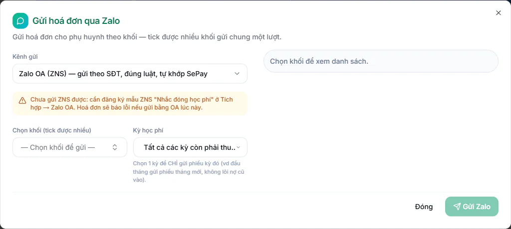

# Bước 14: Gửi phiếu cho phụ huynh và thu tiền

Phiếu đã soát xong ở [Bước 13](13-xuat-phieu-hoc-phi.md), giờ bạn đưa phiếu đến tay phụ huynh, ghi nhận tiền khi họ đóng và nhắc những ai còn nợ.

## Mục tiêu

Sau bước này, phụ huynh đã nhận phiếu, mỗi khoản tiền thu được đã gắn vào đúng phiếu, và bạn biết ai còn nợ để nhắc.

## Cần có trước

- Phiếu của tháng đã được tạo và soát (xem [Bước 13](13-xuat-phieu-hoc-phi.md)).
- **Mẫu hoá đơn** đã lưu thông tin thật của trung tâm, gồm ngân hàng nhận và số tài khoản (xem [Bước 5](05-cau-hinh-hoc-phi.md)). Chưa lưu thì phiếu mang thông tin mẫu có sẵn, chưa phải của trung tâm bạn, và không có mã QR.
- Muốn gửi Zalo: trung tâm có gói mở rộng **Zalo (Cá nhân + OA)** và đã đăng nhập ít nhất một nick Zalo cá nhân, có từ hai nick thì nên đặt nick gửi mặc định (xem [Bước 6](06-ket-noi-zalo-ngan-hang-email.md) và [Zalo cá nhân](../tich-hop/zalo-ca-nhan.md)). Hồ sơ phụ huynh cần có số điện thoại dùng Zalo.
- Nếu người gửi là **Kế toán**: Quản trị viên phải chia sẻ nick Zalo cho Kế toán trước (mục **Chia sẻ nick cho Kế toán** ở [Bước 6](06-ket-noi-zalo-ngan-hang-email.md)). Chưa chia sẻ thì Kế toán không dùng được nick đó, kể cả nick mặc định, và hệ thống báo **Không có quyền truy cập account này**.
- Muốn gửi email: đã nhập tài khoản email gửi đi ở [Bước 6](06-ket-noi-zalo-ngan-hang-email.md), và phụ huynh có địa chỉ email thật.
- Muốn báo qua app: phụ huynh đã có tài khoản **và đã được duyệt**. Tài khoản phụ huynh tạo từ hồ sơ học sinh luôn ở trạng thái chờ duyệt, Quản trị viên duyệt ở **Quản trị hệ thống → Quản lý Đăng ký** (xem [Bước 8](08-them-hoc-sinh-phu-huynh.md)). Phụ huynh xem phiếu trong Cổng Phụ huynh nên trung tâm cần gói **Cổng Phụ huynh**. Muốn máy phụ huynh rung, phụ huynh phải bật nhận thông báo trên điện thoại. Với app điện thoại KLASSA, trung tâm cần có gói **Ứng dụng Di động (PWA)** thì máy phụ huynh mới đăng ký nhận thông báo được.
- Vai của bạn là Kế toán, Quản lý chi nhánh hoặc Quản trị viên.

## Chọn cách gửi

| Cách | Dùng khi | Nút |
| --- | --- | --- |
| Zalo theo khối | Gửi hàng loạt cả khối, kèm ảnh phiếu (có mã QR chuyển khoản nếu Mẫu hoá đơn đã đủ thông tin ngân hàng) | **Gửi Zalo theo khối** |
| Zalo cho vài phiếu đã chọn | Gửi cho một số học sinh | **Gửi Zalo (n)** trên thanh chọn, hoặc **Thao tác khác → Gửi qua Zalo** ở cuối dòng cho một phiếu |
| Báo qua app | Phụ huynh đã được duyệt tài khoản, nhận chuông thông báo; ai đã bật nhận thông báo trên điện thoại thì máy rung | **Báo phụ huynh qua app** |
| Gửi email | Gửi từng phiếu cho phụ huynh có email thật, cần đã nhập email gửi đi | **Thao tác khác → Gửi email** ở cuối dòng phiếu |
| Gửi tay hoặc in giấy | Zalo lỗi hoặc đưa phiếu trực tiếp | Biểu tượng bàn tay ở cột **Đã gửi** |

## Gửi phiếu qua Zalo theo khối

::: steps
1. Vào **Tài chính → Kế toán → Hoá đơn chi tiết**.
2. Bấm **Gửi Zalo theo khối**. Hộp **Gửi hoá đơn qua Zalo** hiện ra.

   

3. Nếu trung tâm đã kết nối Zalo OA, đầu hộp có ô **Kênh gửi**. Muốn làm theo các bước dưới đây (gửi ảnh hoá đơn bằng nick Zalo cá nhân), chọn **Zalo cá nhân**. Nếu chưa kết nối Zalo OA thì không có ô này, hộp luôn gửi bằng Zalo cá nhân.
4. Ở mục **Chọn khối (tick được nhiều)**, bấm vào ô để mở danh sách và tick các khối cần gửi. Ô hiện **Chọn khối để gửi** khi chưa tick khối nào.
5. Mở ô **Kỳ học phí** và chọn đúng tháng cần gửi. Mặc định là **Tất cả các kỳ còn phải thu (gom cả nợ cũ)**, nghĩa là cả phiếu các tháng trước còn nợ cũng bị gửi. Đầu tháng muốn chỉ gửi phiếu tháng mới thì chọn đúng một kỳ.
6. Mở ô **Gửi từ nick** (chỉ hiện khi đã có nick Zalo cá nhân). **Tự động** nghĩa là nick nào đang trò chuyện với phụ huynh đó thì gửi bằng nick đó. Có thể chọn một nick cụ thể cho lần gửi này.
7. Ở mục **Gửi đến**, chọn **Phụ huynh** (gửi riêng từng phụ huynh) hoặc **Nhóm lớp Zalo** (gửi vào nhóm Zalo của lớp, chỉ gửi được ảnh).
8. Chọn **Gửi ảnh hoá đơn** hoặc **Gửi tin nhắn**. Ảnh hoá đơn chỉ có mã QR chuyển khoản khi Mẫu hoá đơn đã lưu đúng **Ngân hàng nhận** và **Số tài khoản**. Chưa lưu thì ảnh không có QR và mang thông tin mẫu có sẵn, hãy quay lại [Bước 5](05-cau-hinh-hoc-phi.md) trước khi gửi.
9. Soạn lời nhắn ở ô **Ghi chú kèm ảnh** (hoặc **Nội dung tin nhắn**). Bấm các biến ở dòng **Chèn biến** để hệ thống tự điền tên học sinh, số tiền theo từng em. Bấm **Xem trước mẫu** để xem bản gửi cho một em mẫu. Có thể lưu lời nhắn thành mẫu bằng **+ Lưu mẫu** hoặc **Đặt làm mặc định**.
10. Xem mục **Danh sách sẽ gửi**. Ghi dạng (số sẽ gửi)/(tổng số). Bỏ tick ở em nào bạn không muốn gửi. Có **Chọn hết** và **Bỏ hết**.
11. Hệ thống gửi từng người, giãn cách để tránh bị chặn thư rác, nên phải **giữ tab trình duyệt mở** đến khi xong. Khi gửi hơn 50 phiếu, dòng cảnh báo màu cam **Sẽ gửi ... hoá đơn** hiện kèm số phút ước tính.
12. Bấm **Gửi Zalo** (kèm số người, ví dụ **Gửi Zalo (25)**).
13. Hộp **Đang gửi hoá đơn qua Zalo...** hiện tiến độ. Cần ngừng giữa chừng thì bấm **Dừng gửi**. Người đã nhận sẽ tự được bỏ qua khi bạn mở gửi lại.
:::

::: tip Mẹo
Phụ huynh có phiếu đã từng gửi Zalo được tự bỏ qua để khỏi gửi trùng. Ở dòng **Bỏ qua ... hoá đơn ĐÃ GỬI Zalo trước đó**, bỏ tick nếu muốn gửi lại.
:::

### Đọc kết quả và xử lý người bị bỏ qua

Khi gửi xong, hộp **Kết quả gửi hoá đơn qua Zalo** hiện số **thành công**, **lỗi**, **bỏ qua**. Người bị bỏ qua chưa nhận được gì, bạn cần xử lý tay. Hộp liệt kê từng người theo lý do:

| Lý do hiện trong hộp | Cách xử lý |
| --- | --- |
| **Có Zalo nhưng chưa kết bạn với nick gửi** | Bấm **Gửi lời mời** ở danh sách, khi phụ huynh đồng ý thì gửi lại |
| **Chưa tìm thấy Zalo phụ huynh** | Xin số Zalo thật rồi cập nhật hồ sơ phụ huynh |
| **Lớp chưa gắn nhóm Zalo** | Gắn nhóm Zalo cho lớp hoặc gửi theo từng phụ huynh |
| **Đã gửi Zalo trước đó** | Không cần làm gì, trừ khi cần gửi lại |
| **Bỏ tick thủ công** | Do bạn bỏ chọn |

Bấm **Sao chép** để lấy danh sách người bị bỏ qua gửi cho đồng nghiệp xử lý. Phần **PH chưa nhận đủ** liệt kê những em cần gửi lại. Mọi lần gửi được lưu, xem lại bằng nút **Lịch sử gửi Zalo** ở đầu trang **Quản lý Hoá đơn**.

::: warning Lưu ý
Nếu nick Zalo mặc định đã bị đăng xuất, hệ thống tạm chuyển sang **Tự động** cho lần gửi đó. Vào **AI Hub → Tích hợp**, phần Zalo cá nhân, để quét QR đăng nhập lại nick. Trung tâm đã kết nối Zalo OA thì ô **Kênh gửi** cho chọn giữa Zalo cá nhân và Zalo OA, và ô này mở sẵn theo lựa chọn ở **AI Hub → Tích hợp**, phần Zalo OA, tab **Chọn kênh** (chọn Zalo OA thì mở sẵn Zalo OA). Khi ô đang ở Zalo OA, hộp chỉ còn **Kênh gửi**, khối, **Kỳ học phí** và danh sách người nhận, các ô **Gửi từ nick**, **Gửi đến**, ảnh hoặc tin nhắn, **Ghi chú kèm ảnh** và **Chèn biến** chỉ hiện ở Zalo cá nhân. Kênh Zalo OA gửi theo số điện thoại phụ huynh, không gửi ảnh, và chỉ gửi được khi trung tâm đã đăng ký mẫu tin **Nhắc đóng học phí** ở phần Zalo OA.
:::

## Báo phụ huynh qua app

::: steps
1. Ở trang **Quản lý Hoá đơn**, bấm **Báo phụ huynh qua app**.
2. Chọn **Kỳ học phí**, tuỳ chọn **Lớp** và tick **Khối** (tick được nhiều).
3. Đọc dòng tóm tắt: bao nhiêu phiếu còn phải đóng, bao nhiêu phiếu đã báo trước đó, bao nhiêu phiếu chưa có tài khoản phụ huynh nên không gửi được. Dòng này cũng đếm cả phụ huynh có tài khoản nhưng chưa được duyệt. Thấy số này lớn thì vào **Quản trị hệ thống → Quản lý Đăng ký** để duyệt, rồi mở lại hộp.
4. Bấm vào một dòng học sinh để xem trước tin phụ huynh sẽ nhận. Phụ huynh bấm vào tin là mở mục học phí trên app.
5. Tick **Báo lại cả phiếu đã báo trước đó** nếu cần nhắc lần nữa.
6. Bấm **Gửi thông báo** (kèm số phiếu).
:::

Tạo phiếu không tự báo phụ huynh. Đây là bước bạn chủ động làm sau khi đã soát xong. Phiếu được báo sẽ hiện nhãn **App** ở cột **Đã gửi**. Phụ huynh nhận tin ở chuông thông báo, ai đã bật nhận thông báo trên điện thoại thì máy rung. Trong hộp, dòng phiếu có phụ huynh đã cài app ghi **Sẽ báo · máy rung**, phiếu của phụ huynh chưa đăng ký máy nhận thông báo vẫn được báo ở chuông.

## Gửi phiếu qua email

Dùng khi phụ huynh quen đọc email hoặc Zalo không liên lạc được. Mỗi lần gửi một phiếu.

::: steps
1. Vào **Tài chính → Kế toán → Hoá đơn chi tiết**.
2. Ở cuối dòng của phiếu, bấm biểu tượng **Thao tác khác** (ba chấm), chọn **Gửi email**.
3. Hộp **Xác nhận gửi email** hiện tên học sinh và mã hoá đơn. Bấm **Gửi email**.
:::

Nếu phụ huynh chưa có email, hệ thống báo **Học sinh chưa có phụ huynh hoặc phụ huynh chưa có email. Vui lòng cập nhật thông tin.** Nếu trung tâm chưa nhập email gửi đi, hệ thống báo chưa cấu hình email, hãy làm [Bước 6](06-ket-noi-zalo-ngan-hang-email.md).

::: warning Lưu ý
Khi hồ sơ phụ huynh bỏ trống email, tài khoản phụ huynh dùng một địa chỉ tự sinh từ số điện thoại để đăng nhập. Phụ huynh không biết địa chỉ này nên sẽ không đọc được thư. Với phụ huynh như vậy, hãy cập nhật email thật hoặc gửi bằng Zalo.
:::

## Đánh dấu đã gửi tay hoặc in giấy

Khi bạn đưa phiếu cho phụ huynh bằng cách khác, đánh dấu để danh sách đã gửi đủ.

::: steps
1. Ở cột **Đã gửi** của phiếu, bấm biểu tượng bàn tay (di chuột vào hiện chữ **Đánh dấu đã gửi thủ công / xem lịch sử gửi**). Trong hộp **Chi tiết hóa đơn**, nút này ghi **Tick gửi tay**. Hộp **Đánh dấu hoá đơn đã gửi** hiện ra.
2. Chọn **Kênh đã gửi**: **Gửi tay** (Messenger, Zalo riêng, SMS riêng), **In giấy đưa PH trực tiếp**, **Email** (gửi ngoài hệ thống) hoặc **Khác**.
3. Điền **Ghi chú (tuỳ chọn)**, ví dụ đã đưa phụ huynh lúc đón con.
4. Bấm **Tick đã gửi**.
:::

Nếu bạn đã bật công tắc **Phụ huynh chỉ thấy phiếu đã gửi** ở [Bước 13](13-xuat-phieu-hoc-phi.md), đánh dấu này cũng làm phiếu hiện ra cho phụ huynh.

## Ghi nhận thanh toán

Có hai trường hợp: phụ huynh chuyển khoản qua ngân hàng đã kết nối, hoặc bạn nhập tay.

### Tự động qua ngân hàng

Khi trung tâm đã kết nối ngân hàng (xem [Bước 6](06-ket-noi-zalo-ngan-hang-email.md) và [Kết nối ngân hàng](../tich-hop/ngan-hang.md)), phụ huynh chuyển khoản với nội dung có mã hoá đơn, đúng như mã QR trên ảnh phiếu. Hệ thống nhận tiền, tìm đúng phiếu chưa thanh toán và ghi nhận. Bạn chỉ cần kiểm tra lại ở **Tài chính → Thanh toán**, tab **Đối soát** (hiện với người có quyền quản lý thanh toán học phí, nơi khớp tay các khoản chưa tự khớp).

### Nhập tay

::: steps
1. Vào **Tài chính → Kế toán → Hoá đơn chi tiết**. Có thể lọc bằng tab **Chưa TT** để chỉ thấy phiếu chưa thanh toán (trên màn hình, "TT" là viết tắt của thanh toán).
2. Ở dòng của phiếu, bấm biểu tượng **Ghi nhận thanh toán** (hình đồng tiền). Chỉ phiếu chưa thanh toán hoặc thanh toán một phần mới có nút này. Có thể mở hộp từ **Tài chính → Học phí**, tab **Thanh toán**, nút **Ghi nhận thanh toán**.
3. Trong hộp **Ghi nhận thanh toán**, chọn **Hóa đơn** (bắt buộc). Mở từ dòng phiếu thì ô này không hiện vì phiếu đã được chọn sẵn.
4. Nhập **Số tiền thu (VNĐ)** (bắt buộc, lớn hơn 0) và **Ngày thanh toán** (bắt buộc).
5. Chọn **Phương thức thanh toán** (bắt buộc): **Tiền mặt**, **Chuyển khoản ngân hàng**, **MoMo** hoặc **VNPay**.
6. Nhập **Mã tham chiếu** (ví dụ mã giao dịch ngân hàng) và **Ghi chú** nếu cần.
7. Bấm **Ghi nhận thanh toán**, kiểm tra lại ở hộp **Xác nhận ghi nhận thanh toán** rồi bấm **Xác nhận ghi nhận**.
:::

Thu một phần thì phiếu chuyển sang trạng thái **TT 1 phần**, thu đủ thì sang **Đã TT**.

::: warning Lưu ý
Số tiền lớn hơn số còn nợ bị chặn để tránh gõ nhầm. Nếu phụ huynh cố ý đóng dư, tick ô **Cho phép thu dư** trong hộp (ô này chỉ hiện khi số tiền bạn nhập lớn hơn số còn nợ). Phiếu được thu đủ, phần dư thành credit cho học sinh dùng ở kỳ sau.
:::

## Theo dõi công nợ

Còn phụ huynh chưa đóng thì xem và nhắc ở hai nơi.

- **Tài chính → Kế toán → Quản lý công nợ**: bảng **Danh sách học sinh nợ** kèm các ô **Tổng nợ**, **HS đang nợ**, **Phiếu chưa TT**, **Credit có thể trừ**. Tìm theo tên, mã học sinh hoặc số điện thoại, lọc theo khối, bấm vào một em để xem và sửa phiếu, có nút xuất Excel.
- **Tài chính → Thu hồi công nợ** (Quản trị viên và Quản lý chi nhánh): ba tab **Danh sách nợ quá hạn**, **Nhắc nợ**, **Lịch sử nhắc**. Ở tab **Nhắc nợ** bấm **Xem trước & Gửi nhắc**, hộp **Soạn & chốt nhắc nợ** cho chọn kênh, soạn lời nhắn, tick phiếu cần nhắc rồi bấm **Gửi nhắc**.

Muốn tự đánh dấu đã nhắc qua điện thoại, dùng nút đánh dấu đã nhắc thủ công ở dòng phiếu trong danh sách quá hạn. Chi tiết xem [Quản lý công nợ](../ke-toan/cong-no.md) và [Thu hồi công nợ](../ke-toan/thu-hoi-cong-no.md).

::: details Trong danh sách phiếu có dòng nhãn "Đã gộp", có cần thu không?
Không. Khi học sinh còn nợ phiếu kỳ trước, khoản nợ đó được cộng vào phiếu mới và phiếu cũ chuyển sang **Đã gộp**, kể cả phiếu đã gửi phụ huynh. Phụ huynh chỉ cần đóng phiếu mới, bạn thu và ghi nhận tiền theo phiếu mới nhất. Nếu phiếu mới bị xoá thì phiếu cũ tự mở lại. Xem thêm [Tạo hoá đơn](../hoc-phi/tao-hoa-don.md).
:::

::: tip Mẹo
Nếu trung tâm bật **Phụ huynh chỉ thấy phiếu đã gửi**, tin nhắc học phí tự động bỏ qua phiếu chưa gửi. Gửi phiếu trước rồi mới nhắc.
:::

## Kiểm tra đã xong

- [ ] Mọi phiếu của tháng ở cột **Đã gửi** đã có dấu gửi (Zalo, App hoặc gửi tay), hoặc ở dòng **Tình trạng gửi** bạn chọn **Chưa gửi** thì danh sách trống.
- [ ] Người bị bỏ qua trong hộp kết quả đã được xử lý.
- [ ] Nếu dùng báo qua app: phụ huynh đã được duyệt tài khoản, dòng "chưa có tài khoản phụ huynh" trong hộp đã giảm về mức bạn chấp nhận.
- [ ] Các khoản phụ huynh đã đóng đều có phiếu ở trạng thái **Đã TT** hoặc **TT 1 phần**.
- [ ] Danh sách nợ đã được nhắc.

## Câu hỏi thường gặp

::: details Gửi Zalo xong nhưng phụ huynh nói chưa thấy?
Mở **Lịch sử gửi Zalo** và hộp kết quả để xem em đó có nằm trong mục **bỏ qua** hoặc **PH chưa nhận đủ** không. Hay gặp nhất là chưa kết bạn với nick gửi. Bấm **Gửi lời mời** rồi gửi lại.
:::

::: details Phụ huynh chuyển khoản nhưng phiếu vẫn chưa thanh toán?
Có thể nội dung chuyển khoản thiếu mã hoá đơn hoặc trung tâm chưa kết nối ngân hàng. Kiểm tra ở **Tài chính → Thanh toán**, tab **Đối soát**, hoặc ghi nhận tay theo hướng dẫn trên.
:::

::: details Ghi nhận nhầm một khoản thanh toán thì sao?
Mở **Chi tiết hóa đơn** của phiếu, ở mục **Lịch sử thanh toán** bấm biểu tượng **Xóa thanh toán này** cạnh khoản sai, rồi ghi nhận lại số đúng. Phiếu đã ở trạng thái **Đã TT** thì Quản trị viên phải bấm **Mở khóa (ADMIN)** trước. Chi tiết xem [Thanh toán](../hoc-phi/thu-chi.md).
:::

## Bước tiếp theo

Tiền học đã thu xong, sang [Bước 15: Chốt lương cuối tháng](15-chot-luong-cuoi-thang.md) để trả lương cho giáo viên và nhân viên. Xem thêm [Gửi hoá đơn qua Zalo](../hoc-phi/gui-hoa-don-zalo.md) và [Báo phụ huynh qua app](../hoc-phi/bao-phu-huynh.md).
