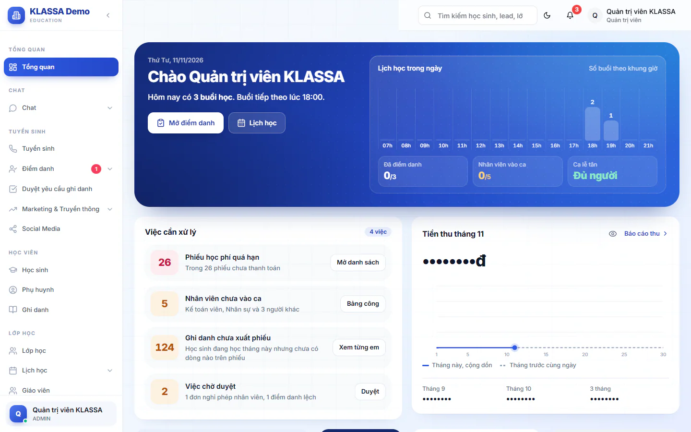
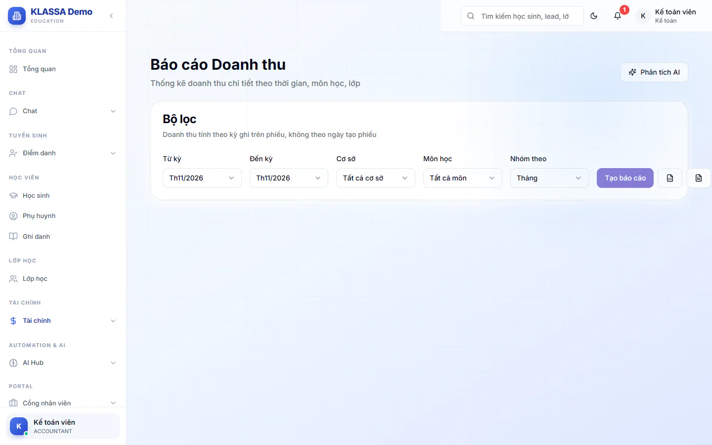

# Bước 16: Theo dõi báo cáo và khoá sổ kỳ

Đây là bước cuối của lộ trình. Bạn đã tạo lớp, ghi danh, điểm danh, xuất phiếu, thu tiền và chốt lương. Giờ là lúc nhìn lại để biết trung tâm đang chạy thế nào và việc gì cần làm tiếp.

## Mục tiêu

Sau bước này, bạn biết xem gì mỗi sáng, xem gì cuối tháng, và biết cách chốt số liệu của một kỳ.

## Cần có trước

- Đã hoàn thành các bước trước, nhất là [Bước 10](10-diem-danh-buoi-dau.md) đến [Bước 15](15-chot-luong-cuoi-thang.md). Báo cáo chỉ có số khi đã có điểm danh, phiếu và thanh toán.
- Mỗi vai thấy các báo cáo khác nhau, xem bảng ở từng phần bên dưới.

## Nhịp theo dõi gợi ý

| Khi nào | Xem gì | Ở đâu |
| --- | --- | --- |
| Mỗi sáng | Buổi học hôm nay, nhận xét hôm qua, nhân viên, ca lễ tân | Trang chủ, khung **Việc cần xử lý** |
| Mỗi ngày | Buổi chưa điểm danh, buổi bị lệch | **Điểm danh → Điểm danh cơ bản** |
| Mỗi tuần | Danh sách học sinh đang nợ | **Tài chính → Kế toán → Quản lý công nợ** |
| Mỗi tuần | Tiền phụ huynh đã đóng | **Tài chính → Thanh toán** |
| Hằng tháng | Rà các phiếu kết quả học tập đã gửi phụ huynh (xem [Bước 12](12-bao-ket-qua-hoc-tap.md)) | Menu **Phiếu tháng** |
| Cuối tháng | Doanh thu, nợ quá hạn, tỷ lệ điểm danh | **Tài chính → Báo cáo** |
| Đầu tháng sau | Chốt lương tháng vừa rồi (xem [Bước 15](15-chot-luong-cuoi-thang.md)) | **Quản lý HR → Quản lý lương** |
| Sau khi đối soát | Khoá kỳ (Quản trị viên hoặc Kế toán) | **Tài chính → Kế toán → Khoá sổ kỳ** |

## Xem tình hình mỗi ngày ở trang chủ

Trang chủ của Quản trị viên, Quản lý chi nhánh và Quản lý gom việc trong ngày vào một chỗ. Mỗi việc có nút mở thẳng trang để xử lý.

::: steps
1. Đăng nhập, bạn vào ngay trang chủ (mục **Tổng quan** trong menu).
2. Đọc dải chào ở trên cùng. Câu tóm tắt cho biết hôm nay có mấy buổi học và có buổi nào đã hết giờ mà chưa ai điểm danh. Khung **Lịch học trong ngày** cho thấy số buổi theo khung giờ, kèm các số nhanh **Đã điểm danh**, **Nhân viên vào ca** và **Ca lễ tân**. Số nào chưa có dữ liệu thì không hiện, ví dụ ngày không ai có ca thì thiếu ô **Nhân viên vào ca**.
3. Xem khung **Việc cần xử lý**. Việc gấp đứng trước, việc đã xong đứng sau cùng. Các việc hay gặp: **Phiếu học phí quá hạn**, **Buổi đã hết giờ chưa điểm danh**, **Giáo viên còn thiếu nhận xét**, **Nhân viên chưa vào ca**, **Ghi danh chưa xuất phiếu**, **Việc chờ duyệt**. Việc nào hôm nay không phát sinh thì không hiện: **Buổi đã hết giờ chưa điểm danh** chỉ hiện khi có buổi quá giờ, **Giáo viên còn thiếu nhận xét** chỉ hiện khi hôm qua có buổi học (đủ nhận xét thì đổi thành **Nhận xét hôm qua đã đủ**).

   

4. Bấm nút ở từng việc, ví dụ **Mở điểm danh** hoặc **Xem ai thiếu**, để xử lý ngay.
5. Vai có quyền xem tài chính thấy thêm khung **Tiền thu tháng** cạnh đó. Số tiền được che sẵn, bấm vào số để hiện.
:::

Phần về người (nhận xét hôm qua, nhân viên vào ca, ca lễ tân) chỉ hiện cho Quản trị viên và Quản lý chi nhánh. Phần nào chưa đọc được số thì ghi rõ là chưa đọc được, không hiện số 0 giả. Số liệu tự đọc lại sau vài phút khi bạn để trang mở.

Các vai khác có trang chủ riêng theo việc của mình. Kế toán thấy **Tiền thu cộng dồn tháng**, **Phiếu quá hạn theo số ngày**, **Tiền vào hôm nay** và mục **Ghi danh chưa xuất phiếu**. Bấm **Xem từng em** để mở trang **Hoá đơn chi tiết** và xuất phiếu còn thiếu.

## Xem báo cáo cuối tháng

Vào **Tài chính → Báo cáo**. Mục này gồm nhiều báo cáo, vai nào được xem báo cáo nào thì thấy trong menu.

| Báo cáo | Cho biết | Vai thấy |
| --- | --- | --- |
| **Tổng quan** | Đã thu tháng này, tổng nợ quá hạn, học sinh đang học, tỷ lệ điểm danh 30 ngày | Quản trị viên, Quản lý chi nhánh |
| **Báo cáo doanh thu** | Doanh thu theo tháng, môn hoặc cơ sở | Quản trị viên, Quản lý chi nhánh, Kế toán |
| **Báo cáo học sinh** | Danh sách học sinh kèm điểm danh, học phí, credit | Quản trị viên, Quản lý chi nhánh, Quản lý, Kế toán, Lễ tân |
| **Báo cáo nợ** | Phiếu quá hạn theo số ngày để nhắc nợ | Quản trị viên, Quản lý chi nhánh, Kế toán |

### Báo cáo doanh thu

::: steps
1. Vào **Tài chính → Báo cáo → Báo cáo doanh thu**.
2. Chọn **Từ kỳ** và **Đến kỳ**. Doanh thu tính theo kỳ ghi trên phiếu, không theo ngày tạo phiếu.
3. Chọn **Nhóm theo**: **Tháng**, **Môn học** hoặc **Cơ sở**. Có thể lọc thêm theo cơ sở hoặc môn.
4. Bấm **Tạo báo cáo**.

   

5. Đọc bốn ô **Tổng doanh thu**, **Đã thu**, **Chưa thu**, **Quá hạn**, hai biểu đồ cột và tròn, rồi bảng **Chi tiết**.
6. Cần gửi cho người khác thì bấm biểu tượng xuất Excel hoặc xuất PDF cạnh nút **Tạo báo cáo**.
:::

::: tip Mẹo
Lấy ví dụ ở [Bước 13](13-xuat-phieu-hoc-phi.md): phiếu tháng 12 của An là 1.200.000đ. Phiếu ghi kỳ tháng 12 nên khoản này tính vào doanh thu tháng 12, kể cả khi bạn xuất phiếu từ cuối tháng 11. Phụ huynh đóng rồi thì nó nằm ở ô **Đã thu**, chưa đóng thì ở ô **Chưa thu**.
:::

### Báo cáo nợ

Vào **Tài chính → Báo cáo → Báo cáo nợ** (tên đầy đủ trên trang là **Báo cáo nợ quá hạn**). Chọn **Tháng**, lọc theo số ngày quá hạn và **Khối**. Ô lớn đầu tiên cho tổng tiền nợ quá hạn và số phiếu, ba ô nhỏ bên cạnh đếm số phiếu theo nhóm **≤7 ngày**, **≤30 ngày** và **>30 ngày**. Bấm **Gửi nhắc hàng loạt** để soạn và gửi nhắc cho nhiều phụ huynh, hoặc **Xuất Excel** để lấy danh sách. Cách nhắc chi tiết xem [Bước 14](14-gui-phieu-va-thu-tien.md). Chi tiết hai báo cáo này có ở [Báo cáo doanh thu](../ke-toan/bao-cao-doanh-thu.md) và [Báo cáo nợ quá hạn](../ke-toan/qua-han.md). Muốn xem tổng nợ còn phải thu xếp theo mức nguy cấp thì mở **Nợ kế toán** ngay dưới đó, xem [Nợ kế toán](../ke-toan/bao-cao-no-ke-toan.md).

### Báo cáo điểm danh và học sinh

- **Điểm danh → Điểm danh cơ bản**, nút **Báo cáo chi tiết**: mở trang **Chi tiết điểm danh**, xem theo tháng, tuần hoặc ngày, lọc theo khối và lớp, tìm theo lớp hoặc giáo viên.
- Ở trang **Điểm danh**, khung **Học sinh cần quan tâm** liệt kê em vắng nhiều trong 30 ngày qua.
- Giáo viên và Trợ giảng có mục **Báo cáo điểm danh** riêng trong menu cho lớp mình phụ trách.

## Chốt số liệu một kỳ bằng Khoá sổ kỳ

Sau khi soát phiếu và đối soát tiền xong, khoá kỳ để số liệu không bị sửa nhầm. Quản trị viên và Kế toán mở được trang này và khoá được kỳ. Quản lý chi nhánh không thấy mục **Khoá sổ kỳ**, nên hãy nhờ Quản trị viên hoặc Kế toán khoá khi bạn đã đối soát xong. Việc mở lại một kỳ đã khoá thì chỉ Quản trị viên làm được. Xem thêm [Khoá sổ kỳ](../ke-toan/khoa-so-ky.md).

::: steps
1. Vào **Tài chính → Kế toán → Khoá sổ kỳ**. Trang này rà soát phiếu của kỳ rồi khoá số liệu.
2. Bấm **Khoá kỳ**. Hộp **Khoá kỳ** hiện ra.
3. Ở ô **Chọn tháng**, chọn tháng cần khoá. Điền **Ghi chú (tuỳ chọn)** nếu cần.
4. Bấm nút khoá ở cuối hộp, tên nút ghi kèm tháng, ví dụ **Khoá kỳ 11/2026**.
5. Sau khi khoá, xem khung **Rà soát kỳ** để biết hệ thống đã quét bao nhiêu phiếu và có cảnh báo nào. Cảnh báo không chặn việc khoá, bạn xử lý dần ở trang **Hoá đơn chi tiết** bằng nút **Rà soát phiếu**.
:::

::: warning Lưu ý
Kỳ đã khoá thì không xuất thêm phiếu cho kỳ đó, và chỉ Quản trị viên sửa được tiền trên phiếu của kỳ đã khoá. Điểm danh sửa sau khi khoá cũng không tự đi vào phiếu, hệ thống chỉ báo cảnh báo. Khoá khi chắc chắn mọi phiếu đã đúng.
:::

## Kiểm tra đã xong

- [ ] Bạn đọc được khung **Việc cần xử lý** ở trang chủ (hoặc trang chủ của vai mình) và hiểu từng mục.
- [ ] Đã tạo thử **Báo cáo doanh thu** cho tháng vừa rồi.
- [ ] Đã xem **Báo cáo nợ** và biết cần nhắc những ai.
- [ ] Biết cách khoá kỳ khi đối soát xong, và biết việc này do Quản trị viên hoặc Kế toán làm.

## Câu hỏi thường gặp

::: details Trang chủ của tôi không có số nhân viên vào ca và nhận xét hôm qua?
Phần này chỉ có cho Quản trị viên và Quản lý chi nhánh. Quản lý vẫn thấy buổi học và việc cần xử lý. Lễ tân và Kế toán có trang chủ riêng theo việc của mình.
:::

::: details Doanh thu trên báo cáo khác với tiền mặt tôi nhận được?
Báo cáo doanh thu tính theo kỳ trên phiếu, còn tiền thực nhận ghi theo ngày thanh toán. Hai con số lệch nhau khi phụ huynh đóng sớm hoặc trễ so với kỳ. Xem ô **Đã thu** và **Chưa thu** để đối chiếu.
:::

::: details Số trên báo cáo bằng 0 hoặc trống?
Kiểm tra lại bộ lọc kỳ, cơ sở, môn. Nếu vẫn trống, xem phiếu và thanh toán của kỳ đã được tạo chưa ở [Bước 13](13-xuat-phieu-hoc-phi.md) và [Bước 14](14-gui-phieu-va-thu-tien.md).
:::

::: details Tôi khoá nhầm kỳ, làm sao mở lại?
Chỉ Quản trị viên mở lại được. Quản trị viên vào lại **Khoá sổ kỳ**, tìm dòng của kỳ đó trong bảng và bấm **Mở lại**, rồi **Xác nhận mở lại**. Kế toán không có nút **Mở lại**, nên Kế toán khoá nhầm thì nhờ Quản trị viên. Với kỳ khoá theo cách hiện nay, thao tác này chỉ mở lại trạng thái, không đụng tới phiếu.
:::

::: details Bấm khoá kỳ mà báo lỗi?
Nếu hệ thống báo **Vui lòng chọn tháng cần khoá**, bạn chưa chọn tháng ở ô **Chọn tháng**. Nếu báo kỳ đã được khoá từ trước, kỳ đó đã khoá rồi, xem dòng của nó trong bảng.
:::

## Bạn đã hoàn thành lộ trình

Chúc mừng, trung tâm của bạn đã chạy trọn một vòng từ lớp học đến thu tiền và trả lương. Từ đây, mỗi tháng bạn lặp lại vòng từ [Bước 10](10-diem-danh-buoi-dau.md) đến Bước 16: điểm danh, xử lý thay đổi trong tháng, báo kết quả học tập, xuất phiếu, gửi phiếu và thu tiền, chốt lương, xem báo cáo.

Tiếp tục theo công việc của từng vai:

- [Hướng dẫn cho Lễ tân](vai-le-tan.md)
- [Hướng dẫn cho Giáo viên](vai-giao-vien.md)
- [Hướng dẫn cho Kế toán](vai-ke-toan.md)
- [Hướng dẫn cho Phụ huynh](vai-phu-huynh.md)
- [Hướng dẫn cho Quản lý chi nhánh](vai-quan-ly-chi-nhanh.md)

Gặp vướng mắc, xem [Câu hỏi thường gặp](../faq/tong-hop.md), [Xử lý sự cố](../faq/xu-ly-su-co.md) hoặc [Liên hệ hỗ trợ](../faq/lien-he.md).
