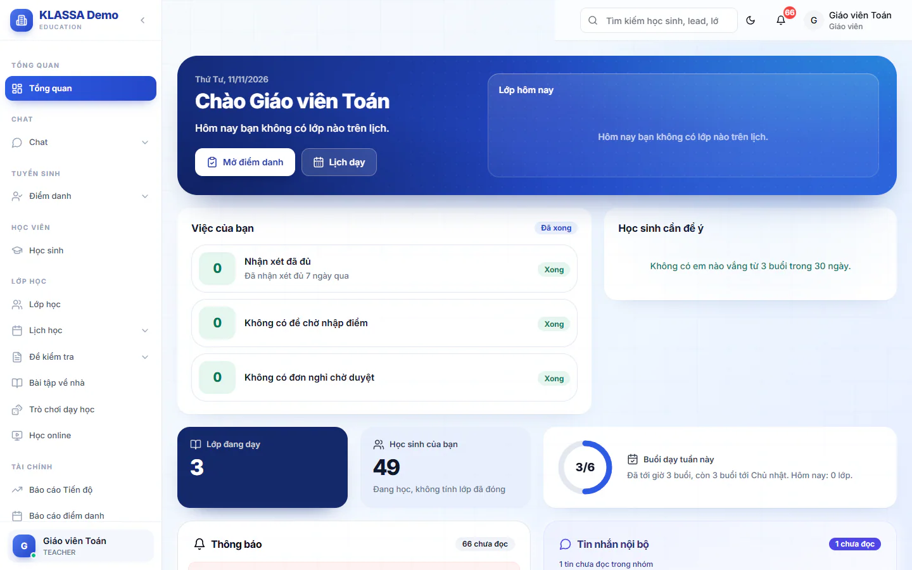

# Hướng dẫn nhanh cho Giáo viên và Trợ giảng

Bài này đi theo một ngày dạy và cả tháng của giáo viên và trợ giảng. Hai vai dùng gần như cùng một bộ menu, chỉ khác ở trang chủ và một vài mục. Chỗ nào khác nhau, bài có ghi rõ.

Bạn chỉ thấy dữ liệu của lớp mình được phân công. Lớp khác không hiện ra.

::: tip Chưa thấy lớp nào?
Lớp và phân công giáo viên, trợ giảng do quản lý làm ở [Bước 7: Tạo lớp, xếp giáo viên, trợ giảng và lịch học](07-tao-lop-va-lich-hoc.md). Chưa được xếp thì nhờ quản lý. Hồ sơ nhân sự và cách tính lương của bạn cũng do quản lý khai ở [Bước 4](04-ho-so-nhan-su-va-cach-tinh-luong.md). Việc đó không cần để được xếp vào lớp, nhưng cần để lương cuối tháng ra đúng.
:::

## Đầu ngày: mở trang chủ

Vào **Tổng quan**. Trang chủ hiện lời chào và những việc của riêng bạn.

**Giáo viên** thấy:

- Khung **Lớp hôm nay** với danh sách lớp, giờ học và sĩ số.
- Nút lớn **Điểm danh** kèm tên lớp sắp học (hoặc **Mở điểm danh** khi không có lớp gấp), và nút **Lịch dạy**.
- Khung **Việc của bạn** và khung **Học sinh cần để ý**.

**Trợ giảng** thấy:

- Thẻ **Ca trợ giảng hôm nay** có nút **Có mặt**.
- Hai nút đầu trang: **Ca và thu nhập** và **Điểm danh học sinh**.
- Khung **Tháng này** với số buổi, số lần đã báo có mặt và thu nhập tạm tính.
- Khung **Lớp hôm nay** để mở điểm danh lớp bạn hỗ trợ.
- Khung **Việc của bạn** (chỉ nhắc buổi chưa nhận xét) và hai lối tắt **Phiếu lương**, **Nghỉ phép**.

Muốn xem lịch cả tuần, vào **Lịch học → Thời khóa biểu**. Xem thêm [Lịch dạy](../lop-hoc/lich-day.md).

## Trước giờ học: báo có mặt (trợ giảng)

Nút **Có mặt** ghi nhận bạn đã tới lớp ở ca trợ giảng. Giáo viên được xếp làm trợ giảng ở lớp khác cũng thấy thẻ này trên trang chủ.

Nút này chỉ ảnh hưởng đến lương khi Quản trị viên bật công tắc **Yêu cầu check-in mới tính lương ca trợ giảng** (ở **Cài đặt → Tổng quan**, tab **Cấu hình**, mục **Điểm danh**, mặc định tắt; xem phần D của [Bước 4](04-ho-so-nhan-su-va-cach-tinh-luong.md)). Khi công tắc tắt, lương ca trợ giảng tính theo phân công lớp, bạn có bấm hay không cũng vậy. Khi công tắc bật, ca nào thiếu lần **Có mặt** hợp lệ sẽ không được tính lương, trừ trợ giảng làm **Toàn thời gian** được miễn. Hãy hỏi quản lý xem trung tâm đang bật hay tắt.

::: steps
1. Vào **Tổng quan** và tìm thẻ **Ca trợ giảng hôm nay**.
2. Tới lớp rồi bấm **Có mặt**. Trước giờ học 60 phút nút hiện **Mở lúc ...** và chưa bấm được.
3. Thẻ đổi thành **Đã có mặt** kèm giờ bấm.
:::

Nếu bạn bấm ở ngoài vùng cho phép, ca hiện **Ngoài vùng, chờ QL** và chờ Quản trị viên hoặc Quản lý chi nhánh xác nhận. Quá 120 phút sau giờ tan, bạn không tự bấm được nữa. Khi đó nút đổi thành **Báo có mặt muộn** (nếu tháng đó bạn còn lượt) hoặc hiện **Quá giờ, nhờ QL xác nhận**.

::: tip Mẹo
Trang **Cổng nhân viên → Ca trợ giảng** liệt kê mọi ca trong tháng, trạng thái từng ca và thu nhập dự kiến.
:::

::: warning Lưu ý
Người làm bán thời gian được tính lương theo buổi dạy nên không cần chấm công cả ngày. Chỉ giáo viên và trợ giảng làm toàn thời gian mới có thêm thẻ chấm công trên trang chủ, với hai nút **Chấm công vào** và **Chấm công ra**.
:::

## Trong buổi học: điểm danh

Điểm danh là việc chính của bạn trong ngày.

::: steps
1. Vào **Điểm danh → Điểm danh cơ bản**, hoặc bấm tên lớp ở khung **Lớp hôm nay**.
2. Với lớp có trong lịch, bấm **Điểm danh** ở đúng dòng lớp. Buổi phát sinh ngoài lịch thì bấm **Điểm danh mới**.
3. Hộp điểm danh mở ra với mọi em được đặt sẵn là **Vắng**. Đổi trạng thái cho từng em có mặt.
4. Bấm **Lưu điểm danh**.
:::

::: warning Lưu ý
Nếu đóng hộp khi đã chấm mà chưa lưu, hệ thống hỏi lại. Chưa bấm **Lưu điểm danh** thì kết quả chưa được ghi.
:::

::: warning Điểm danh liên quan đến lương
Buổi học được ghi nhận khi có người điểm danh. Quên điểm danh thì buổi đó có thể không có để tính lương cho bạn. Hãy điểm danh xong trong ngày. Nếu lỡ quên, báo quản lý sớm để xử lý trước khi chốt lương cuối tháng. Lần điểm danh đầu tiên được hướng dẫn kỹ ở [Bước 10: Điểm danh buổi học đầu tiên](10-diem-danh-buoi-dau.md).
:::

Lễ tân sẽ chấm đối chiếu sau buổi học. Nếu lễ tân đã chấm khác bạn, sau khi bấm **Lưu điểm danh** hộp **Phát hiện xung đột điểm danh** hiện ra: bấm **Sửa theo ...** để lấy kết quả của người chấm trước, hoặc **Giữ nguyên ...** để giữ kết quả của bạn và chờ quản lý xem xét. Xem [Điểm danh đối chiếu](../diem-danh/doi-chieu.md). Khi trung tâm bật khoá điểm danh ngược, ngày đã quá hạn bạn không chấm được và cần nhờ Quản trị viên hoặc quản lý chi nhánh. Xem [Điểm danh hằng ngày](../diem-danh/cham-hang-ngay.md).

## Sau buổi học: nhận xét và theo dõi

Khung **Việc của bạn** trên trang chủ nhắc những việc còn tồn:

- **Buổi chưa nhận xét**: số buổi trong 7 ngày qua chưa có nhận xét. Bấm **Viết nhận xét** để mở danh sách.
- **Đề chưa nhập điểm** (chỉ giáo viên): đề đã tới ngày kiểm tra mà chưa có kết quả. Bấm **Nhập điểm**.
- **Đề chưa công bố điểm** (chỉ giáo viên): đã có điểm nhưng phụ huynh chưa thấy. Bấm **Công bố điểm**.
- **Đơn nghỉ chờ bạn duyệt** (chỉ giáo viên): đơn xin nghỉ của học sinh lớp bạn. Bấm **Duyệt đơn**.

Khung **Học sinh cần để ý** (chỉ giáo viên) liệt kê những em vắng từ 3 buổi trong 30 ngày, để bạn nhắc phụ huynh sớm.

Mục **Nhận xét lớp tôi** ở menu cho bạn xem và viết nhận xét của các lớp mình phụ trách.

## Kiểm tra và công bố điểm

Điều kiện trước: chỉ người **tạo đề** (và từng dạy lớp đó) hoặc Quản lý, Quản lý chi nhánh, Quản trị viên mới lưu điểm và **Công bố điểm** được. Đề do người khác tạo thì bạn chỉ xem được. Nếu mở đề của người khác rồi lưu điểm, hệ thống báo không tìm thấy đề. Muốn tự nhập điểm, bạn tạo đề riêng cho lớp mình.

::: steps
1. Vào **Đề kiểm tra → Danh sách đề**. Chưa có đề thì bấm **Tạo đề thủ công**, ở tab **Tạo rỗng** chọn **Lớp áp dụng**, nhập **Tên đề** và **Ngày** (ba ô bắt buộc). **Hệ số** mặc định 1.0, **Điểm tối đa** mặc định 10. Bấm **Tạo đề rỗng**, đề mở ra ngay. Ô **Công bố điểm ngay** mặc định không tích, nên để trống.
2. Nếu đã có đề do bạn tạo, mở đề đó từ danh sách.
3. Ở thẻ **Chấm điểm**, nhập điểm cho từng em rồi bấm **Lưu điểm**.
4. Kiểm tra lại, rồi bấm **Công bố điểm** và xác nhận.
:::

Đề mới tạo ở trạng thái chưa công bố, nên phụ huynh chưa thấy điểm cho đến khi bạn công bố. Nếu còn ô điểm vừa gõ chưa lưu, hệ thống nhắc bấm **Lưu điểm** trước.

Xem thêm [Bài đánh giá](../hoc-tap/bai-danh-gia.md) và [Công bố điểm](../hoc-tap/cong-bo-diem.md). Các mục khác trong nhóm **Đề kiểm tra** gồm **Ngân hàng câu hỏi**, **Ma trận đề thi** và **Chấm bài AI** (xem [Chấm bài AI](../hoc-tap/cham-bai-ai.md)). Bạn cũng có **Bài tập về nhà** và **Trò chơi dạy học** ở menu.

## Cuối tháng

### Phiếu kết quả học tập tháng

**Phiếu tháng lớp tôi** là phiếu kết quả học tập tháng của học sinh lớp bạn. Phiếu được chụp lại số liệu ngay lúc tạo, nên hãy làm đúng thứ tự:

::: steps
1. Viết hết nhận xét buổi học ở **Nhận xét lớp tôi** và chấm xong bài tập về nhà.
2. Nhập điểm các đề kiểm tra và bấm **Công bố điểm** (điểm chưa công bố thì phiếu không lấy).
3. Vào **Phiếu tháng lớp tôi**, chọn **Lớp** và **Tháng**, rồi bấm **Tạo phiếu cả lớp**.
4. Dùng **Nhập nhanh cả lớp** để bổ sung điểm và nhận xét còn thiếu.
5. Soát lại từng phiếu, bấm **Chốt phiếu**, rồi bấm **Gửi Zalo** cho phụ huynh.
:::

::: warning Lưu ý
Tạo phiếu sớm thì cột điểm và nhận xét còn trống, điểm công bố sau không tự chạy vào phiếu. Phiếu nháp thì bấm được **Tạo lại từ dữ liệu gốc**, nhưng thao tác này đè lên chỗ bạn đã sửa tay. Phiếu đã chốt thì phụ huynh đã nhận thông báo, và chỉ quản lý mới **Mở lại** được, nên hãy soát kỹ trước khi chốt.
:::

Nút **Gửi Zalo** cần gói mở rộng **Zalo (Cá nhân + OA)**, và bạn phải liên kết Zalo cá nhân ở **Cổng nhân viên → Zalo của tôi**. Bấm **Gửi Zalo** là chốt luôn các phiếu nháp: phụ huynh thấy phiếu và nhận thông báo ngay cả khi tin Zalo gửi lỗi. Chi tiết ở [Phiếu tháng](../hoc-tap/phieu-thang.md) và [Bước 12: Báo kết quả học tập cho phụ huynh](12-bao-ket-qua-hoc-tap.md).

### Báo cáo, phiếu lương và nghỉ phép

- **Báo cáo Tiến độ** và **Báo cáo điểm danh**: số liệu của các lớp bạn dạy.
- **Phiếu lương**: vào **Cổng nhân viên → Phiếu lương**, mở phiếu của tháng để xem chi tiết hoặc bấm **Tải PDF**. Bấm **Xác nhận đã nhận phiếu lương** sau khi đối chiếu. Phiếu chỉ hiện sau khi quản lý duyệt kỳ lương hoặc gửi phiếu cho bạn, nên chưa thấy phiếu thì hỏi quản lý. Xem [Phiếu lương](../cong-nhan-vien/phieu-luong.md).
- **Nghỉ phép**: vào **Cổng nhân viên → Nghỉ phép**, bấm **Tạo đơn mới**, chọn **Loại nghỉ phép** (bắt buộc), chọn ngày nghỉ, ghi lý do nếu cần, rồi bấm **Gửi đơn**.

::: warning Nghỉ phép không tự đổi người dạy
Đơn nghỉ phép được duyệt không tự chuyển buổi học cho người khác, và lương buổi đó vẫn tính cho giáo viên chính của lớp. Khi nghỉ buổi nào, hãy báo quản lý hoặc xin dạy thay trên app điện thoại. Quản lý và lễ tân tạo **yêu cầu dạy thay** ở trang **Điểm danh**, quản lý duyệt ở **Quản lý HR → Dạy thay**, lúc đó lương buổi mới chuyển sang người thay. Xem [Dạy thay](../nhan-su/dan-day-thay.md) và [Bước 11: Xử lý thay đổi trong tháng](11-thay-doi-trong-thang.md).
:::

::: tip Mẹo
Học sinh cần chuyển lớp, vắng dài ngày hay có vấn đề riêng thì nhắn quản lý qua **Chat → Tin nhắn** thay vì tự sửa hồ sơ. Giáo viên và trợ giảng chỉ xem được hồ sơ học sinh, không sửa được.
:::

## Câu hỏi thường gặp

::: details Tôi không thấy lớp nào ở khung Lớp hôm nay?
Hôm nay bạn không có lớp trên lịch, hoặc quản lý chưa phân công bạn vào lớp. Hãy nhờ quản lý kiểm tra phân công lớp.
:::

::: details Nút Có mặt bị mờ, ghi Mở lúc?
Nút chỉ mở trước giờ học 60 phút. Đến giờ đó nút tự mở, bạn không cần tải lại trang.
:::

::: details Tôi quên bấm Có mặt thì sao?
Nếu còn lượt trong tháng, bấm **Báo có mặt muộn** ở thẻ ca hoặc ở trang **Ca trợ giảng**. Hết lượt thì nhờ Quản trị viên hoặc Quản lý chi nhánh xác nhận giúp. Nếu trung tâm đang bật yêu cầu check-in thì ca quên bấm sẽ không có lương cho tới khi họ bấm **Xác nhận có mặt** ở **Quản lý HR → Giờ dạy** rồi tính lại phiếu lương.
:::

::: details Phụ huynh nói chưa thấy điểm?
Mở đề ở **Đề kiểm tra → Danh sách đề**. Nếu đề do bạn tạo và chưa công bố, bấm **Công bố điểm**. Nếu đề do quản lý tạo thì bạn không có nút này, hãy nhờ quản lý công bố.
:::

::: details Tôi mở đề mà lưu điểm bị báo không tìm thấy đề?
Đề đó do người khác tạo nên bạn chỉ xem được. Nhờ người tạo đề hoặc quản lý nhập điểm, hoặc tạo đề riêng của bạn.
:::

::: details Sao tháng này chưa có phiếu lương?
Phiếu chỉ hiện sau khi quản lý duyệt kỳ lương hoặc gửi phiếu cho bạn. Hãy hỏi quản lý xem lương tháng đã chốt chưa.
:::

::: details Bấm Gửi Zalo báo lỗi thì phụ huynh đã thấy phiếu chưa?
Rồi. Bấm **Gửi Zalo** đã chốt phiếu, phụ huynh thấy phiếu và nhận thông báo dù tin Zalo gửi lỗi. Kiểm tra bạn đã liên kết Zalo cá nhân ở **Cổng nhân viên → Zalo của tôi**, rồi gửi lại.
:::
