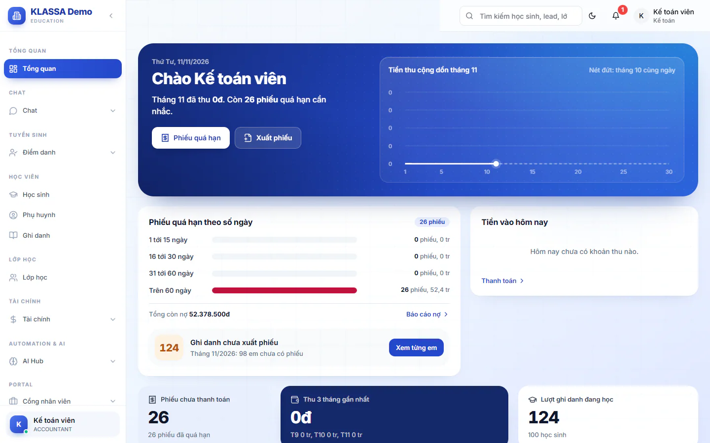

# Hướng dẫn nhanh cho Kế toán

Kế toán lo phần tiền học phí: lập phiếu, gửi phiếu, ghi nhận tiền thu, theo dõi nợ và khoá số liệu cuối kỳ. Bài này đi theo thứ tự công việc trong ngày và trong tháng, rồi nói rõ những gì Kế toán không làm được.

## Đầu ngày: xem trang chủ

Vào **Tổng quan**. Trang chủ của Kế toán gồm:

- Hai nút đầu trang: **Phiếu quá hạn** (mở báo cáo nợ) và **Xuất phiếu** (mở danh sách hoá đơn chi tiết).
- Biểu đồ **Tiền thu cộng dồn** của tháng này, có nét đứt là tháng trước tính đến cùng ngày.
- Khung **Phiếu quá hạn theo số ngày** để biết nợ nằm ở nhóm nào.
- Mục **Ghi danh chưa xuất phiếu**: số lượt ghi danh chưa có phiếu. Bấm **Xem từng em** để rà từng học sinh.
- Khung **Tiền vào hôm nay** với đường dẫn sang **Thanh toán**.
- Ba ô số: **Phiếu chưa thanh toán**, **Thu 3 tháng gần nhất** và **Lượt ghi danh đang học**.

## Trong ngày: ghi nhận tiền thu

Tiền phụ huynh chuyển khoản hoặc nộp trực tiếp cần được ghi vào đúng phiếu.

::: steps
1. Vào **Tài chính → Kế toán → Hoá đơn chi tiết**.
2. Gõ tên học sinh hoặc mã hoá đơn vào ô tìm kiếm để tìm phiếu.
3. Ở phiếu **Chưa thanh toán** hoặc **Thanh toán một phần**, bấm biểu tượng **Ghi nhận thanh toán**.
4. Trong hộp **Ghi nhận thanh toán**, điền **Số tiền thu (VNĐ)**, **Ngày thanh toán** và **Phương thức thanh toán** (ba ô bắt buộc), thêm **Mã tham chiếu** hoặc **Ghi chú** nếu cần, rồi bấm **Ghi nhận thanh toán**. Hộp mở ra đã điền sẵn số còn nợ, ngày hôm nay và phương thức **Tiền mặt**, hãy đổi nếu thực tế khác (ví dụ **Chuyển khoản ngân hàng**).
5. Hộp **Xác nhận ghi nhận thanh toán** hiện ra. Kiểm tra lại rồi bấm **Xác nhận ghi nhận**.
:::

::: tip Mẹo
Nếu số tiền nhập lớn hơn số còn nợ, hệ thống chặn lại. Phụ huynh cố ý đóng dư thì tích ô cho phép thu dư để phần dư chuyển thành credit.
:::

Để xem lại các khoản đã thu và đối soát với cổng thanh toán hoặc ngân hàng, vào **Tài chính → Thanh toán**. Trang này có các thẻ **Dashboard**, **MoMo**, **VNPay**, **SePay**, **Đối soát**, **Aging Report** và **Lịch sử**. Xem [Thanh toán](../hoc-phi/thu-chi.md).

Khoản thu ngoài học phí như sách hay cơ sở vật chất được lập ở **Tài chính → Phiếu phụ thu**.

## Gửi phiếu cho phụ huynh

Trang **Hoá đơn chi tiết** có sẵn các nút gửi hàng loạt ở đầu trang: **Gửi Zalo theo khối** và **Báo phụ huynh qua app**. Xem [Gửi hoá đơn qua Zalo](../hoc-phi/gui-hoa-don-zalo.md).

::: warning Cần có trước khi gửi Zalo
Gửi Zalo cần trung tâm đã bật gói **Zalo (Cá nhân + OA)**. Kế toán không tự thêm nick Zalo được, chỉ dùng được nick đã được **chia sẻ** cho mình. Chưa được chia sẻ thì khi gửi sẽ báo "Không có quyền truy cập account này", kể cả khi trung tâm đã có nick mặc định. Nhờ Quản trị viên chia sẻ nick cho bạn, cách làm nằm ở mục "Chia sẻ nick cho Kế toán" của [Bước 6](06-ket-noi-zalo-ngan-hang-email.md), xem thêm [Zalo cá nhân](../tich-hop/zalo-ca-nhan.md).
:::

Gửi qua email: ở **Hoá đơn chi tiết**, bấm biểu tượng **Thao tác khác** ở dòng phiếu, chọn **Gửi email**, rồi bấm **Gửi email** ở hộp **Xác nhận gửi email**. Cần Quản trị viên đã nhập thông tin email gửi đi ([Email](../tich-hop/email.md), xem thêm [Bước 6](06-ket-noi-zalo-ngan-hang-email.md)) và phụ huynh có email. Chưa nhập thì hệ thống báo "SMTP chưa được cấu hình"; phụ huynh chưa có email thì báo cần cập nhật thông tin.

::: tip Mẹo
Cột **Đã gửi** cho biết phiếu nào đã gửi, phiếu nào chưa. Ở dòng **Tình trạng gửi**, chọn **Chưa gửi** để chỉ còn các phiếu chưa gửi trước khi bấm gửi hàng loạt.
:::

Chi tiết từng bước nằm ở [Bước 13](13-xuat-phieu-hoc-phi.md) và [Bước 14](14-gui-phieu-va-thu-tien.md).

::: details "Phiếu tháng" là phiếu nào?
Có hai loại khác nhau. Phiếu học phí (tiền phải đóng) do bạn lập ở **Hoá đơn chi tiết**, phụ huynh thấy ở mục **Phiếu thu**. **Phiếu tháng** trong menu và ở cổng phụ huynh là Phiếu kết quả học tập tháng của giáo viên, không có số tiền. Xem [Phiếu tháng](../hoc-tap/phieu-thang.md) và [Bước 12](12-bao-ket-qua-hoc-tap.md).
:::

## Đầu tháng và cuối kỳ: lập phiếu

Mỗi kỳ, Kế toán lập phiếu học phí cho học sinh theo gói đã chọn.

::: steps
1. Vào **Tài chính → Kế toán → Hoá đơn chi tiết**.
2. Bấm **Tạo hoá đơn tự động**. Trong hộp hiện ra, chọn tháng (bắt buộc), có thể chọn thêm khối hoặc lớp, rồi bấm **Xem trước hoá đơn**.
3. Xem danh sách, bỏ tick học sinh không muốn tạo, rồi bấm **Xác nhận tạo ... hoá đơn**.
4. Bấm **Rà soát phiếu** để kiểm tra các phiếu vừa tạo.
:::

::: tip Chỉ lập cho em chưa có phiếu
Bấm **Rà soát phiếu chưa tạo** thay cho bước 2: hộp mở sẵn tháng hiện tại và tự chạy xem trước, danh sách chỉ gồm các em đang học mà chưa có phiếu tháng này. Chưa có gì được tạo cho tới khi bạn bấm **Xác nhận tạo ... hoá đơn**.
:::

Học sinh dùng gói thu sau theo buổi đã học có nút riêng là **Tạo hoá đơn thu sau**. Lập một phiếu lẻ cho một học sinh thì vào **Tài chính → Học phí** và bấm **Tạo hóa đơn**. Trang này cũng có thẻ **Gói học phí** để bạn xem các gói. Kế toán vẫn thấy nút **Tạo gói học phí** nhưng bấm lưu sẽ bị báo lỗi và không tạo được: tạo và sửa gói là việc của Quản trị viên hoặc Quản lý chi nhánh ở [Bước 5](05-cau-hinh-hoc-phi.md). Xem [Quản lý học phí](../hoc-phi/quan-ly-hoc-phi.md) và [Tạo hoá đơn](../hoc-phi/tao-hoa-don.md).

::: info Phiếu có nhãn Đã gộp
Khi phiếu mới đã cộng đủ nợ của phiếu cũ, phiếu cũ chuyển sang nhãn **Đã gộp** (kể cả phiếu đã gửi phụ huynh). Tiền vẫn thu theo phiếu mới nhất, đừng ghi nhận thanh toán vào phiếu **Đã gộp**. Xoá phiếu mới thì phiếu cũ được mở lại. Xem [Hoá đơn chi tiết](../ke-toan/hoa-don-chi-tiet.md).
:::

## Học sinh nghỉ giữa tháng

Học sinh tạm nghỉ hoặc nghỉ hẳn thì hệ thống không tự hoàn phần học phí đã đóng cho các buổi chưa học. Phần này bạn xử lý bằng sổ credit hoặc sửa phiếu, xem [Sổ cái credit](../ke-toan/so-cai-credit.md). Nút **Hành động** để đổi trạng thái học sinh chỉ có với Quản trị viên và Quản lý chi nhánh, nên bạn nhờ họ làm, xem [Nghỉ học](../hoc-sinh/nghi-hoc.md) và [Bước 11](11-thay-doi-trong-thang.md). Nút xoá ghi danh bị chặn khi học sinh còn phiếu chưa thanh toán hoặc thanh toán một phần, kể cả phiếu của lớp khác.

## Theo dõi công nợ và credit

- **Tài chính → Kế toán → Quản lý công nợ**: tổng hợp học sinh còn nợ.
- **Tài chính → Báo cáo → Báo cáo nợ** và **Nợ kế toán**: danh sách phiếu quá hạn để nhắc phụ huynh. Xem [Báo cáo công nợ](../ke-toan/cong-no.md).
- **Tài chính → Kế toán → Sổ cái công nợ**, **Báo cáo credit khả dụng** và **Rà soát & đồng bộ credit**: theo dõi khoản khấu trừ do học sinh nghỉ buổi.

## Cuối tháng: khoá kỳ và báo cáo

::: steps
1. Rà soát lại các phiếu của kỳ ở **Hoá đơn chi tiết**.
2. Báo Quản trị viên khoá kỳ. Việc này làm ở **Tài chính → Kế toán → Khoá sổ kỳ**: bấm **Khoá kỳ**, chọn tháng, rồi bấm nút **Khoá kỳ** kèm tháng đó. Hiện trang này chỉ Quản trị viên mở được, menu không hiện mục **Khoá sổ kỳ** với Kế toán. Xem [Khoá sổ kỳ](../ke-toan/khoa-so-ky.md) và [Bước 16](16-theo-doi-bao-cao.md).
3. Mở **Tài chính → Báo cáo → Báo cáo doanh thu** để xem tổng doanh thu, số đã thu, số chưa thu và số quá hạn. Xem [Báo cáo doanh thu](../ke-toan/bao-cao-doanh-thu.md).
:::

Ngoài ra bạn còn xem được **Báo cáo học sinh** và **Báo cáo Credit**. Mục **Chi tiết điểm danh** trong nhóm **Điểm danh** giúp bạn đối chiếu số buổi khi tính credit. Bạn cũng xem được danh sách **Học sinh**, **Phụ huynh** và **Lớp học** để tra cứu, nhưng không sửa được.

::: warning Lưu ý
Khoá kỳ là bước chốt số liệu. Hãy rà soát phiếu xong rồi mới bấm.
:::

## Việc của riêng bạn như một nhân viên

Ở nhóm **Cổng nhân viên** bạn có **Phiếu lương** để xem lương của chính mình, **Chấm công của tôi**, **Đăng ký ca**, **Nghỉ phép** và **Hồ sơ cá nhân**. Xem [Phiếu lương](../cong-nhan-vien/phieu-luong.md).

## Những việc Kế toán không làm

- Không quản lý lương của nhân viên. Bảng lương và phiếu lương cả trung tâm nằm ở mục **Quản lý HR**, Kế toán không thấy mục này. Kế toán chỉ xem phiếu lương của mình.
- Không dùng mục **Thu hồi công nợ** (dành cho Quản trị viên và Quản lý chi nhánh). Các mục **Quản lý khuyến mãi**, **Mẫu hóa đơn** và **Khoá sổ kỳ** cũng không hiện trong menu của Kế toán.
- Không tạo hay sửa học sinh, lớp, điểm danh.

## Câu hỏi thường gặp

::: details Tôi không thấy mục Quản lý HR trong menu?
Đúng. Mục đó chỉ dành cho Quản trị viên, Quản lý chi nhánh và Quản lý. Kế toán xem lương của mình ở **Cổng nhân viên → Phiếu lương**. Việc chốt lương cả trung tâm xem [Bước 15](15-chot-luong-cuoi-thang.md) (không phải việc của Kế toán).
:::

::: details Phụ huynh nói đã chuyển khoản mà phiếu vẫn Chưa thanh toán?
Vào **Tài chính → Thanh toán**, thẻ **Đối soát** hoặc **Lịch sử** để xem tiền đã về chưa. Nếu tiền đã về mà chưa khớp phiếu, ghi nhận thanh toán thủ công ở **Hoá đơn chi tiết**.
:::

::: details Trên trang chủ báo Ghi danh chưa xuất phiếu, tôi xử lý thế nào?
Bấm **Xem từng em**, trang **Hoá đơn chi tiết** mở ra. Bấm dòng báo "còn ghi danh chưa xuất phiếu" ở đầu trang để xem danh sách từng em. Em chưa có phiếu nào thì bấm **Xuất phiếu cho các em này**, xem trước rồi xác nhận. Em đã có phiếu nhưng thiếu môn thì bấm **Tạo phiếu bổ sung** ở dòng của em đó.
:::
