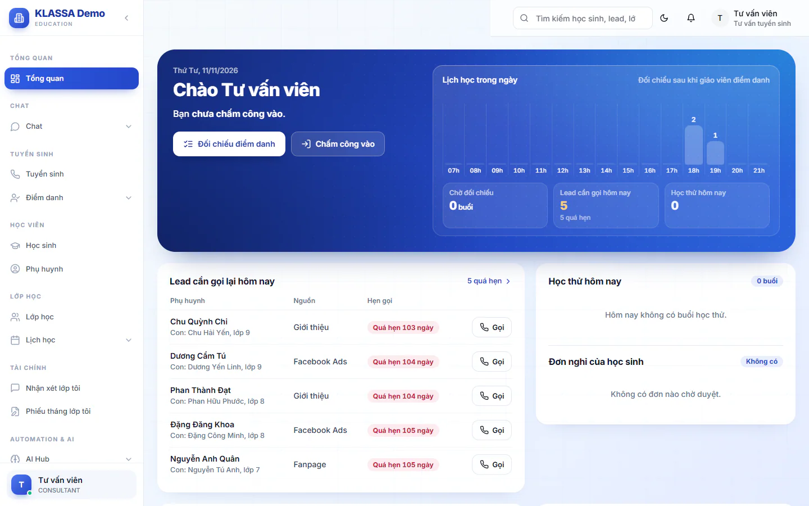

# Hướng dẫn nhanh cho Lễ tân

Bài này đi theo một ngày làm việc của Lễ tân, từ đầu ca đến cuối tháng. Mỗi việc chỉ nói ngắn gọn và dẫn sang bài chi tiết khi cần.

Khi đăng nhập, bạn vào **Tổng quan**. Trang này có sẵn lời chào, lịch học trong ngày và các việc của riêng Lễ tân, nên hãy bắt đầu từ đây mỗi sáng.

## Đầu ca: chấm công và xem việc hôm nay

Trang **Tổng quan** có nút chấm công ngay ở đầu trang. Nút đổi chữ theo tình trạng của bạn: **Chấm công vào**, **Chấm công ra** hoặc **Chấm công**. Câu chào bên dưới tên bạn cho biết ca làm hôm nay và giờ bạn đã chấm công.

::: steps
1. Vào **Tổng quan**.
2. Bấm **Chấm công vào** ở đầu trang. Trang **Chấm công của tôi** mở ra.
3. Bấm **Chấm công vào** trên trang này khi đã đến nơi làm việc.
4. Nếu hệ thống chưa xác thực được vị trí, một khung hiện ra. Ghi lý do (ít nhất 3 ký tự) rồi bấm **Gửi cho quản lý duyệt**. Công của bạn vẫn được ghi nhận, chỉ chờ quản lý duyệt.
:::

::: warning Lưu ý
Nếu trang báo **Tài khoản chưa gắn hồ sơ nhân sự**, bạn chưa chấm công được. Hãy nhờ quản lý gắn hồ sơ nhân viên cho tài khoản của bạn. Nút chấm công còn cần trung tâm có gói mở rộng **Ứng dụng Di động (PWA)** (xem phần E của [Bước 4](04-ho-so-nhan-su-va-cach-tinh-luong.md)).
:::

::: tip Mẹo
Hệ thống chỉ bắt chấm công đúng nơi làm việc khi trung tâm đã khai WiFi hoặc vùng vị trí (GPS) cho cơ sở. Chưa khai thì chấm công được từ bất cứ đâu và không có bước xác thực vị trí. Quản lý khai ở [Cấu hình chấm công](../nhan-su/cau-hinh-cham-cong.md).
:::

Xem thêm cách chấm công và sửa giờ ở [Chấm công của tôi](../cong-nhan-vien/cham-cong.md).

::: tip Mẹo
Khung **Lịch học trong ngày** ở đầu trang cho biết hôm nay có những lớp nào và giờ nào. Bên dưới có ba ô tóm tắt: **Chờ đối chiếu**, **Lead cần gọi hôm nay** và **Học thử hôm nay**. Trung tâm chưa có gói mở rộng CRM Tuyển sinh + AI thì không có ô lead, chỉ còn hai ô.
:::

## Trong ngày: lead, học thử và đơn nghỉ

Trang **Tổng quan** gom ba việc cần theo dõi trong ngày.

- **Lead cần gọi lại hôm nay**: bảng phụ huynh cần gọi, kèm nguồn và giờ hẹn. Lead quá hẹn hiện màu đỏ. Bấm **hẹn hôm nay** hoặc **quá hẹn** để mở danh sách lead đã lọc sẵn.
- **Học thử hôm nay**: các em có lịch học thử. Dòng nhỏ bên dưới cho biết đã có mấy em đến.
- **Đơn nghỉ của học sinh**: số đơn đang chờ duyệt.

Phần lead chỉ có khi trung tâm dùng gói mở rộng CRM Tuyển sinh + AI. Chưa có gói này thì trang chỉ hiện học thử và đơn nghỉ.

### Gọi lead và chăm sóc

::: steps
1. Vào **Tuyển sinh**.
2. Mở lead cần gọi, ghi lại kết quả cuộc gọi và hẹn lần gọi tiếp theo (nút **Hẹn gọi lại…**).
3. Khi phụ huynh đồng ý học thử, mở hồ sơ lead và bấm **Đặt buổi học thử 1**. Các buổi đã đặt hiện ở **Lịch học → Lịch học thử**, đây là nơi để xem và chuẩn bị đón em.
:::

Chi tiết nằm ở [Danh sách lead](../tuyen-sinh/danh-sach-lead.md), [Tạo lead mới](../tuyen-sinh/tao-lead-moi.md), [Ghi chăm sóc và hẹn gọi lại](../tuyen-sinh/hoat-dong-tu-van.md), [Đặt lịch và ghi kết quả học thử](../tuyen-sinh/dat-lich-hoc-thu.md) và [Lịch học thử](../tuyen-sinh/lich-hoc-thu.md).

### Duyệt đơn xin nghỉ của học sinh

Vào **Điểm danh → Đơn xin nghỉ** để xem các đơn phụ huynh gửi và duyệt hoặc từ chối.

## Khi có học sinh mới

Khi phụ huynh quyết định cho con học chính thức, bạn làm theo thứ tự sau.

::: steps
1. Nếu em đến từ lead, chuyển lead thành học sinh theo bài [Chuyển lead thành học sinh](../tuyen-sinh/chuyen-lead-thanh-hoc-sinh.md). Em chưa có lead thì vào **Học sinh** và tạo hồ sơ mới, xem [Tạo học sinh](../hoc-sinh/tao-moi.md).
2. Kiểm tra phụ huynh của em ở **Phụ huynh**. Lễ tân được xem thông tin phụ huynh, xem [Phụ huynh](../hoc-sinh/phu-huynh.md).
3. Vào **Lớp học**, mở lớp em sẽ học rồi bấm **Thêm học sinh** để xếp em vào lớp. Menu của Lễ tân không có mục **Ghi danh**, nên đây là đường ghi danh của bạn. Xem [Chi tiết lớp học](../lop-hoc/chi-tiet.md) và [Ghi danh vào lớp](../hoc-sinh/ghi-danh.md).
:::

Chuyển lead chỉ tạo hồ sơ học sinh, chưa xếp em vào lớp, nên bạn vẫn cần làm bước 3. Toàn bộ thứ tự tạo học sinh rồi xếp lớp nằm ở [Bước 8](./08-them-hoc-sinh-phu-huynh.md) và [Bước 9](./09-ghi-danh-vao-lop.md) của lộ trình.

::: warning Lưu ý
Lễ tân chỉ xem được danh sách **Lớp học** và **Phụ huynh**, không tạo lớp hay sửa thông tin phụ huynh được. Cần mở lớp mới thì nhờ Quản trị viên hoặc Quản lý. Mục **Ghi danh** và **Duyệt yêu cầu ghi danh** không hiện trong menu của Lễ tân.
:::

## Sau buổi học: đối chiếu điểm danh

Mỗi buổi học có hai người chấm: giáo viên chấm trước, Lễ tân chấm đối chiếu sau. Hệ thống tự coi là khớp nếu hai bên giống nhau và báo lệch cho quản lý nếu khác.

::: steps
1. Vào **Tổng quan** và bấm nút **Đối chiếu điểm danh**. Nút này mở thẳng buổi đã có giáo viên chấm mà bạn chưa đối chiếu.
2. Chấm từng em theo những gì bạn thấy trên thực tế, rồi bấm **Lưu điểm danh**.
3. Quay lại bấm **Đối chiếu điểm danh** để sang buổi kế tiếp.
:::

Ô **Chờ đối chiếu** ở đầu trang cho biết còn bao nhiêu buổi chờ bạn. Ở trang **Điểm danh → Điểm danh cơ bản**, mục **Lễ tân chưa chấm đối chiếu** có nút **Chấm đối chiếu** làm cùng việc này.

::: warning Lưu ý
Khi giáo viên và Lễ tân chấm khác nhau, trang báo **Lệch điểm danh cần xử lý**. Lễ tân không tự xử lý được. Quản trị viên, Quản lý chi nhánh và Quản lý xử lý ở **Điểm danh → Nâng cao → Đối chiếu xung đột**.
:::

Xem thêm [Điểm danh hằng ngày](../diem-danh/cham-hang-ngay.md) và [Đối chiếu điểm danh](../diem-danh/doi-chieu.md).

### Khi giáo viên nghỉ đột xuất

Duyệt đơn nghỉ phép của giáo viên không tự đổi người đứng lớp. Muốn có người dạy thay, bạn tạo yêu cầu dạy thay: vào **Điểm danh → Điểm danh cơ bản**, mở menu ba chấm **Thao tác khác** của buổi học cần đổi người và chọn **Dạy thay**. Menu này chỉ có ở buổi đã mở trên trang, buổi chưa mở thì chưa có. Yêu cầu do Quản trị viên, Quản lý chi nhánh hoặc Quản lý duyệt, xem [Dạy thay](../nhan-su/dan-day-thay.md). Chưa được duyệt thì buổi học vẫn tính cho người dạy cũ.

## Nhắn tin với phụ huynh

Nếu trung tâm dùng gói mở rộng Zalo (Cá nhân + OA), bạn nhắn tin với phụ huynh ở **Chat → Chat Zalo**. Nick Zalo của chính bạn nằm ở **Cổng nhân viên → Zalo của tôi**. Xem thêm [Zalo](../tin-nhan/zalo.md).

## Khi bạn kiêm trợ giảng

Một số Lễ tân được quản lý xếp làm trợ giảng ở vài lớp. Khi đó bạn có thêm:

- Thẻ ca trợ giảng ở **Tổng quan** với nút **Có mặt**. Nút mở trước giờ học 60 phút và khoá sau giờ tan 120 phút. Bạn bấm khi đã tới lớp.
- Hai mục **Nhận xét lớp tôi** và **Phiếu tháng lớp tôi** dùng được ở đúng các lớp bạn được xếp trợ giảng. Lớp khác thì bạn không xem được.
- Trang **Cổng nhân viên → Ca trợ giảng** để xem lại các ca đã làm và thu nhập dự kiến.

## Cuối ngày

::: steps
1. Vào **Tổng quan**.
2. Bấm **Chấm công ra** ở đầu trang. Trang **Chấm công của tôi** mở ra.
3. Bấm **Chấm công ra** trên trang này.
:::

Bạn làm thêm ca tối trong cùng ngày thì quay lại trang này và bấm **Chấm công vào ca tiếp**.

Quên chấm công ra thì mở **Cổng nhân viên → Chấm công của tôi**, bấm **Tôi quên chấm ra**, chọn giờ bạn thật sự ra về, ghi lý do rồi bấm **Gửi giờ ra**. Giờ ra chờ quản lý duyệt, sau đó bạn chấm vào ca tiếp được ngay.

## Cuối tháng

- **Đăng ký ca**: nếu bạn làm bán thời gian, vào **Cổng nhân viên → Đăng ký ca**, tích các ca muốn làm rồi bấm **Lưu**. Lịch tự khoá vào đầu ngày chốt của tháng trước, nên hãy đăng ký sớm. Tab **Lịch cả đội** cho xem lịch đã chốt khi quản lý công bố. Mục này chỉ dùng được khi nhân sự đã bật ô **Đăng ký ca lễ tân (part-time)** trong hồ sơ của bạn. Chưa bật thì trang báo **Tài khoản chưa được bật đăng ký ca.**, hãy nhờ quản lý hoặc nhân sự bật. Trang báo **Chưa cấu hình khung giờ ca.** nghĩa là quản lý chưa gán giờ cho ba ca Sáng, Chiều, Tối ở Cấu hình HR, bạn chưa đăng ký được cho tới khi quản lý làm xong. Muốn tiền công tính theo ca thì khung Sáng, Chiều, Tối cũng cần có đơn giá, việc này do quản lý khai. Xem [Đăng ký ca](../cong-nhan-vien/dang-ky-ca.md).
- **Phiếu lương**: vào **Cổng nhân viên → Phiếu lương**, mở phiếu để xem chi tiết. Bấm **Xác nhận đã nhận phiếu lương** sau khi đối chiếu. Xem [Phiếu lương](../cong-nhan-vien/phieu-luong.md).
- **Nghỉ phép**: vào **Cổng nhân viên → Nghỉ phép**, bấm **Tạo đơn mới**.
- **Báo cáo**: Lễ tân xem được **Báo cáo học sinh** và báo cáo phễu tuyển sinh. Nhóm **Tài chính** không hiện trên menu của Lễ tân, nên hãy mở từ liên kết **Báo cáo học sinh** ở trang **Học sinh** và liên kết **Phễu tuyển sinh** ở trang **Tuyển sinh** (cần gói CRM Tuyển sinh + AI).

## Câu hỏi thường gặp

::: details Tại sao Tổng quan không có phần lead và trang Tuyển sinh không dùng được?
Phần lead cần gói mở rộng CRM Tuyển sinh + AI. Hãy nhờ Quản trị viên kiểm tra gói ở **Cài đặt → Plugin Marketplace**.
:::

::: details Tôi chấm công mà báo không xác thực được vị trí, phải làm sao?
Điền lý do và bấm **Gửi cho quản lý duyệt**. Bạn vẫn chấm công được, chỉ cần quản lý duyệt.
:::

::: details Tôi có sửa được điểm danh mà giáo viên đã chấm không?
Về kỹ thuật thì được: hộp **Chi tiết** của buổi có biểu tượng bút để sửa từng em, mỗi lần sửa phải nhập **Lý do chỉnh sửa** và hệ thống ghi lại ai đã sửa (xem [Bước 10](10-diem-danh-buoi-dau.md)). Nhưng việc của Lễ tân là chấm đối chiếu theo phần của mình. Khi hai bên lệch, hãy để quản lý chốt, chỉ sửa khi quản lý nhờ.
:::

::: details Tôi không thấy mục Ghi danh trong menu, ghi danh em vào lớp ở đâu?
Lễ tân ghi danh từ trang lớp: vào **Lớp học**, mở lớp, bấm **Thêm học sinh**.
:::

::: details Tôi có tạo được lớp hoặc lập phiếu học phí không?
Không. Lớp học Lễ tân chỉ xem. Học phí do Kế toán và quản lý phụ trách.
:::
