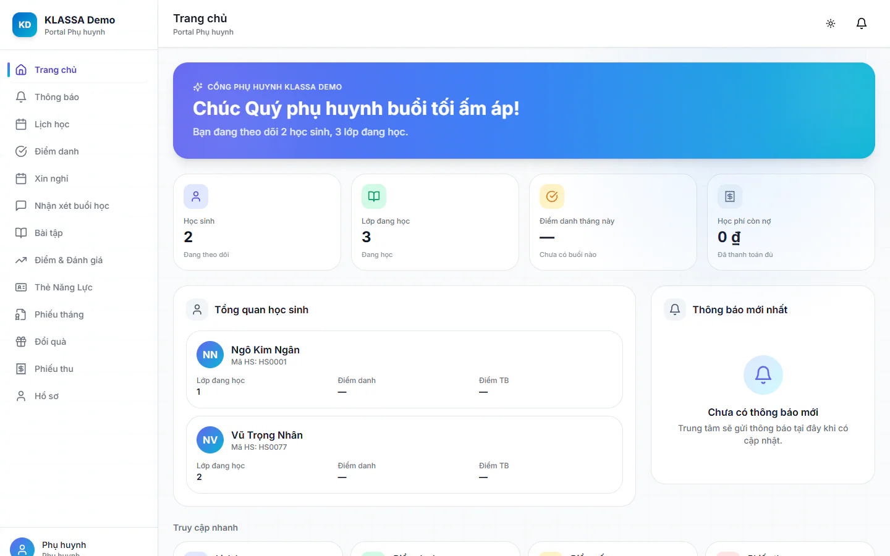
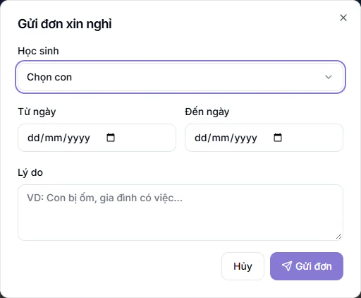

# Hướng dẫn nhanh cho Phụ huynh và Học sinh

Cổng Phụ huynh giúp bạn theo dõi việc học của con mà không cần đến trung tâm: xem lịch, biết con có đi học không, xem điểm, xem phiếu học phí và gửi đơn xin nghỉ. Cổng Phụ huynh là gói mở rộng của trung tâm. Nếu bạn không vào được, hãy hỏi trung tâm đã bật gói này chưa.

Phụ huynh đăng nhập bằng **email**. Học sinh đăng nhập bằng **số điện thoại**. Hai phần dưới đây tách riêng cho từng người.

## Dành cho phụ huynh

### Đăng nhập lần đầu

::: steps
1. Mở trang đăng nhập của trung tâm.
2. Ở ô **Email hoặc số điện thoại**, nhập email phụ huynh đã đăng ký với trung tâm. Nếu trung tâm không có email của bạn, hãy hỏi trung tâm email đăng nhập đã cấp cho bạn.
3. Nhập **Mật khẩu** do trung tâm cung cấp, rồi bấm **Đăng nhập vào hệ thống**.
:::

Tài khoản do trung tâm cấp cho bạn. Bạn cũng có thể tự đăng ký ở trang đăng nhập, bấm **Đăng ký ngay**. Dù do trung tâm tạo hay tự đăng ký, tài khoản phải được trung tâm duyệt thì mới đăng nhập được và mới nhận thông báo (nhận xét, điểm, phiếu kết quả học tập, phiếu thu). Nếu chưa vào được hoặc chưa thấy thông báo nào, hãy báo trung tâm kiểm tra tài khoản đã được duyệt chưa. Xem [Đăng nhập](../tai-khoan/dang-nhap.md).

Cổng trên web không có mục đổi mật khẩu cho phụ huynh. Nếu cần đổi, hãy dùng ứng dụng KLASSA trên điện thoại hoặc nhờ trung tâm hỗ trợ.

::: warning Lưu ý
Nếu sau khi đăng nhập trang báo **Chưa có học sinh**, hồ sơ phụ huynh của bạn chưa được gắn với con. Hãy liên hệ trung tâm để được hỗ trợ.
:::

### Trang chủ

Vào **Trang chủ**. Phần **Tổng quan học sinh** cho biết số lớp con đang học, tỷ lệ điểm danh và điểm trung bình. Ô **Học phí còn nợ** cho biết số tiền cần đóng. Phần **Thông báo mới nhất** hiện tin từ trung tâm, và khung **Truy cập nhanh** có bốn lối tắt: **Lịch học**, **Điểm danh**, **Điểm số**, **Phiếu thu**.

Nếu có nhiều con, mỗi em có một thẻ riêng trong phần **Tổng quan học sinh**. Mỗi trung tâm tự chọn mục nào hiện cho phụ huynh, nên menu của bạn có thể ít hơn bài này liệt kê.

### Xem lịch học

Vào **Lịch học** để xem các buổi học sắp tới của con, kèm giờ và lớp. Xem thêm [Lịch học](../cong-phu-huynh/lich-hoc.md).

### Xem điểm danh

Vào **Điểm danh** (trang **Điểm danh & Lưu ý**) để biết con có mặt hay vắng ở từng buổi. Bảng **Chi tiết điểm danh** liệt kê từng buổi. Xem thêm [Điểm danh của con](../cong-phu-huynh/diem-danh.md).

### Xem điểm và nhận xét

- **Điểm & Đánh giá**: điểm trung bình theo môn và **Kết quả kiểm tra gần đây**. Điểm bài kiểm tra chỉ hiện sau khi giáo viên bấm **Công bố điểm**. Xem [Điểm số](../cong-phu-huynh/diem-so.md).
- **Nhận xét buổi học**: lời nhận xét của giáo viên sau mỗi buổi.
- **Phiếu tháng**: phiếu kết quả học tập tháng của con. Phiếu chỉ hiện sau khi trung tâm phát hành. Đây không phải phiếu học phí. Xem [Phiếu tháng](../cong-phu-huynh/ket-qua-thang.md).
- **Bài tập**: bài tập về nhà của con.

::: tip Hai loại phiếu khác nhau
**Phiếu tháng** là kết quả học tập. **Phiếu thu** là học phí cần đóng. Hai mục nằm riêng trong menu, đừng nhầm.
:::

### Xem phiếu học phí

Vào **Phiếu thu**. Nếu có nhiều con, chọn từng em ở ô **Học sinh**. Lọc theo **Trạng thái**: **Chưa thanh toán**, **Trả một phần**, **Đã thanh toán**, **Quá hạn** hoặc **Đã huỷ**. Mở một phiếu để xem **Chi tiết phiếu thu** và **Lịch sử thanh toán**.

Với phiếu chưa thanh toán, nếu trung tâm bật hiển thị, bạn thấy số tài khoản, nội dung chuyển khoản và mã QR. Bấm vào mã QR để phóng to. Hãy ghi đúng nội dung chuyển khoản để trung tâm đối chiếu nhanh. Xem thêm [Phiếu thu](../cong-phu-huynh/hoa-don.md).

::: tip Muốn điện thoại rung khi trung tâm báo phiếu thu
Cài ứng dụng KLASSA trên điện thoại và bật thông báo cho ứng dụng. Trung tâm cần bật tính năng ứng dụng điện thoại, nếu không ứng dụng sẽ không nhận được thông báo. Tài khoản của bạn cũng phải đã được duyệt. Chưa cài thì bạn vẫn xem được phiếu trong cổng, hoặc nhận qua Zalo nếu trung tâm gửi.
:::

### Gửi đơn xin nghỉ cho con

::: steps
1. Vào **Xin nghỉ**.
2. Bấm **Xin nghỉ**, hộp **Gửi đơn xin nghỉ** hiện ra.

   

3. Nếu có nhiều con, chọn **Học sinh**. Điền **Từ ngày**, **Đến ngày** và **Lý do** (đủ cả ba mới gửi được).
4. Bấm **Gửi đơn**.
:::

Đơn đang chờ có nút **Hủy** nếu bạn muốn rút lại. Khi trung tâm duyệt, kết quả và phần **Phản hồi** hiện ngay trên đơn.

### Gửi yêu cầu khác cho trung tâm

Một số mục chỉ hiện khi trung tâm bật, và thường mặc định tắt:

- **Đăng ký thêm môn học**: bấm **Nhờ tư vấn** ở môn khối con chưa học để trung tâm liên hệ tư vấn, hoặc bấm **Tạm dừng** để xin tạm dừng một môn đang học. Điền đủ thông tin trong hộp rồi bấm **Gửi**.
- **Góp ý**: gửi góp ý về giáo viên, trung tâm hoặc ứng dụng. Bấm **Gửi góp ý**.

Xem thêm [Đăng ký thêm môn học](../cong-phu-huynh/dang-ky-them-mon.md) và [Góp ý](../cong-phu-huynh/gop-y.md).

### Cập nhật thông tin của bạn

Vào **Hồ sơ**. Ở khung **Thông tin phụ huynh**, bấm **Sửa**, sửa thông tin cần thiết rồi bấm **Lưu**. Phần **Học sinh** liệt kê các con của bạn. Xem [Hồ sơ](../cong-phu-huynh/ho-so.md).

## Dành cho học sinh

Học sinh có tài khoản riêng để vào khu Học online của trung tâm.

::: steps
1. Mở trang đăng nhập của trung tâm.
2. Nhập số điện thoại ghi trên hồ sơ học sinh vào ô **Email hoặc số điện thoại**, rồi nhập **Mật khẩu**.
3. Nếu số điện thoại dùng chung cho nhiều anh chị em cùng mật khẩu, màn hình **Bạn là ai?** hiện ra. Chọn đúng tên của mình để vào học.
:::

Sau khi vào, menu của học sinh gồm **Bàn học**, **Khoá học**, **Lịch học**, **Điểm & thành tích**, **Đơn hàng** và **Thông tin cá nhân**. Mục **Đánh giá thầy cô** chỉ hiện khi trung tâm bật tính năng này (mặc định tắt).

::: tip Mẹo
Trung tâm cấp tài khoản cho học sinh đang học khi hồ sơ có số điện thoại hợp lệ, và tài khoản cần được Quản trị viên duyệt. Chưa đăng nhập được thì nhờ trung tâm kiểm tra số điện thoại trên hồ sơ của em.
:::

## Câu hỏi thường gặp

::: details Tôi quên mật khẩu thì làm sao?
Trang đăng nhập không có nút lấy lại mật khẩu. Hãy liên hệ trung tâm để được cấp lại mật khẩu.
:::

::: details Tôi không thấy mục Điểm hoặc Phiếu thu trong menu?
Mỗi trung tâm tự bật hoặc tắt từng mục của cổng. Hãy hỏi trung tâm nếu bạn cần mục đó.
:::

::: details Con tôi vừa thi mà chưa thấy điểm?
Điểm chỉ hiện sau khi giáo viên công bố. Hãy đợi hoặc hỏi giáo viên của lớp.
:::

::: details Tôi có thể đăng nhập bằng số điện thoại không?
Số điện thoại dành cho học sinh. Phụ huynh đăng nhập bằng email.
:::
