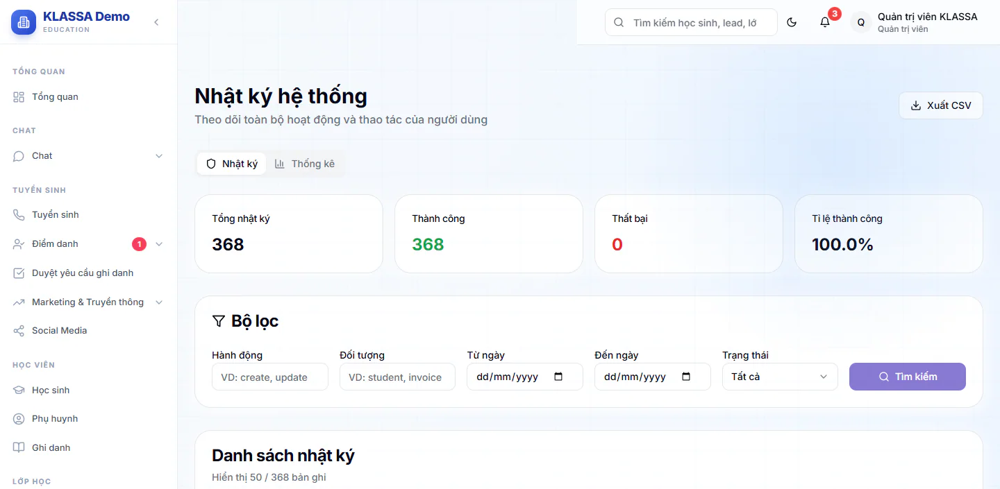

# Nhật ký hệ thống

Nhật ký ghi lại các thao tác của người dùng trên hệ thống. Dùng khi bạn cần biết ai đã sửa một dữ liệu, lúc nào và sửa từ giá trị nào sang giá trị nào. Chỉ **Quản trị viên** xem được.

## Tìm một thao tác

::: steps
1. Vào **Quản trị hệ thống → Nhật ký hệ thống**, mở thẻ **Nhật ký**.
2. Trong khung **Bộ lọc**, nhập **Hành động** (ví dụ create, update) hoặc **Đối tượng** (ví dụ student, invoice).
3. Chọn **Từ ngày**, **Đến ngày** nếu cần.
4. Chọn **Trạng thái**: **Tất cả**, **Thành công** hoặc **Thất bại**.
5. Bấm **Tìm kiếm**.
:::

Mỗi dòng trong **Danh sách nhật ký** cho biết hành động và đối tượng (đã dịch sang tiếng Việt), mã rút gọn của bản ghi, tên và email người làm, địa chỉ IP, thời gian. Dòng thất bại có kèm thông báo lỗi màu đỏ. Phía trên danh sách có bốn số: **Tổng nhật ký**, **Thành công**, **Thất bại**, **Tỉ lệ thành công**.

## Xem chi tiết một thay đổi

Bấm biểu tượng con mắt (**Xem chi tiết**) ở cuối dòng. Hộp **Chi tiết nhật ký** hiện thời gian, người dùng, hành động, đối tượng, địa chỉ IP, trình duyệt hoặc thiết bị. Khi thao tác có sửa dữ liệu, hộp còn cho xem **Dữ liệu trước thay đổi**, **Dữ liệu sau thay đổi** và **Khác biệt chi tiết**.

## Xem thống kê

Mở thẻ **Thống kê**, chọn **7 ngày**, **30 ngày** hoặc **90 ngày**. Bạn thấy:

- **Tổng thay đổi**, **Hành động nhạy cảm**, **Người dùng hoạt động**, **Loại đối tượng**.
- **Theo hành động** và **Theo loại đối tượng** (top 10).
- **Người dùng hoạt động nhiều nhất** (top 10).
- **Hoạt động 7 ngày gần đây** theo từng ngày.

## Xuất nhật ký ra CSV

Bấm **Xuất CSV** ở góc trên bên phải. Tệp tải về có tên dạng nhat-ky-he-thong-....csv và báo **Đã xuất nhật ký ra CSV** khi xong.

::: tip Mẹo
Khi nghi ngờ có người đổi nhầm dữ liệu, lọc theo **Đối tượng** và khoảng ngày, rồi mở **Xem chi tiết** để so dữ liệu trước và sau.
:::

## Câu hỏi thường gặp

::: details Tôi không thấy một thao tác mà tôi nhớ đã làm?
Nới rộng khoảng **Từ ngày**, **Đến ngày** và để **Trạng thái** là **Tất cả**. Không phải thao tác nào cũng được ghi vào nhật ký.
:::

::: details Có xoá được nhật ký không?
Trang này chỉ để xem, lọc và xuất, không có nút xoá.
:::
