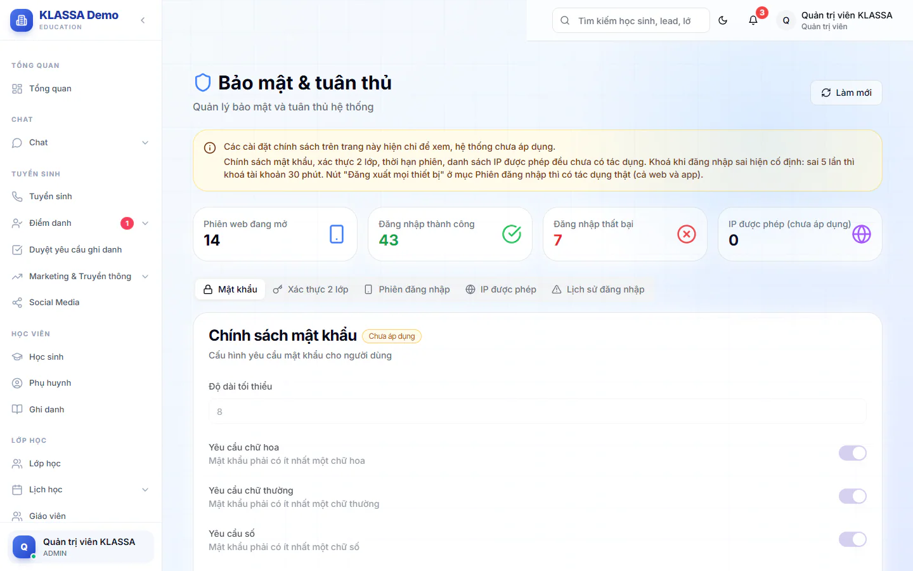

# Bảo mật & Compliance

Trang này giúp Quản trị viên theo dõi ai đang đăng nhập, ai đăng nhập sai, và đăng xuất một người khi cần (ví dụ nhân viên làm mất điện thoại).

::: warning Đọc trước khi dùng
Trên trang có dải màu vàng nói rõ: chính sách mật khẩu, xác thực 2 lớp, thời hạn phiên và danh sách IP được phép **hiện chỉ để xem, hệ thống chưa áp dụng**. Các thẻ này được gắn nhãn **Chưa áp dụng** và các ô bị khoá. Đừng coi đó là lớp bảo vệ đang chạy.
:::

Những gì đang có tác dụng thật:

- Khoá khi đăng nhập sai: sai mật khẩu 5 lần thì tài khoản bị khoá 30 phút. Mức này cố định, chưa chỉnh được.
- Nút **Đăng xuất mọi thiết bị**: có tác dụng cả web và app.
- **Phiên đăng nhập** và **Lịch sử đăng nhập**: dữ liệu thật để bạn theo dõi.

## Xem số liệu tổng quan

Vào **Quản trị hệ thống → Bảo mật & Compliance**. Trang mở ra có tiêu đề **Bảo mật & tuân thủ**. Đầu trang có bốn ô: **Phiên web đang mở**, **Đăng nhập thành công**, **Đăng nhập thất bại**, **IP được phép (chưa áp dụng)**. Bấm **Làm mới** để tải lại.

## Đăng xuất một người khỏi mọi thiết bị

::: steps
1. Vào **Quản trị hệ thống → Bảo mật & Compliance**, mở thẻ **Phiên đăng nhập**.
2. Trong bảng **Phiên web đang mở**, tìm dòng của người cần đăng xuất (có cột Email, Địa chỉ IP, Trình duyệt / thiết bị, Hoạt động gần nhất, Đăng nhập lúc).
3. Bấm **Đăng xuất mọi thiết bị** ở cuối dòng.
4. Hộp **Đăng xuất mọi thiết bị?** hiện ra. Bấm **Đăng xuất mọi thiết bị** để xác nhận, hoặc **Huỷ**.
:::

Người đó bị đăng xuất khỏi mọi máy, cả web và app, trong khoảng 1 phút. Dòng của chính bạn không có nút này.

::: warning Lưu ý
Đăng xuất không khoá tài khoản. Người đó vẫn đăng nhập lại được bằng mật khẩu hiện tại. Muốn chặn hẳn, hãy chọn **Vô hiệu hóa** tài khoản hoặc đặt lại mật khẩu ở [Người dùng](nguoi-dung.md).
:::

Bảng có phân trang với các nút **Đầu**, **Trước**, **Sau**, **Cuối**.

## Xem lịch sử đăng nhập

Mở thẻ **Lịch sử đăng nhập**. Bảng **Lịch sử gần đây (50 lần cuối)** có các cột Email, Địa chỉ IP, Thời gian, Trạng thái (thành công hoặc thất bại) và Lý do. Các ô **Số lần thử tối đa**, **Thời gian khóa (phút)** và **Xoá bộ đếm sai sau (phút)** đang bị khoá, chưa áp dụng.

## Các thẻ chỉ để xem

- **Mật khẩu**: **Độ dài tối thiểu**, yêu cầu chữ hoa, chữ thường, số, ký tự đặc biệt, **Mật khẩu hết hạn sau (ngày)**.
- **Xác thực 2 lớp**: **Bật 2FA**, **Bắt buộc 2FA**, **Phương thức hỗ trợ**.
- **IP được phép**: **Bật danh sách IP được phép** và danh sách IP.

Mục **Cài đặt → Cấu hình → Bảo mật** cũng có vài ô tương tự (thời gian phiên, hết hạn mật khẩu, số lần đăng nhập tối đa). Những ô đó chỉ được lưu lại, không điều khiển việc đăng nhập.

## Câu hỏi thường gặp

::: details Tài khoản bị khoá do nhập sai mật khẩu thì sao?
Chờ 30 phút thì tài khoản tự mở lại. Nếu cần vào ngay, Quản trị viên đặt lại mật khẩu cho người đó ở [Người dùng](nguoi-dung.md).
:::

::: details Tôi muốn bắt buộc đổi mật khẩu định kỳ?
Hiện chưa làm được. Ô hết hạn mật khẩu chưa có tác dụng.
:::
