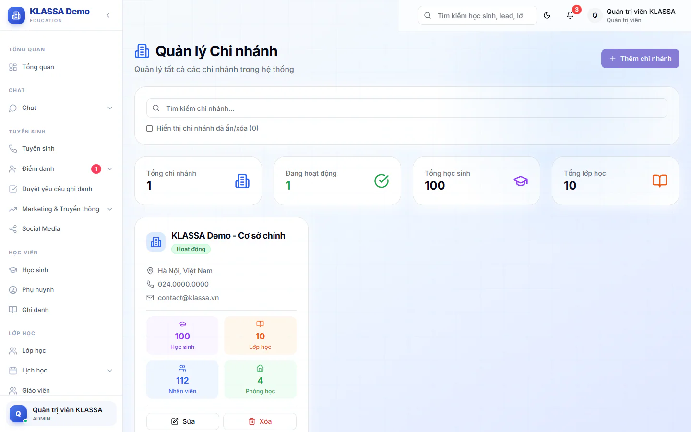

# Quản lý chi nhánh

Chi nhánh (cơ sở) là từng địa điểm học của trung tâm. Học sinh, lớp, phòng học và nhân viên đều gắn với một chi nhánh. Có hai nơi liên quan: mục **Chi nhánh** trên thanh menu để thêm hoặc sửa chi nhánh, và mục **Quản lý Chi nhánh** trong nhóm quản trị hệ thống để so sánh số liệu và chuyển người giữa các chi nhánh.

Chi nhánh đầu tiên tạo được ngay. Từ chi nhánh thứ hai trở đi, trung tâm cần có gói mở rộng **Đa chi nhánh** và còn trong giới hạn số chi nhánh của gói đang dùng. Nếu thiếu, hệ thống báo lỗi và bạn liên hệ KLASSA để mua hoặc nâng gói.

## Thêm chi nhánh mới

Chỉ **Quản trị viên** thêm và sửa được. Quản lý chi nhánh và Quản lý chỉ xem.

::: steps
1. Vào **Chi nhánh** ở thanh menu.
2. Bấm **Thêm chi nhánh**, hộp **Thêm chi nhánh mới** hiện ra.
3. Nhập **Tên chi nhánh** (bắt buộc). Có thể điền thêm **Địa chỉ**, **Số điện thoại**, **Email**.
4. Bấm **Tạo mới**.
:::

Sau khi tạo, hãy thêm phòng học, gán nhân viên và cấu hình mẫu hoá đơn cho chi nhánh mới.

## Xem danh sách và tìm chi nhánh

Trang mở từ mục **Chi nhánh** (tiêu đề **Quản lý Chi nhánh**) hiện bốn ô tổng hợp **Tổng chi nhánh**, **Đang hoạt động**, **Tổng học sinh**, **Tổng lớp học**. Mỗi chi nhánh là một thẻ có tên, nhãn **Hoạt động** hoặc **Không hoạt động**, và số **Học sinh**, **Lớp học**, **Nhân viên**, **Phòng học**.

Gõ vào ô **Tìm kiếm chi nhánh...** để lọc theo tên. Tích **Hiển thị chi nhánh đã ẩn/xóa** để thấy cả các chi nhánh đã tắt.

## Sửa, ẩn, bật lại, xoá chi nhánh

| Thao tác | Cách làm |
|---|---|
| Sửa thông tin | Bấm **Sửa** trên thẻ chi nhánh, đổi thông tin, bấm **Cập nhật**. Trong hộp sửa có ô **Chi nhánh đang hoạt động**. |
| Ẩn chi nhánh | Bấm **Xóa** rồi xác nhận ở hộp **Xác nhận xóa chi nhánh**. Chi nhánh chỉ bị ẩn, vẫn xem lại được khi tích **Hiển thị chi nhánh đã ẩn/xóa**. |
| Bật lại | Với chi nhánh đã ẩn, bấm **Kích hoạt lại**. |
| Xoá hẳn | Với chi nhánh đã ẩn, bấm **Xóa vĩnh viễn** rồi xác nhận. |

::: danger Không thể hoàn tác
**Xóa vĩnh viễn** gỡ hẳn chi nhánh, không khôi phục được.
:::

::: warning Lưu ý
Chi nhánh còn nhân viên, lớp hoặc học sinh thì không xoá được, cả khi ẩn lẫn xoá vĩnh viễn. Hãy chuyển hết sang chi nhánh khác trước. Hộp xác nhận hiện sẵn số nhân viên, lớp, học sinh, phòng học của chi nhánh để bạn kiểm tra.
:::

## Xem số liệu từng chi nhánh

Vào **Quản trị hệ thống → Quản lý Chi nhánh** (chỉ Quản trị viên). Đây là trang khác với trang **Chi nhánh** ở trên: dùng để so sánh số liệu và chuyển người giữa các chi nhánh, không dùng để thêm hay sửa chi nhánh.

- Phần **Thống kê tổng hợp** cộng số liệu toàn trung tâm: **Tổng số học sinh**, **Học sinh đang học**, **Tổng số lớp**, **Doanh thu**.
- Tab **Thống kê chi nhánh** có một thẻ cho mỗi chi nhánh, ghi tên và **Mã** chi nhánh. Trong thẻ có số **Học sinh** đang học trên tổng số (kèm số học sinh mới trong tháng), số **Lớp học**, **Doanh thu** và khoản còn nợ, tỷ lệ **Chuyên cần** trung bình.

## Chuyển học sinh hoặc nhân sự sang chi nhánh khác

Dùng khi một học sinh, giáo viên hoặc nhân viên chuyển hẳn sang chi nhánh khác. Hệ thống chỉ đổi chi nhánh ghi trong hồ sơ. Lớp và ghi danh của học sinh không tự đổi, bạn cần xử lý riêng.

::: steps
1. Vào **Quản trị hệ thống → Quản lý Chi nhánh**.
2. Bấm **Tạo yêu cầu chuyển**, hộp **Tạo yêu cầu chuyển chi nhánh** hiện ra.
3. Chọn **Đối tượng chuyển**: **Học sinh**, **Giáo viên** hoặc **Nhân viên**.
4. Nhập **Mã đối tượng (ID)** (mã nội bộ của người cần chuyển), chọn **Từ chi nhánh** và **Đến chi nhánh**.
5. Chọn **Ngày chuyển** và **Ngày có hiệu lực**, nhập **Lý do** nếu cần.
6. Bấm **Tạo yêu cầu chuyển**. Hệ thống báo "Đã tạo yêu cầu chuyển chi nhánh".
7. Mở tab **Yêu cầu chuyển** (con số bên cạnh là số yêu cầu đang **Chờ duyệt**). Ở yêu cầu cần xử lý, bấm **Duyệt** để duyệt (hoặc **Huỷ** để huỷ), rồi bấm **Hoàn tất** để thực hiện chuyển.
:::

Chỉ Quản trị viên duyệt, huỷ và hoàn tất được yêu cầu. Phải bấm **Duyệt** trước rồi mới bấm **Hoàn tất** được. Yêu cầu đã làm xong hiện nhãn **Đã hoàn tất**.

## Câu hỏi thường gặp

::: details Quản lý chi nhánh có thấy dữ liệu của chi nhánh khác không?
Trang **Chi nhánh** cho Quản lý chi nhánh và Quản lý xem danh sách. Quyền xem dữ liệu từng phần (học sinh, học phí...) tuỳ theo vai và chi nhánh được gán trong [Quản lý người dùng](nguoi-dung.md).
:::

::: details Tôi không tạo được chi nhánh thứ hai?
Kiểm tra trung tâm đã có gói mở rộng **Đa chi nhánh** chưa và còn trong giới hạn số chi nhánh của gói. Nếu chưa, liên hệ KLASSA.
:::

::: details Gán nhân viên vào chi nhánh ở đâu?
Chọn **Chi nhánh** khi [tạo hoặc sửa người dùng](nguoi-dung.md).
:::
