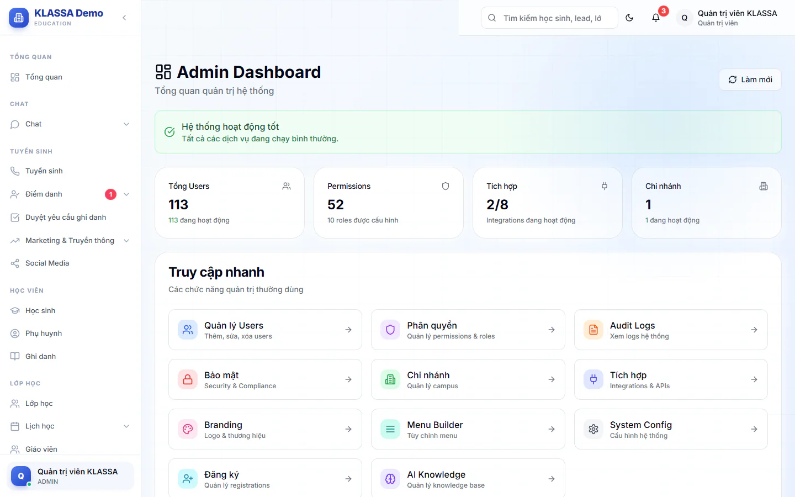

# Dashboard Quản trị

Trang này cho bạn cái nhìn nhanh về tình trạng hệ thống: có bao nhiêu tài khoản, bao nhiêu chi nhánh, ai vừa làm gì. Từ đây bạn cũng nhảy thẳng tới các trang quản trị hay dùng.

::: warning Lưu ý
Menu có thể hiện mục này cho cả Quản lý chi nhánh và Quản lý, nhưng trang chỉ mở cho **Quản trị viên**. Vai khác bấm vào sẽ thấy thông báo không có quyền truy cập.
:::

## Mở trang

::: steps
1. Vào **Quản trị hệ thống → Dashboard Quản trị**.
2. Chờ trang tải xong. Bấm **Làm mới** ở góc trên bên phải khi muốn lấy số liệu mới nhất.
:::

## Thông báo tình trạng hệ thống

Ngay dưới tiêu đề **Admin Dashboard** có một dải thông báo:

- Màu xanh **Hệ thống hoạt động tốt**: mọi thứ bình thường.
- Màu vàng **Cảnh báo hệ thống**: một số dịch vụ đang gặp vấn đề, bạn nên kiểm tra. Hiện hệ thống chưa tự đặt trạng thái này, nên bạn thường chỉ thấy dải xanh.

Nếu không có dải nào hiện ra, hoặc trang báo lỗi **Không thể tải dữ liệu dashboard**, hãy bấm **Làm mới** để thử lại.

## Bốn ô số liệu

| Ô | Số lớn | Dòng nhỏ bên dưới |
|---|---|---|
| **Tổng Users** | Tổng số tài khoản | Số tài khoản đang hoạt động |
| **Permissions** | Tổng số quyền đã khai báo | Số vai đang có người dùng |
| **Tích hợp** | Dạng "đang hoạt động / tổng" | Integrations đang hoạt động |
| **Chi nhánh** | Tổng số chi nhánh | Số chi nhánh đang hoạt động |

::: warning Lưu ý
Con số ở ô **Tích hợp** hiện chỉ là số tạm, chưa phản ánh đúng kết nối thật của trung tâm. Muốn biết kết nối nào đang chạy, hãy xem ở mục **Tích hợp & APIs** trong nhóm **Quản trị hệ thống**.
:::

## Khối Truy cập nhanh

Khối **Truy cập nhanh** gồm các thẻ. Bấm vào một thẻ để mở trang tương ứng:

| Thẻ | Dòng mô tả trên thẻ | Xem bài hướng dẫn |
|---|---|---|
| **Quản lý Users** | Thêm, sửa, xóa users | [Người dùng](nguoi-dung.md) |
| **Phân quyền** | Quản lý permissions & roles | |
| **Audit Logs** | Xem logs hệ thống | [Nhật ký hệ thống](audit-log.md) |
| **Bảo mật** | Security & Compliance | [Bảo mật](bao-mat.md) |
| **Chi nhánh** | Quản lý campus | [Cơ sở](co-so.md) |
| **Tích hợp** | Integrations & APIs | |
| **Branding** | Logo & thương hiệu | [Thương hiệu](thuong-hieu.md) |
| **Menu Builder** | Tùy chỉnh menu | |
| **System Config** | Cấu hình hệ thống | [Cấu hình hệ thống](cau-hinh-he-thong.md) |
| **Đăng ký** | Quản lý registrations | [Duyệt đăng ký](duyet-dang-ky-nguoi-dung.md) |
| **AI Knowledge** | Quản lý knowledge base | |

## Khối Hoạt động gần đây

Khối **Hoạt động gần đây** liệt kê 10 dòng nhật ký mới nhất, mỗi dòng gồm:

- **Hành động**: việc đã làm.
- **Resource**: đối tượng bị tác động (hiện dạng nhãn).
- **User**: tên và email người thực hiện.
- **Thời gian**: ngày giờ, dạng ngày/tháng/năm giờ:phút.
- **Trạng thái**: **Thành công** hoặc **Thất bại**.

Chưa có hoạt động nào thì khối hiện **Chưa có hoạt động nào**. Bấm **Xem tất cả** để sang trang **Nhật ký hệ thống** xem đầy đủ và lọc.

::: tip Mẹo
Mỗi sáng, lướt qua khối này để phát hiện thao tác **Thất bại** bất thường, ví dụ nhiều lần đăng nhập lỗi liên tiếp.
:::

## Câu hỏi thường gặp

::: details Vì sao Quản lý chi nhánh thấy mục này trong menu mà không vào được?
Trang tổng quan này dành riêng cho Quản trị viên. Các vai khác không mở được dù menu có hiện mục này.
:::

::: details Số liệu có tự cập nhật không?
Không. Số liệu tải một lần khi mở trang. Bấm **Làm mới** để tải lại.
:::
