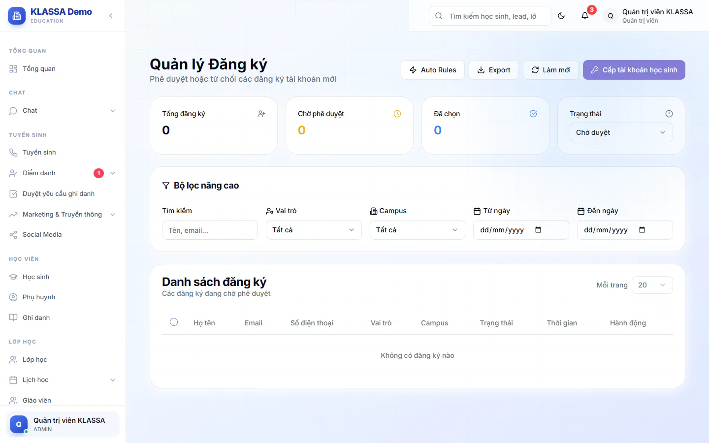
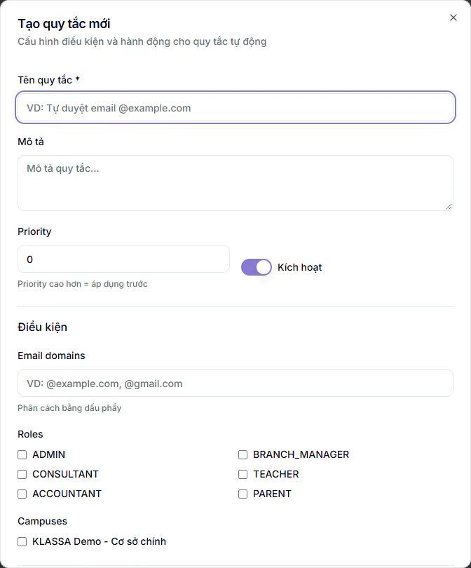

# Duyệt đăng ký người dùng

Khi ai đó tự đăng ký tài khoản (xem [Đăng ký tài khoản](../tai-khoan/dang-ky.md)), tài khoản ở trạng thái chờ duyệt và chưa đăng nhập được. Trang này giúp Quản trị viên xem từng yêu cầu rồi duyệt hoặc từ chối.

Đây là duyệt **tài khoản đăng nhập vào phần mềm**, khác với duyệt học sinh đăng ký học thử ở mục tuyển sinh.

Chỉ **Quản trị viên** vào được trang này.

## Xem danh sách chờ duyệt

Vào **Quản trị hệ thống → Quản lý Đăng ký**. Trang mở sẵn ở trạng thái **Chờ duyệt**. Đầu trang có các ô **Tổng đăng ký**, **Chờ phê duyệt**, **Đã chọn** và ô **Trạng thái** để chuyển giữa **Chờ duyệt**, **Đã duyệt**, **Từ chối**.

Bảng **Danh sách đăng ký** gồm: **Họ tên**, **Email**, **Số điện thoại**, **Vai trò**, **Campus** (chi nhánh), **Trạng thái**, **Thời gian** và **Hành động**.

Trong **Bộ lọc nâng cao**, bạn có thể lọc theo **Tìm kiếm** (tên, email), **Vai trò**, **Campus**, **Từ ngày**, **Đến ngày**. Bấm **Xóa bộ lọc** để về mặc định. Nút **Export** xuất danh sách ra **Export CSV** hoặc **Export JSON**.

## Duyệt một đăng ký

::: steps
1. Vào **Quản trị hệ thống → Quản lý Đăng ký**.
2. Ở dòng cần duyệt, bấm nút dấu tích màu xanh. Hộp **Phê duyệt đăng ký** hiện ra.
3. Chọn **Chi nhánh** cho người này (ô bắt buộc với mọi vai, trừ **Phụ huynh** và **Học sinh**).
4. Bấm **Phê duyệt**.
:::

Sau khi duyệt, tài khoản đăng nhập được ngay và người đăng ký nhận một thông báo trong ứng dụng. Với vai nhân viên (Quản trị viên, Quản lý chi nhánh, Quản lý, Lễ tân, Giáo viên, Trợ giảng, Kế toán, Nhân sự), hệ thống tự tạo hồ sơ nhân sự để họ dùng **Cổng nhân viên**.

::: tip Mẹo
Phụ huynh tự đăng ký có thể trùng với phụ huynh lễ tân đã nhập trước. Hãy đối chiếu số điện thoại trước khi duyệt.
:::

## Từ chối một đăng ký

::: steps
1. Ở dòng cần từ chối, bấm nút dấu nhân màu đỏ. Hộp **Từ chối đăng ký** hiện ra.
2. Nhập **Lý do từ chối** (bắt buộc).
3. Bấm **Từ chối**.
:::

Người bị từ chối không đăng nhập được.

## Duyệt hoặc từ chối nhiều đăng ký cùng lúc

::: steps
1. Ở tab **Chờ duyệt**, tích chọn các dòng. Thanh **Đã chọn ... đăng ký** hiện ra.
2. Bấm **Phê duyệt hàng loạt** hoặc **Từ chối hàng loạt**.
3. Khi duyệt: chọn một chi nhánh chung cho cả lô nếu trong lô có vai cần chi nhánh. Khi từ chối: nhập một lý do chung.
4. Bấm **Phê duyệt** hoặc **Từ chối** để xác nhận.
:::

Bấm **Bỏ chọn** nếu muốn chọn lại từ đầu.

## Tự động duyệt bằng quy tắc

Nếu bạn tin một nguồn đăng ký (ví dụ email của chính trung tâm), có thể đặt quy tắc để hệ thống duyệt hoặc từ chối thay bạn. Bấm **Auto Rules** ở đầu trang, trang **Auto-Approval Rules** mở ra.

::: steps
1. Bấm **Tạo quy tắc**.
   
2. Nhập **Tên quy tắc** (bắt buộc) và **Mô tả** nếu muốn. Số **Priority** càng cao thì quy tắc được xét trước.
3. Phần **Điều kiện**: nhập **Email domains** (ví dụ `@example.com`), tích **Roles** và **Campuses** nếu cần. Ô **Roles** chỉ có 6 lựa chọn và hiện bằng mã tiếng Anh: `ADMIN` (Quản trị viên), `BRANCH_MANAGER` (Quản lý chi nhánh), `CONSULTANT` (Lễ tân), `TEACHER` (Giáo viên), `ACCOUNTANT` (Kế toán), `PARENT` (Phụ huynh). Chưa có Quản lý, Trợ giảng, Nhân sự, Học sinh.
4. Phần **Hành động**: bật **Auto Approve** để tự duyệt hoặc **Auto Reject** để tự từ chối. Có thể chọn thêm **Gán role** (chỉ chọn được `PARENT`, `TEACHER`, `CONSULTANT`) hoặc **Gán campus**.
5. Giữ công tắc **Kích hoạt** bật, rồi lưu quy tắc.
6. Bấm **Xử lý tự động** để áp dụng các quy tắc đang bật lên toàn bộ đăng ký đang chờ.
:::

Mỗi quy tắc có nút sửa, xoá và bật hoặc tắt. Trang hiện số **Tổng quy tắc**, **Đang hoạt động**, **Đã tắt**.

::: warning Lưu ý
- Quy tắc **không tự chạy** khi có người đăng ký. Chỉ khi bạn bấm **Xử lý tự động**, hệ thống mới xét các đăng ký đang chờ.
- Một đăng ký khớp quy tắc khi thoả **bất kỳ** điều kiện nào (đúng đuôi email, hoặc đúng vai, hoặc đúng chi nhánh), không cần thoả tất cả. Hãy đặt điều kiện hẹp.
- Đừng tick `ADMIN` hay `BRANCH_MANAGER` trong quy tắc **Auto Approve**, vì như vậy người lạ tự đăng ký vai quản trị cũng có thể được duyệt.
- Tài khoản được duyệt tự động vẫn nhận hồ sơ nhân sự như khi duyệt tay.
:::

## Câu hỏi thường gặp

::: details Duyệt nhầm vai thì sao?
Vào [Quản lý người dùng](nguoi-dung.md), bấm **Chỉnh sửa** và đổi vai.
:::

::: details Tôi muốn tự tạo tài khoản, không chờ người ta đăng ký?
Dùng nút **Thêm User** ở [Quản lý người dùng](nguoi-dung.md). Tài khoản tạo ở đó dùng được ngay.
:::

::: details Nút Cấp tài khoản học sinh ở đầu trang dùng để làm gì?
Để cấp tài khoản đăng nhập cho học sinh từ hồ sơ học sinh. Xem [Tài khoản học sinh](../hoc-sinh/tai-khoan-hoc-sinh.md).
:::
