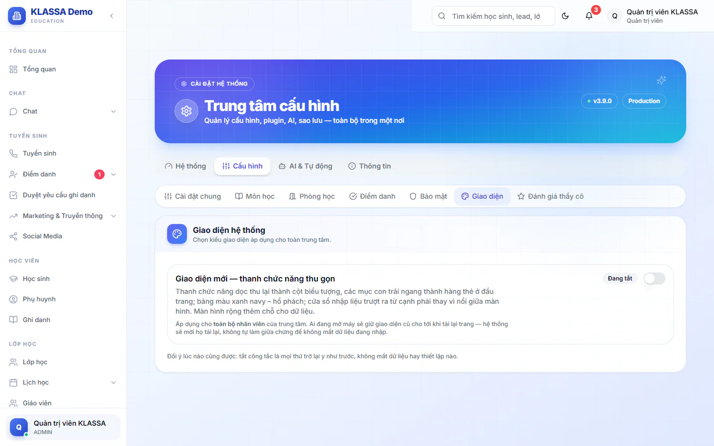

# Giao diện mới (thanh chức năng thu gọn)

Phần mềm có hai kiểu giao diện. Kiểu cũ giữ thanh chức năng đầy đủ. Kiểu mới thu thanh chức năng thành cột biểu tượng, các mục con trải ngang thành hàng thẻ ở đầu trang, đổi sang bảng màu xanh navy và hổ phách, và cửa sổ nhập liệu trượt ra từ cạnh phải thay vì nổi giữa màn hình. Chữ trên nút và menu không đổi.

## Bật giao diện mới

::: steps
1. Vào **Cài đặt → Tổng quan**, chọn thẻ **Cấu hình**, rồi **Giao diện**.
2. Ở khung **Giao diện hệ thống**, bật công tắc **Bật giao diện mới**. Nhãn bên cạnh đổi thành **Đang bật**.
:::

Nhãn hiện **Đang tắt** nghĩa là trung tâm đang dùng kiểu cũ.

::: warning Lưu ý
Công tắc áp dụng cho **toàn bộ nhân viên** của trung tâm, không phải riêng bạn. Ai đang mở máy giữ giao diện cũ cho tới khi tải lại trang. Hệ thống sẽ mời họ tải lại, không tự làm giữa chừng để họ không mất dữ liệu đang nhập.
:::

## Quay về giao diện cũ

Tắt công tắc là mọi thứ trở lại như trước, không mất dữ liệu hay thiết lập nào.

## Câu hỏi thường gặp

::: details Người khác ngoài Quản trị viên có đổi được không?
Không. Thẻ **Giao diện** báo cần quyền quản trị với các vai khác.
:::

::: details Hướng dẫn trong tài liệu có khác nhau giữa hai kiểu không?
Tên menu, nút và hộp thoại ghi giống nhau ở cả hai kiểu. Chỉ vị trí và màu sắc khác.
:::
