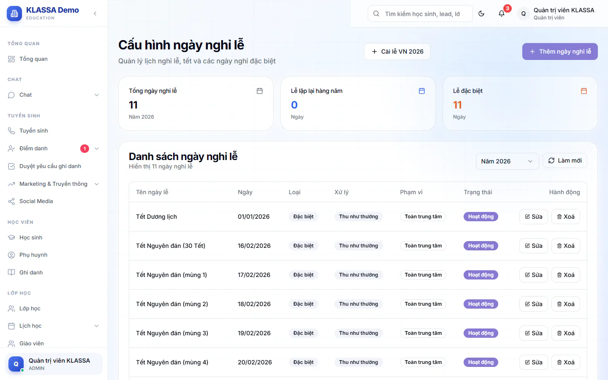
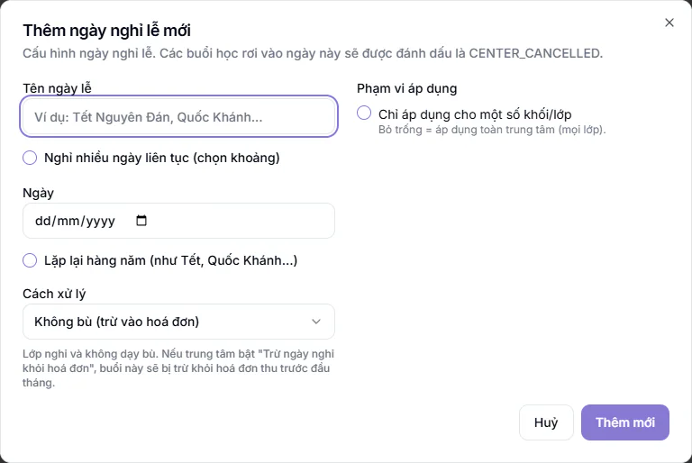

# Ngày nghỉ lễ

Khai báo các ngày trung tâm nghỉ để buổi học rơi vào ngày đó được tính là trung tâm cho nghỉ. Bạn cũng chọn được ngày nghỉ đó có bị trừ vào học phí hay không. **Quản trị viên** và **Quản lý chi nhánh** thêm, sửa, xoá được. Các vai khác không có nút chỉnh sửa.

## Mở trang

Trang này không có mục riêng trên menu. Có hai đường vào:

- **Quản lý HR → Dashboard HR**, nhóm **Công cụ & AI**, bấm thẻ **Lịch nghỉ lễ**.
- Từ phần cấu hình học phí, bấm **Quản lý lịch nghỉ** ở thẻ **Trừ ngày nghỉ khỏi hoá đơn** (xem [cấu hình tài chính](../hoc-phi/cai-dat.md)).

Trang có tiêu đề **Cấu hình ngày nghỉ lễ**.

## Cài sẵn các ngày lễ Việt Nam

::: steps
1. Bấm **Cài lễ VN** (kèm năm hiện tại).
2. Hộp xác nhận hỏi cài sẵn các ngày lễ: Tết Dương lịch, Tết Âm lịch, Giỗ Tổ, 30/4, 1/5, 2/9. Bấm đồng ý.
3. Các ngày lễ xuất hiện trong **Danh sách ngày nghỉ lễ**.
:::

Các ngày cài sẵn mặc định **không** trừ tiền học. Muốn trừ, bạn sửa từng ngày (xem **Cách xử lý** bên dưới).

## Thêm một ngày nghỉ

::: steps
1. Bấm **Thêm ngày nghỉ lễ**. Hộp **Thêm ngày nghỉ lễ mới** hiện ra.
2. Điền **Tên ngày lễ** (ví dụ Tết Nguyên Đán, Quốc Khánh).
3. Chọn **Ngày**. Nếu nghỉ nhiều ngày liền, tích **Nghỉ nhiều ngày liên tục (chọn khoảng)** rồi chọn **Từ ngày**, **Đến ngày**. Tích thêm **Bỏ qua Chủ nhật trong khoảng** nếu không muốn tính Chủ nhật.
4. Tích **Lặp lại hàng năm (như Tết, Quốc Khánh...)** nếu ngày này năm nào cũng nghỉ.
5. Chọn **Cách xử lý** (xem bên dưới).
6. Chọn **Phạm vi áp dụng** (xem bên dưới).
7. Bấm **Thêm mới**.
:::

Nếu để trống ô bắt buộc, hệ thống báo **Vui lòng điền đầy đủ thông tin**. Nếu **Đến ngày** không sau **Từ ngày**, hệ thống báo lỗi và không lưu.

## Cách xử lý

Khi thêm ngày nghỉ mới, ô này mặc định chọn **Không bù (trừ vào hoá đơn)**. Hãy đổi nếu bạn không muốn trừ tiền.

| Lựa chọn | Ý nghĩa |
|---|---|
| **Không bù (trừ vào hoá đơn)** | Lớp nghỉ, không dạy bù. Nếu trung tâm bật **Trừ ngày nghỉ khỏi hoá đơn**, buổi này bị trừ khỏi hoá đơn thu trước đầu tháng |
| **Dạy bù sau** | Lớp nghỉ nhưng sẽ dạy bù. Không trừ hoá đơn. Hệ thống chưa tự tạo buổi bù, bạn sắp xếp thủ công |
| **Thu như thường** | Lớp vẫn dạy hoặc học sinh chấp nhận mất buổi. Không trừ hoá đơn |

::: warning Lưu ý
Chỉ ngày nghỉ có cách xử lý **Không bù (trừ vào hoá đơn)** mới bị trừ vào hoá đơn, và chỉ khi công tắc **Tự động trừ ngày nghỉ khỏi hoá đơn đầu kỳ** ở cấu hình tài chính đang bật.
:::

## Phạm vi áp dụng

Mặc định ngày nghỉ áp dụng cho toàn trung tâm. Để giới hạn, tích **Chỉ áp dụng cho một số khối/lớp**, rồi chọn **Theo khối** hoặc tìm và chọn từng lớp. Cột **Phạm vi** trong danh sách hiện **Toàn trung tâm** hoặc khối, lớp đã chọn.

## Xem và sửa danh sách

**Danh sách ngày nghỉ lễ** có cột **Tên ngày lễ**, **Ngày**, **Loại** (**Lặp hàng năm** hoặc **Đặc biệt**), **Xử lý**, **Phạm vi**, **Trạng thái** (**Hoạt động** hoặc **Tạm ngưng**) và **Hành động**. Chọn năm ở ô **Chọn năm** để xem từng năm. Ba ô thống kê trên đầu là **Tổng ngày nghỉ lễ**, **Lễ lặp lại hàng năm**, **Lễ đặc biệt**.

Ở cột **Hành động**, bấm nút sửa để mở hộp **Cập nhật ngày nghỉ lễ**, hoặc nút xoá rồi xác nhận ở hộp **Xác nhận xoá**.

## Câu hỏi thường gặp

::: details Tôi là giáo viên, sao không thấy nút thêm ngày nghỉ?
Chỉ Quản trị viên và Quản lý chi nhánh có nút **Thêm ngày nghỉ lễ**, **Cài lễ VN** và nút sửa, xoá.
:::

::: details Ngày nghỉ có được tính vào buổi học của lớp không?
Các buổi học rơi vào ngày nghỉ được đánh dấu là trung tâm cho nghỉ. Xem thêm cách tính tiền ở [Tạo hoá đơn](../hoc-phi/tao-hoa-don.md).
:::
