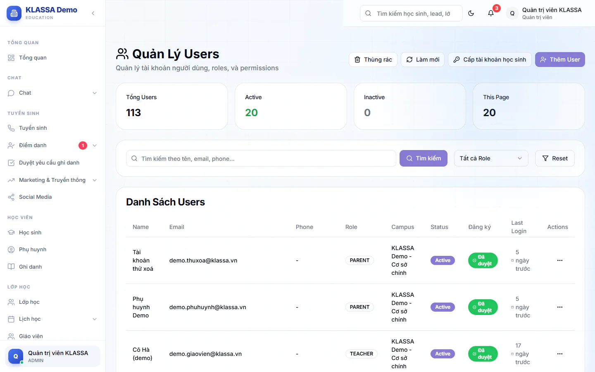
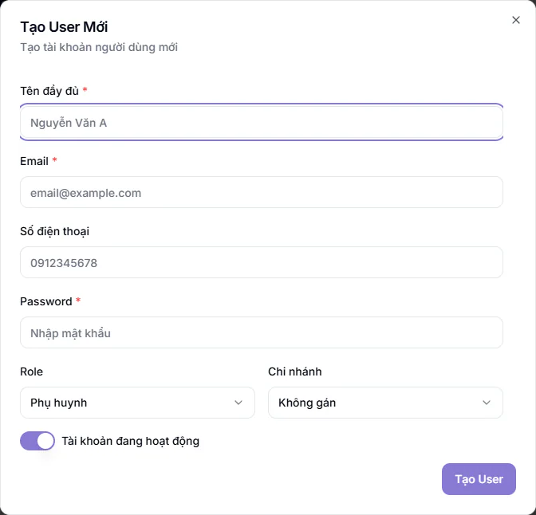

# Quản lý người dùng

Trang này là nơi Quản trị viên tạo tài khoản cho nhân viên, đổi vai, đặt lại mật khẩu và khoá hoặc xoá tài khoản khi cần. Tài khoản tạo ở đây dùng được ngay, không phải chờ duyệt.

Chỉ **Quản trị viên** vào được trang này. Các vai khác sẽ thấy thông báo không đủ quyền.

## Mở trang

Vào **Quản trị hệ thống → Quản lý Users**. Đầu trang có 4 ô thống kê (**Tổng Users**, **Active**, **Inactive**, **This Page**), thanh tìm kiếm và bảng **Danh Sách Users**.

Bảng có các cột: tên, email, số điện thoại, vai, chi nhánh, trạng thái (**Active** hoặc **Inactive**, kèm **Bị khóa** nếu đang bị khoá), trạng thái đăng ký, lần đăng nhập gần nhất (hoặc **Chưa đăng nhập**) và nút thao tác.

Để tìm người, gõ tên, email hoặc số điện thoại vào ô tìm kiếm rồi bấm **Tìm kiếm**. Lọc theo vai ở ô **Tất cả Role**. Bấm **Reset** để xoá bộ lọc. Mỗi trang hiện 20 người.

## Tạo tài khoản cho nhân viên

::: steps
1. Vào **Quản trị hệ thống → Quản lý Users**.
2. Bấm **Thêm User**, hộp **Tạo User Mới** hiện ra.
   
3. Điền **Tên đầy đủ**, **Email**, **Số điện thoại** (không bắt buộc).
4. Nhập **Password**. Ô này bắt buộc khi tạo mới, hệ thống không tự sinh mật khẩu.
5. Chọn **Role** (vai) và **Chi nhánh**. Chọn **Không gán** nếu người này không thuộc chi nhánh nào.
6. Giữ công tắc **Tài khoản đang hoạt động** ở trạng thái bật, rồi bấm **Tạo User**.
:::

Ô bắt buộc: **Tên đầy đủ**, **Email**, **Password**. Email không được trùng với tài khoản đang có.

Nếu bỏ trống vai, hệ thống đặt là **Phụ huynh**, vì vậy hãy chọn vai cho đúng trước khi lưu.

Khi vai là nhân viên (Quản trị viên, Quản lý chi nhánh, Quản lý, Lễ tân, Giáo viên, Trợ giảng, Kế toán, Nhân sự), hệ thống tự tạo luôn hồ sơ nhân sự cho tài khoản đó. Nhờ vậy người này vào được **Cổng nhân viên** ngay. Phụ huynh không có hồ sơ nhân sự.

::: warning Lưu ý
- Hệ thống không tự gửi email thông tin đăng nhập. Bạn cần báo email và mật khẩu cho nhân viên, và nên dặn họ đổi mật khẩu ở lần đăng nhập đầu.
- Số tài khoản nhân viên bị giới hạn theo gói của trung tâm. Khi đủ số lượng hoặc gói hết hạn, hệ thống báo lỗi và không cho tạo thêm. Tài khoản **Phụ huynh** không tính vào giới hạn này. Khi gặp thông báo này, liên hệ KLASSA để nâng gói hoặc gia hạn.
- Không tạo tài khoản **Học sinh** ở đây. Hãy cấp từ hồ sơ học sinh, xem [Tài khoản học sinh](../hoc-sinh/tai-khoan-hoc-sinh.md).
:::

## Sửa thông tin, đổi vai, khoá tài khoản

Bấm nút ba chấm ở cuối dòng để mở menu thao tác.

| Thao tác | Dùng để làm gì |
|---|---|
| **Chỉnh sửa** | Đổi tên, số điện thoại, vai, chi nhánh, trạng thái hoạt động. Email không đổi được. Để trống **Password** nếu không muốn đổi mật khẩu. Bấm **Cập nhật** để lưu. |
| **Vô hiệu hóa** / **Kích hoạt** | Tắt hoặc bật lại tài khoản, ví dụ khi nhân viên nghỉ việc. Tài khoản tắt không đăng nhập được. |
| **Mở khóa tài khoản** | Chỉ hiện khi tài khoản đang bị khoá do nhập sai mật khẩu nhiều lần. Bấm để mở lại ngay, không cần chờ. |
| **Đặt lại mật khẩu** | Đặt mật khẩu mới cho người quên. |
| **Xóa** | Chuyển tài khoản vào thùng rác. |

### Đặt lại mật khẩu

::: steps
1. Ở dòng người cần đổi, bấm nút ba chấm, chọn **Đặt lại mật khẩu**.
2. Nhập **Mật khẩu mới** (tối thiểu 6 ký tự).
3. Bấm **Đặt lại**, rồi báo mật khẩu mới cho người đó.
:::

Khi bạn đổi mật khẩu, vai hoặc chi nhánh của một người, mọi phiên đăng nhập cũ của họ trên web và app bị đăng xuất. Họ đăng nhập lại để nhận quyền mới. Khi vô hiệu hóa tài khoản, họ cũng bị đăng xuất.

## Xóa và khôi phục tài khoản

Bấm **Xóa** ở menu thao tác, hộp **Xóa user** hiện ra. Ô **Lý do xóa** không bắt buộc (nếu để trống, hệ thống ghi "Không có lý do cụ thể"). Bấm **Xóa** để xác nhận.

Tài khoản bị xoá chỉ được chuyển vào thùng rác, dữ liệu không mất. Bạn không thể tự xoá chính tài khoản của mình.

Để khôi phục: bấm **Thùng rác** ở đầu trang, tìm người cần lấy lại, bấm **Khôi phục**.

## Câu hỏi thường gặp

::: details Nhân viên đã được tạo tài khoản nhưng không đăng nhập được?
Kiểm tra cột trạng thái: nếu là **Inactive**, bấm **Kích hoạt**. Nếu có nhãn **Bị khóa**, bấm **Mở khóa tài khoản**. Sau đó xác nhận lại email và mật khẩu đã báo cho họ.
:::

::: details Tạo nhầm vai thì sửa thế nào?
Bấm **Chỉnh sửa** ở dòng người đó, đổi **Role**, bấm **Cập nhật**. Người đó cần đăng nhập lại để nhận quyền mới.
:::

::: details Khác gì với duyệt đăng ký?
Ở đây Quản trị viên tạo thẳng tài khoản và dùng được ngay. Còn người tự đăng ký thì chờ ở [Duyệt đăng ký người dùng](duyet-dang-ky-nguoi-dung.md) đến khi được duyệt.
:::

::: details Có thể tự tạo vai mới hoặc chỉnh quyền từng vai không?
Không. Các vai có bộ quyền cố định, xem [Vai trò người dùng](../tai-khoan/vai-tro-nguoi-dung.md).
:::
