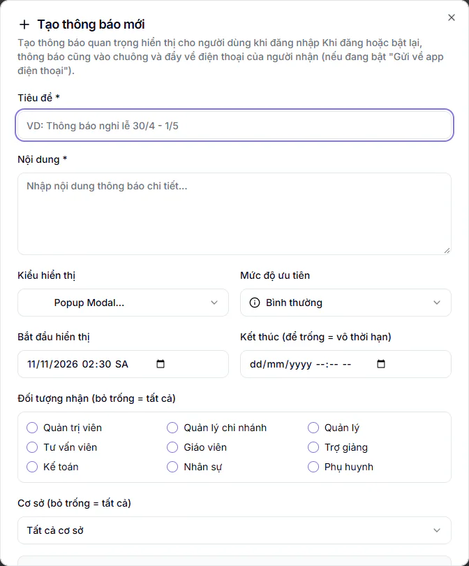

# Thông báo Popup

Dùng để gửi một thông báo quan trọng (nghỉ lễ, đổi lịch, bảo trì) hiện ra khi người nhận đăng nhập. Bạn chọn thông báo đến ai, hiện trong khoảng thời gian nào và đi qua kênh nào.

## Tạo một thông báo

::: steps
1. Vào **Quản trị hệ thống → Thông báo Popup**.
2. Bấm **Tạo thông báo mới**. Hộp **Tạo thông báo mới** hiện ra.
3. Điền **Tiêu đề** và **Nội dung** (hai ô bắt buộc, có dấu *).
4. Chọn **Kiểu hiển thị**: **Popup Modal** (hộp thoại khi đăng nhập), **Banner** (dải ở đầu trang) hoặc **Toàn màn hình**.
5. Chọn **Mức độ ưu tiên**: **Bình thường**, **Cao** hoặc **Khẩn cấp**.
6. Đặt **Bắt đầu hiển thị** và **Kết thúc (để trống = vô thời hạn)** nếu cần giới hạn thời gian.
7. Chọn **Đối tượng nhận**: tích các vai cần gửi. Bỏ trống nghĩa là gửi tất cả. Có thể chọn **Cơ sở** để chỉ gửi cho một cơ sở (mặc định **Tất cả cơ sở**).
8. Chỉnh các công tắc ở phần **Tùy chọn hiển thị** (xem bên dưới), rồi bấm **Tạo thông báo**.
:::

Danh sách vai trong ô **Đối tượng nhận** có: Quản trị viên, Quản lý chi nhánh, Quản lý, Tư vấn viên (tức Lễ tân), Giáo viên, Trợ giảng, Kế toán, Nhân sự, Phụ huynh.

## Công tắc hiển thị

| Công tắc | Ý nghĩa | Mặc định |
|---|---|---|
| **Kích hoạt** | Thông báo có đang hoạt động không | Bật |
| **Hiện khi đăng nhập** | Tự hiện popup khi người dùng đăng nhập | Bật |
| **Chỉ hiện 1 lần** | Đọc xong thì không hiện lại cho người đó | Tắt |

## Chọn kênh: web, app điện thoại hoặc cả hai

Mục **Hiển thị ở đâu** có hai công tắc, mặc định đều bật:

- **Hiện trên web**: hộp nổi khi nhân viên, phụ huynh mở web.
- **Gửi về app điện thoại**: hộp nổi khi mở app, kèm thông báo đẩy về máy.

Kết quả theo cách bạn bật:

| Bật | Kết quả |
|---|---|
| Cả hai | Hiện trên web và trong app |
| Chỉ **Hiện trên web** | Chỉ web. Điện thoại không nhận gì, kể cả chuông thông báo |
| Chỉ **Gửi về app điện thoại** | Chỉ app. Web không hiện hộp nổi |

::: warning Lưu ý
Phải bật ít nhất một kênh. Nếu tắt cả hai, hộp báo đỏ **Phải bật ít nhất một kênh** hiện ra và bạn không lưu được.
:::

Khi bạn đăng hoặc bật lại một thông báo, hệ thống cũng báo vào chuông của người nhận. Sau khi lưu, màn hình báo số người vừa được báo.

## Quản lý các thông báo đã tạo

Đầu trang có ba số: **Tổng thông báo**, **Đang hoạt động**, **Khẩn cấp**, cùng số lượt đã đọc. Bộ lọc **Tất cả**, **Đang hoạt động**, **Hết hạn / Tắt** giúp bạn tìm nhanh.

Trên mỗi thông báo có các nút:

- Biểu tượng con mắt (**Xem trước**): xem như người nhận sẽ thấy.
- **Vô hiệu hóa** hoặc **Kích hoạt**: tắt hoặc bật lại mà không xoá.
- **Sửa**: mở lại hộp để chỉnh.
- **Xóa**: hỏi **Xóa thông báo?** rồi mới xoá.

::: tip Mẹo
Thông báo do KLASSA gửi xuống cho trung tâm hiện dòng **Quản lý tại KLASSA** và không có nút sửa hay xoá. Bạn chỉ xem trước được.
:::

## Câu hỏi thường gặp

::: details Tôi chỉ muốn gửi cho phụ huynh thì làm sao?
Ở **Đối tượng nhận**, chỉ tích **Phụ huynh**.
:::

::: details Vì sao điện thoại của giáo viên không nhận thông báo?
Kiểm tra thông báo đó có đang bật **Gửi về app điện thoại** không. Nếu chỉ bật **Hiện trên web** thì điện thoại không nhận gì.
:::
