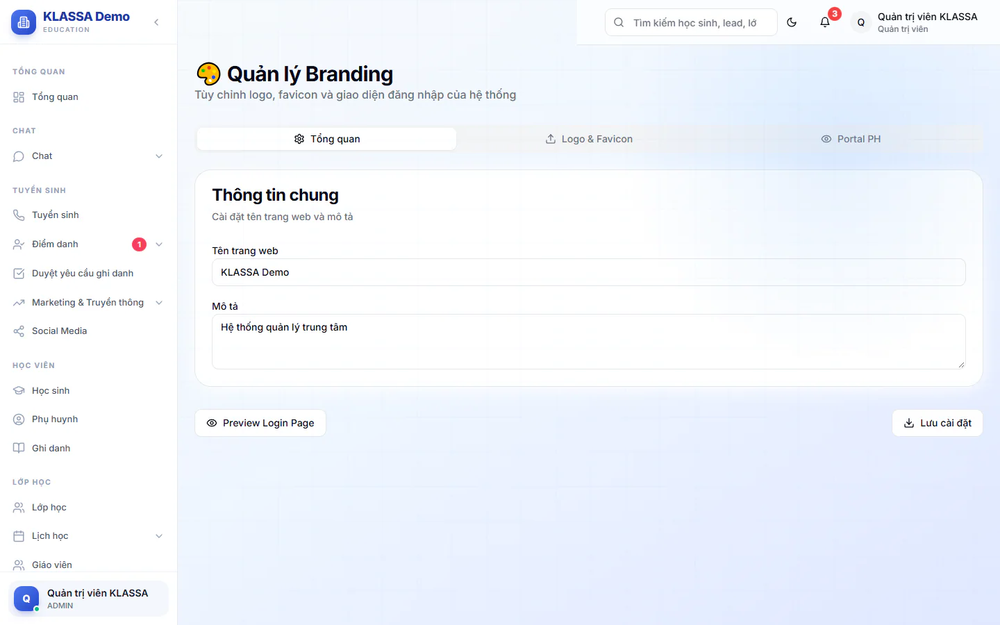
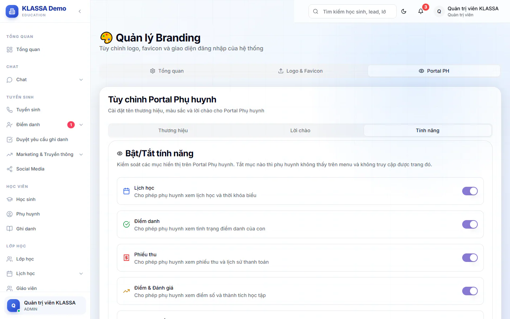

# Thương hiệu: tên, logo, favicon, Cổng phụ huynh

Trang này giúp phần mềm mang diện mạo của trung tâm bạn: tên trên trang đăng nhập, logo, biểu tượng trên thẻ trình duyệt, và cách Cổng phụ huynh chào đón phụ huynh. Chỉ **Quản trị viên** mở được trang này.

## Đổi tên và mô tả trung tâm

::: steps
1. Vào **Quản trị hệ thống → Thương hiệu**. Trang có tiêu đề **Quản lý Branding**.
2. Ở thẻ **Tổng quan**, điền **Tên trang web** và **Mô tả**.
3. Bấm **Lưu cài đặt** ở cuối trang. Thông báo **Lưu thành công** hiện ra là xong.
:::

## Tải logo và favicon

Logo hiện trên trang đăng nhập. Favicon là biểu tượng nhỏ trên thẻ trình duyệt.

::: steps
1. Vào **Quản trị hệ thống → Thương hiệu**, mở thẻ **Logo & Favicon**.
2. Ở khung **Logo chính**, chọn ảnh PNG, JPG hoặc SVG, tối đa 2MB. Nên dùng ảnh 200x200px trở lên.
3. Ở khung **Favicon**, chọn ảnh ICO hoặc PNG, tối đa 100KB.
4. Khi thấy thông báo **Upload thành công**, bấm **Lưu cài đặt** để áp dụng.
:::

::: warning Lưu ý
Tải ảnh lên chưa đủ. Bạn phải bấm **Lưu cài đặt** thì logo và favicon mới được ghi nhận.
:::

## Xem trước trang đăng nhập

Bấm **Preview Login Page** ở góc dưới bên trái trang. Hộp **Preview Giao diện Login** hiện ra để bạn xem trang đăng nhập sẽ trông thế nào.

## Tuỳ chỉnh Cổng phụ huynh

Thẻ **Portal PH** quyết định phụ huynh thấy gì khi vào Cổng phụ huynh. Thẻ này có nút **Lưu cài đặt** riêng nằm cuối khung, tách khỏi nút **Lưu cài đặt** của trang.

Bên trong có ba thẻ nhỏ:

- **Thương hiệu**: **Tên thương hiệu** (hiện ở góc trên Cổng phụ huynh), **Tiêu đề Portal** (dòng chữ nhỏ hiện dưới tên thương hiệu, ví dụ "Portal Phụ huynh") và **Màu thương hiệu** (mã màu như #0066cc).
- **Lời chào**: ba câu chào theo giờ. **Lời chào buổi sáng** dùng từ 5:00 đến 11:59, buổi chiều từ 12:00 đến 17:59, còn lại là buổi tối. Bên dưới có khung xem trước lời chào hiện tại.
- **Tính năng**: công tắc bật hoặc tắt từng mục trên menu của phụ huynh. Tắt mục nào thì phụ huynh không thấy mục đó và không vào được trang đó.

Các công tắc trong thẻ **Tính năng**, mặc định đều bật:

| Công tắc | Phụ huynh thấy |
|---|---|
| **Lịch học** | Lịch học và thời khoá biểu |
| **Điểm danh** | Tình trạng điểm danh của con |
| **Phiếu thu** | Phiếu thu và lịch sử thanh toán |
| **Điểm & Đánh giá** | Điểm số và thành tích |
| **Nhận xét buổi học** | Nhận xét của giáo viên |
| **Thông báo** | Thông báo chung của trung tâm |
| **Xin nghỉ** | Gửi đơn xin nghỉ trực tuyến |
| **Bài tập** | Bài tập của con |
| **Thẻ Năng Lực** | Thẻ năng lực |
| **Phiếu tháng** | Phiếu kết quả học tập tháng |
| **Đổi quà** | Đổi điểm thưởng lấy quà |

::: tip Mẹo
Cổng phụ huynh thuộc gói mở rộng **Cổng Phụ huynh**. Xem [giới thiệu gói mở rộng](../plugin/gioi-thieu.md).
:::

## Câu hỏi thường gặp

::: details Tôi đổi tên rồi nhưng tên cũ vẫn còn ở một số nơi?
Tải lại trang rồi kiểm tra lại. Tên ở **Thương hiệu** (thẻ **Tổng quan**) và **Tên thương hiệu** của Cổng phụ huynh là hai ô riêng, nên đổi cả hai nếu muốn đồng nhất.
:::

::: details Người khác ngoài Quản trị viên có đổi được logo không?
Không. Trang này chỉ dành cho Quản trị viên.
:::
