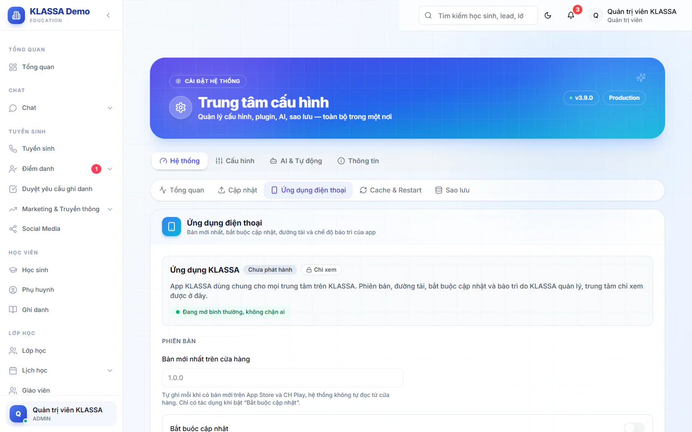

# Ứng dụng điện thoại và ai đang dùng app

Thẻ này cho Quản trị viên biết app KLASSA trên điện thoại đang ở bản nào và ai đã dùng app. Khi cần, bạn lấy danh sách phụ huynh chưa vào app để nhờ giáo viên nhắc.

## Mở thẻ

Vào **Cài đặt → Tổng quan**, chọn thẻ **Hệ thống**, rồi **Ứng dụng điện thoại**. Thẻ gồm hai khung: **Ứng dụng điện thoại** và **Ai đang dùng app**. Chỉ Quản trị viên mở được.

## Xem cấu hình app

Với trung tâm dùng app KLASSA dùng chung, khung này hiện **Chỉ xem**. Phiên bản, đường tải, bắt buộc cập nhật và bảo trì do KLASSA quản lý. Bạn xem được các mục sau nhưng không sửa:

- **Phiên bản**: **Bản mới nhất trên cửa hàng**, **Bắt buộc cập nhật**, **Lời nhắn trên màn "Cần cập nhật"**, **Bản tối thiểu cho iPhone**, **Bản tối thiểu cho Android**.
- **Đường tải**: **App Store** và **CH Play**.
- **Bảo trì**: **Chế độ bảo trì** và **Lời nhắn bảo trì**.

Nhãn **Chưa phát hành** hiện khi chưa có đường tải nào.

::: tip Mẹo
Bản chạy trên máy thấp hơn **Bản tối thiểu** sẽ bị chặn vào app. **Bắt buộc cập nhật** chặn máy dùng bản cũ hơn bản mới nhất. **Chế độ bảo trì** làm mọi người dùng app chỉ thấy màn bảo trì, web vẫn dùng bình thường.
:::

## Xem ai đang dùng app

Khung **Ai đang dùng app** thống kê những người đã đăng nhập app trên iPhone và Android:

- **Đang dùng app** (kèm số iPhone, Android), **Mới vào hôm nay**.
- **Phụ huynh đã vào app** trên tổng số tài khoản phụ huynh.
- **Học sinh có phụ huynh dùng app** trên tổng số học sinh đang học.
- **Theo vai trò**: số người theo từng vai.
- **Ai đã vào app**: danh sách tên, có ô **Tìm theo tên** và nút **Xem thêm**.

Chỉ tính người đã đăng nhập app. Ai tải app mà chưa đăng nhập thì chỉ App Store và CH Play đếm được. Bấm **Làm mới** để lấy số liệu mới.

## Lấy danh sách phụ huynh chưa vào app

::: steps
1. Ở khung **Ai đang dùng app**, kéo tới mục **Phụ huynh chưa vào app, theo lớp**.
2. Tìm lớp ở ô **Tìm lớp hoặc giáo viên**.
3. Bấm vào lớp để xem học sinh có phụ huynh chưa vào app. Học sinh chưa có tài khoản phụ huynh có nhãn **Chưa có tài khoản phụ huynh**.
4. Bấm **Chép danh sách gửi giáo viên**, rồi dán vào nhóm lớp để giáo viên nhắc.
:::

## Câu hỏi thường gặp

::: details Vì sao tôi không sửa được phiên bản app?
Với app dùng chung của KLASSA, phần này chỉ để xem. Cần thay đổi hãy liên hệ KLASSA.
:::

::: details Thông báo đẩy tới app có liên quan gì?
Xem [Thông báo Popup](thong-bao.md) để chọn gửi thông báo về app điện thoại hay chỉ trên web.
:::
