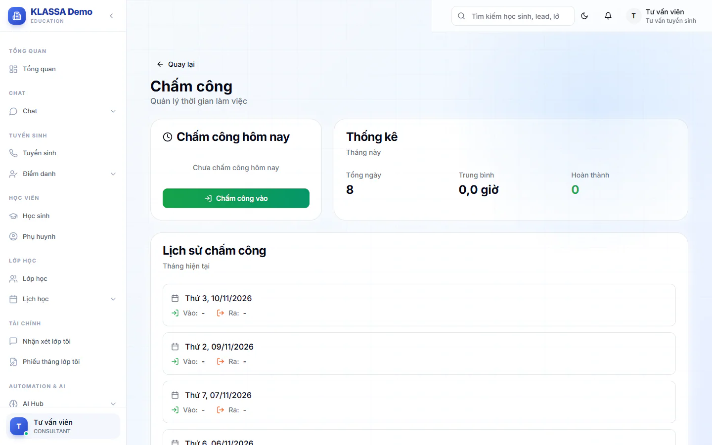

# Chấm công của tôi

Chấm công để trung tâm biết giờ bạn có mặt làm việc. Bạn chấm vào khi bắt đầu, chấm ra khi kết thúc, ngay trên web hoặc trên app điện thoại.

Chấm công trên web cần gói mở rộng **Ứng dụng Di động (PWA)**. Nếu trung tâm chưa bật, khung chấm công báo "Trung tâm chưa bật chấm công trên web".

## Chấm vào và chấm ra

::: steps
1. Vào **Cổng nhân viên → Chấm công của tôi** (hoặc dùng khung **Chấm công hôm nay** ngay ở **Tổng quan**).
2. Khi bắt đầu làm, bấm **Chấm công vào**. Trình duyệt có thể hỏi quyền vị trí, hãy bấm cho phép.
3. Khi kết thúc, bấm **Chấm công ra**. Màn hình báo giờ ra và số giờ của ca vừa làm.
:::

Trong ngày có thể làm nhiều ca. Sau khi chấm ra, nút đổi thành **Chấm công vào ca tiếp** (ví dụ ca sáng rồi ca chiều). Khi hết lượt, khung hiện "Đã hoàn thành chấm công hôm nay".

::: tip Mẹo
Bật định vị trên điện thoại và kết nối đúng WiFi của trung tâm để chấm công được xác nhận ngay.
:::

## Khi hệ thống không xác nhận được vị trí

Nếu WiFi hỏng, định vị lỗi, hoặc bạn đang đi công tác, hệ thống báo lỗi vị trí rồi mở ô nhập lý do.

::: steps
1. Ghi rõ lý do vào ô (ít nhất 3 ký tự), ví dụ "Đang đi công tác".
2. Bấm **Gửi cho quản lý duyệt**.
:::

Lần chấm này được ghi nhận ngay và chờ quản lý duyệt. Trong lúc chờ, giờ công vẫn được tính tạm. Nếu bị từ chối thì lần chấm đó không được tính. Bấm **Huỷ** để đóng ô nhập lý do.

## Tôi quên chấm ra

Nếu bạn quên chấm ra ca trước mà đã sang ca sau, đừng bấm **Chấm công ra** lúc này, vì giờ nghỉ sẽ bị tính thành giờ làm.

::: steps
1. Khi đang ở trạng thái đang làm việc, bấm **Tôi quên chấm ra** (dòng chữ nhỏ dưới nút).
2. Chọn giờ bạn đã ra về thật.
3. Ghi lý do (ít nhất 3 ký tự), ví dụ "Hết ca sáng quên bấm chấm ra".
4. Bấm **Gửi giờ ra**.
:::

Giờ ra chờ quản lý duyệt, sau đó bạn chấm vào ca tiếp được ngay.

## Xem lịch sử chấm công

Trang mở từ mục **Chấm công của tôi** có tiêu đề **Chấm công** (phụ đề "Quản lý thời gian làm việc"), gồm khung **Chấm công hôm nay**, khối **Thống kê** của tháng này (**Tổng ngày**, **Trung bình** giờ mỗi ngày, **Hoàn thành**) và khối **Lịch sử chấm công** liệt kê từng ngày với giờ **Vào**, **Ra** và số giờ làm.

::: warning Lưu ý
- Trợ giảng làm bán thời gian không chấm công cả ngày. Họ bấm **Có mặt** từng buổi ở mục [Ca trợ giảng](ca-tro-giang.md), nên khung chấm công này được ẩn. Trợ giảng toàn thời gian vẫn chấm công như nhân viên thường.
- Nếu thấy "Tài khoản chưa gắn hồ sơ nhân sự", nhờ quản lý gắn hồ sơ nhân viên cho tài khoản của bạn.
:::

## Câu hỏi thường gặp

::: details Vì sao tôi không thấy nút chấm công?
Có ba lý do thường gặp: trung tâm chưa bật chấm công trên web, tài khoản chưa gắn hồ sơ nhân sự, hoặc bạn là trợ giảng bán thời gian (chấm theo buổi ở **Ca trợ giảng**).
:::

::: details Quản lý duyệt các lần chấm chờ duyệt ở đâu?
Ở phần nhân sự. Xem [Chấm công nhân viên](../nhan-su/cham-cong.md).
:::
