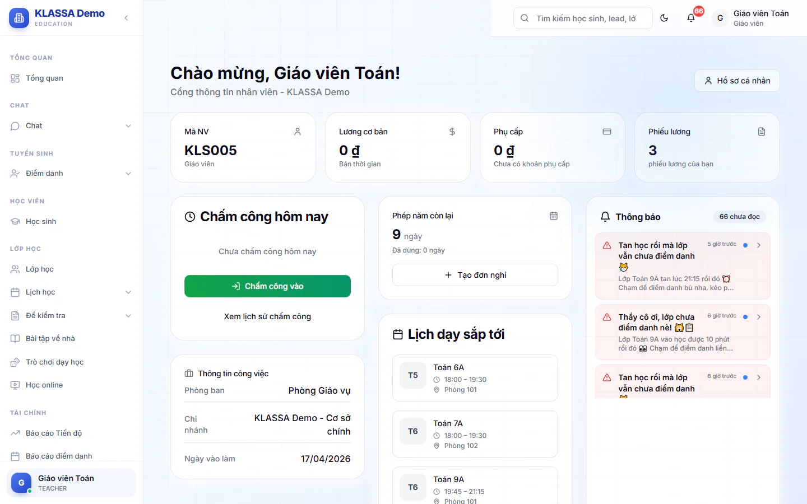

# Tổng quan Cổng nhân viên

Cổng nhân viên là nơi mỗi người xem và làm các việc của riêng mình: chấm công, xem phiếu lương, xin nghỉ phép, đăng ký ca. Bạn chỉ thấy dữ liệu của bạn, không thấy của đồng nghiệp.

## Mở Cổng nhân viên

::: steps
1. Đăng nhập bằng tài khoản nhân viên.
2. Trong menu, mở nhóm **Cổng nhân viên**.
3. Bấm **Tổng quan**.
:::

Nhóm **Cổng nhân viên** có các mục: **Tổng quan**, **Phiếu lương**, **Chấm công của tôi**, **Đăng ký ca**, **Ca trợ giảng**, **Nghỉ phép**, **Phúc lợi**, **Hồ sơ cá nhân**, **Zalo của tôi**. Mục nào hiện còn tuỳ vai của bạn và gói mở rộng trung tâm đang dùng.

::: warning Lưu ý
Tài khoản phải được gắn với một hồ sơ nhân viên. Nếu thấy dòng "Tài khoản của bạn chưa có hồ sơ nhân viên", hãy nhờ quản lý hoặc nhân sự gắn hồ sơ cho bạn. Vai Quản trị viên không có nhóm menu **Cổng nhân viên**.
:::

## Trang Tổng quan cho bạn thấy gì

Đầu trang là lời chào kèm nút **Hồ sơ cá nhân**. Phía dưới là bốn ô tóm tắt: **Mã NV**, **Lương cơ bản**, **Phụ cấp** và **Phiếu lương** (số phiếu lương của bạn).

Các khối còn lại:

| Khối | Dùng để |
|---|---|
| **Chấm công hôm nay** | Chấm vào, chấm ra trong ngày. Xem [Chấm công của tôi](cham-cong.md). |
| **Thông tin công việc** | Xem phòng ban, chi nhánh, ngày vào làm. |
| Khối nghỉ phép | Xem số ngày phép còn lại, bấm **Tạo đơn nghỉ** để xin nghỉ. Xem [Nghỉ phép](nghi-phep.md). |
| **Lịch dạy sắp tới** (giáo viên) hoặc **Lịch làm việc** (vai khác) | Xem các buổi dạy sắp tới, hoặc ca trực 7 ngày tới. |
| **Thông báo** | Đọc thông báo gần nhất, bấm **Xem tất cả** để xem đủ. |
| **Phiếu lương gần đây** | Mở nhanh các phiếu lương mới, bấm **Xem tất cả** để sang danh sách. |

## Các mục khác nằm ngoài nhóm Cổng nhân viên

- [Tin nhắn nội bộ](chat.md): nhắn riêng và nhắn nhóm với đồng nghiệp.
- [Công việc của tôi](viec-can-lam.md): việc được giao (cần gói mở rộng).
- [Trò chơi cờ](tro-choi-co.md): giải trí nội bộ.
- [KLASSA Office](van-phong-klassa.md): xem ai đang online.
- **Zalo của tôi**: liên kết Zalo cá nhân, xem [Zalo của tôi](../tin-nhan/zalo-cua-toi.md).

## Câu hỏi thường gặp

::: details Tôi không thấy mục Ca trợ giảng hoặc Đăng ký ca?
**Ca trợ giảng** chỉ hiện cho Giáo viên, Trợ giảng và Lễ tân. **Đăng ký ca** hiện cho mọi vai nhân viên nhưng chỉ dùng được khi quản lý đã bật quyền đăng ký ca cho bạn.
:::

::: details Ai cấp tài khoản nhân viên cho tôi?
Quản lý hoặc nhân sự của trung tâm tạo tài khoản. Nếu chưa có, hãy hỏi trực tiếp họ.
:::
