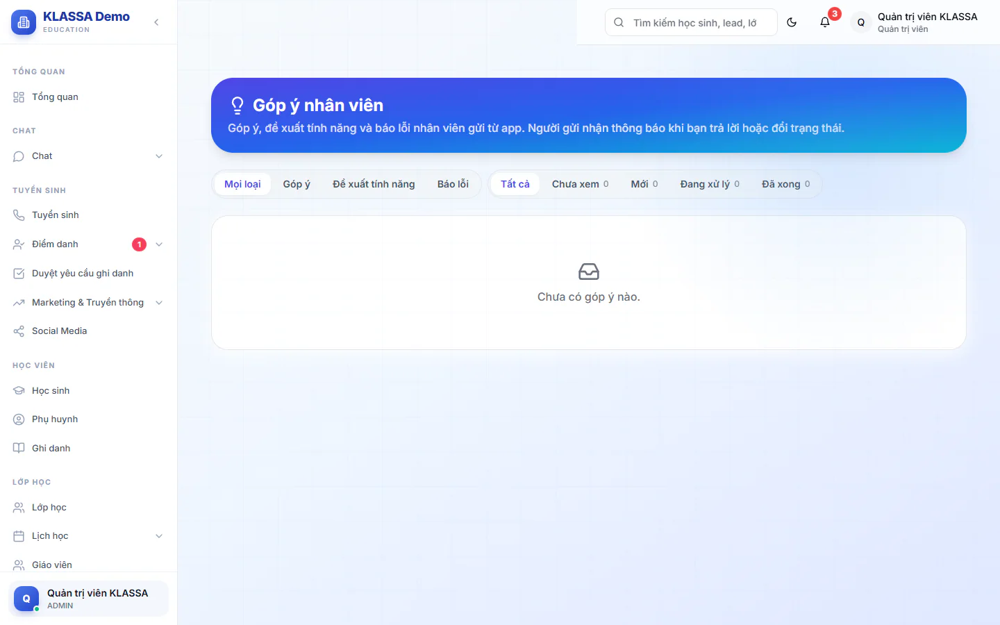

# Góp ý và báo lỗi của nhân viên

Nhân viên gửi góp ý, đề xuất tính năng hoặc báo lỗi từ app điện thoại KLASSA. Quản trị viên đọc và trả lời ở đây. Người gửi nhận thông báo mỗi khi bạn trả lời hoặc đổi trạng thái.

## Gửi góp ý (dành cho nhân viên)

Nhân viên gửi bài trên app điện thoại, ở **Hồ sơ → Góp ý & báo lỗi**. Trên web không có chỗ gửi bài mới. Có ba loại: **Góp ý**, **Đề xuất tính năng** và **Báo lỗi**, kèm ảnh chụp nếu cần.

Khi bấm vào thông báo trả lời, nhân viên mở được trang **Góp ý của tôi** trên web. Đó là trang chỉ đọc, hiện các bài họ đã gửi và câu trả lời của Quản trị viên.

## Xem và lọc hộp góp ý

::: steps
1. Đăng nhập bằng tài khoản Quản trị viên.
2. Vào mục **Góp ý nhân viên** (ở cuối menu).
3. Lọc theo loại: **Mọi loại**, **Góp ý**, **Đề xuất tính năng**, **Báo lỗi**.
4. Lọc theo trạng thái: **Tất cả**, **Chưa xem**, **Mới**, **Đang xử lý**, **Đã xong**. Số bên cạnh mỗi trạng thái là số bài đang ở trạng thái đó.
:::

Mỗi dòng hiện loại, trạng thái, số ảnh đính kèm, và nhãn **Đã trả lời** nếu bạn đã trả lời.

## Trả lời và đổi trạng thái

::: steps
1. Bấm vào một bài để mở. Việc mở bài đánh dấu bài đã xem.
2. Đọc nội dung, xem ảnh (bấm vào ảnh để phóng to) và phần **Thông tin máy** của người gửi.
3. Chọn **Trạng thái** mới nếu cần.
4. Viết câu trả lời vào ô "Trả lời người gửi" (tối đa 4000 ký tự).
5. Bấm **Lưu**. Màn hình báo "Đã lưu, người gửi nhận được thông báo".
:::

Bạn có thể chỉ đổi trạng thái hoặc chỉ trả lời. Nếu không đổi gì, nút **Lưu** bị khoá.

::: tip Mẹo
Đặt trạng thái **Đang xử lý** ngay khi bắt đầu xem để người gửi biết bài đã được tiếp nhận, rồi chuyển **Đã xong** khi giải quyết xong.
:::

::: warning Lưu ý
Chỉ Quản trị viên mở được hộp góp ý đầy đủ. Các vai khác chỉ xem được bài của chính mình.
:::

## Câu hỏi thường gặp

::: details Người gửi có biết ai trả lời không?
Họ nhận thông báo kèm câu trả lời, và trên trang của họ ghi là "Quản trị viên trả lời".
:::
