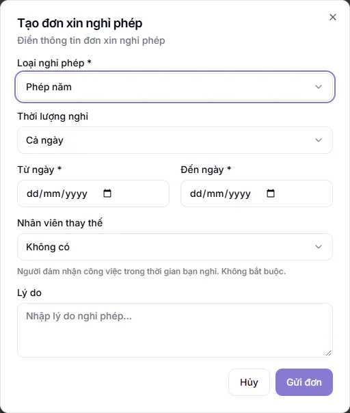

# Nghỉ phép

Dùng khi bạn cần nghỉ và muốn trung tâm biết trước. Đơn gửi đi sẽ chờ quản lý hoặc nhân sự duyệt.

## Tạo đơn xin nghỉ

::: steps
1. Vào **Cổng nhân viên → Nghỉ phép**, bấm **Tạo đơn mới**. (Ở **Tổng quan** cũng có nút **Tạo đơn nghỉ**.)
2. Chọn **Loại nghỉ phép** (bắt buộc): **Phép năm**, **Ốm đau**, **Không lương**, **Thai sản** hoặc **Công tác (không trừ phép)**.
3. Chọn **Thời lượng nghỉ**: **Cả ngày**, hoặc nghỉ nửa ngày buổi **Sáng** hoặc **Chiều** (tính 0.5 ngày).
4. Chọn ngày. Nghỉ cả ngày thì điền **Từ ngày** và **Đến ngày** (bắt buộc). Nghỉ nửa ngày thì chỉ chọn **Ngày nghỉ**.
5. Nếu có người đảm nhận việc khi bạn nghỉ, chọn ở ô **Nhân viên thay thế**. Ô này không bắt buộc, mặc định là **Không có**.
6. Ghi **Lý do** nếu muốn.
7. Bấm **Gửi đơn**. Màn hình báo "Đã gửi đơn xin nghỉ phép".
:::

::: warning Lưu ý
- Nghỉ **Phép năm** bị trừ vào số dư. Nếu số ngày xin vượt số còn lại, đơn bị từ chối ngay lúc gửi.
- Người thay thế phải là nhân viên khác bạn.
- Bấm **Hủy** trong hộp tạo đơn chỉ đóng hộp, không phải huỷ đơn đã gửi. Cần rút đơn đã gửi thì báo nhân sự.
:::

## Theo dõi đơn và số dư

Phía trên trang có các ô tóm tắt: **Phép năm còn lại**, **Phép ốm đau**, **Đã sử dụng**, **Chờ duyệt**. Bảng **Lịch sử đơn xin nghỉ** liệt kê từng đơn gồm **Loại**, **Từ ngày**, **Đến ngày**, **Số ngày**, **Lý do**, **Người thay thế**, **Trạng thái**, **Ngày tạo**.

Trạng thái đơn: **Chờ duyệt**, **Đã duyệt**, **Từ chối**.

## Câu hỏi thường gặp

::: details Ai duyệt đơn nghỉ phép của tôi?
Nhân sự hoặc quản lý ở phần nhân sự. Xem [Ngày phép](../nhan-su/ngay-phep.md).
:::

::: details Trung tâm không áp dụng phép năm, tôi có xin nghỉ được không?
Được. Ô nghỉ phép trên **Tổng quan** ghi "Không áp dụng phép năm, vẫn tạo được đơn xin nghỉ khi cần".
:::
