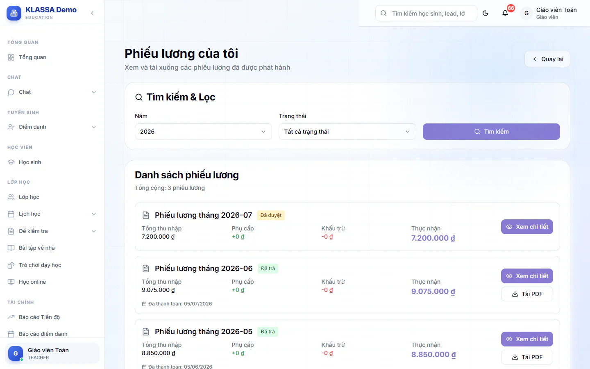

# Phiếu lương của tôi

Phiếu lương cho bạn biết tháng đó bạn nhận bao nhiêu và vì sao. Bạn chỉ thấy phiếu của mình, và chỉ thấy phiếu sau khi nhân sự đã chốt hoặc chủ động gửi cho bạn.

## Xem danh sách phiếu lương

::: steps
1. Vào **Cổng nhân viên → Phiếu lương**.
2. Chọn **Năm** (mặc định là năm hiện tại, chọn **Tất cả** để xem mọi năm).
3. Nếu cần, chọn **Trạng thái**: **Đã phát hành** hoặc **Đã trả**.
4. Bấm **Tìm kiếm**.
:::

Mỗi phiếu hiện tháng lương, trạng thái và bốn số: **Tổng thu nhập**, **Phụ cấp**, **Khấu trừ**, **Thực nhận**. Phiếu bạn đã xác nhận có thêm nhãn **Đã xác nhận**. Danh sách chia trang, dùng hai nút mũi tên để chuyển trang.

Mỗi phiếu mang một trong các nhãn sau:

- **Bản tạm (chưa chốt)**: nhân sự gửi kèm số tiền để bạn soát, số có thể còn đổi. Bản tạm chưa từng được gửi thì không hiện ra.
- **Đã duyệt**: phiếu đã được duyệt nhưng chưa phát hành. Lúc này chưa có nút **Tải PDF**.
- **Đã phát hành**: phiếu đã chốt và gửi cho bạn. Phiếu mới được trả một phần vẫn hiện là **Đã phát hành** cho tới khi trả đủ.
- **Đã trả**: phiếu đã được trả đủ.

Ô lọc **Trạng thái** chỉ có hai lựa chọn **Đã phát hành** và **Đã trả**, nên muốn thấy phiếu **Đã duyệt** hoặc **Bản tạm (chưa chốt)** thì để **Tất cả**. Nút **Tải PDF** chỉ có ở phiếu **Đã phát hành** và **Đã trả**.

## Xem chi tiết và tải PDF

::: steps
1. Ở dòng phiếu cần xem, bấm **Xem chi tiết**.
2. Đọc các khoản thu nhập, phụ cấp, thưởng, làm thêm giờ và khấu trừ. Cuối phiếu là **Tổng thu nhập**, **Tổng phụ cấp**, **Tổng khấu trừ** và **Thực nhận**.
3. Bấm **Tải PDF** để lưu hoặc in phiếu.
:::

Phần đầu phiếu có họ tên, chức vụ, mã nhân viên và tài khoản ngân hàng nhận lương. Nếu thấy sai thông tin này, gửi yêu cầu sửa ở [Hồ sơ cá nhân](ho-so.md).

## Xác nhận đã nhận phiếu

Sau khi đọc xong, bạn xác nhận để trung tâm biết bạn đã nhận phiếu.

::: steps
1. Mở chi tiết phiếu, kéo xuống phần cuối.
2. Bấm **Xác nhận đã nhận phiếu lương**.
:::

Sau khi xác nhận, phiếu hiện giờ xác nhận và nút biến mất.

::: warning Lưu ý
Xác nhận chỉ cho biết bạn đã nhận phiếu, không phải đồng ý hay phản đối con số. Nếu thấy số liệu sai, liên hệ nhân sự hoặc quản lý trước khi xác nhận.
:::

## Câu hỏi thường gặp

::: details Vì sao tháng này tôi chưa thấy phiếu?
Phiếu chỉ hiện sau khi nhân sự phát hành. Nếu đã quá ngày thường nhận lương mà chưa thấy, hỏi nhân sự.
:::

::: details Tôi muốn tạm ứng lương thì làm sao?
Xem mục **Tạm ứng lương** trong [Phúc lợi](phuc-loi.md).
:::
