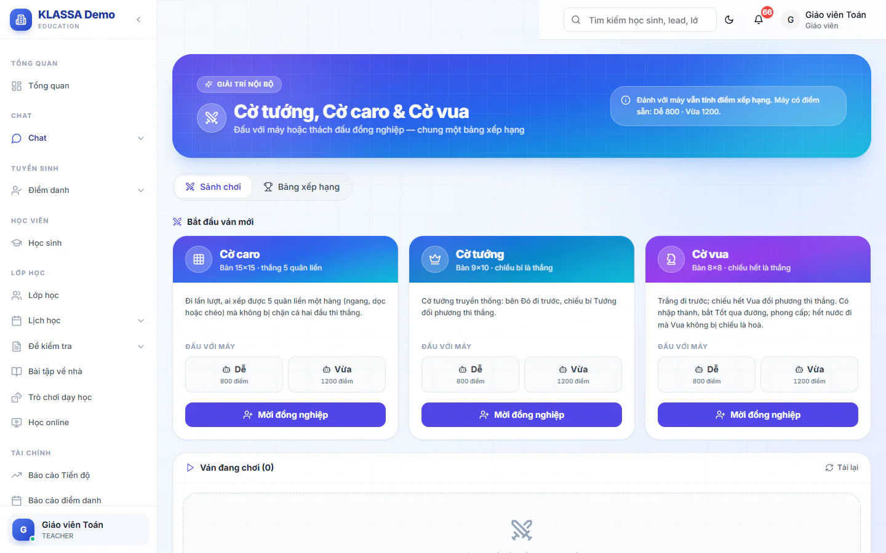

# Trò chơi cờ nội bộ

Góc giải trí giữa giờ cho nhân viên: chơi cờ với máy hoặc thách đấu đồng nghiệp. Phụ huynh và học sinh không vào được khu này.

## Bắt đầu ván mới

::: steps
1. Vào **Chat → Trò chơi cờ**, mở tab **Sảnh chơi**.
2. Ở khối **Bắt đầu ván mới**, chọn một trò: **Cờ caro** (bàn 15x15, xếp 5 quân liền thì thắng), **Cờ tướng** hoặc **Cờ vua**.
3. Muốn đấu máy, bấm **Dễ** hoặc **Vừa** trong ô **Đấu với máy**.
4. Muốn đấu người, bấm **Mời đồng nghiệp**, tìm theo tên, email hoặc số điện thoại rồi gửi lời mời.
:::

Máy có điểm sẵn: **Dễ** 800, **Vừa** 1200.

## Mời và nhận lời mời

Lời mời gửi đi có hạn 15 phút. Người nhận thấy lời mời ở đầu sảnh và bấm nhận hoặc **Từ chối**. Lời mời bạn đã gửi nằm ở khối **Lời mời bạn đã gửi**.

## Trong ván

- Khối **Ván đang chơi** cho biết **Tới lượt bạn** hay **Chờ đối thủ**. Bấm vào ván để vào bàn.
- Có thể đề nghị hoà. Đối thủ đồng ý hoặc từ chối.
- Bấm **Xin thua** (hộp **Xin thua ván này?**) để chịu thua.
- Bấm **Bỏ ván** ở sảnh để bỏ ván đang chơi. Bấm **Về sảnh cờ** để quay lại sảnh.
- Ván không ai đi nước nào trong 6 giờ sẽ tự đóng. Ô đếm ngược ở sảnh báo khi sắp đóng.
- Mỗi loại cờ chỉ giữ một ván đấu máy cùng lúc. Nếu bạn còn ván dở, sảnh hỏi bạn **Tiếp tục ván cũ** hay bỏ ván cũ để chơi mới.

::: warning Lưu ý về điểm
- Đấu với máy vẫn tính điểm xếp hạng, theo công thức Elo như đấu người.
- Xin thua hoặc bỏ ván đã đi từ 6 nước trở lên được tính là một ván thua và bị trừ điểm. Bỏ khi chưa tới 6 nước thì không mất điểm và không vào lịch sử.
:::

## Bảng xếp hạng

Mở tab **Bảng xếp hạng** để xem:

- **Toàn thời gian**: xếp theo điểm Elo hiện tại, ai mạnh nhất.
- **Tuần này**, **Tháng này**: xếp theo mức điểm lên hoặc xuống trong kỳ, ai tiến bộ nhất.

Ở sảnh, khối **Ván gần đây** liệt kê các ván đã xong kèm kết quả.

## Câu hỏi thường gặp

::: details Chơi với máy có làm tăng điểm xếp hạng không?
Có, nhưng đánh với máy yếu hơn bạn thì gần như không tăng điểm.
:::

::: details Đối thủ không trả lời lời mời thì sao?
Sau 15 phút lời mời hết hạn. Bạn mời lại hoặc chơi với máy.
:::
