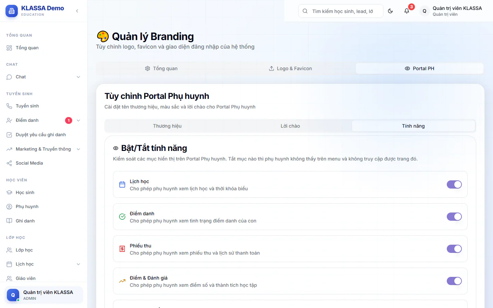

# Tuỳ chỉnh và bật tắt Cổng Phụ huynh

Mỗi trung tâm quyết định phụ huynh được thấy những mục nào và cổng mang tên, màu, lời chào ra sao. Bài này dành cho Quản trị viên.

## Mở trang tuỳ chỉnh

::: steps
1. Vào **Quản trị hệ thống → Thương hiệu**.
2. Bấm tab **Portal PH**. Khung **Tùy chỉnh Portal Phụ huynh** hiện ra với ba tab: **Thương hiệu**, **Lời chào**, **Tính năng**.
3. Sửa xong ở bất kỳ tab nào, bấm **Lưu cài đặt** ở cuối khung **Tùy chỉnh Portal Phụ huynh**. Cổng báo **Cài đặt Portal Phụ huynh đã được cập nhật**.
:::

## Tab Thương hiệu

- **Tên thương hiệu**: hiện ở góc trên cổng.
- **Tiêu đề Portal**: dòng phụ dưới tên thương hiệu.
- **Màu thương hiệu**: chọn màu hoặc nhập mã màu.

## Tab Lời chào

Lời chào ở **Trang chủ** thay đổi theo giờ trong ngày. Bạn viết riêng ba câu: **Lời chào buổi sáng** (5:00 - 11:59), **Lời chào buổi chiều** (12:00 - 17:59), **Lời chào buổi tối** (18:00 - 4:59). Bên dưới có khung xem trước.

## Tab Tính năng

Mỗi mục có một công tắc. Tắt mục nào thì phụ huynh không thấy mục đó trên menu và không vào được trang đó (gõ thẳng địa chỉ cũng chỉ thấy báo mục đã được tạm tắt). Các công tắc, mặc định đều bật:

| Công tắc | Mục phụ huynh thấy |
| --- | --- |
| **Lịch học** | [Lịch học](lich-hoc.md) |
| **Điểm danh** | [Điểm danh](diem-danh.md) |
| **Phiếu thu** | [Phiếu thu](hoa-don.md) |
| **Điểm & Đánh giá** | [Điểm & Đánh giá](diem-so.md) |
| **Nhận xét buổi học** | [Nhận xét buổi học](diem-so.md) |
| **Thông báo** | [Thông báo](thong-bao.md) và biểu tượng chuông |
| **Xin nghỉ** | [Xin nghỉ](xin-nghi.md) |
| **Bài tập** | [Bài tập](bai-tap.md) |
| **Thẻ Năng Lực** | [Thẻ Năng Lực](ket-qua-thang.md) |
| **Phiếu tháng** | [Phiếu tháng](ket-qua-thang.md) |
| **Đổi quà** | [Đổi quà](doi-qua.md) |

**Trang chủ** và **Hồ sơ** luôn hiện, không có công tắc.

## Các mục có công tắc ở nơi khác

| Mục | Mặc định | Bật ở đâu |
| --- | --- | --- |
| [Đăng ký thêm môn học](dang-ky-them-mon.md) | Tắt | **Điểm danh → Yêu cầu phụ huynh → Cài đặt** |
| [Góp ý](gop-y.md) | Tắt | **Điểm danh → Yêu cầu phụ huynh → Cài đặt** |
| **Đánh giá thầy cô** | Tắt | **Cài đặt → Cấu hình → Đánh giá thầy cô**, bật **Bật đánh giá thầy cô**. Phụ huynh chỉ chấm được khi **Cho phụ huynh chấm thay** bật (mặc định bật) |
| Chỉ thấy phiếu đã gửi | Tắt | **Tài chính → Kế toán → Cấu hình tài chính**, xem [Phiếu thu](hoa-don.md) |

::: warning Lưu ý
Tên, màu, lời chào là cài đặt chung của trung tâm. Phụ huynh không tự đổi được.
:::

## Câu hỏi thường gặp

::: details Tắt Điểm danh thì phụ huynh còn thấy gì?
Menu, ô ở **Trang chủ** và các số liệu điểm danh biến mất. Phụ huynh vẫn xem được các mục còn bật.
:::

::: details Phụ huynh không vào được cổng thì kiểm tra gì?
Kiểm tra gói mở rộng **Cổng Phụ huynh** đã bật chưa, xem [Gói mở rộng](../plugin/gioi-thieu.md).
:::
