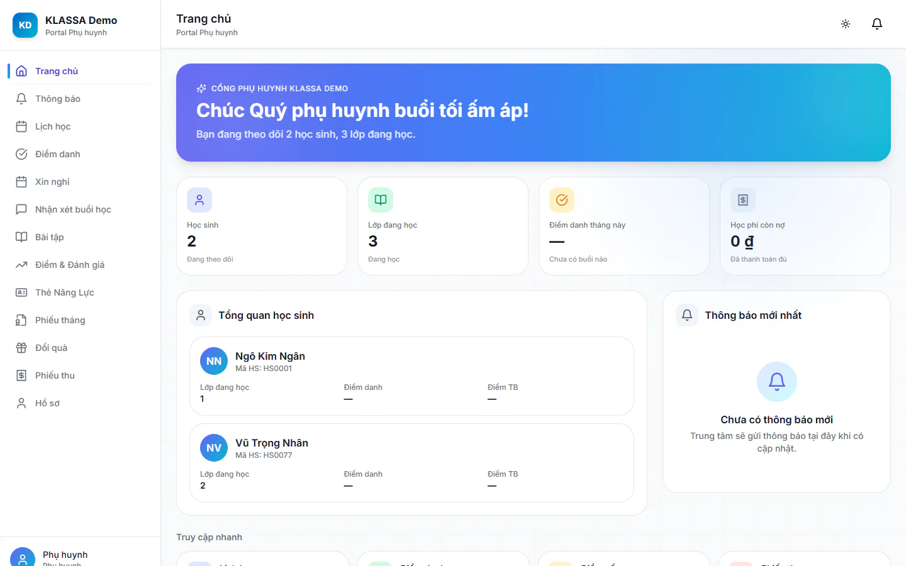

# Cổng Phụ huynh là gì

Cổng Phụ huynh là nơi phụ huynh tự xem tình hình học của con mà không cần gọi hỏi trung tâm. Phụ huynh chỉ thấy học sinh gắn với tài khoản của mình, không thấy dữ liệu của em khác hay số liệu nội bộ của trung tâm. Cổng thuộc gói mở rộng **Cổng Phụ huynh**.

## Phụ huynh vào cổng thế nào

::: steps
1. Mở địa chỉ phần mềm của trung tâm, vào trang đăng nhập.
2. Nhập email và mật khẩu của tài khoản phụ huynh, bấm đăng nhập.
3. Hệ thống tự đưa bạn vào cổng, mục **Trang chủ**.
:::

Tài khoản phụ huynh đăng nhập bằng email. Nếu quên mật khẩu, xem [Đăng nhập](../tai-khoan/dang-nhap.md) và [Đổi mật khẩu](../tai-khoan/doi-mat-khau.md). Trên điện thoại, phụ huynh có thể dùng [app KLASSA](../mobile/app-phu-huynh.md).

## Các mục trong cổng

Menu bên trái (hoặc nút **Thêm** ở thanh dưới trên điện thoại) có các mục sau. Mục nào trung tâm tắt thì phụ huynh không thấy, xem [Bật tắt mục cho phụ huynh](cai-dat-cong.md).

| Mục | Dùng để |
| --- | --- |
| **Trang chủ** | Xem nhanh số lớp, điểm danh tháng này, học phí còn nợ và thông báo mới |
| [**Thông báo**](thong-bao.md) | Đọc tin trung tâm gửi |
| [**Lịch học**](lich-hoc.md) | Xem lịch tuần của con |
| [**Điểm danh**](diem-danh.md) | Xem con đi học hay vắng, kèm lưu ý của giáo viên |
| [**Xin nghỉ**](xin-nghi.md) | Gửi đơn xin nghỉ buổi học |
| [**Đăng ký thêm môn học**](dang-ky-them-mon.md) | Xem môn khác của khối và nhờ trung tâm tư vấn |
| [**Nhận xét buổi học**](diem-so.md) | Đọc nhận xét của giáo viên sau buổi học |
| [**Bài tập**](bai-tap.md) | Xem và nộp bài tập về nhà |
| [**Điểm & Đánh giá**](diem-so.md) | Xem điểm kiểm tra và điểm trung bình |
| [**Thẻ Năng Lực**](ket-qua-thang.md) | Xem thẻ năng lực theo từng kỳ |
| [**Phiếu tháng**](ket-qua-thang.md) | Xem kết quả học tập từng tháng |
| [**Đánh giá thầy cô**](#muc-mac-dinh-tat) | Chấm sao thầy cô thay con (khi trung tâm bật) |
| [**Đổi quà**](doi-qua.md) | Dùng điểm thưởng của con đổi quà |
| [**Phiếu thu**](hoa-don.md) | Xem học phí, quét mã chuyển khoản |
| [**Góp ý**](gop-y.md) | Gửi góp ý cho trung tâm |
| [**Hồ sơ**](ho-so.md) | Sửa thông tin phụ huynh, xem hồ sơ con |

## Phụ huynh có nhiều con

Một tài khoản xem được tất cả các con. Ở **Trang chủ**, mỗi con có một dòng riêng với số lớp, tỷ lệ điểm danh và điểm trung bình. Ở các trang **Lịch học**, **Điểm danh**, **Phiếu thu**, **Điểm & Đánh giá**, chọn con ở ô **Học sinh** để xem riêng từng em, hoặc để **Tất cả học sinh**.

## Tài khoản chưa gắn với học sinh

Nếu **Trang chủ** báo **Chưa có học sinh**, tài khoản chưa được liên kết với em nào. Bấm **Liên hệ trung tâm** để lấy số điện thoại cơ sở. Nhân viên xử lý theo hướng dẫn ở [Phụ huynh](../hoc-sinh/phu-huynh.md).

## Mục mặc định tắt {#muc-mac-dinh-tat}

Ba mục sau mặc định tắt ở mọi trung tâm, Quản trị viên bật khi cần:

- **Đăng ký thêm môn học** và **Góp ý**: bật trong **Điểm danh → Yêu cầu phụ huynh**, bấm **Cài đặt**.
- **Đánh giá thầy cô**: Quản trị viên vào **Cài đặt**, tab **Cấu hình**, mục **Đánh giá thầy cô**, bật **Bật đánh giá thầy cô**. Công tắc **Cho phụ huynh chấm thay** ở cùng chỗ, mặc định bật.

Mục **Phiếu thu** có thêm một công tắc: phụ huynh chỉ thấy phiếu đã gửi, xem [Hoá đơn của con](hoa-don.md).

::: tip Mẹo
Trên điện thoại, mở cổng bằng trình duyệt rồi chọn thêm vào màn hình chính để mở nhanh như một ứng dụng. Hoặc dùng app KLASSA, xem [Cài đặt app điện thoại](../mobile/cai-dat-app.md).
:::

## Câu hỏi thường gặp

::: details Phụ huynh có thấy học sinh khác hoặc lương giáo viên không?
Không. Mỗi tài khoản chỉ thấy các em được gắn với mình.
:::

::: details Tại sao một mục biến mất khỏi menu?
Trung tâm đã tắt mục đó. Nếu phụ huynh gõ thẳng địa chỉ của mục, cổng báo mục đã được trung tâm tạm tắt và có nút **Về trang chủ**.
:::
