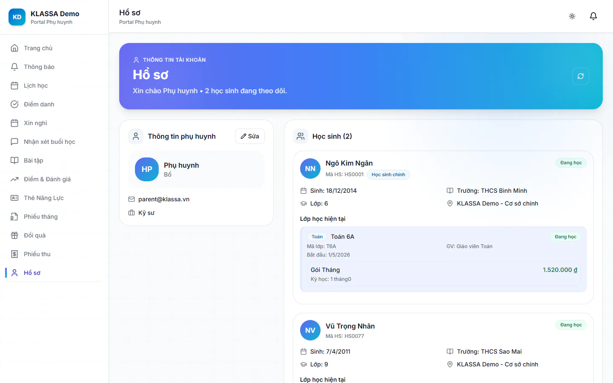

# Hồ sơ phụ huynh và hồ sơ con

Mục **Hồ sơ** giữ thông tin liên hệ của phụ huynh để trung tâm gọi đúng số, đồng thời cho xem nhanh hồ sơ của con.

## Sửa thông tin phụ huynh

::: steps
1. Vào **Hồ sơ** ở menu cổng.
2. Ở khung **Thông tin phụ huynh**, bấm **Sửa**.
3. Sửa các ô: **Họ và tên**, **Số điện thoại**, **Mối quan hệ** (ví dụ Cha, Mẹ, Ông, Bà), **Nghề nghiệp**, **Nơi làm việc**, **Địa chỉ**.
4. Bấm **Lưu**. Bấm nút huỷ bên cạnh nếu muốn bỏ thay đổi.
:::

Email là tên đăng nhập nên chỉ hiện để xem, không sửa ở đây.

## Xem hồ sơ của con

Khung **Học sinh (số con)** liệt kê từng em: tên, trạng thái học, khối lớp, trường, số điện thoại, cơ sở và địa chỉ nếu có. Em được đánh dấu **Học sinh chính** khi trung tâm chọn em làm đại diện. Phần **Lớp học hiện tại** ghi mã lớp, tên lớp và giáo viên. Phần **Ghi chú** hiện nếu hồ sơ có ghi chú.

Thông tin của con do trung tâm quản lý. Thấy chỗ nào chưa đúng, báo trung tâm để nhân viên sửa ở [Hồ sơ học sinh](../hoc-sinh/chi-tiet.md).

## Đăng xuất

Bấm **Đăng xuất** ở cuối menu cổng. Với app điện thoại, xem [Cài đặt app điện thoại](../mobile/cai-dat-app.md).

## Xoá tài khoản

Cuối trang **Hồ sơ** có khung **Xoá tài khoản**. Thực chất đây là vô hiệu hoá: tài khoản không đăng nhập được nữa, dữ liệu học tập và học phí vẫn do trung tâm lưu, và trung tâm có thể mở lại.

::: danger Bạn sẽ không đăng nhập được nữa
Sau khi xoá, muốn dùng lại bạn phải liên hệ trung tâm mở lại tài khoản.
:::

## Câu hỏi thường gặp

::: details Muốn đổi mật khẩu thì làm ở đâu?
Trên app điện thoại, vào **Hồ sơ → Đổi mật khẩu**. Cổng web không có mục đổi mật khẩu riêng cho phụ huynh, hãy nhờ trung tâm hỗ trợ.
:::
