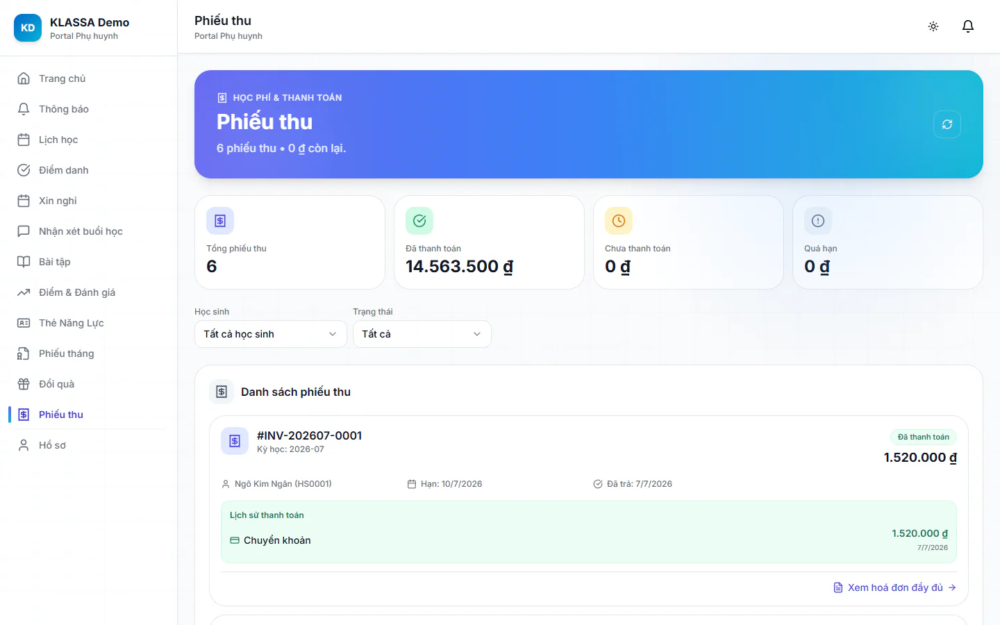

# Phiếu thu và học phí của con

Mục **Phiếu thu** cho phụ huynh biết học phí từng tháng, đã đóng bao nhiêu, còn nợ bao nhiêu và chuyển khoản ở đâu. Cách trung tâm tạo phiếu xem ở [Tạo hoá đơn](../hoc-phi/tao-hoa-don.md).

## Xem phiếu thu

::: steps
1. Vào **Phiếu thu** ở menu cổng (thanh dưới trên điện thoại cũng có mục này).
2. Xem bốn ô tổng hợp: **Tổng phiếu thu**, **Đã thanh toán**, **Chưa thanh toán** (gồm cả phần quá hạn) và **Quá hạn**.
3. Lọc theo **Học sinh** và **Trạng thái** (**Tất cả**, **Chưa thanh toán**, **Trả một phần**, **Đã thanh toán**, **Quá hạn**, **Đã huỷ**).
4. Ở **Danh sách phiếu thu**, mở từng phiếu để xem **Chi tiết phiếu thu**, giảm giá, **Tổng cộng** và **Lịch sử thanh toán**.
:::

Phiếu đã được trung tâm gộp sang phiếu mới hiện nhãn **Đã gộp sang phiếu mới**, không phải **Đã huỷ**.

## Chuyển khoản học phí

Với phiếu còn nợ, ô **Thanh toán học phí** hiện thông tin chuyển khoản nếu trung tâm đã cài: **Ngân hàng**, **Số tài khoản**, **Chủ tài khoản**, **Nội dung CK** và **Số tiền cần trả**.

::: steps
1. Bấm vào **Nội dung CK** để sao chép.
2. Chuyển khoản đúng số tiền và ghi đúng nội dung này để hệ thống ghi nhận tự động.
3. Nếu có mã QR, bấm vào mã để phóng to rồi quét bằng app ngân hàng.
:::

Số tiền cần trả đã trừ phần đã đóng và phần trung tâm miễn theo thoả thuận.

## Xem hoá đơn đầy đủ

Cuối mỗi phiếu có liên kết **Xem hoá đơn đầy đủ**. Trang này hiện bản hoá đơn như trung tâm in, có nút **Tải PDF** và nút in. Bấm **Quay lại phiếu thu** để trở lại danh sách.

## Quản trị viên: phụ huynh thấy phiếu nào

Mặc định phụ huynh thấy phiếu ngay khi trung tâm xuất. Muốn chỉ cho phụ huynh thấy phiếu đã gửi, bật công tắc theo cơ sở:

::: steps
1. Vào **Tài chính → Kế toán → Cấu hình tài chính**.
2. Tìm mục **Phiếu hiện cho phụ huynh**.
3. Bật **Phụ huynh chỉ thấy phiếu đã gửi** (mặc định tắt).
:::

Khi bật, phiếu còn ghi **Chưa gửi** ở trang Hoá đơn chưa hiện cho phụ huynh trên web và app. Phiếu đã có tiền thu luôn hiện. Nhắc học phí tự động bỏ qua phiếu chưa gửi. Xem thêm [Cấu hình tài chính](../hoc-phi/cai-dat.md).

::: tip Mẹo
Thông tin ngân hàng và mã QR cài ở cấu hình tài chính. Không cài thì phụ huynh vẫn xem được phiếu nhưng không thấy ô **Thanh toán học phí**.
:::

## Câu hỏi thường gặp

::: details Vì sao phiếu của con chưa hiện?
Có thể trung tâm bật chế độ chỉ cho phụ huynh thấy phiếu đã gửi và phiếu chưa được gửi. Hỏi trung tâm.
:::

::: details Chuyển khoản xong nhưng phiếu vẫn ghi chưa thanh toán?
Hệ thống ghi nhận theo nội dung chuyển khoản. Nếu ghi sai nội dung, báo trung tâm kèm ảnh giao dịch để nhân viên đối chiếu.
:::
