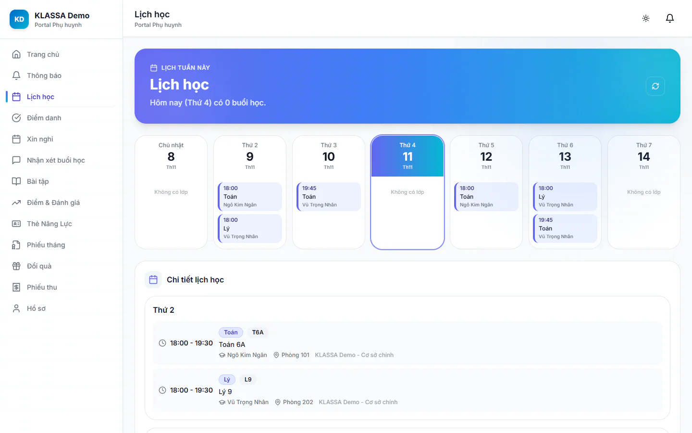

# Lịch học của con

Mục **Lịch học** cho phụ huynh biết hôm nay và cả tuần con học môn nào, giờ nào, ở đâu. Lịch lấy từ các lớp con đang học.

## Xem lịch trong tuần

::: steps
1. Vào **Lịch học** ở menu cổng (hoặc ô **Lịch học** ở **Trang chủ**).
2. Dòng đầu trang cho biết hôm nay có bao nhiêu buổi học.
3. Lưới theo ngày hiện từ **Chủ nhật** đến **Thứ 7**. Mỗi ô ghi giờ bắt đầu, môn và tên học sinh. Ngày hôm nay được viền nổi bật, ngày không có lớp ghi **Không có lớp**.
4. Kéo xuống phần **Chi tiết lịch học** để xem từng buổi đầy đủ: giờ bắt đầu và kết thúc, mã lớp, tên lớp, học sinh, phòng và cơ sở.
:::

Nếu trang ghi **Chưa có lịch học**, con chưa có lớp nào đang học. Hãy liên hệ trung tâm để được hỗ trợ.

::: tip Mẹo
Phụ huynh có hai con trở lên sẽ thấy lịch của tất cả các con trong cùng một lưới. Nhìn tên học sinh ở từng ô để phân biệt.
:::

::: warning Lưu ý
Mục này chỉ hiện khi trung tâm bật. Nếu menu không có **Lịch học**, hãy hỏi trung tâm. Quản trị viên bật lại ở [Bật tắt mục cho phụ huynh](cai-dat-cong.md).
:::

## Câu hỏi thường gặp

::: details Vì sao lớp con vừa đổi giờ mà lịch chưa đổi?
Cổng hiện lịch hiện tại của lớp. Nếu vẫn thấy giờ cũ, kéo làm mới trang. Nếu vẫn cũ, báo trung tâm kiểm tra lịch lớp.
:::

::: details Buổi học bù hoặc buổi nghỉ có hiện ở đây không?
Mục này chỉ hiện lịch lặp theo tuần của lớp. Tình trạng từng buổi (có mặt, vắng, học bù, trung tâm nghỉ) xem ở [Điểm danh](diem-danh.md).
:::
